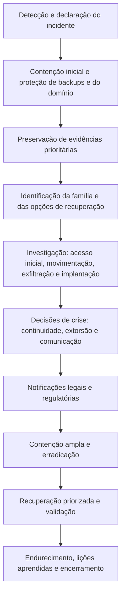

# Ferramentas, Fluxo, Modelos e Checklist de Ransomware

> **Objetivo pedagógico:** padronizar as ferramentas, o fluxo de trabalho, os registros e a verificação de qualidade na resposta e na investigação de incidentes de ransomware, de modo que as decisões sejam documentadas, as evidências preservadas e a recuperação conduzida de forma segura.

## 1. Ferramentas por finalidade

| Finalidade | Ferramentas |
|---|---|
| Contenção e visibilidade | EDR e XDR, firewall, controles de acesso à rede, console de MDM e de identidade |
| Coleta de evidências | `wevtutil`, EDR, ferramentas de aquisição de memória e de disco (pastas 03, 09 e 10), coleta de logs do ESXi |
| Análise de logs do Windows | Hayabusa, Chainsaw, EvtxECmd e Timeline Explorer (pasta 11) |
| Linha do tempo | Plaso, Timesketch (pasta 05) |
| Análise de rede | Zeek, Wireshark, NetFlow e logs de proxy e DNS (pasta 13) |
| Análise de amostras | Laboratório isolado, capa, FLOSS, Sysmon, sandboxes (pasta 15) |
| Identificação e decifradores | ID Ransomware e No More Ransom |
| Detecção e caça | YARA, Sigma, consultas de EDR (pastas 11 e 15) |
| Identidade e Active Directory | Logs de controladores de domínio, ferramentas de revisão do AD, guia de recuperação de floresta |
| Gestão do incidente | Livro de decisões, sala de crise, canal fora de banda, planilhas e quadro de tarefas |
| Inteligência | Relatórios do CISA, de CSIRTs e de fornecedores; MISP |

Registre nome, versão e origem das ferramentas e mantenha uma lista de ferramentas aprovadas e pré-posicionadas, pois, durante o incidente, não é hora de instalar ferramentas novas em sistemas comprometidos.

## 2. Fluxo de trabalho do incidente

## 3. Dez perguntas e como respondê-las

| Pergunta | Onde responder |
|---|---|
| 1. Qual o alcance atual da criptografia e a contenção está eficaz? | EDR, inventário, rede e relatos |
| 2. Os backups e o domínio estão protegidos e íntegros? | Verificação de imutabilidade e logs de acesso |
| 3. Qual a família e há opções de decifragem? | Nota, extensão, serviços de identificação e análise da amostra |
| 4. Qual foi o acesso inicial e quando? | VPN, RDP, e-mail, equipamentos de borda e credenciais |
| 5. O domínio e as credenciais foram comprometidos? | DCSync, LSASS, contas e GPOs |
| 6. Quais sistemas e contas foram afetados? | Linha do tempo, artefatos e caça |
| 7. Houve exfiltração? Que dados? | Fluxos, proxy, EDR e arquivos de preparação |
| 8. Que obrigações de notificação existem e quais os prazos? | Jurídico, DPO e contratos |
| 9. Qual a estratégia de recuperação e a ordem? | BIA, backups e dependências |
| 10. Como evitar a reincidência? | Causas raiz, endurecimento e monitoramento |

## 4. Modelo A: Livro de Decisões do Incidente

| ID | Data e hora (UTC) | Decisão | Alternativas consideradas | Fundamentos e informações disponíveis | Decisor | Aprovação (Jurídico e DPO, quando aplicável) | Resultado e revisão |
|---|---|---|---|---|---|---|---|
| D-001 | | | | | | | |
| D-002 | | | | | | | |

## 5. Modelo B: Inventário de Sistemas Afetados e Prioridade de Recuperação

| ID | Sistema | Função e dono | Nível de prioridade (0 a 3) | Estado (criptografado, afetado ou íntegro) | Evidências preservadas | Fonte de recuperação (backup, decifrador ou reconstrução) | RTO desejado e RPO | Dependências | Responsável | Situação |
|---|---|---|---|---|---|---|---|---|---|---|
| S-001 | | | | | | | | | | |
| S-002 | | | | | | | | | | |

## 6. Modelo C: Registro de Evidências do Incidente

| ID | Descrição | Origem (sistema e fonte) | Coletada por e hora (UTC) | Hash SHA-256 | Local de armazenamento | Custódia | Observações |
|---|---|---|---|---|---|---|---|
| E-001 | Logs de EDR | | | | | | |
| E-002 | Memória do DC | | | | | | |

## 7. Modelo D: Linha do Tempo do Ataque

| Data e hora (UTC) | Fase | Evento | Host e conta | Fonte da evidência | Confiança (alta, média ou baixa) | Técnica ATT&CK |
|---|---|---|---|---|---|---|
| | Acesso inicial | | | | | |
| | Credenciais | | | | | |
| | Movimentação lateral | | | | | |
| | Exfiltração | | | | | |
| | Implantação | | | | | |

## 8. Modelo E: Matriz de Notificações

| Destinatário | Base legal ou contratual | Prazo | Responsável | Conteúdo-chave | Data e hora do envio (UTC) | Protocolo ou confirmação | Complementações |
|---|---|---|---|---|---|---|---|
| ANPD | LGPD, art. 48; Res. CD/ANPD nº 15/2024 | 3 dias úteis | | | | | |
| Titulares | LGPD, art. 48 | | | | | | |
| Regulador setorial | | | | | | | |
| Clientes e parceiros | Contratos | | | | | | |
| Seguradora | Apólice | | | | | | |
| Polícia e CSIRT | | | | | | | |

## 9. Modelo F: Estrutura do Relatório Pós-Incidente

| Seção | Conteúdo |
|---|---|
| 1. Resumo executivo | O que ocorreu, impacto, decisões e estado atual |
| 2. Linha do tempo | Do acesso inicial à recuperação |
| 3. Análise técnica | Acesso inicial, ferramentas, credenciais, movimentação, exfiltração e implantação |
| 4. Família e amostra | Identificação, comportamento e indicadores |
| 5. Escopo e impacto | Sistemas, contas, dados e titulares |
| 6. Decisões de crise | Extorsão, comunicação e notificações |
| 7. Recuperação | Estratégia, prazos e resultados |
| 8. Causas raiz | Fatores técnicos, de processo e de governança |
| 9. Recomendações | Plano de ação com responsáveis e prazos |
| 10. Limitações | Lacunas de evidência e incertezas |
| 11. Anexos | Hashes, indicadores, livro de decisões e custódia |

## 10. Checklist operacional de ransomware

**Caso:** DFL-AAAA-NNN
**Líder do incidente:** ____________________
**Data e hora (UTC):** ____________________

### 10.1 Primeiras horas

- [ ] Incidente declarado; livro de decisões aberto
- [ ] Canal fora de banda estabelecido
- [ ] Jurídico, DPO, seguradora e fornecedores de resposta acionados
- [ ] Hosts afetados isolados; criptografia contida
- [ ] Backups isolados e integridade verificada
- [ ] Controladores de domínio protegidos e monitorados
- [ ] Logs prioritários exportados (EDR, VPN, firewall, domínio, nuvem e e-mail)
- [ ] Memória e artefatos dos sistemas-chave capturados
- [ ] Nota de resgate, arquivos de exemplo e amostra preservados

### 10.2 Investigação

- [ ] Família e opções de decifragem avaliadas
- [ ] Paciente zero e acesso inicial identificados
- [ ] Domínio e credenciais avaliados (LSASS, DCSync e GPOs)
- [ ] Movimentação lateral e implantação reconstruídas
- [ ] Exfiltração avaliada, com volumes, destinos e dados envolvidos
- [ ] Linha do tempo e escopo documentados, com grau de confiança
- [ ] Alegações do atacante verificadas

### 10.3 Decisão, comunicação e notificação

- [ ] Estratégia de extorsão decidida e documentada
- [ ] Triagem de sanções realizada, se houver contato ou pagamento
- [ ] Classificação dos dados potencialmente expostos concluída
- [ ] Notificações legais e contratuais avaliadas e enviadas nos prazos
- [ ] Comunicações internas e externas coordenadas

### 10.4 Recuperação e encerramento

- [ ] Evidências preservadas antes da reconstrução
- [ ] Identidade e domínio reconstruídos; credenciais redefinidas (incluindo `krbtgt`, quando aplicável)
- [ ] Backups validados em ambiente isolado; ponto de restauração anterior ao acesso do atacante
- [ ] Decifradores validados em ambiente isolado, se utilizados
- [ ] Vetor de acesso inicial corrigido
- [ ] Caça por indicadores e persistência antes da reconexão
- [ ] Monitoramento reforçado ativo
- [ ] Revisão pós-incidente, plano de ação e atualização do plano de resposta

## 11. Resultado da verificação

| Resultado | Condição |
|---|---|
| Conforme | Todos os itens aplicáveis marcados |
| Conforme com ressalvas | Pendências sem impacto nas decisões e nas obrigações, com plano de ação |
| Não conforme | Evidências críticas não preservadas, notificações fora do prazo, restauração em ambiente não erradicado ou decisões sem registro; comunicar a direção |

**Assinatura do líder do incidente:** ____________________
**Assinatura do revisor:** ____________________

## 12. Casos de uso corporativos

- Padronização do manual de resposta a ransomware.
- Exercícios de simulação com os modelos de decisão e de notificação.
- Auditoria da prontidão para ransomware (plano, backups, contratos e capacidades).

## 13. Normas e frameworks relevantes

- NIST SP 800-61 Rev. 3; NIST SP 800-184; NIST IR 8374; NIST CSF 2.0
- CISA #StopRansomware Guide; ISO/IEC 27035; ISO/IEC 27037:2012
- MITRE ATT&CK; CIS Controls v8.1, controles 11 e 17
- LGPD, arts. 46, 48 e 52; Resolução CD/ANPD nº 15/2024

## 14. Referências

- CISA; MS-ISAC. #StopRansomware Guide.
- NIST IR 8374; NIST SP 800-61 Rev. 3; NIST SP 800-184.
- CISA. Cybersecurity Tabletop Exercise Packages (CTEP).
- Documentação do Hayabusa, do Chainsaw, do Plaso, do Timesketch e do Zeek.
- No More Ransom Project; ID Ransomware.
- SANS Institute. FOR508 e SEC504.
