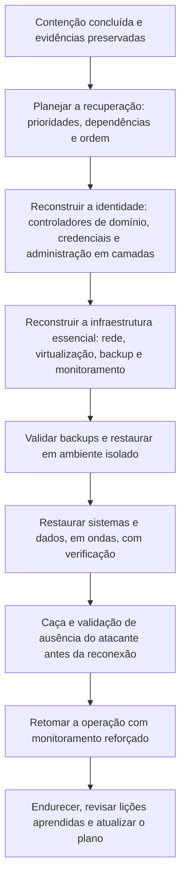

# Recuperação, Erradicação e Endurecimento

> **Objetivo pedagógico:** recuperar os serviços de forma segura e priorizada, erradicar o acesso do atacante (inclusive o comprometimento do domínio), validar backups e decifradores, reconstruir sistemas e identidades e implementar as melhorias que reduzem a chance e o impacto de um novo incidente.

## 1. Princípios

| Princípio | Aplicação |
|---|---|
| Erradicar antes de restaurar | Restaurar em um ambiente ainda comprometido leva a nova criptografia |
| Priorizar | Recuperar primeiro o que sustenta a operação e a própria recuperação (identidade, rede e backup) |
| Reconstruir em vez de limpar | Sistemas com comprometimento profundo devem ser reconstruídos a partir de fontes confiáveis |
| Validar | Backups, dados restaurados e decifradores devem ser verificados em ambiente isolado |
| Preservar evidências antes de reconstruir | Imagens e memória dos sistemas-chave já coletadas |
| Recuperação em fases | Ambiente limpo, restauração controlada, monitoramento reforçado |
| Documentar | Cada etapa, decisão e verificação |

## 2. Fases da recuperação

## 3. Priorização

| Nível | Exemplos | Observação |
|---|---|---|
| 0: base | Rede, DNS, DHCP, diretório (Active Directory e Entra ID), PKI, backup e monitoramento | Sem eles, nada mais é recuperado com segurança |
| 1: serviços críticos | Aplicações essenciais ao negócio e à segurança de pessoas | Definidos pela análise de impacto nos negócios (BIA) |
| 2: serviços importantes | Sistemas de apoio e de produtividade | Após a estabilização |
| 3: demais | Sistemas não críticos | Conforme a capacidade |

Use o RTO (tempo de recuperação) e o RPO (ponto de recuperação) do plano de continuidade como referência, ajustando-os à realidade do incidente.

## 4. Recuperação do Active Directory

| Etapa | Descrição |
|---|---|
| Decidir entre reparar e reconstruir | Com comprometimento do domínio (DCSync, `ntds.dit` e persistência), a floresta deve ser tratada como não confiável; siga o guia de recuperação de floresta da Microsoft |
| Preservar | Imagens e memória dos controladores de domínio antes de qualquer alteração |
| Restaurar de backup anterior ao comprometimento | Verificar o estado do backup e a data de ingresso do atacante |
| Redefinir `krbtgt` | Duas vezes, com intervalo adequado, para invalidar tíquetes forjados |
| Redefinir credenciais privilegiadas | Administradores, contas de serviço, contas de domínio de computador e senhas locais |
| Revisar objetos e delegações | Contas novas, grupos privilegiados, GPOs, relações de confiança e permissões ACL |
| Administração em camadas | Separar contas e estações de administração |
| Monitoramento | Auditoria avançada nos controladores de domínio |

## 5. Backups e restauração

| Verificação | Descrição |
|---|---|
| Integridade e escopo | Os backups não foram alcançados pelo atacante (cópias imutáveis, offline e fora do domínio) |
| Ponto de restauração | Escolher o ponto anterior ao início do acesso do atacante (o tempo de permanência importa), considerando o RPO |
| Ausência de persistência e de malware | Restaurar em ambiente isolado, varrer e caçar indicadores antes de integrar |
| Teste de restauração | Validar a consistência e a funcionalidade da aplicação |
| Verificação de dados | Hashes, contagens e testes de aplicação |
| Ordem | Seguir as prioridades e as dependências |

Restaurar uma imagem completa de sistema comprometido pode reintroduzir a persistência do atacante. Quando possível, reconstrua o sistema operacional a partir de mídia confiável e restaure apenas os dados.

## 6. Uso de decifradores

| Prática | Descrição |
|---|---|
| Origem confiável | Preferir decifradores de fontes reconhecidas (como o No More Ransom); tratar decifradores obtidos do atacante com cautela |
| Teste em ambiente isolado | Verificar a eficácia, a velocidade e a ausência de código malicioso |
| Trabalhar em cópias | Manter os arquivos criptografados originais intactos |
| Verificação | Conferir a integridade dos arquivos decifrados (aplicação e hashes quando houver) |
| Limitações | Pode haver arquivos que não são recuperados e arquivos corrompidos |
| Após a decifragem | Os sistemas ainda precisam ser reconstruídos e validados |

## 7. Reconstrução e erradicação

| Elemento | Ação |
|---|---|
| Estações e servidores comprometidos | Reinstalar a partir de imagens confiáveis; não "limpar" apenas |
| Hipervisores (ESXi e vCenter) | Reconstruir, aplicar atualizações, restringir a gestão e rotacionar credenciais |
| Credenciais e segredos | Todas as contas, chaves de API, certificados, tokens, segredos de aplicações e contas de serviço expostos |
| MFA e métodos de autenticação | Registrar novamente e revisar métodos suspeitos |
| Acesso remoto | Remover ferramentas de gestão remota não autorizadas; restringir VPN e RDP |
| Persistência | Procurar e remover: tarefas, serviços, WMI, chaves de registro, contas e GPOs |
| Rede | Bloquear indicadores e reforçar a segmentação |
| E-mail e nuvem | Revisar regras de caixa, encaminhamentos, aplicativos OAuth e acessos |
| Validação | Caça por indicadores e por comportamentos antes de reconectar à rede de produção |

## 8. Fechamento da porta de entrada

| Vetor | Correção |
|---|---|
| VPN sem MFA | MFA resistente a phishing, bloqueio de acesso por geolocalização e dispositivos não gerenciados |
| RDP exposto | Remover a exposição; acesso por gateway com MFA |
| Vulnerabilidades em equipamentos de borda | Atualizações, redução da exposição e monitoramento |
| Phishing | Filtros, conscientização, proteção de e-mail e de navegadores |
| Credenciais comprometidas | Redefinição, detecção de uso anômalo e monitoramento de vazamentos |
| Fornecedores e provedores | Revisão de acessos, MFA e segmentação |

## 9. Endurecimento: medidas de maior impacto contra ransomware

| Área | Medidas |
|---|---|
| Backup | Regra 3-2-1-1-0 (três cópias, duas mídias, uma fora do local, uma offline ou imutável e zero erros em testes); backups fora do domínio; testes de restauração periódicos |
| Identidade | MFA resistente a phishing, administração em camadas, gestão de acesso privilegiado, senhas locais únicas (LAPS), redução de contas privilegiadas |
| Superfície de ataque | Atualização rápida de sistemas de borda, remoção de serviços expostos, inventário de ativos |
| Endpoint | EDR em todos os sistemas (inclusive servidores), proteção contra adulteração, controle de aplicações, restrição de scripts e de macros |
| Rede | Segmentação, restrição de SMB e RDP laterais, bloqueio de saída desnecessária, gestão de hipervisores em rede separada |
| Dados | Classificação, minimização e criptografia; monitoramento de exfiltração |
| Detecção | Centralização de logs, alertas para ferramentas de acesso remoto, DCSync, exclusão de cópias de sombra e criptografia em massa |
| Resposta | Plano testado, contratos de resposta, exercícios de simulação (tabletop) e canal fora de banda |
| Governança | Gestão de riscos de ransomware, métricas e apoio da direção |

Referências de apoio: o perfil NIST IR 8374, o CISA #StopRansomware Guide e os controles do CIS (11, 4, 5, 6, 8, 12 e 13).

## 10. Monitoramento pós-incidente

| Atividade | Período e observação |
|---|---|
| Monitoramento reforçado de identidade, rede e endpoints | Pelo menos 30 a 90 dias, com ajuste conforme o risco |
| Caça contínua por indicadores e por comportamentos | Revisão periódica |
| Monitoramento de vazamentos e de ofertas de acesso | Serviços especializados |
| Verificação de tentativas de reextorsão | Contatos posteriores e publicações |
| Revisão de contas e de privilégios | Periódica |

## 11. Lições aprendidas e métricas

| Item | Descrição |
|---|---|
| Revisão pós-incidente (blameless) | Linha do tempo, o que funcionou, o que falhou e as causas raiz |
| Métricas | Tempo de permanência, tempo de detecção, de contenção e de recuperação, custo, volume de dados e sistemas afetados |
| Plano de ação | Responsáveis, prazos e acompanhamento |
| Atualização do plano de resposta e dos playbooks | Incorporar as lições |
| Comunicação à direção | Resultados, riscos residuais e investimentos necessários |
| Evidências para auditoria, reguladores e seguradora | Dossiê organizado |

## 12. Exemplo prático: plano de recuperação em 10 dias

| Dia | Atividades |
|---|---|
| 1 a 2 | Estabilizar a contenção; preservar evidências; reconstruir novos controladores de domínio em rede limpa; redefinir `krbtgt` e credenciais privilegiadas |
| 3 | Reconstruir a infraestrutura de backup e o monitoramento; validar os backups em ambiente isolado |
| 4 a 5 | Restaurar os sistemas de nível 1 em ondas, com verificação e caça por indicadores antes da reconexão |
| 6 a 7 | Reimagem das estações dos usuários críticos; restaurar os serviços de nível 2 |
| 8 a 9 | Restaurar os demais serviços; testes de aplicação com os donos de negócio |
| 10 | Retomada declarada, monitoramento reforçado, revisão inicial de lições aprendidas e plano de endurecimento |

## 13. Casos de uso corporativos

- Condução da recuperação com prioridades definidas pelo negócio.
- Reconstrução segura da identidade após o comprometimento do domínio.
- Planejamento do programa de redução do risco de ransomware.

## 14. Normas e frameworks relevantes

- NIST SP 800-184: Guide for Cybersecurity Event Recovery; NIST IR 8374; NIST CSF 2.0 (função Recuperar)
- CISA #StopRansomware Guide; ISO/IEC 27031 (continuidade de TIC); ISO 22301
- ISO/IEC 27002:2022, controles 5.29, 5.30, 8.13 (backup) e 8.14 (redundância)
- CIS Controls v8.1, controles 4, 5, 6, 8, 11, 12, 13 e 17
- MITRE ATT&CK: mitigações para T1486, T1490, T1078 e T1021

## 15. Referências

- Bartock, M. et al. NIST SP 800-184. 2016; NIST IR 8374. 2022.
- CISA; MS-ISAC. #StopRansomware Guide.
- Microsoft Learn. Active Directory Forest Recovery Guide.
- Microsoft. Guias de proteção contra ransomware operado por humanos.
- Veeam e outros fornecedores: a regra de backup 3-2-1-1-0 (documentação pública).
- SANS Institute. FOR508 e SEC504.
