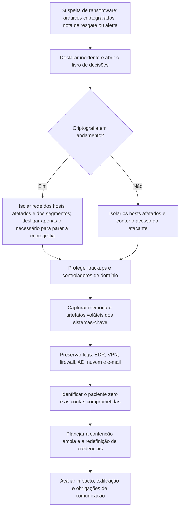

# Resposta Inicial, Contenção e Preservação

> **Objetivo pedagógico:** conduzir as primeiras horas de um incidente de ransomware, equilibrando a contenção do avanço da criptografia, a preservação das evidências (memória, logs e artefatos) e a continuidade do negócio, com papéis, canais de comunicação e decisões documentados.

## 1. Primeiras decisões

| Decisão | Orientação |
|---|---|
| Declarar o incidente e acionar o plano | Líder do incidente, equipe de resposta, Jurídico, DPO, TI, comunicação e patrocinador executivo |
| Canal de comunicação | Fora de banda e confiável (telefone, mensageria independente e sala de crise), pois o e-mail e o diretório podem estar comprometidos |
| Seguro cibernético e fornecedores | Verificar as condições da apólice (prazo de aviso e fornecedores credenciados) e acionar o contrato de resposta a incidentes |
| Privilégio jurídico | Jurídico (e assessoria externa, quando adequado) conduz a contratação e a coordenação, para proteger comunicações sensíveis |
| Prioridades | Segurança das pessoas, contenção, preservação, continuidade de serviços críticos e comunicação |
| Registro | Livro de decisões com hora (UTC), decisão, responsável e justificativa |

## 2. Contenção: princípios

| Princípio | Aplicação |
|---|---|
| Isolar, e não apagar | Isolar sistemas da rede (por EDR, firewall, VLAN ou desconexão do cabo e do Wi-Fi) em vez de reinstalar |
| Interromper a propagação | Bloquear caminhos de movimentação lateral (SMB, RDP e WinRM) e contas comprometidas |
| Proteger os backups | Isolar a infraestrutura de backup, verificar a imutabilidade e impedir exclusões |
| Preservar a memória quando possível | A memória pode conter chaves e vestígios do atacante; capture antes do desligamento quando for viável e seguro |
| Evitar alertar o atacante sem planejamento | Mudanças amplas e visíveis podem acelerar a criptografia; coordene as ações de contenção |
| Contas | Desabilitar contas comprometidas e restringir contas privilegiadas; planejar a redefinição em massa |

### 2.1 Isolar ou desligar?

| Situação | Orientação |
|---|---|
| Criptografia em andamento e sem isolamento possível | Desligar o equipamento interrompe a criptografia, ao custo de perder a memória; priorize impedir a perda de dados |
| Isolamento de rede possível | Isolar e manter ligado, para capturar memória e artefatos voláteis |
| Hibernação e suspensão | Evite: alteram o estado; a hibernação grava a memória em disco, o que pode ajudar, mas exige tratamento documentado |
| Máquinas virtuais | Preservar instantâneos e a memória pelo hipervisor, quando seguro; atenção à criptografia de arquivos de VM |
| Servidores críticos | Decisão do líder, com o negócio e a investigação, documentada |

## 3. Árvore de decisão das primeiras horas



## 4. Evidências a preservar, por prioridade

| Prioridade | Evidência | Observação |
|---|---|---|
| 1 | Logs de EDR e de antivírus | Pode ser sobrescrito ou removido pelo atacante; exportar imediatamente |
| 1 | Logs de VPN, firewall, proxy e DNS | Acesso inicial e exfiltração |
| 1 | Logs de controladores de domínio e do Entra ID | Autenticações, DCSync e alterações de GPO |
| 2 | Memória do paciente zero, de controladores de domínio, de servidores de arquivos e de servidores de backup | Chaves, processos do atacante e conexões |
| 2 | Imagens de disco, ou coletas direcionadas, dos mesmos sistemas | Artefatos de execução e de persistência (ver pastas 07 e 10) |
| 2 | Nota de resgate, arquivos criptografados de exemplo e a amostra do binário | Identificação e análise (ver arquivo seguinte) |
| 2 | Logs do hipervisor (por exemplo, ESXi) e instantâneos de VMs | Criptografia de máquinas virtuais |
| 3 | Logs de e-mail e de nuvem (Microsoft 365 e outros) | Acesso inicial e movimentação na nuvem |
| 3 | Configurações e inventários | Escopo e prioridade de recuperação |
| 3 | Fotografias de telas e de notas de resgate | Registro do estado |

Preserve com hash e cadeia de custódia (pastas 02 e 04) e armazene fora do ambiente comprometido.

### 4.1 Exemplos de coleta rápida

```powershell
# Windows: copiar os principais logs de eventos de um host para mídia externa (execução com conta de resposta)
wevtutil epl Security E:\coleta\%COMPUTERNAME%_Security.evtx
wevtutil epl System E:\coleta\%COMPUTERNAME%_System.evtx
wevtutil epl "Microsoft-Windows-TerminalServices-RemoteConnectionManager/Operational" E:\coleta\%COMPUTERNAME%_RCM.evtx
wevtutil epl "Microsoft-Windows-PowerShell/Operational" E:\coleta\%COMPUTERNAME%_PS.evtx
```

```bash
# ESXi (via SSH, com autorização): informações iniciais e coleta de logs
esxcli vm process list
esxcli network ip connection list
tar -czf /tmp/esxi_logs_$(hostname).tgz /var/log/hostd.log /var/log/vmkernel.log /var/log/shell.log /var/log/auth.log
```

Para memória e imagens, siga os procedimentos das pastas 03, 09 e 10. Coletas ao vivo alteram o sistema: registre cada ação.

## 5. Contenção da identidade e do domínio

| Ação | Cuidado |
|---|---|
| Desabilitar contas comprometidas e contas de serviço expostas | Avaliar o impacto nos serviços |
| Isolar controladores de domínio comprometidos | Preservar antes de reconstruir |
| Revogar sessões e tokens (nuvem) | Contas de usuários e de administradores |
| Redefinição em massa de senhas | Planejar para depois da erradicação do acesso do atacante, para não se repetir |
| Redefinir `krbtgt` duas vezes (quando houver comprometimento do domínio) | Procedimento planejado, com intervalo adequado entre as redefinições |
| Restringir acesso administrativo remoto | VPN, RDP e ferramentas de gestão remota |
| Bloquear indicadores | IPs, domínios, hashes e ferramentas identificados |

## 6. Papéis e responsabilidades

| Papel | Responsabilidade |
|---|---|
| Líder do incidente | Coordena, decide e mantém o livro de decisões |
| Líder forense | Preservação, análise, linha do tempo e escopo |
| Líder de contenção e TI | Isolamento, backups, identidade e recuperação |
| Jurídico e DPO | Obrigações legais, comunicações, contratos e privilégio |
| Comunicação e relações com stakeholders | Mensagens internas e externas |
| Continuidade de negócios | Operação manual, prioridades e impacto |
| Patrocinador executivo | Decisões de alto impacto (inclusive pagamento) |
| Fornecedores e seguradora | Apoio especializado, conforme os contratos |

## 7. Comunicação inicial

| Público | Orientação |
|---|---|
| Equipe interna | Instruções claras: não desligar nem reiniciar equipamentos por conta própria (salvo orientação), não usar sistemas suspeitos, não apagar notas e arquivos |
| Alta direção | Resumo objetivo do que se sabe, do que não se sabe, das decisões necessárias e dos prazos |
| Clientes e parceiros | Somente depois de alinhado com o Jurídico e com base em fatos verificados |
| Autoridades | Polícia (por exemplo, a Polícia Federal e as unidades de crimes cibernéticos), CERT.br e reguladores, conforme a avaliação do Jurídico |
| Atacante | Nenhum contato sem decisão formal da direção e orientação especializada |

## 8. Linha do tempo de referência das primeiras 72 horas

| Janela | Objetivos |
|---|---|
| 0 a 1 h | Declarar o incidente, isolar, proteger backups e domínio, abrir o livro de decisões |
| 1 a 4 h | Preservar logs e memória dos sistemas-chave, identificar o paciente zero e o escopo inicial, acionar fornecedores, seguradora e Jurídico |
| 4 a 24 h | Identificar a família e o acesso inicial, verificar exfiltração, definir a estratégia de contenção ampla, planejar a recuperação |
| 24 a 72 h | Contenção ampla e erradicação do acesso, avaliar obrigações de comunicação (inclusive o prazo de 3 dias úteis para a ANPD, conforme a regulamentação vigente), iniciar a recuperação priorizada |

## 9. Exemplo prático: primeiras 3 horas

| Hora (UTC) | Ação | Resultado |
|---|---|---|
| 02:40 | Alerta de criptografia em um servidor de arquivos | Incidente declarado; livro de decisões aberto |
| 02:50 | Isolamento do servidor e dos segmentos de servidores no firewall | Criptografia contida no segmento |
| 03:05 | Isolamento do servidor de backup e verificação de cópias imutáveis | Backups íntegros fora do domínio |
| 03:20 | Exportação de logs de EDR, VPN e controladores de domínio | Preservados com hash |
| 03:40 | Captura de memória do servidor de arquivos e de um controlador de domínio | Preservadas |
| 04:10 | Primeira identificação: logon por VPN do usuário X, 9 dias antes, como candidato ao acesso inicial | Hipótese de acesso inicial |
| 05:00 | Reunião com o Jurídico, o DPO, a seguradora e o fornecedor de resposta | Plano de 72 horas aprovado |

## 10. Casos de uso corporativos

- Execução do plano de resposta a ransomware em um incidente real.
- Exercícios de simulação (tabletop) com decisões de isolamento, preservação e comunicação.
- Revisão do tempo de resposta e da qualidade das decisões após o incidente.

## 11. Normas e frameworks relevantes

- NIST SP 800-61 Rev. 3; NIST SP 800-184; NIST IR 8374; CISA #StopRansomware Guide
- ISO/IEC 27035; ISO/IEC 27037:2012
- MITRE ATT&CK: T1486, T1490, T1562.001, T1070
- CIS Controls v8.1, controle 17; LGPD, arts. 46 e 48; Resolução CD/ANPD nº 15/2024

## 12. Referências

- CISA; MS-ISAC. #StopRansomware Guide.
- NIST SP 800-61 Rev. 3; NIST SP 800-184; NIST IR 8374.
- Microsoft Learn. Active Directory Forest Recovery Guide.
- CERT.br. Orientações para a notificação e a resposta a incidentes.
- Documentação do VMware ESXi (logs e `esxcli`).
- SANS Institute. FOR508; Ransomware response guidance.
