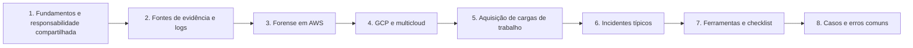

# 17 Forense em Nuvem

## Objetivo

Investigar incidentes em ambientes de nuvem pública (IaaS, PaaS, contêineres e serverless), com foco nos fundamentos, em AWS, em Google Cloud e em cenários multicloud: preparar a prontidão forense, preservar logs e cargas de trabalho, reconstruir a atividade a partir do plano de controle e da identidade, conter com preservação e relatar com integridade, base legal e limitações declaradas. Azure e Microsoft 365 são tratados nas pastas 18 e 19.

## Trilha de estudo recomendada

## Conteúdo da pasta

| Ordem | Arquivo | Objetivo |
|---|---|---|
| 1 | [fundamentos-de-forense-em-nuvem-e-responsabilidade-compartilhada.md](fundamentos-de-forense-em-nuvem-e-responsabilidade-compartilhada.md) | Diferenças da nuvem, responsabilidade compartilhada, prontidão e aspectos legais |
| 2 | [fontes-de-evidencia-e-logs-na-nuvem.md](fontes-de-evidencia-e-logs-na-nuvem.md) | Fontes de log, retenções padrão, integridade, consultas e evasão |
| 3 | [forense-em-aws.md](forense-em-aws.md) | IAM, CloudTrail, S3, EC2, snapshots e conta forense |
| 4 | [forense-em-gcp-e-multicloud.md](forense-em-gcp-e-multicloud.md) | Cloud Audit Logs, contas de serviço, equivalências e investigação multicloud |
| 5 | [aquisicao-de-cargas-de-trabalho-vms-conteineres-e-serverless.md](aquisicao-de-cargas-de-trabalho-vms-conteineres-e-serverless.md) | VMs, memória, contêineres, Kubernetes e funções |
| 6 | [investigacao-de-incidentes-tipicos-em-nuvem.md](investigacao-de-incidentes-tipicos-em-nuvem.md) | Dez cenários de incidente, indícios, logs e resposta |
| 7 | [ferramentas-fluxo-modelos-e-checklist-de-nuvem.md](ferramentas-fluxo-modelos-e-checklist-de-nuvem.md) | Ferramentas, fluxo, modelos e checklist |
| 8 | [casos-de-uso-e-erros-comuns-em-nuvem.md](casos-de-uso-e-erros-comuns-em-nuvem.md) | Sete cenários, erros comuns e exercícios |

## Princípios

- Habilitar e centralizar logs antes do incidente, em conta separada e imutável
- Preservar logs primeiro; desativar em vez de excluir; copiar antes de alterar
- Tratar a identidade como o perímetro e começar a investigação pela credencial
- Impedir a reciclagem de recursos efêmeros e automatizar a preservação
- Garantir chaves e permissões para a conta forense antes de compartilhar snapshots cifrados
- Montar discos somente leitura, gerar imagem com hash e manter a cadeia de custódia
- Declarar as limitações de logs (eventos de dados, DNS e regiões) e considerar o pior caso
- Respeitar a jurisdição, os contratos, a multilocação e a privacidade

## Relação com outras pastas

- 02-cadeia-de-custodia e 04-hash-e-integridade: custódia e hash das cópias em nuvem
- 05-timeline-analysis: linha do tempo unificada entre provedores
- 08-linux-forensics e 09-memory-forensics: análise de instâncias e de memória
- 10-disk-forensics: análise das imagens de discos
- 11-log-analysis e 13-network-forensics: logs de nuvem, fluxo e DNS
- 15-malware-forensics e 16-ransomware-investigation: cargas maliciosas e ransomware em nuvem
- 18-azure-forensics e 19-m365-forensics: aprofundamento nos serviços da Microsoft

## Referências

- NIST SP 800-201: NIST Cloud Computing Forensic Reference Architecture (2023); NIST IR 8006 (2020); NIST SP 800-190 (2017)
- ISO/IEC 27017; ISO/IEC 27018; ISO/IEC 27037, 27041, 27042 e 27043
- Cloud Security Alliance. Security Guidance v4 e Cloud Controls Matrix
- CIS Benchmarks (AWS, Azure, Google Cloud, Kubernetes)
- MITRE ATT&CK for Cloud
- AWS Security Incident Response Guide; documentação do CloudTrail, do IAM, do EC2 e do GuardDuty
- Google Cloud. Documentação do Cloud Audit Logs, do IAM e do Security Command Center
- Documentação do Prowler, do ScoutSuite, do Steampipe, do dfTimewolf e do Stratus Red Team
- Brasil. Lei nº 13.709/2018 (LGPD); Lei nº 12.965/2014 (Marco Civil da Internet)
- SANS Institute. FOR509: Enterprise Cloud Forensics and Incident Response; SEC541
