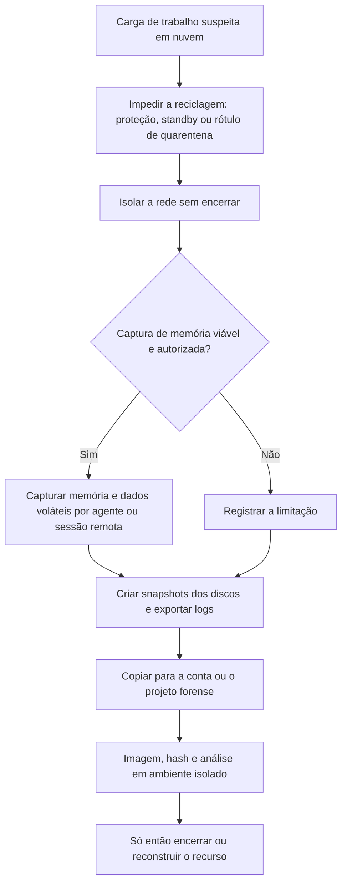

# Aquisição de Cargas de Trabalho: VMs, Contêineres e Serverless

> **Objetivo pedagógico:** adquirir evidências de máquinas virtuais, contêineres, clusters Kubernetes e funções serverless em nuvem, preservando o estado antes que o recurso seja reciclado, mantendo a integridade e a cadeia de custódia e registrando as limitações de cada técnica.

## 1. Ordem de volatilidade e decisão

| Prioridade | Evidência | Observação |
|---|---|---|
| 1 | Logs do plano de controle e de rede | Já fora da carga de trabalho; preservar primeiro |
| 2 | Memória e processos | Perdidos ao desligar; exige agente ou acesso remoto |
| 3 | Conexões, sessões e estado de rede | Voláteis |
| 4 | Discos (snapshots) | Persistentes, mas a instância pode ser destruída |
| 5 | Imagens, configuração e metadados | Úteis para reconstrução e comparação |



## 2. Máquinas virtuais

### 2.1 Impedir a perda do recurso

| Provedor | Medidas |
|---|---|
| AWS | Proteção contra encerramento (`disable-api-termination`); retirar do Auto Scaling (`enter-standby` ou `detach-instances`); impedir o encerramento por eventos de manutenção |
| Azure | Bloqueios de recurso e retirada de conjuntos de escala de máquinas virtuais (ver pasta 18) |
| Google Cloud | Proteção contra exclusão (`--deletion-protection`); retirar de grupos de instâncias gerenciados |

### 2.2 Memória na nuvem

A nuvem pública geralmente não oferece um instantâneo de memória da máquina virtual sob demanda. A captura exige software dentro da instância (com os riscos de alterar o estado e de a instância estar comprometida).

| Sistema | Ferramentas |
|---|---|
| Linux | AVML (Acquire Volatile Memory for Linux, da Microsoft) e LiME (módulo de kernel) |
| Windows | WinPmem e ferramentas de aquisição de memória (ver pasta 09) |
| Acesso remoto | SSM Session Manager e Run Command (AWS), Run Command (Azure) e IAP e SSH (Google Cloud); registrar sessões |

```bash
# Linux: aquisição de memória com AVML (ferramenta previamente armazenada em volume de evidências)
sudo ./avml /mnt/evid/DFL-2026-001-E012.mem
sha256sum /mnt/evid/DFL-2026-001-E012.mem > /mnt/evid/DFL-2026-001-E012.mem.sha256
```

Para o Linux, o Volatility 3 requer símbolos do kernel correspondentes (pasta 09). Documente a versão do kernel e preserve a saída da aquisição.

### 2.3 Dados voláteis e metadados

```bash
# Coleta rápida de estado volátil em Linux (salvar em local externo, com hash)
date -u; uname -a; uptime
ps auxwwf; ss -tunap; lsof -nP -i
ip addr; ip route; arp -an
who; last -a | head -50
```

| Metadado da nuvem | Valor |
|---|---|
| Descrição e etiquetas da instância | Dono, função e histórico de criação |
| Dados do usuário (user data) e scripts de inicialização | Persistência e configuração |
| Perfil ou função da instância | Permissões e credenciais temporárias |
| Grupos de segurança e rotas | Exposição |
| Imagem de origem (AMI e imagem do provedor) | Comparação com a imagem de referência |
| Chaves de acesso (par de chaves) e usuários | Quem pôde acessar |

### 2.4 Discos

Siga o procedimento descrito no arquivo de AWS (snapshot, compartilhamento, criação de volume na conta forense, imagem bruta com hash, montagem somente leitura). Princípios:

| Princípio | Aplicação |
|---|---|
| Nunca montar com permissão de escrita | Use `ro,noload` (ext4), `ro,norecovery,nouuid` (XFS) e disco somente leitura no Windows |
| Hash | Da imagem bruta e dos arquivos extraídos |
| Documentar | Identificadores do snapshot, da conta, da região, do volume e da instância |
| Chaves de criptografia | Garantir o acesso à chave antes que o recurso seja excluído |
| Cadeia de custódia | Registrar as cópias e os acessos (pasta 02) |

## 3. Contêineres (Docker e runtimes)

| Ação | Comando ou procedimento |
|---|---|
| Listar contêineres e inspecionar | `docker ps -a` e `docker inspect <id>` |
| Alterações no sistema de arquivos em relação à imagem | `docker diff <id>` |
| Logs | `docker logs --timestamps <id>` |
| Exportar o sistema de arquivos | `docker export <id> -o /mnt/evid/E013_container.tar` |
| Preservar o estado de execução | `docker pause <id>` (congela os processos) |
| Isolar da rede | `docker network disconnect <rede> <id>` |
| Examinar a imagem | `docker history <imagem>` e análise de camadas |
| Processos e conexões do contêiner | A partir do host: `nsenter -t <PID> -n ss -tunap` (ver pasta 13) |

```bash
docker inspect <id> > /mnt/evid/E013_inspect.json
docker diff <id> > /mnt/evid/E013_diff.txt
docker logs --timestamps <id> > /mnt/evid/E013_logs.txt
docker export <id> -o /mnt/evid/E013_fs.tar
sha256sum /mnt/evid/E013_* > /mnt/evid/E013_hashes.sha256
```

Avalie também as imagens de origem (registro), os segredos montados, os volumes e a configuração de privilégios (contêineres privilegiados, montagem do socket do Docker e `hostPID`).

## 4. Kubernetes e serviços gerenciados

| Fonte | Observação |
|---|---|
| Logs de auditoria da API do Kubernetes | Em serviços gerenciados, habilitar o registro do plano de controle (EKS, AKS e GKE) |
| Eventos, definições e estado de pods | `kubectl get pod -o yaml`, `kubectl describe pod` e `kubectl get events` |
| Logs de contêineres | `kubectl logs <pod> -c <container> --timestamps` e `--previous` para a instância anterior |
| Configuração de RBAC, contas de serviço e segredos | Acessos e privilégios |
| Políticas de rede e malhas de serviços | Comunicações |
| Nós | Discos e memória (tratados como VMs) |

```bash
# Preservar a definição e os logs do pod
kubectl get pod POD -n NS -o yaml > pod_E014.yaml
kubectl describe pod POD -n NS > pod_E014_describe.txt
kubectl logs POD -n NS --all-containers --timestamps > pod_E014_logs.txt
kubectl logs POD -n NS --all-containers --previous --timestamps > pod_E014_logs_anterior.txt 2>/dev/null

# Retirar o pod do serviço e do controlador sem destruí-lo: alterar rótulos para que o ReplicaSet crie um substituto
kubectl label pod POD -n NS app- quarentena=DFL-2026-001 --overwrite

# Impedir novos pods no nó suspeito
kubectl cordon NO_SUSPEITO

# Depurar com contêiner efêmero (sem alterar a imagem original), se permitido
kubectl debug -it POD -n NS --image=busybox --target=CONTAINER
```

Para isolar a rede do pod, aplique uma política de rede que negue o tráfego para o rótulo de quarentena (se o plugin de rede suportar). Para a investigação do nó, trate-o como uma VM (snapshots e memória). Sempre preserve antes de excluir o pod.

## 5. Funções serverless

| Provedor | Evidências |
|---|---|
| AWS Lambda | Código (`get-function` retorna um link temporário de download), configuração, variáveis de ambiente, versões e aliases, função de execução, camadas, gatilhos e logs do CloudWatch |
| Azure Functions | Código, configurações de aplicativo, identidades gerenciadas e logs |
| Cloud Functions e Cloud Run | Código-fonte, configuração, contas de serviço e logs |

```bash
aws lambda get-function --function-name FUNCAO-EXEMPLO > lambda_get.json
aws lambda list-versions-by-function --function-name FUNCAO-EXEMPLO > lambda_versoes.json
aws lambda get-function-configuration --function-name FUNCAO-EXEMPLO > lambda_config.json
# Baixar o pacote de código usando a URL temporária do campo Code.Location (válida por pouco tempo) e calcular o hash
```

Indícios de comprometimento: atualização de código ou de configuração fora do pipeline, novas variáveis de ambiente, nova função de execução com mais permissões, novos gatilhos e conexões de saída incomuns. Funções são efêmeras: o histórico está nos logs e nas versões.

## 6. Armazenamento e bancos de dados

| Recurso | Preservação |
|---|---|
| Armazenamento de objetos | Versionamento, `list-object-versions`, bloqueio de objetos e cópia para o repositório forense |
| Bancos de dados gerenciados | Snapshots, logs de auditoria e de consultas, e parâmetros de retenção |
| Filas e fluxos de mensagens | Retenção e exportação de mensagens quando relevantes |
| Cópias de segurança | Preservar pontos de restauração anteriores ao incidente |

## 7. Integridade e cadeia de custódia na nuvem

| Item | Registro |
|---|---|
| Identificação do recurso | Provedor, conta, região, tipo, identificador e etiquetas |
| Cópias | Identificadores dos snapshots e dos volumes derivados, contas e regiões |
| Hashes | Das imagens brutas, dos arquivos exportados e dos pacotes de logs |
| Acessos | Quem acessou a conta forense e quando (logs de auditoria da própria conta forense) |
| Horários | UTC; diferença do relógio da instância |
| Ferramentas | Versões e parâmetros |
| Limitações | Recursos efêmeros já perdidos, memória não capturada e logs ausentes |

## 8. Exemplo prático: instância com mineração e acesso remoto

| Hora (UTC) | Ação | Resultado |
|---|---|---|
| 15:00 | Proteção contra encerramento e retirada do Auto Scaling | Instância preservada |
| 15:05 | Substituição do grupo de segurança por quarentena | Tráfego de saída bloqueado |
| 15:12 | Captura de memória por sessão remota (AVML) | Arquivo de 8 GB com hash |
| 15:25 | Snapshots dos dois volumes, com etiquetas do caso | Concluídos |
| 15:40 | Compartilhamento com a conta forense (volumes cifrados com chave gerenciada pelo cliente) | Volumes criados |
| 16:30 | Imagens brutas e hashes; montagem somente leitura | Análise iniciada |
| Achados | Processo de mineração em `/tmp`, tarefa agendada de persistência e chave SSH do atacante em `authorized_keys` | Mapeamento: T1496, T1053.003 e T1098.004 |

## 9. Casos de uso corporativos

- Preservação de instâncias e de contêineres comprometidos em ambientes elásticos.
- Análise de pods e de nós em clusters Kubernetes gerenciados.
- Investigação de funções serverless adulteradas.

## 10. Normas e frameworks relevantes

- ISO/IEC 27037:2012; NIST SP 800-201; NIST SP 800-190 (segurança de contêineres)
- MITRE ATT&CK: T1610, T1611, T1612, T1578, T1496, T1053.003, T1098.004
- CIS Benchmarks (Docker e Kubernetes); CIS Controls v8.1, controles 4, 8 e 17
- ISO/IEC 27002:2022, controles 8.15 e 8.16

## 11. Referências

- Souppaya, M.; Morello, J.; Scarfone, K. NIST SP 800-190: Application Container Security Guide. 2017.
- Documentação do Docker, do Kubernetes (`kubectl debug`, `cordon` e auditoria), do AWS Lambda e do Google Cloud Run.
- Microsoft. AVML (Acquire Volatile Memory for Linux); LiME; WinPmem.
- AWS. Forensic investigation environment strategies in the AWS Cloud.
- Ligh, M. H. et al. The Art of Memory Forensics. 2014.
- SANS Institute. FOR509.
