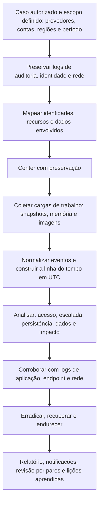

# Ferramentas, Fluxo, Modelos e Checklist de Nuvem

> **Objetivo pedagógico:** padronizar as ferramentas, o fluxo de trabalho, os registros e a verificação de qualidade das investigações em nuvem, de modo que sejam reproduzíveis, seguras, rastreáveis e proporcionais ao escopo autorizado.

## 1. Ferramentas por finalidade

| Finalidade | Ferramentas |
|---|---|
| CLIs e SDKs dos provedores | AWS CLI, `gcloud`, Azure CLI e PowerShell, `kubectl` |
| Consulta de logs em larga escala | Amazon Athena e CloudTrail Lake, BigQuery e Log Analytics (KQL), SIEMs e data lakes |
| Avaliação de postura e inventário | Prowler, ScoutSuite, Steampipe, Cloud Asset Inventory e AWS Config |
| Coleta e automação forense em nuvem | dfTimewolf e Cloud Forensics Utils (Google), scripts próprios, automações com Step Functions ou equivalentes |
| Aquisição de memória | AVML, LiME e WinPmem |
| Análise de discos | Autopsy, The Sleuth Kit, ferramentas da pasta 10 em instância de análise |
| Análise de contêineres e imagens | `docker` e `kubectl`, Trivy e Grype (varredura), `skopeo` |
| Linha do tempo | Plaso, Timesketch e planilhas (pasta 05) |
| Detecção e caça | Regras Sigma e consultas do SIEM (pasta 11), GuardDuty, Defender for Cloud e Security Command Center |
| Emulação de técnicas de ataque (somente em contas de teste) | Stratus Red Team, Atomic Red Team (testes de nuvem) |
| Gestão de segredos e varredura de repositórios | Ferramentas de detecção de segredos em repositórios e pipelines |
| Documentação | Modelos deste arquivo e repositório versionado |

Registre nome, versão e origem das ferramentas, as permissões usadas e o horário das execuções. O acesso do investigador deve ser por conta nominal, com permissões mínimas (somente leitura, quando possível) e registro.

## 2. Fluxo de trabalho padronizado

## 3. Dez perguntas e como respondê-las

| Pergunta | Onde responder |
|---|---|
| 1. Quais contas, projetos, regiões e identidades estão no escopo? | Inventário e organização do provedor |
| 2. Os logs necessários existem, estão íntegros e por quanto tempo? | Mapa de logs e retenção |
| 3. Qual credencial ou identidade foi usada e como foi comprometida? | Logs de identidade e de auditoria |
| 4. O que o atacante fez (reconhecimento, escalada e persistência)? | Eventos do plano de controle |
| 5. Que dados foram acessados, copiados ou destruídos? | Eventos de dados, rede e versionamento |
| 6. Que recursos foram criados, alterados ou excluídos? | Auditoria, configuração e inventário |
| 7. Há persistência remanescente? | Chaves, usuários, funções, funções serverless e aplicativos |
| 8. As cargas de trabalho afetadas foram preservadas? | Snapshots, memória e imagens, com hash |
| 9. Quais obrigações legais e contratuais se aplicam? | Jurídico, DPO e contratos |
| 10. Que limitações precisam ser declaradas? | Logs ausentes, eventos de dados desativados e recursos já destruídos |

## 4. Modelo A: Inventário de Contas, Recursos e Identidades no Escopo

| ID | Provedor | Conta, assinatura ou projeto | Região | Ambiente | Responsável | Logs de auditoria habilitados | Retenção | Observações |
|---|---|---|---|---|---|---|---|---|
| C-001 | | | | | | | | |
| C-002 | | | | | | | | |

## 5. Modelo B: Mapa de Logs e Retenção

| Fonte | Provedor | Habilitada? | Cobertura (regiões e contas) | Destino e retenção | Imutabilidade e integridade | Lacunas |
|---|---|---|---|---|---|---|
| Auditoria do plano de controle | | | | | | |
| Eventos de dados | | | | | | |
| Logs de fluxo | | | | | | |
| Logs de DNS | | | | | | |
| Identidade | | | | | | |
| Cargas de trabalho | | | | | | |

## 6. Modelo C: Registro de Aquisição em Nuvem

| Campo | Preenchimento |
|---|---|
| Identificador | DFL-AAAA-NNN-ENNN |
| Provedor, conta, região e tipo de recurso | |
| Identificador do recurso (instância, volume e função) e etiquetas | |
| Estado ao identificar (execução, parado e isolado) | |
| Ações de preservação (proteção, isolamento e standby), com horário (UTC) | |
| Snapshots e identificadores; chaves de criptografia usadas | |
| Conta ou projeto forense de destino | |
| Memória capturada (ferramenta, versão e hash) | |
| Imagens brutas e hashes SHA-256 | |
| Logs exportados e hashes | |
| Responsável pela coleta e conta usada | |
| Limitações | |
| Custódia e armazenamento | |

## 7. Modelo D: Registro de Ações de Contenção (com estado anterior)

| ID | Data e hora (UTC) | Ação (por exemplo, desativar chave) | Recurso e identidade | Estado anterior preservado (configuração exportada) | Autorizada por | Impacto observado | Reversão possível |
|---|---|---|---|---|---|---|---|
| A-001 | | | | | | | |
| A-002 | | | | | | | |

## 8. Modelo E: Linha do Tempo em Nuvem

| Hora (UTC) | Provedor e conta | Identidade (usuário, função ou chave) | Evento (API) | Recurso | IP e agente | Interpretação | Fonte e identificador do evento | Confiança | ATT&CK |
|---|---|---|---|---|---|---|---|---|---|
| | | | | | | | | | |

## 9. Modelo F: Solicitação ao Provedor

| Campo | Preenchimento |
|---|---|
| Data e hora da solicitação (UTC) | |
| Provedor e canal | |
| Tipo (preservação, suporte técnico ou processo legal) | |
| Base legal e autoridade (por exemplo, ordem judicial) | |
| Escopo (contas, recursos e período) | |
| Dados solicitados | |
| Prazo e confirmação | |
| Responsável (Jurídico e investigador) | |
| Resposta e dados recebidos (hashes) | |

## 10. Checklist operacional de nuvem

**Caso:** DFL-AAAA-NNN
**Provedor(es):** ____________________
**Analista:** ____________________
**Data e hora (UTC):** ____________________

### 10.1 Escopo e autorização

- [ ] Autorização, base legal e escopo (contas, regiões e período) definidos
- [ ] Jurídico e DPO consultados sobre dados, jurisdição e contratos
- [ ] Acesso do investigador por conta nominal, com permissões mínimas e registro
- [ ] Inventário de contas, recursos e identidades elaborado

### 10.2 Preservação

- [ ] Logs de auditoria, identidade e rede exportados e preservados com hash
- [ ] Integridade dos logs validada (por exemplo, validação de trilhas)
- [ ] Retenções ampliadas onde necessário
- [ ] Recursos protegidos contra exclusão e reciclagem
- [ ] Recursos isolados sem encerramento
- [ ] Memória capturada, quando viável, ou limitação registrada
- [ ] Snapshots criados e copiados para a conta ou o projeto forense
- [ ] Chaves de criptografia e permissões verificadas

### 10.3 Análise

- [ ] Identidade comprometida e vetor identificados
- [ ] Atividade reconstruída: reconhecimento, escalada, persistência, dados e impacto
- [ ] Regiões e contas incomuns verificadas
- [ ] Persistência procurada (chaves, usuários, funções, serverless e aplicativos)
- [ ] Dados acessados e exfiltrados avaliados, com as limitações de logs declaradas
- [ ] Horários normalizados para UTC; eventos mapeados ao ATT&CK

### 10.4 Contenção, relato e melhoria

- [ ] Ações de contenção registradas com o estado anterior
- [ ] Credenciais desativadas e rotacionadas; sessões revogadas
- [ ] Persistência removida e a causa raiz corrigida
- [ ] Notificações e comunicações avaliadas (LGPD, contratos e reguladores)
- [ ] Limitações e grau de confiança declarados
- [ ] Recomendações de prontidão, de detecção e de endurecimento
- [ ] Revisão por pares realizada

## 11. Resultado da verificação

| Resultado | Condição |
|---|---|
| Conforme | Todos os itens aplicáveis marcados |
| Conforme com ressalvas | Pendências sem impacto nas conclusões, com plano de ação |
| Não conforme | Recursos ou credenciais excluídos antes da preservação, logs não exportados, acesso fora do escopo ou conclusões sem corroboração; comunicar o líder e o Jurídico |

**Assinatura do analista:** ____________________
**Assinatura do revisor:** ____________________

## 12. Casos de uso corporativos

- Padronização das investigações em nuvem do time de resposta a incidentes.
- Treinamento de analistas em contas de teste, com cenários e modelos.
- Auditoria da prontidão forense em nuvem e da qualidade das investigações.

## 13. Normas e frameworks relevantes

- NIST SP 800-201; NIST SP 800-61 Rev. 3; ISO/IEC 27037, 27041, 27042 e 27043; ISO/IEC 27017
- MITRE ATT&CK for Cloud; CIS Benchmarks; CIS Controls v8.1, controles 8 e 17
- LGPD, arts. 6º, 46 e 48

## 14. Referências

- Documentação do AWS CLI, do `gcloud`, do Azure CLI e do `kubectl`.
- Documentação do Prowler, do ScoutSuite, do Steampipe, do dfTimewolf e do Cloud Forensics Utils.
- Datadog. Stratus Red Team.
- NIST SP 800-201. 2023.
- SANS Institute. FOR509 e SEC541.
