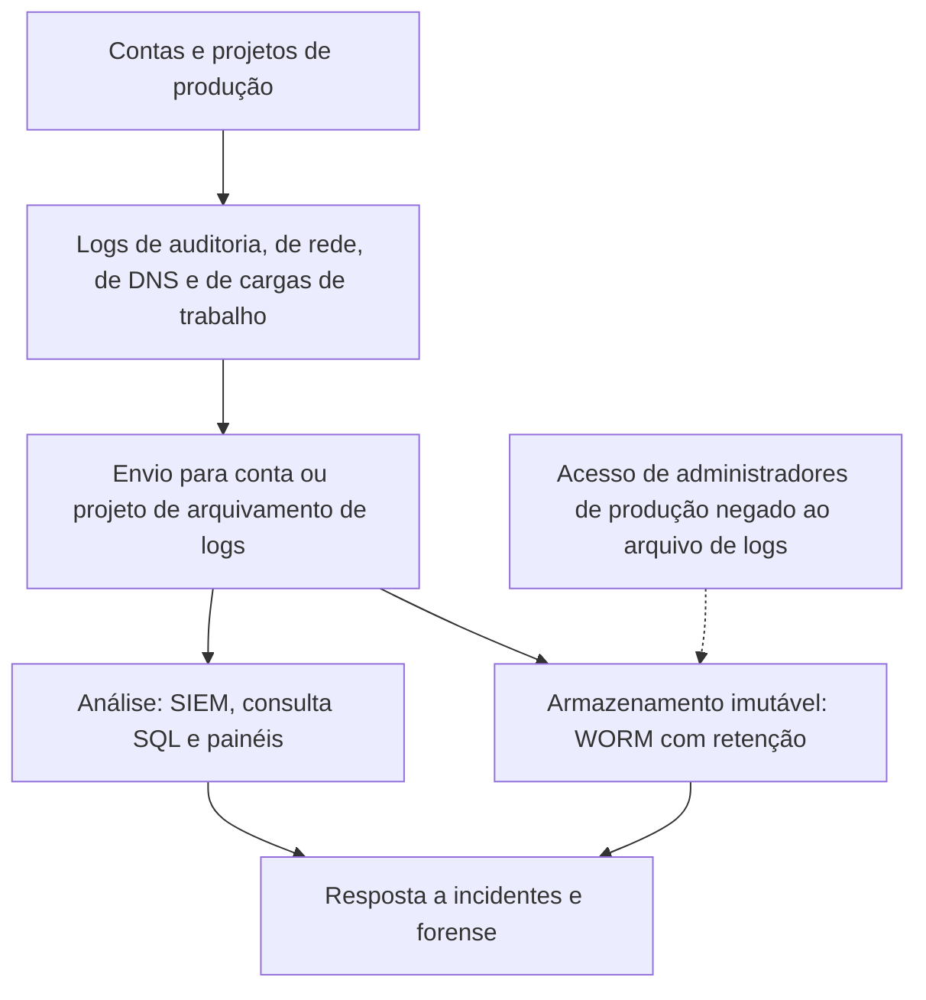

# Fontes de Evidência e Logs na Nuvem

> **Objetivo pedagógico:** conhecer as principais fontes de log e de configuração nos provedores de nuvem (plano de controle, plano de dados, rede, identidade, cargas de trabalho e detecção), suas retenções padrão e lacunas, e aprender a consultá-las, preservá-las e validar sua integridade.

> As retenções e os padrões de habilitação mudam com frequência. Confirme-os na documentação vigente de cada provedor no início do caso.

## 1. Taxonomia de logs na nuvem

| Categoria | O que registra | Exemplos de serviços |
|---|---|---|
| Plano de controle (auditoria) | Chamadas de API que criam, alteram e excluem recursos e permissões | AWS CloudTrail, Azure Activity Log e Cloud Audit Logs (Google Cloud) |
| Plano de dados | Acesso a objetos, consultas a bancos de dados, leitura de segredos | Eventos de dados do CloudTrail, logs de acesso ao armazenamento de objetos, logs de acesso a dados do Google Cloud |
| Identidade | Entradas, falhas, MFA, emissão de tokens e alterações de contas | Logs de entrada do Entra ID, eventos de entrada do CloudTrail, logs do Cloud Identity e do Google Workspace |
| Rede | Fluxos, DNS, balanceadores, firewalls e WAF | VPC Flow Logs, logs do resolvedor de DNS, logs de balanceadores e de WAF |
| Cargas de trabalho | SO, aplicações, contêineres, Kubernetes e funções | Agentes de logs, CloudWatch Logs, Cloud Logging, Azure Monitor e logs de auditoria do Kubernetes |
| Detecção e postura | Achados de segurança e desvios de configuração | Amazon GuardDuty, Microsoft Defender for Cloud e Security Command Center |
| Configuração e inventário | Histórico de configuração de recursos | AWS Config, Cloud Asset Inventory e Azure Resource Graph |
| Faturamento | Consumo por serviço e região | Cost Explorer, relatórios de custos e alertas |
| SaaS | Auditoria de usuários e de administradores | Logs de auditoria do Microsoft 365, do Google Workspace e de outras plataformas |

## 2. Principais fontes por provedor e retenção padrão

| Provedor | Fonte | Padrão e retenção (referência) | Observação |
|---|---|---|---|
| AWS | CloudTrail, histórico de eventos | Eventos de gerenciamento dos últimos 90 dias, por região, sem configuração | Não inclui eventos de dados; para retenção maior, criar uma trilha |
| AWS | CloudTrail, trilha | Armazenamento em S3 pelo tempo definido pelo cliente | Habilitar para todas as regiões e contas, com validação de integridade |
| AWS | Eventos de dados (S3, Lambda e outros) | Desabilitados por padrão | Habilitar para recursos críticos |
| AWS | VPC Flow Logs | Desabilitados por padrão | Habilitar nas redes críticas, com destino S3 ou CloudWatch |
| AWS | Logs de consultas do Route 53 Resolver | Desabilitados por padrão | Habilitar para DNS |
| AWS | GuardDuty, AWS Config, CloudWatch Logs | Conforme configuração | Retenção própria |
| Azure | Activity Log | 90 dias, por padrão | Exportar para workspace do Log Analytics ou armazenamento |
| Azure | Logs de entrada e de auditoria do Entra ID | Retenção depende do licenciamento | Exportar para o SIEM (ver pasta 18) |
| Azure | Logs de fluxo (NSG ou de rede virtual) | Conforme configuração | Confirme os serviços vigentes |
| Google Cloud | Logs de auditoria de atividade administrativa | Sempre habilitados; retenção de 400 dias no bucket `_Required` | Não podem ser desabilitados |
| Google Cloud | Logs de auditoria de acesso a dados | Desabilitados por padrão (exceto BigQuery); retenção padrão de 30 dias no bucket `_Default` | Habilitar por serviço |
| Google Cloud | VPC Flow Logs e logs do Cloud DNS | Desabilitados por padrão | Habilitar conforme necessário |
| Google Cloud | Security Command Center | Conforme o nível de serviço | Achados e postura |

## 3. Arquitetura de centralização e proteção



| Medida | Descrição |
|---|---|
| Conta separada de logs | Administradores das contas de produção não podem alterar nem apagar o arquivo |
| Imutabilidade | S3 Object Lock, políticas de retenção bloqueadas e armazenamento imutável |
| Validação de integridade | Arquivos de resumo assinados (por exemplo, a validação de arquivos de log do CloudTrail) |
| Criptografia e controle de acesso | Chaves gerenciadas pelo cliente e permissões mínimas |
| Alertas sobre a própria infraestrutura de logs | Desativação de trilhas, exclusão de destinos e mudanças em políticas de retenção |
| Cobertura de todas as regiões e contas | Incluindo regiões não usadas (onde atacantes criam recursos) |

## 4. Consultas e preservação: exemplos

### 4.1 AWS CLI: histórico de eventos

```bash
# Eventos de login no console nos últimos dias (histórico de 90 dias)
aws cloudtrail lookup-events \
  --lookup-attributes AttributeKey=EventName,AttributeValue=ConsoleLogin \
  --start-time 2026-10-20T00:00:00Z --end-time 2026-10-31T23:59:59Z \
  --max-results 50 --output json > consolelogin.json

# Atividade de uma chave de acesso específica
aws cloudtrail lookup-events \
  --lookup-attributes AttributeKey=AccessKeyId,AttributeValue=AKIAEXEMPLO000000000 \
  --output json > atividade_chave.json
```

### 4.2 Validação de integridade das trilhas

```bash
aws cloudtrail validate-logs \
  --trail-arn arn:aws:cloudtrail:us-east-1:111122223333:trail/organizacao \
  --start-time 2026-10-20T00:00:00Z --end-time 2026-10-31T23:59:59Z
```

### 4.3 Consulta em larga escala com SQL (Amazon Athena sobre CloudTrail)

```sql
SELECT eventtime, eventname, useridentity.arn, sourceipaddress, useragent, errorcode
FROM cloudtrail_logs
WHERE eventtime BETWEEN '2026-10-20T00:00:00Z' AND '2026-10-31T23:59:59Z'
  AND useridentity.accesskeyid = 'AKIAEXEMPLO000000000'
ORDER BY eventtime;
```

### 4.4 Google Cloud: logs de auditoria

```bash
gcloud logging read \
  'logName:"cloudaudit.googleapis.com%2Factivity" AND protoPayload.authenticationInfo.principalEmail="sa-exemplo@projeto.iam.gserviceaccount.com"' \
  --project=projeto-exemplo --freshness=14d --format=json > audit_sa.json
```

Registre o comando, o horário, a conta usada e o hash do arquivo exportado, e armazene em repositório protegido (pastas 02 e 04).

## 5. Estrutura de um evento de auditoria (AWS CloudTrail) e campos-chave

| Campo | Utilidade |
|---|---|
| `eventTime` | Horário em UTC |
| `eventSource` e `eventName` | Serviço e ação (por exemplo, `iam.amazonaws.com` e `CreateAccessKey`) |
| `userIdentity` | Quem agiu: tipo (usuário, função assumida ou serviço), ARN, `accessKeyId` e emissor da sessão |
| `sourceIPAddress` | IP de origem (pode ser um serviço da AWS) |
| `userAgent` | Cliente usado (console, CLI, SDK ou ferramenta de ataque) |
| `awsRegion` | Região (atenção a regiões incomuns) |
| `requestParameters` e `responseElements` | Parâmetros e resultado da chamada |
| `errorCode` e `errorMessage` | Falhas e negações (indício de enumeração de permissões) |
| `readOnly` | Separação entre leitura e escrita |
| `recipientAccountId` e `eventID` | Conta e identificador do evento |

Para Google Cloud, os campos equivalentes em `protoPayload` incluem `authenticationInfo.principalEmail`, `requestMetadata.callerIp`, `methodName`, `resourceName` e `status`.

## 6. Defesa evasiva e lacunas de logs

| Ação do atacante (nuvem) | Evento ou indício | ATT&CK |
|---|---|---|
| Parar ou excluir trilhas de auditoria | `StopLogging`, `DeleteTrail`, `UpdateTrail`, `PutEventSelectors` | T1562.008 |
| Desabilitar logs de fluxo e de DNS | `DeleteFlowLogs` e remoção da configuração de logs do resolvedor | T1562.008 |
| Desativar serviços de detecção | `DeleteDetector` e `DisableOrganizationAdminAccount` (GuardDuty) | T1562.001 |
| Alterar políticas de retenção e destinos | Mudanças em políticas de bucket e de ciclo de vida | T1562.008 |
| Usar regiões não monitoradas | Atividade em regiões sem trilhas | T1535 |
| Excluir objetos de logs | Exclusão de objetos no bucket de logs | T1070 |

Mitigações: trilhas organizacionais que o administrador da conta não possa desativar, imutabilidade, alertas para estes eventos e cobertura de todas as regiões.

## 7. Limites e cuidados

| Limite | Cuidado |
|---|---|
| Latência de entrega de logs | Eventos podem levar minutos para aparecer |
| Eventos não registrados | Algumas ações de plano de dados não são registradas sem configuração prévia |
| Volume | Planeje custos de armazenamento e consulta |
| Identidades temporárias | Sessões de funções assumidas exigem rastrear a cadeia de emissão (quem assumiu a função) |
| IPs de serviços | O `sourceIPAddress` pode ser de um serviço do provedor, e não do atacante |
| Fusos e formatos | Padronizar para UTC e normalizar campos (pasta 11) |
| Acesso do investigador | Conta nominal, mínima e registrada; o acesso também é um evento auditável |

## 8. Exemplo prático: avaliação de cobertura de logs

| Pergunta | Fonte | Resultado |
|---|---|---|
| Quem criou a chave de acesso e quando? | CloudTrail (`CreateAccessKey`) | Disponível na trilha organizacional |
| Que objetos foram lidos do bucket? | Eventos de dados do S3 | Não habilitados: sem evidência de leitura |
| Houve conexões de saída ao IP do atacante? | VPC Flow Logs | Habilitados na VPC de produção; presentes |
| Resolveu domínios maliciosos? | Logs do resolvedor | Não habilitados |
| Conclusão | Identidade e rede cobertas; plano de dados e DNS com lacunas, que limitam a avaliação do dado acessado; registrar a limitação no relatório |

## 9. Casos de uso corporativos

- Auditoria de cobertura de logs em nuvem para segurança e conformidade.
- Preservação rápida de logs nos primeiros minutos de um incidente.
- Definição de retenção e de arquivamento em conta separada.

## 10. Normas e frameworks relevantes

- NIST SP 800-92; NIST SP 800-201; ISO/IEC 27002:2022, controles 8.15 e 8.16
- CIS Benchmarks (AWS, Azure e Google Cloud); CIS Controls v8.1, controle 8
- MITRE ATT&CK: T1562.001, T1562.008, T1070, T1535
- PCI DSS v4.0, requisito 10; LGPD, art. 46

## 11. Referências

- AWS. Documentação do CloudTrail, do VPC Flow Logs, do Route 53 Resolver Query Logging, do GuardDuty e do Athena.
- Google Cloud. Documentação do Cloud Audit Logs, do Cloud Logging e do VPC Flow Logs.
- Microsoft Learn. Documentação do Azure Monitor e do Activity Log.
- CIS Benchmarks para provedores de nuvem.
- Kent, K.; Souppaya, M. NIST SP 800-92. 2006.
- SANS Institute. FOR509 e SEC541.
