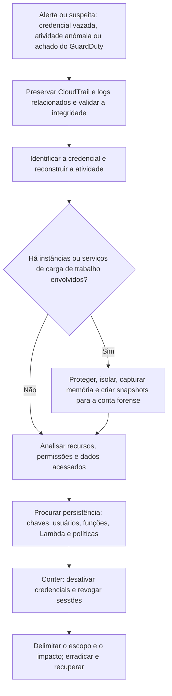

# Forense em AWS

> **Objetivo pedagógico:** investigar incidentes em contas AWS (identidades, chaves de acesso, S3, EC2 e serviços associados), conter com preservação, coletar evidências de instâncias por snapshots em uma conta forense, interpretar eventos do CloudTrail e conhecer as armadilhas de criptografia e de isolamento.

## 1. Modelo de contas e identidades

| Elemento | Relevância forense |
|---|---|
| AWS Organizations, contas e políticas de controle de serviço (SCPs) | Escopo do incidente; restrições aplicáveis; contas-membro e de gestão |
| Usuários IAM e chaves de acesso de longo prazo (`AKIA...`) | Credenciais estáticas, alvo comum de vazamento |
| Funções IAM e credenciais temporárias do STS (`ASIA...`) | Sessões temporárias; cadeia de `AssumeRole` |
| Políticas (identidade, recurso e limites de permissões) | Alterações de política indicam escalada ou persistência |
| Serviço de metadados da instância (IMDSv1 e IMDSv2) | Credenciais da função da instância; o IMDSv2 reduz o risco de roubo por SSRF |
| Provedores de identidade federados e IAM Identity Center | Entradas por federação; origem das sessões |
| Chaves de criptografia (KMS) | Acesso a dados cifrados; compartilhamento de snapshots |

## 2. Investigação de credenciais comprometidas

### 2.1 Eventos e indícios

| Evento (CloudTrail) | Interpretação |
|---|---|
| `GetCallerIdentity` por uma chave recém-vazada | Verificação de validade pelo atacante |
| `ListBuckets`, `ListUsers`, `ListRoles`, `DescribeInstances`, `GetAccountAuthorizationDetails` | Reconhecimento (T1580, T1526 e T1087.004) |
| Muitos `AccessDenied` e `UnauthorizedOperation` | Enumeração de permissões |
| `CreateAccessKey`, `CreateLoginProfile`, `UpdateLoginProfile`, `CreateUser` | Persistência (T1098.001 e T1136.003) |
| `AttachUserPolicy`, `PutUserPolicy`, `CreatePolicyVersion`, `AttachRolePolicy` | Escalada de privilégios |
| `UpdateAssumeRolePolicy` com conta externa | Função de porta dos fundos |
| `RunInstances` em regiões incomuns ou com tipos de GPU | Abuso de recursos (mineração, T1496) |
| `GetSecretValue`, `GetParameter` e `GetParameters` | Acesso a segredos |
| `ModifySnapshotAttribute` e `ModifyImageAttribute` | Compartilhamento de snapshots e de AMIs (T1537) |
| `StopLogging`, `DeleteTrail`, `PutEventSelectors`, `DeleteFlowLogs` | Evasão de defesas (T1562.008) |
| `ConsoleLogin` com origem ou agente incomuns | Acesso interativo, com ou sem MFA (verifique `additionalEventData.MFAUsed`) |

### 2.2 Procedimento

| Passo | Ação |
|---|---|
| 1 | Identificar a credencial (chave de acesso, sessão ou usuário) e o primeiro indício de uso indevido |
| 2 | Consultar toda a atividade da credencial no período (histórico de eventos ou trilha) |
| 3 | Para credenciais temporárias, rastrear a origem: quem assumiu a função, a partir de qual identidade e IP |
| 4 | Listar recursos criados, alterados e excluídos; permissões concedidas; regiões usadas |
| 5 | Verificar acessos a dados (S3, bancos e segredos) e transferências para fora da conta |
| 6 | Procurar persistência: chaves, usuários, funções, políticas, funções Lambda e tarefas agendadas |
| 7 | Determinar o primeiro e o último uso, e o vetor de comprometimento (repositório público, instância, estação, phishing) |
| 8 | Conter com preservação e erradicar |

```sql
-- Athena: atividade de uma sessão de função assumida, por emissor da sessão
SELECT eventtime, eventname, eventsource, awsregion, sourceipaddress, useragent, errorcode
FROM cloudtrail_logs
WHERE useridentity.sessioncontext.sessionissuer.arn = 'arn:aws:iam::111122223333:role/FuncaoExemplo'
  AND eventtime BETWEEN '2026-10-25T00:00:00Z' AND '2026-10-31T23:59:59Z'
ORDER BY eventtime;
```

## 3. Contenção de identidades com preservação

```bash
# Desativar (e não excluir) uma chave de acesso, preservando-a como evidência
aws iam update-access-key --user-name usuario-exemplo --access-key-id AKIAEXEMPLO000000000 --status Inactive

# Listar chaves e último uso
aws iam list-access-keys --user-name usuario-exemplo
aws iam get-access-key-last-used --access-key-id AKIAEXEMPLO000000000
```

| Ação | Cuidado |
|---|---|
| Desativar chaves | Registrar o estado anterior; a exclusão elimina a possibilidade de consulta futura de detalhes |
| Credenciais temporárias já emitidas | Desativar a chave original não invalida as sessões já emitidas; use a política de revogação de sessões (condição de horário de emissão do token) na função ou política de negação |
| Usuários do console | Remover o perfil de login e exigir redefinição, registrando o estado |
| Funções comprometidas | Revisar a política de confiança; aplicar negação para sessões emitidas antes de um horário |
| Políticas de controle de serviço | Em Organizations, restringir regiões e serviços durante a contenção |

## 4. S3 e dados

| Fonte | Valor |
|---|---|
| Eventos de dados do CloudTrail para S3 (`GetObject`, `PutObject` e `DeleteObject`) | Quem acessou quais objetos, se habilitados |
| Logs de acesso do servidor S3 | Alternativa com campos como solicitante, operação, chave e bytes |
| Configuração do bucket e histórico | `PutBucketPolicy`, `PutBucketAcl`, `DeletePublicAccessBlock`, versionamento e replicação |
| Amazon Macie | Descoberta de dados sensíveis (classificação) |
| Versionamento e Object Lock | Recuperação de objetos excluídos e proteção contra exclusão |
| Replicação e `CopyObject` | Transferência para outra conta (T1537) |

```bash
# Listar versões de objetos (inclui marcadores de exclusão) para avaliar alterações e exclusões
aws s3api list-object-versions --bucket bucket-exemplo --prefix dados/ --output json > versoes_dados.json

# Política atual do bucket e bloqueio de acesso público
aws s3api get-bucket-policy --bucket bucket-exemplo
aws s3api get-public-access-block --bucket bucket-exemplo
```

Sem eventos de dados, só é possível afirmar que o acesso era **possível**, e não que objetos específicos foram lidos; declare a limitação.

## 4.1 Achados do GuardDuty

| Tipo de achado (exemplos) | Interpretação |
|---|---|
| `UnauthorizedAccess:IAMUser/InstanceCredentialExfiltration.OutsideAWS` | Credenciais de uma instância usadas fora da AWS |
| `CryptoCurrency:EC2/BitcoinTool.B` | Comunicação com infraestrutura de mineração |
| `Recon:IAMUser/...` e `Discovery:S3/...` | Reconhecimento |
| `Stealth:IAMUser/CloudTrailLoggingDisabled` | Desativação de logs |

Os achados são pontos de partida: confirme-os nos logs de origem.

## 5. EC2: contenção e preservação

### 5.1 Ordem recomendada

| Passo | Ação | Observação |
|---|---|---|
| 1 | Proteger contra exclusão e impedir a reciclagem automática | Retirar do grupo de Auto Scaling e habilitar a proteção contra encerramento |
| 2 | Isolar a rede | Substituir os grupos de segurança por um grupo de quarentena sem regras de entrada e de saída; conexões já rastreadas podem persistir, então use também NACL ou desassocie a interface se necessário |
| 3 | Capturar a memória e os dados voláteis (se viável) | Por agente ou sessão remota; documentar (ver arquivo de cargas de trabalho) |
| 4 | Criar snapshots dos volumes | Todos os volumes anexados, com identificação e etiquetas |
| 5 | Compartilhar os snapshots com a conta forense | Atenção às chaves KMS |
| 6 | Preservar metadados | Descrição da instância, perfil de instância, grupos de segurança, dados do usuário (user data), imagem (AMI), chaves e etiquetas |
| 7 | Manter a instância (parada ou isolada) até concluir | Não encerrar antes de validar as cópias |

```bash
# 1. Proteger contra encerramento e retirar do Auto Scaling mantendo a instância em espera
aws ec2 modify-instance-attribute --instance-id i-0abc123def4567890 --disable-api-termination
aws autoscaling enter-standby --instance-ids i-0abc123def4567890 \
  --auto-scaling-group-name grupo-exemplo --should-decrement-desired-capacity

# 2. Isolar com um grupo de segurança de quarentena (sem regras)
aws ec2 modify-instance-attribute --instance-id i-0abc123def4567890 --groups sg-0quarentena00000

# 4. Snapshots dos volumes
aws ec2 describe-instances --instance-ids i-0abc123def4567890 \
  --query "Reservations[].Instances[].BlockDeviceMappings[].Ebs.VolumeId" --output text
aws ec2 create-snapshot --volume-id vol-0abc123def4567890 \
  --description "DFL-2026-001-E010 volume raiz" \
  --tag-specifications 'ResourceType=snapshot,Tags=[{Key=Caso,Value=DFL-2026-001},{Key=Evidencia,Value=E010}]'

# 5. Compartilhar o snapshot com a conta forense (somente se for cifrado com chave gerenciada pelo cliente e a chave estiver compartilhada)
aws ec2 modify-snapshot-attribute --snapshot-id snap-0abc123def4567890 \
  --attribute createVolumePermission --operation-type add --user-ids 999988887777
```

### 5.2 Criptografia e snapshots

| Situação | Consequência |
|---|---|
| Volume cifrado com a chave padrão gerenciada pela AWS (`aws/ebs`) | O snapshot **não pode ser compartilhado** com outra conta; é preciso copiá-lo e recifrá-lo com uma chave gerenciada pelo cliente (na mesma conta) antes de compartilhar |
| Volume cifrado com chave gerenciada pelo cliente | É possível compartilhar o snapshot e conceder à conta forense permissão de uso da chave |
| Chave KMS desabilitada ou excluída pelo atacante | Pode impedir o acesso; atue rapidamente e verifique a política da chave |
| Cópia entre regiões | Exige permissão de chave na região de destino |

Planeje essas dependências na prontidão: **chaves e permissões para a conta forense** devem existir antes do incidente.

### 5.3 Análise na conta forense

```bash
# Na conta forense: criar volume a partir do snapshot compartilhado e anexar a uma instância de análise (não o monte como leitura e escrita)
aws ec2 create-volume --snapshot-id snap-0abc123def4567890 --availability-zone us-east-1a
aws ec2 attach-volume --volume-id vol-0forense000000000 --instance-id i-0analise00000000 --device /dev/sdf

# Na instância de análise (Linux): gerar a imagem bruta e o hash, ou montar somente leitura
sudo dd if=/dev/nvme1n1 of=/mnt/evid/DFL-2026-001-E010.raw bs=4M status=progress conv=noerror,sync
sha256sum /mnt/evid/DFL-2026-001-E010.raw > /mnt/evid/DFL-2026-001-E010.raw.sha256
sudo mount -o ro,noload /dev/nvme1n1p1 /mnt/analise        # ext4
# XFS: sudo mount -o ro,norecovery,nouuid /dev/nvme1n1p1 /mnt/analise
```

Para o Windows, ponha o disco em modo somente leitura (por exemplo, `attributes disk set readonly` no `diskpart`) antes de qualquer acesso. Veja a pasta 10 para a análise do disco.

## 6. Fluxo de investigação em AWS



## 7. Outros serviços

| Serviço | Evidências e cuidados |
|---|---|
| Lambda | Código e configuração (`get-function`), versões e aliases, variáveis de ambiente, função de execução e logs; alterações indicam persistência |
| ECS e EKS | Definições de tarefas, logs do plano de controle, imagens e auditoria do Kubernetes (ver arquivo de cargas de trabalho) |
| RDS e bancos de dados | Snapshots, logs de auditoria e de consultas, compartilhamento de snapshots |
| Secrets Manager e SSM Parameter Store | Acessos a segredos e rotação posterior |
| IAM Access Analyzer | Recursos compartilhados externamente (buckets, funções e chaves) |
| CloudFormation e Terraform | Alterações de infraestrutura e arquivos de estado |
| AWS Config | Histórico de configuração dos recursos |
| SSM Session Manager e Run Command | Acesso remoto e coleta; os comandos executados ficam registrados |

## 8. Exemplo prático: chave vazada em repositório público

| Hora (UTC) | Evento | Interpretação |
|---|---|---|
| 14:02 | Commit com a chave `AKIA...` em um repositório público | Vazamento |
| 14:19 | `GetCallerIdentity` de IP de hospedagem, agente `python-requests` | Teste da chave |
| 14:21 a 14:30 | `ListBuckets`, `DescribeInstances`, `GetAccountAuthorizationDetails` e muitos `AccessDenied` | Reconhecimento |
| 14:44 | `RunInstances` em 6 regiões, tipo com GPU | Mineração (T1496) |
| 14:51 | `CreateAccessKey` para outro usuário com política administrativa | Persistência |
| 15:02 | `StopLogging` na trilha da conta | Evasão (a trilha organizacional continuou registrando) |
| 15:20 | Alerta de custos | Detecção |
| Resposta | Desativar as chaves, remover as instâncias após snapshots, revogar sessões, remover o usuário criado, rotacionar segredos, bloquear regiões não usadas por SCP e varrer repositórios por segredos |

## 9. Casos de uso corporativos

- Resposta a vazamento de chaves de acesso e a abuso de recursos.
- Análise de exposição de dados em buckets S3.
- Preservação de instâncias EC2 comprometidas em uma conta forense.

## 10. Normas e frameworks relevantes

- MITRE ATT&CK for Cloud: T1078.004, T1098.001, T1136.003, T1526, T1530, T1537, T1552.005, T1562.008, T1578, T1580, T1496
- NIST SP 800-201; NIST SP 800-61 Rev. 3; ISO/IEC 27017
- CIS AWS Foundations Benchmark; CIS Controls v8.1, controles 5, 6, 8 e 17
- AWS Security Incident Response Guide

## 11. Referências

- AWS. Security Incident Response Guide e documentação do CloudTrail, do IAM, do EC2, do KMS e do GuardDuty.
- AWS. Forensic investigation environment strategies in the AWS Cloud.
- SANS Institute. FOR509: Enterprise Cloud Forensics and Incident Response.
- Rhino Security Labs; Datadog (Stratus Red Team). Técnicas de ataque em AWS para estudo.
- Documentação do Prowler e do Steampipe.
- MITRE ATT&CK for Cloud. https://attack.mitre.org
