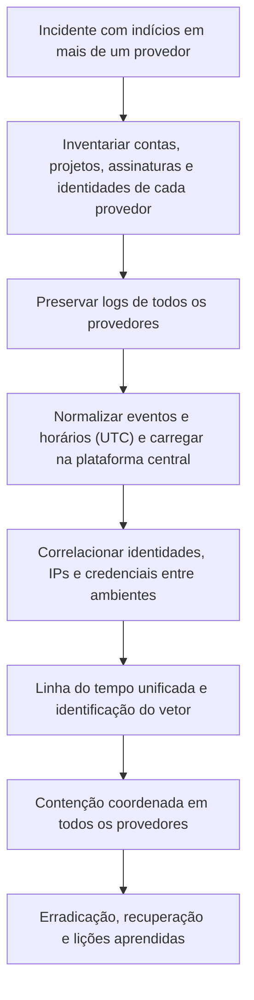

# Forense em GCP e Multicloud

> **Objetivo pedagógico:** investigar incidentes no Google Cloud (hierarquia de recursos, IAM, contas de serviço, logs de auditoria, instâncias e armazenamento), correlacionar equivalências entre AWS, Azure e Google Cloud, e conduzir investigações em ambientes multicloud com linha do tempo unificada.

## 1. Estrutura e identidades no Google Cloud

| Elemento | Relevância forense |
|---|---|
| Organização, pastas e projetos | Hierarquia de políticas e de herança de permissões; escopo do incidente |
| Principais do IAM (usuários, grupos, contas de serviço e identidades de carga de trabalho) | Quem agiu |
| Contas de serviço e chaves de conta de serviço | Credenciais de longo prazo (arquivos JSON), alvo comum de vazamento |
| Personificação de contas de serviço (impersonation) e tokens de curta duração | Cadeias de acesso; identificar quem personificou |
| Funções e vinculações de políticas | `SetIamPolicy` altera permissões; verificar concessões |
| Servidor de metadados da instância | Token da conta de serviço da instância, alvo de SSRF |
| Chaves de criptografia (Cloud KMS) | Acesso a dados cifrados |
| VPC Service Controls e políticas da organização | Restrições aplicáveis e exfiltração |

## 2. Cloud Audit Logs

| Tipo | Conteúdo | Padrão |
|---|---|---|
| Atividade administrativa (Admin Activity) | Operações que alteram configuração ou metadados | Sempre habilitado; não pode ser desativado; retenção de 400 dias no bucket `_Required` |
| Acesso a dados (Data Access) | Leitura de dados e de configurações do usuário | Desabilitado por padrão (exceto BigQuery); habilitar por serviço |
| Eventos do sistema (System Event) | Ações automáticas do Google | Sempre habilitado |
| Política negada (Policy Denied) | Acessos negados por políticas de segurança | Habilitado por padrão |

| Campo de `protoPayload` | Utilidade |
|---|---|
| `authenticationInfo.principalEmail` | Principal (usuário ou conta de serviço) |
| `authenticationInfo.serviceAccountDelegationInfo` | Cadeia de personificação |
| `requestMetadata.callerIp` e `callerSuppliedUserAgent` | Origem e cliente |
| `methodName` e `serviceName` | Ação (por exemplo, `SetIamPolicy`) |
| `resourceName` | Recurso afetado |
| `status` | Resultado (sucesso ou erro) |
| `authorizationInfo` | Permissões verificadas |

```bash
# Alterações de IAM em um projeto, nos últimos 14 dias
gcloud logging read \
  'logName:"cloudaudit.googleapis.com%2Factivity" AND protoPayload.methodName:"SetIamPolicy"' \
  --project=projeto-exemplo --freshness=14d --format=json > setiampolicy.json

# Criação de chaves de contas de serviço
gcloud logging read \
  'protoPayload.methodName="google.iam.admin.v1.CreateServiceAccountKey"' \
  --project=projeto-exemplo --freshness=30d --format=json > sa_keys.json

# Criação de instâncias de Compute Engine
gcloud logging read \
  'protoPayload.methodName="v1.compute.instances.insert"' \
  --project=projeto-exemplo --freshness=14d --format="table(timestamp,protoPayload.authenticationInfo.principalEmail,protoPayload.resourceName)"
```

Exporte logs para o BigQuery ou para o Cloud Storage por meio de coletores (sinks) para retenção longa e consultas em larga escala. Alterações em coletores e em buckets de logs (por exemplo, `DeleteSink`) são indícios de evasão (T1562.008).

## 3. Outras fontes no Google Cloud

| Fonte | Uso |
|---|---|
| Logs do Cloud Storage (acesso a dados e logs de uso) | Leitura e gravação de objetos |
| VPC Flow Logs e logs de firewall | Conexões entre instâncias e para a internet |
| Cloud DNS (logs de consultas) | Resolução de domínios |
| Logs de balanceadores e do Cloud Armor | Tráfego web e ataques |
| Security Command Center | Achados de ameaças e de postura |
| Cloud Asset Inventory | Inventário e histórico de recursos e de políticas |
| Logs do GKE (auditoria da API do Kubernetes, nós e cargas) | Operações no cluster |
| Logs de Cloud Functions e Cloud Run | Execuções e solicitações |
| Google Workspace e Cloud Identity | Entradas e administração de contas |

## 4. Contenção e preservação em Compute Engine

```bash
# Proteger contra exclusão (e desabilitar o reinício automático, se aplicável)
gcloud compute instances update INSTANCIA --zone=ZONA --deletion-protection

# Isolar usando uma etiqueta de rede associada a uma regra de firewall de quarentena
gcloud compute instances add-tags INSTANCIA --zone=ZONA --tags=quarentena
# (A regra de firewall que nega a entrada e a saída para a etiqueta "quarentena" deve existir previamente, com prioridade alta.)

# Snapshots de discos da instância
gcloud compute instances describe INSTANCIA --zone=ZONA --format="value(disks[].source)"
gcloud compute disks snapshot DISCO --zone=ZONA --snapshot-names=dfl-2026-001-e011 \
  --labels=caso=dfl-2026-001,evidencia=e011

# Desativar (e não excluir) a chave de conta de serviço
gcloud iam service-accounts keys disable ID_DA_CHAVE --iam-account=sa-exemplo@projeto.iam.gserviceaccount.com
```

Para analisar: crie discos a partir dos snapshots em um **projeto forense** separado e anexe-os a uma instância de análise (mesmos princípios de imagem bruta, hash e montagem somente leitura descritos no arquivo de AWS). Se o disco estiver cifrado com chave gerenciada pelo cliente (CMEK), a conta forense precisa de permissão sobre a chave.

## 5. Equivalências entre provedores

| Função | AWS | Azure | Google Cloud |
|---|---|---|---|
| Auditoria do plano de controle | CloudTrail | Activity Log | Cloud Audit Logs (Admin Activity) |
| Auditoria do plano de dados | Eventos de dados do CloudTrail; logs de acesso do S3 | Logs de recursos (diagnóstico) | Cloud Audit Logs (Data Access) |
| Identidade | IAM, STS e IAM Identity Center | Entra ID | Cloud IAM e Cloud Identity |
| Logs de rede | VPC Flow Logs | Logs de fluxo de NSG ou de rede virtual | VPC Flow Logs |
| Logs de DNS | Route 53 Resolver Query Logs | Logs de DNS (Azure DNS e Firewall) | Cloud DNS Logging |
| Detecção de ameaças | GuardDuty | Microsoft Defender for Cloud | Security Command Center |
| Histórico de configuração e inventário | AWS Config | Azure Resource Graph e Change Tracking | Cloud Asset Inventory |
| Snapshot de disco | Snapshot do EBS | Snapshot de disco gerenciado | Snapshot de disco persistente |
| Isolamento de instância | Grupo de segurança de quarentena e NACL | NSG de quarentena | Regra de firewall por etiqueta de rede |
| Funções serverless | Lambda | Azure Functions | Cloud Functions e Cloud Run |
| Kubernetes gerenciado | EKS | AKS | GKE |
| Gestão de segredos | Secrets Manager e Parameter Store | Key Vault | Secret Manager |
| Metadados de instância | IMDS (`169.254.169.254`) | IMDS (`169.254.169.254`) | Servidor de metadados (`metadata.google.internal`) |

## 6. Investigação multicloud

| Desafio | Abordagem |
|---|---|
| Formatos diferentes de log | Normalizar para um esquema comum (ECS, OCSF ou esquema próprio) e converter horários para UTC |
| Identidades distintas | Mapear contas entre provedores e identificar contas federadas e de serviço compartilhadas |
| Ataques que atravessam provedores | Chaves vazadas usadas em mais de um provedor, pipelines de CI/CD com acesso a vários ambientes e provedores de identidade únicos |
| Visão unificada | SIEM ou data lake com os logs de todos os provedores, e consultas padronizadas |
| Retenção e custos | Estratégia de camadas e de arquivamento por provedor |
| Ferramentas de avaliação | Prowler, ScoutSuite, Steampipe e ferramentas de inventário para visão multicloud |
| Contatos e processos | Canais de suporte e de processo legal de cada provedor |



## 7. Exemplo prático: chave de conta de serviço vazada

| Hora (UTC) | Evento | Interpretação |
|---|---|---|
| 09:10 | Arquivo JSON da chave publicado em um repositório público | Vazamento |
| 09:31 | `GetIamPolicy` e `ListServiceAccounts` pela conta de serviço, de IP de hospedagem | Reconhecimento |
| 09:40 | `google.iam.admin.v1.CreateServiceAccountKey` para outra conta de serviço | Persistência |
| 09:55 | `compute.instances.insert` em zonas incomuns, com GPUs | Abuso de recursos |
| 10:20 | `storage.objects.get` em massa (Data Access habilitado) no bucket de dados | Acesso a dados |
| Resposta | Desativar as chaves, revisar as concessões, snapshots das instâncias, revisão dos objetos acessados, ativar logs de acesso a dados em todo o projeto, política da organização que impeça a criação de chaves de conta de serviço |

## 8. Casos de uso corporativos

- Investigação de incidentes em ambientes com mais de um provedor de nuvem.
- Padronização de logs e de consultas entre provedores.
- Comparação de controles e de prontidão forense entre ambientes.

## 9. Normas e frameworks relevantes

- MITRE ATT&CK for Cloud; NIST SP 800-201; NIST SP 800-61 Rev. 3
- CIS Google Cloud Platform Foundation Benchmark; CIS Controls v8.1, controles 5, 6, 8 e 17
- ISO/IEC 27017; ISO/IEC 27018; CSA Cloud Controls Matrix

## 10. Referências

- Google Cloud. Documentação do Cloud Audit Logs, do Cloud Logging, do IAM, do Compute Engine e do Security Command Center.
- Google Cloud. Orientações de resposta a incidentes e de investigação.
- Google (dfTimewolf e Cloud Forensics Utils). Ferramentas de coleta forense em nuvem de código aberto.
- Documentação do Prowler, do ScoutSuite e do Steampipe.
- SANS Institute. FOR509.
- MITRE ATT&CK for Cloud. https://attack.mitre.org
