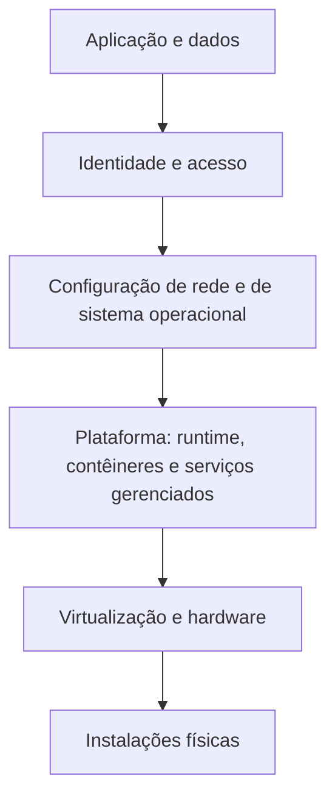

# Fundamentos de Forense em Nuvem e Responsabilidade Compartilhada

> **Objetivo pedagógico:** compreender como a computação em nuvem altera a prática forense (recursos efêmeros, plano de controle por API, multilocação, jurisdição e dependência do provedor), mapear as evidências disponíveis em cada modelo de serviço e estruturar a prontidão forense antes do incidente.

## 1. Por que a nuvem muda a forense

| Característica | Consequência para a investigação |
|---|---|
| Recursos efêmeros (instâncias, contêineres e funções) | A evidência pode desaparecer em minutos (reduções automáticas de escala, reciclagem e exclusão) |
| Infraestrutura definida por API (plano de controle) | Muito do que o atacante faz fica registrado em logs de auditoria da conta |
| Identidade como perímetro | Credenciais, chaves e tokens são o alvo principal; a investigação começa pela identidade |
| Multilocação | Não há acesso ao hardware físico nem a dados de outros clientes; a coleta usa as interfaces do provedor |
| Retenção de logs variável e, às vezes, desativada por padrão | Logs críticos podem não existir se não foram habilitados antes do incidente |
| Dados distribuídos em regiões e países | Jurisdição, residência de dados e transferência internacional |
| Dependência de terceiros | Parte das evidências só pode ser obtida do provedor, por processo formal |
| Automação e infraestrutura como código | O repositório de código e o pipeline de CI/CD também são fontes de evidência |
| Escala | Volumes de logs e de recursos exigem consulta e automação, e não análise manual |

## 2. Modelo de responsabilidade compartilhada

| Modelo | O cliente controla | O provedor controla | Evidências típicas ao alcance do cliente |
|---|---|---|---|
| IaaS (máquinas virtuais, redes e discos) | Sistema operacional, aplicações, dados, identidade e rede virtual | Hardware, virtualização e instalações | Discos (snapshots), memória (por agente), logs do SO, logs de rede e de auditoria |
| CaaS e Kubernetes gerenciado | Imagens, cargas de trabalho, configuração e identidade | Plano de controle (em parte), nós gerenciados e infraestrutura | Logs do cluster, auditoria da API, imagens e configuração |
| PaaS (bancos de dados e plataformas gerenciadas) | Aplicação, dados e identidade | Sistema operacional e plataforma | Logs de serviço, de auditoria e de acesso; snapshots |
| FaaS (funções) | Código, configuração e permissões | Execução e ambiente | Código, versões, logs de execução e de auditoria |
| SaaS | Dados, usuários e configuração | Aplicação e infraestrutura | Logs de auditoria e de acesso do serviço, exportações e retenção |

Regra prática: quanto mais alto o modelo (SaaS), menos evidências de baixo nível o cliente tem e mais depende dos logs e das APIs do provedor.

## 3. Prontidão forense em nuvem (antes do incidente)

| Controle | Descrição |
|---|---|
| Habilitar logs de auditoria em todas as contas, regiões e serviços | Plano de controle, acesso a dados de serviços críticos, rede e DNS |
| Centralizar logs em conta separada e protegida | Conta de arquivamento de logs com acesso restrito, imutabilidade (WORM) e retenção definida |
| Retenção adequada | Alinhada a requisitos legais e a necessidades investigativas (ver pasta 11) |
| Integridade dos logs | Validação de integridade, assinatura e controle de acesso |
| Sincronização de tempo | Registros em UTC; documentar fontes |
| Inventário de contas, recursos e identidades | Mapa de contas, projetos, assinaturas, chaves e provedores de identidade |
| Conta ou projeto forense dedicado | Ambiente pré-configurado para receber cópias de discos e executar análises |
| Permissões de resposta a incidentes | Funções específicas para resposta, com acesso de emergência (break-glass), registradas e monitoradas |
| Automação de preservação | Roteiros para snapshots, isolamento e coleta de logs |
| Contratos e contatos com o provedor | Canais de suporte, requisitos de processo legal e prazos |
| Exercícios | Simulações de incidentes em nuvem e testes de restauração |
| Gestão de segredos e de chaves | Rotação, detecção de vazamento e inventário de credenciais |

## 4. Aspectos legais, jurisdicionais e de privacidade

> **Aviso:** este material é técnico-educacional e não substitui parecer jurídico. Valide cada caso com o Jurídico e com o DPO.

| Tema | Orientação |
|---|---|
| Local dos dados | Dados podem estar em regiões e países distintos; mapeie as regiões usadas |
| Transferência internacional | LGPD, arts. 33 a 36 e a regulamentação da ANPD sobre transferência internacional de dados (confirme a norma vigente); cláusulas contratuais e bases legais |
| Acesso a dados mantidos pelo provedor | Depende dos termos do contrato, da retenção e de processo legal (ordem judicial, cooperação internacional) |
| Cooperação internacional | Instrumentos como a Convenção de Budapeste (Decreto nº 11.491/2023) e acordos de assistência jurídica |
| Dados de terceiros e multilocação | A coleta se limita aos recursos da organização; não acesse dados de outros clientes |
| Registros de acesso (Marco Civil) | Provedores de aplicação mantêm registros conforme os arts. 13 e 15; a organização, como cliente, mantém os seus |
| Contratos de nuvem | Cláusulas de auditoria, notificação de incidentes, retenção, cooperação forense e devolução de dados |
| Acesso do investigador | Autorização formal e uso de contas nominais e registradas |

## 5. Evidências por camada

| Camada | Exemplos de evidências | Onde obter |
|---|---|---|
| Identidade | Entradas, tokens, chaves de acesso, alterações de políticas e de funções | Logs do provedor de identidade e de auditoria da conta |
| Plano de controle | Criação, alteração e exclusão de recursos; mudanças de permissões | Logs de auditoria (por exemplo, CloudTrail, Cloud Audit Logs e Activity Log) |
| Plano de dados | Acesso a objetos, consultas a bancos e leitura de segredos | Logs de acesso a dados (frequentemente desativados por padrão) |
| Rede | Fluxos, DNS, balanceadores, WAF e firewalls | Logs de fluxo, de DNS e de serviços de rede |
| Cargas de trabalho | Discos, memória, logs do sistema, logs de contêiner e de funções | Snapshots, agentes, coletores de logs |
| Configuração | Histórico de configurações e inventário de recursos | Serviços de configuração e de inventário |
| Código e pipelines | Repositórios, execuções de CI/CD, segredos e artefatos | Plataformas de código e de entrega contínua |
| Faturamento e uso | Anomalias de consumo (por exemplo, mineração) | Painéis e alertas de custo |

## 6. Estratégia geral de resposta em nuvem

| Passo | Descrição |
|---|---|
| 1. Identificar o escopo | Contas, assinaturas, projetos, regiões, identidades e recursos envolvidos |
| 2. Preservar os logs | Exportar e proteger os logs antes que a retenção os elimine ou o atacante os altere |
| 3. Conter com preservação | Isolar recursos, desativar (e não excluir) credenciais e impedir a destruição de evidências |
| 4. Coletar as cargas de trabalho | Snapshots de discos, memória (quando viável), imagens e configuração |
| 5. Reconstruir a linha do tempo | Eventos do plano de controle, identidade, rede e carga de trabalho |
| 6. Determinar o impacto | Dados acessados, serviços alterados e custos |
| 7. Erradicar e recuperar | Remover persistência, rotacionar credenciais e reconstruir a partir de infraestrutura como código |
| 8. Aprimorar | Endurecer a configuração e a detecção |

Princípio: **desative em vez de excluir** (chaves, funções e instâncias), para preservar a evidência; e **copie antes de alterar**.

## 7. Exemplo prático: avaliação de prontidão

| Item | Situação | Lacuna |
|---|---|---|
| CloudTrail e logs de auditoria | Habilitados em todas as contas, com arquivamento em conta separada | Sem lacunas |
| Logs de acesso a dados do armazenamento de objetos | Desabilitados | Sem rastreio de leitura de objetos |
| Logs de fluxo de rede | Habilitados apenas na rede de produção | Redes de desenvolvimento sem cobertura |
| Retenção | 30 dias | Insuficiente para investigações tardias |
| Conta forense | Inexistente | Atraso na análise de snapshots |
| Inventário de credenciais | Parcial | Chaves de acesso desconhecidas |
| Resultado | Plano de ação com prazos e responsáveis |

## 8. Casos de uso corporativos

- Avaliação de prontidão forense antes de uma migração ou de uma certificação.
- Definição dos requisitos de logs e de retenção em contratos de nuvem.
- Estruturação de um ambiente de análise forense em nuvem.

## 9. Normas e frameworks relevantes

- NIST SP 800-201: NIST Cloud Computing Forensic Reference Architecture; NIST IR 8006: NIST Cloud Computing Forensic Science Challenges
- ISO/IEC 27017 (controles de segurança para serviços em nuvem); ISO/IEC 27018 (proteção de dados pessoais em nuvem); ISO/IEC 27037, 27041, 27042 e 27043
- CSA Security Guidance for Critical Areas of Focus in Cloud Computing e Cloud Controls Matrix; CIS Benchmarks para provedores de nuvem
- MITRE ATT&CK for Cloud (IaaS, SaaS e identidade)
- LGPD, arts. 33 a 36 e 46; Marco Civil da Internet, arts. 10, 13 e 15

## 10. Referências

- NIST SP 800-201. NIST Cloud Computing Forensic Reference Architecture. 2023.
- NIST IR 8006. NIST Cloud Computing Forensic Science Challenges. 2020.
- Cloud Security Alliance. Security Guidance v4.
- AWS Security Incident Response Guide; Google Cloud. Documentação de resposta a incidentes; Microsoft. Documentação de resposta a incidentes em Azure.
- SANS Institute. FOR509: Enterprise Cloud Forensics and Incident Response.
- Brasil. Lei nº 13.709/2018; Lei nº 12.965/2014.
