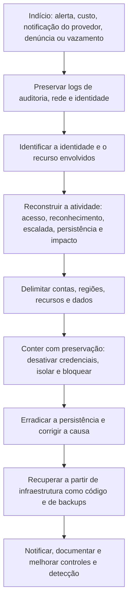

# Investigação de Incidentes Típicos em Nuvem

> **Objetivo pedagógico:** investigar os cenários de incidente mais frequentes em ambientes de nuvem (credenciais vazadas, exposição de armazenamento, abuso de recursos, escalada de privilégios, persistência, exfiltração, destruição de dados, ataques à cadeia de entrega e roubo de credenciais de metadados), identificando os indícios, os logs e as ações de resposta de cada um.

## 1. Mapa dos cenários

| Cenário | Vetor ou causa comum | Impacto |
|---|---|---|
| Credencial ou chave vazada | Repositórios públicos, arquivos de configuração e logs com segredos | Acesso à conta, abuso de recursos e acesso a dados |
| Armazenamento exposto | Configuração pública, políticas permissivas | Vazamento de dados |
| Abuso de recursos (cryptojacking) | Credenciais comprometidas, serviços expostos | Custos elevados e degradação |
| Escalada de privilégios no IAM | Permissões excessivas, `PassRole` e alteração de políticas | Controle administrativo |
| Persistência | Novas chaves, usuários, funções, funções serverless e aplicativos | Acesso prolongado |
| Exfiltração para outra conta | Compartilhamento de snapshots e de imagens, replicação e cópia de objetos | Perda de dados |
| Destruição e ransomware em nuvem | Exclusão de recursos e de versões, criptografia com chaves do atacante | Indisponibilidade e perda de dados |
| Roubo de credenciais de metadados | SSRF em aplicações e serviços de metadados sem proteção | Credenciais da instância |
| Comprometimento de CI/CD e de código | Segredos em pipelines, ações maliciosas e dependências | Cadeia de suprimentos |
| Comprometimento de contêineres e do cluster | Painéis expostos, imagens maliciosas e privilégios excessivos | Controle do cluster |
| Insider | Abuso de acesso legítimo | Vazamento e sabotagem |
| Sequestro de DNS e de subdomínios | Registros apontando para recursos excluídos | Phishing e distribuição de malware |

## 2. Fluxo geral de investigação

## 3. Cenários em detalhe

### 3.1 Credencial ou chave vazada

| Item | Descrição |
|---|---|
| Indícios | Alerta do provedor sobre credencial exposta; uso por IP e agente incomuns; atividade fora do horário e do padrão |
| Logs | Auditoria do plano de controle e eventos de identidade |
| Investigação | Primeiro uso suspeito, ações realizadas, recursos criados, permissões alteradas, dados acessados |
| Resposta | Desativar a chave, revogar sessões, rotacionar segredos relacionados, remover persistência, varrer repositórios e pipelines por segredos |
| ATT&CK | T1552.001, T1078.004 |

### 3.2 Armazenamento exposto

| Item | Descrição |
|---|---|
| Indícios | Bucket ou contêiner com acesso público; alerta de postura; denúncia de terceiros |
| Logs | Eventos de configuração (`PutBucketPolicy`, `PutBucketAcl`, `DeletePublicAccessBlock`), logs de acesso e eventos de dados |
| Investigação | Quando passou a ser público, por quem e por qual mudança; quais objetos eram acessíveis; acessos externos (IPs não autenticados) |
| Resposta | Bloquear o acesso público, preservar a configuração e os logs, classificar os dados e avaliar a notificação |
| ATT&CK | T1530 |

Sem logs de acesso a dados, não há como saber quais objetos foram baixados; considere o pior caso na avaliação do impacto.

### 3.3 Abuso de recursos (cryptojacking)

| Item | Descrição |
|---|---|
| Indícios | Aumento de custos, instâncias de GPU ou de grande porte em regiões incomuns, uso de CPU contínuo |
| Logs | Criação de instâncias, logs de fluxo (conexões a pools de mineração), DNS, GuardDuty e alertas de custo |
| Investigação | Credenciais usadas, vetor de acesso, recursos criados e persistência (gatilhos, funções e imagens) |
| Resposta | Remover recursos após snapshots, restringir regiões e tipos por políticas, orçamentos com alertas |
| ATT&CK | T1496, T1578.002 |

### 3.4 Escalada de privilégios no IAM

| Item | Descrição |
|---|---|
| Indícios | `CreatePolicyVersion`, `AttachUserPolicy`, `PutUserPolicy`, `UpdateAssumeRolePolicy`, `SetIamPolicy`, permissões `PassRole` abusadas |
| Investigação | Quem recebeu qual permissão, por quem e quando; identificar caminhos de escalada |
| Resposta | Reverter as alterações (registrando o estado anterior), revisar políticas e limites de permissões |
| ATT&CK | T1098, T1484 |

### 3.5 Persistência

| Mecanismo | Indícios |
|---|---|
| Novas chaves de acesso e usuários | `CreateAccessKey`, `CreateUser`, `CreateLoginProfile` |
| Funções com confiança externa | `UpdateAssumeRolePolicy` ou criação de função confiando em conta desconhecida |
| Funções serverless e tarefas agendadas | `CreateFunction`, `UpdateFunctionCode` e regras de eventos novas |
| Aplicativos e consentimentos OAuth | Registros de aplicativos e concessões (ver pastas 18 e 19) |
| Imagens e modelos de inicialização alterados | Alterações em AMIs, modelos de lançamento e scripts de inicialização |
| Chaves SSH em instâncias | Alterações de `authorized_keys` (ver pasta 08) |
| ATT&CK | T1098.001, T1136.003, T1053 e T1546 |

### 3.6 Exfiltração para outra conta

| Mecanismo | Indícios |
|---|---|
| Compartilhamento de snapshots, AMIs e bancos de dados | `ModifySnapshotAttribute`, `ModifyImageAttribute` e compartilhamento de snapshots de bancos |
| Replicação e cópia de objetos entre contas | `PutBucketReplication`, `CopyObject` com destino externo |
| Transferência por rede | Grandes volumes de saída nos logs de fluxo |
| Resposta | Revogar os compartilhamentos, identificar a conta de destino, avaliar a exposição e solicitar a atuação do provedor |
| ATT&CK | T1537, T1567, T1530 |

### 3.7 Destruição e ransomware em nuvem

| Mecanismo | Indícios |
|---|---|
| Exclusão de recursos, de versões e de backups | `DeleteObject`, `DeleteObjectVersion`, `DeleteBucket`, `DeleteDBInstance`, `DeleteSnapshot` |
| Criptografia com chave do atacante | Objetos recriados com a chave de outra conta; alteração de criptografia |
| Desativação de proteções | Remoção de versionamento e de Object Lock (quando possível), exclusão de chaves |
| Resposta | Parar a atividade, preservar logs, recuperar de versões, backups imutáveis e réplicas isoladas |
| ATT&CK | T1485, T1486, T1490 |

### 3.8 Roubo de credenciais de metadados (SSRF)

| Item | Descrição |
|---|---|
| Indícios | Credenciais da função da instância usadas de IP externo; requisições com URLs para o serviço de metadados em logs da aplicação e do WAF |
| Investigação | A aplicação vulnerável, as requisições, as credenciais emitidas e as ações realizadas com elas |
| Resposta | Corrigir a falha, exigir o IMDSv2 (ou controles equivalentes), reduzir as permissões da função e rotacionar |
| ATT&CK | T1552.005, T1190 |

### 3.9 CI/CD e cadeia de suprimentos

| Item | Descrição |
|---|---|
| Indícios | Execuções de pipeline fora do padrão, segredos expostos em logs de build, dependências novas, alterações em arquivos de pipeline |
| Investigação | Commits, tokens, execuções, artefatos publicados e implantações realizadas |
| Resposta | Rotacionar segredos do pipeline, revisar artefatos e imagens publicados, revisar as dependências e os acessos |
| ATT&CK | T1195, T1199 |

### 3.10 Contêineres e clusters

| Item | Descrição |
|---|---|
| Indícios | Painéis e APIs expostos, pods privilegiados criados, imagens desconhecidas, uso de CPU anômalo |
| Logs | Auditoria da API do Kubernetes, logs do nó e de contêineres |
| Resposta | Isolar o pod e o nó, preservar, rotacionar segredos montados, revisar RBAC e políticas |
| ATT&CK | T1610, T1611, T1613 |

## 4. Tabela de eventos críticos por provedor (referência rápida)

| Objetivo do atacante | AWS (CloudTrail) | Google Cloud (Audit Logs) |
|---|---|---|
| Reconhecimento | `ListBuckets`, `DescribeInstances`, `GetAccountAuthorizationDetails` | `GetIamPolicy`, `ListServiceAccounts`, `compute.instances.list` |
| Persistência de identidade | `CreateAccessKey`, `CreateUser`, `UpdateAssumeRolePolicy` | `CreateServiceAccountKey`, `SetIamPolicy` |
| Escalada | `AttachUserPolicy`, `CreatePolicyVersion` | `SetIamPolicy`, personificação de contas de serviço |
| Evasão | `StopLogging`, `DeleteTrail`, `DeleteFlowLogs` | `DeleteSink`, alterações de exclusões de logs |
| Exfiltração | `ModifySnapshotAttribute`, `CopyObject`, `PutBucketReplication` | `compute.snapshots.setIamPolicy`, `storage.setIamPermissions` |
| Abuso de recursos | `RunInstances` | `compute.instances.insert` |
| Dados | `GetObject` (eventos de dados), `GetSecretValue` | `storage.objects.get` (Data Access), `AccessSecretVersion` |

## 5. Exemplo prático: investigação de persistência por função com confiança externa

| Hora (UTC) | Evento | Interpretação |
|---|---|---|
| 03:10 | `CreateRole` "AuditoriaSuporte" com política de confiança para a conta externa `444455556666` | Porta dos fundos (T1098) |
| 03:11 | `AttachRolePolicy` com `AdministratorAccess` | Privilégio total |
| 03:40 | `AssumeRole` por essa função, a partir de IP externo, na conta da vítima | Uso da persistência |
| 03:42 a 04:10 | `ListBuckets`, `GetObject` em massa e `ModifySnapshotAttribute` para a conta externa | Coleta e exfiltração |
| Resposta | Registrar a configuração da função, removê-la, revogar as sessões, revisar o compartilhamento dos snapshots, notificar o provedor e avaliar os dados |

## 6. Casos de uso corporativos

- Elaboração de manuais de resposta por cenário para o SOC e o time de nuvem.
- Detecções para eventos críticos de IAM, evasão e exfiltração em nuvem.
- Exercícios de simulação com cenários de credenciais vazadas e armazenamento exposto.

## 7. Normas e frameworks relevantes

- MITRE ATT&CK for Cloud: T1078.004, T1098, T1136.003, T1484, T1496, T1530, T1537, T1552, T1562.008, T1578, T1485, T1486, T1195, T1610, T1611
- NIST SP 800-61 Rev. 3; NIST SP 800-201; ISO/IEC 27017
- CIS Benchmarks (AWS, Azure, GCP, Kubernetes); CIS Controls v8.1, controles 3, 5, 6, 8 e 17
- LGPD, arts. 46 e 48

## 8. Referências

- MITRE ATT&CK for Cloud. https://attack.mitre.org
- AWS, Google Cloud e Microsoft. Guias de resposta a incidentes e documentação de auditoria.
- Datadog. Stratus Red Team (técnicas de ataque em nuvem para teste de detecção).
- Rhino Security Labs. CloudGoat. Wiz. The Big IAM Challenge.
- The DFIR Report; relatórios públicos de incidentes em nuvem.
- SANS Institute. FOR509 e SEC541.
