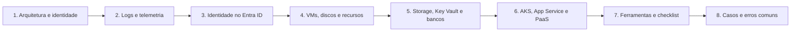

# 18 Forense em Azure

## Objetivo

Investigar incidentes no Microsoft Azure e no Microsoft Entra ID: compreender a hierarquia e o modelo de identidade, preservar e consultar logs de identidade, de plano de controle e de plano de dados, investigar o comprometimento de identidades, adquirir máquinas virtuais, discos e serviços de plataforma (Storage, Key Vault, bancos de dados, AKS e App Service), conter com preservação e relatar com integridade, base legal e limitações declaradas. O Microsoft 365 é tratado na pasta 19.

## Trilha de estudo recomendada

## Conteúdo da pasta

| Ordem | Arquivo | Objetivo |
|---|---|---|
| 1 | [arquitetura-do-azure-e-modelo-de-identidade-para-forense.md](arquitetura-do-azure-e-modelo-de-identidade-para-forense.md) | Hierarquia, Entra ID, RBAC, PIM, identidades e prontidão forense |
| 2 | [logs-e-telemetria-do-azure-e-do-entra-id.md](logs-e-telemetria-do-azure-e-do-entra-id.md) | Fontes de log, retenções, diagnóstico, KQL e preservação |
| 3 | [investigacao-de-identidade-no-entra-id.md](investigacao-de-identidade-no-entra-id.md) | Entradas, tokens, aplicativos, consentimentos, privilégios e federação |
| 4 | [aquisicao-de-vms-discos-e-recursos-no-azure.md](aquisicao-de-vms-discos-e-recursos-no-azure.md) | Bloqueios, isolamento, snapshots, criptografia e assinatura forense |
| 5 | [storage-key-vault-e-bancos-de-dados-no-azure.md](storage-key-vault-e-bancos-de-dados-no-azure.md) | Acesso a dados, SAS, cofres, bancos, recuperação e contenção |
| 6 | [aks-app-service-e-servicos-paas-no-azure.md](aks-app-service-e-servicos-paas-no-azure.md) | AKS, App Service, Functions, ACR, Automation e pipelines |
| 7 | [ferramentas-fluxo-modelos-e-checklist-de-azure.md](ferramentas-fluxo-modelos-e-checklist-de-azure.md) | Ferramentas, permissões, fluxo, modelos e checklist |
| 8 | [casos-de-uso-e-erros-comuns-em-azure.md](casos-de-uso-e-erros-comuns-em-azure.md) | Sete cenários, erros comuns e exercícios |

## Princípios

- Separar o plano de identidade (Entra ID) do plano de recursos (Azure Resource Manager) e investigar ambos
- Exportar os logs para retenção própria, com imutabilidade, antes que a retenção nativa os elimine
- Habilitar o diagnóstico dos recursos por política, em todas as assinaturas
- Analisar as quatro categorias de entradas: interativas, não interativas, de entidades de serviço e de identidades gerenciadas
- Tratar aplicativos, consentimentos, funções privilegiadas e federação como vetores de persistência
- Preservar antes de conter: bloquear, isolar, copiar e só então remover; desativar em vez de excluir
- Garantir chaves de criptografia, permissões e proteção contra expurgo para a assinatura forense
- Declarar as limitações de logs e considerar o pior caso quando não houver evidência do plano de dados

## Relação com outras pastas

- 02-cadeia-de-custodia e 04-hash-e-integridade: custódia e hash das cópias e dos logs
- 05-timeline-analysis: linha do tempo unificada
- 08-linux-forensics, 09-memory-forensics e 10-disk-forensics: análise de VMs, memória e discos
- 11-log-analysis: KQL, Sigma e detecção
- 12-email-forensics: phishing que origina o comprometimento de identidades
- 15-malware-forensics e 16-ransomware-investigation: cargas maliciosas e ransomware
- 17-cloud-forensics: fundamentos de nuvem, AWS, GCP e cargas de trabalho
- 19-m365-forensics: e-mail, arquivos e auditoria unificada do Microsoft 365

## Referências

- Microsoft Learn. Documentação do Microsoft Entra ID, do Azure Monitor, do Log Analytics, do Microsoft Sentinel e do Defender for Cloud
- Microsoft. Incident response playbooks; Microsoft Cloud Security Benchmark
- NIST SP 800-201 (2023); NIST SP 800-61 Rev. 3 (2025); NIST SP 800-63B; NIST SP 800-190
- ISO/IEC 27017; ISO/IEC 27018; ISO/IEC 27037, 27041, 27042 e 27043
- CIS Microsoft Azure Foundations Benchmark
- MITRE ATT&CK for Cloud
- Invictus IR. Microsoft-Extractor-Suite; SpecterOps. AzureHound; Mollema, D. ROADtools; Datadog. Stratus Red Team
- Brasil. Lei nº 13.709/2018 (LGPD)
- SANS Institute. FOR509: Enterprise Cloud Forensics and Incident Response; SEC541
