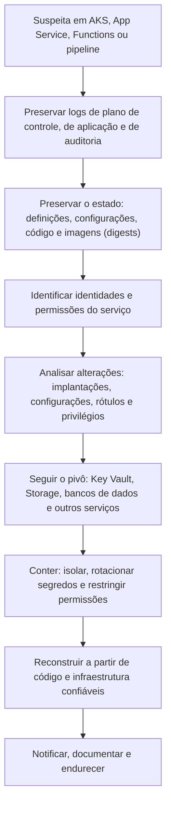

# AKS, App Service e Serviços PaaS no Azure

> **Objetivo pedagógico:** investigar serviços de plataforma do Azure (AKS, App Service, Functions, Container Registry, Automation e pipelines de entrega), identificando as fontes de log, os artefatos de persistência e abuso, e preservando o estado desses recursos efêmeros ou gerenciados.

## 1. Visão geral dos serviços e do que o cliente controla

| Serviço | O cliente controla | Evidências principais |
|---|---|---|
| AKS (Kubernetes gerenciado) | Cargas de trabalho, RBAC, imagens, configurações e nós de trabalho (parcialmente) | Logs de auditoria da API (via diagnóstico), definições de pods, logs de contêineres, discos dos nós |
| App Service | Código, configuração e identidade | Logs HTTP, de aplicação e de implantação, console de gerenciamento (Kudu), configurações |
| Functions | Código, gatilhos, configuração e identidade | Código, configurações, logs de execução e de implantação |
| Container Registry (ACR) | Imagens e acesso | Eventos de autenticação e de repositório |
| Automation e Logic Apps | Runbooks, credenciais, conexões e gatilhos | Log de atividade, execuções e configuração |
| Azure DevOps e GitHub Actions | Pipelines, conexões de serviço e segredos | Logs de auditoria da plataforma e execuções |
| Azure Firewall, Application Gateway e WAF | Regras e políticas | Logs de acesso e de bloqueio |

## 2. AKS

### 2.1 Fontes

| Fonte | Observação |
|---|---|
| Logs do plano de controle (`kube-audit` e `kube-audit-admin`) | Habilitar por configurações de diagnóstico; registram chamadas à API do Kubernetes (quem criou, alterou ou excluiu recursos) |
| `kube-apiserver`, `cluster-autoscaler` e outros logs do plano de controle | Contexto |
| Container Insights e logs de contêineres | Saída dos contêineres e métricas |
| Log de atividade | Operações de gerenciamento do cluster (por exemplo, obter credenciais, escalar e alterar o cluster) |
| Entradas do Entra ID | Autenticação ao cluster, quando integrada |
| Defender for Containers | Alertas de comportamento, de imagens e de configuração |
| Discos e memória dos nós | Tratados como VMs (arquivos anteriores) |

### 2.2 Indícios de comprometimento

| Indício | Interpretação |
|---|---|
| Criação de pods privilegiados ou com `hostPath`, `hostPID` ou `hostNetwork` | Tentativa de escapar para o nó (T1611) |
| Novas ligações de função de cluster (ClusterRoleBinding) para o grupo `system:anonymous` ou para contas incomuns | Escalada e persistência |
| Implantações com imagens de registros desconhecidos | Execução de código malicioso (T1610) |
| Leitura em massa de segredos | Coleta de credenciais (T1552.007) |
| Uso do token da conta de serviço de dentro de um pod fora do padrão | Movimentação |
| Exposição de painéis e de serviços por balanceadores públicos | Acesso inicial |
| Consumo anômalo de CPU | Mineração (T1496) |

### 2.3 Preservação

```bash
# Obter credenciais do cluster com conta de investigação (registra o acesso)
az aks get-credentials --resource-group RG --name aks-exemplo --file kubeconfig_dfl --overwrite-existing

# Preservar a definição, o estado e os logs do pod
kubectl get pod POD -n NS -o yaml > pod_E021.yaml
kubectl describe pod POD -n NS > pod_E021_describe.txt
kubectl logs POD -n NS --all-containers --timestamps > pod_E021_logs.txt
kubectl logs POD -n NS --all-containers --previous --timestamps > pod_E021_logs_anterior.txt 2>/dev/null

# Manter o pod para análise e permitir que o controlador crie um substituto: remover os rótulos que o ligam ao controlador e ao serviço
kubectl label pod POD -n NS app- quarentena=DFL-2026-001 --overwrite

# Impedir novos pods no nó suspeito
kubectl cordon NO_SUSPEITO
```

Para investigar o nó, use os procedimentos de VMs (snapshots e memória) sobre o conjunto de escala do pool de nós, retirando o nó do conjunto de forma controlada. Para persistência na API, liste: `ClusterRoleBinding`, `RoleBinding`, `CronJob`, `DaemonSet`, `MutatingWebhookConfiguration` e contas de serviço.

## 3. App Service e Functions

### 3.1 Fontes

| Fonte | Conteúdo |
|---|---|
| `AppServiceHTTPLogs` | Requisições HTTP: IP, método, URI, status, user-agent e bytes |
| `AppServiceConsoleLogs` e `AppServiceAppLogs` | Saída e logs da aplicação |
| `AppServiceAuditLogs` | Autenticações em FTP e no console de gerenciamento (Kudu) |
| `AppServiceIPSecAuditLogs` | Decisões de restrição de IP |
| Log de implantação | Histórico de implantações, origem e usuário |
| Configurações do aplicativo | Variáveis, cadeias de conexão e segredos (dados sensíveis: manusear com cuidado) |
| Identidade gerenciada | Permissões do aplicativo a outros recursos |
| Functions: código, gatilhos e logs de execução | Alterações de código e de gatilhos indicam persistência |

### 3.2 Indícios de comprometimento

| Indício | Interpretação |
|---|---|
| Arquivos novos ou alterados no diretório do aplicativo e requisições POST repetidas a um mesmo arquivo recente | Webshell (T1505.003; ver pasta 15) |
| Autenticações no console de gerenciamento (Kudu) ou em FTP de IPs incomuns | Acesso administrativo ao aplicativo |
| Implantação fora do pipeline ou por usuário incomum | Alteração de código |
| Novas configurações de aplicativo, cadeias de conexão e domínios personalizados | Preparação de abuso |
| Uso da identidade gerenciada para acessar o Key Vault e o Storage | Pivô para dados |
| Taxa elevada de saída | Exfiltração |

```bash
# Baixar os logs do App Service para análise (os arquivos podem conter dados sensíveis)
az webapp log download --resource-group RG --name app-exemplo --log-file app_E022_logs.zip

# Listar as configurações do aplicativo (contêm segredos: proteger e registrar o acesso)
az webapp config appsettings list --resource-group RG --name app-exemplo --output json > app_E022_settings.json

# Listar os históricos de implantação (por exemplo, em Functions)
az functionapp deployment list-publishing-credentials --resource-group RG --name func-exemplo >/dev/null 2>&1   # evite exportar credenciais; use apenas para verificar acesso, se autorizado
```

Os arquivos do aplicativo podem ser obtidos pelo console de gerenciamento (Kudu) ou por pacotes de implantação; para preservar, copie o conteúdo para armazenamento protegido, calcule o hash e compare com o repositório de código.

## 4. Container Registry (ACR)

| Fonte | Conteúdo |
|---|---|
| `ContainerRegistryLoginEvents` | Autenticações no registro |
| `ContainerRegistryRepositoryEvents` | Envio (`push`), obtenção (`pull`) e exclusão de imagens |
| Log de atividade | Alterações de configuração e de acesso |
| Indícios | Imagem com o mesmo rótulo sobrescrita, envio de imagens por identidade incomum, credenciais de administrador habilitadas e usadas |

Preserve os resumos (digests) das imagens implantadas: o rótulo (`tag`) pode ser movido, mas o digest identifica o conteúdo. Compare o digest implantado com o digest legítimo do pipeline.

## 5. Automation, Logic Apps e pipelines

| Serviço | Evidências e riscos |
|---|---|
| Automation (runbooks, webhooks e credenciais) | Runbooks criados ou alterados, webhooks expostos, contas Run As e identidades gerenciadas com privilégios; usados para persistência e execução (T1651 e T1053) |
| Logic Apps | Conexões com credenciais de terceiros e fluxos que encaminham dados |
| Azure DevOps | Logs de auditoria (fluxos de auditoria), conexões de serviço com permissões amplas, alterações em pipelines e variáveis secretas |
| GitHub Actions e credenciais federadas | Confianças de identidade de carga de trabalho excessivamente amplas; execuções fora do padrão |
| Funções do pipeline | Permissões que permitem implantar e alterar recursos |

Em incidentes de cadeia de suprimentos, preserve os logs de auditoria da plataforma de código e de entrega, o histórico de execuções e os artefatos publicados, e rotacione os segredos e as credenciais federadas.

## 6. Rede, WAF e firewall

| Fonte | Uso |
|---|---|
| Logs do Application Gateway e do WAF | Tentativas de exploração, regras acionadas e IPs |
| Azure Firewall | Conexões permitidas e negadas, regras de aplicação e inteligência de ameaças |
| Logs de fluxo de rede | Conexões entre recursos (confirme o recurso vigente) |
| DNS | Consultas do ambiente (conforme habilitação) |

## 7. Fluxo de investigação de serviços PaaS



## 8. Exemplo prático: webshell em App Service

| Hora (UTC) | Evento | Interpretação |
|---|---|---|
| D-2, 21:02 | `AppServiceHTTPLogs`: `POST /upload` com 200 e arquivo enviado | Exploração de upload inseguro (T1190) |
| D-2, 21:05 | Novos arquivos no diretório do aplicativo; requisições POST ao arquivo novo, com parâmetros codificados | Webshell (T1505.003) |
| D-2, 21:20 | O aplicativo, por sua identidade gerenciada, lê segredos do Key Vault (log do cofre) | Pivô para dados (T1552) |
| D-2, 21:40 | `StorageBlobLogs`: leitura em massa por essa identidade | Exfiltração (T1530) |
| Resposta | Preservar os arquivos e os logs; parar e reconstruir o aplicativo a partir do pipeline; remover a permissão da identidade ao cofre; rotacionar os segredos lidos; corrigir o upload; avaliar os dados acessados |

## 9. Casos de uso corporativos

- Investigação de clusters AKS comprometidos e de implantações maliciosas.
- Resposta a webshells e a abuso de aplicativos em App Service.
- Revisão de pipelines, conexões de serviço e credenciais federadas.

## 10. Normas e frameworks relevantes

- MITRE ATT&CK for Cloud e para contêineres: T1610, T1611, T1613, T1552.007, T1505.003, T1190, T1651, T1195, T1496
- NIST SP 800-190 (contêineres); NIST SP 800-201; NIST SP 800-61 Rev. 3
- CIS Benchmarks (Azure, Kubernetes e Docker); Microsoft Cloud Security Benchmark
- CIS Controls v8.1, controles 4, 8, 16 e 17

## 11. Referências

- Microsoft Learn. AKS (registros de recursos e auditoria), App Service (diagnóstico e Kudu), Azure Functions, Azure Container Registry, Azure Automation e Azure DevOps (auditoria).
- Microsoft. Threat Matrix for Kubernetes e Defender for Containers.
- Souppaya, M.; Morello, J.; Scarfone, K. NIST SP 800-190. 2017.
- Documentação do `kubectl`, do Azure CLI e do GitHub Actions (OIDC).
- MITRE ATT&CK. https://attack.mitre.org
- SANS Institute. FOR509.
