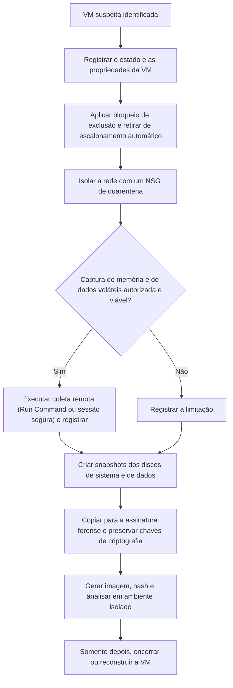

# Aquisição de VMs, Discos e Recursos no Azure

> **Objetivo pedagógico:** preservar e adquirir máquinas virtuais, discos e metadados no Azure, aplicando bloqueios e isolamento sem destruir evidências, criando snapshots, tratando a criptografia de discos, copiando para uma assinatura forense, capturando dados voláteis por meios remotos e mantendo a cadeia de custódia.

## 1. Princípios

| Princípio | Aplicação |
|---|---|
| Preservar logs primeiro | Log de atividade, entradas e logs de recursos (arquivo anterior) |
| Impedir a exclusão e a reciclagem | Bloqueios de recurso, remoção de conjuntos de escala e proteção de backups |
| Isolar sem desligar | Alterar a rede; manter a VM ligada para dados voláteis, quando autorizado |
| Copiar antes de alterar | Snapshots de todos os discos |
| Trabalhar em assinatura forense | Cópias e análise fora do ambiente comprometido |
| Documentar | Identificadores, chaves, horários e comandos |
| Desativar, e não excluir | Credenciais, extensões e acessos |

## 2. Fluxo de preservação de uma VM



## 3. Registro inicial e proteção

```bash
# Registrar o estado e a configuração da VM (salvar como evidência com hash)
az vm show --resource-group RG --name VM-EXEMPLO --output json > vm_E020_show.json
az vm get-instance-view --resource-group RG --name VM-EXEMPLO --output json > vm_E020_instanceview.json
az network nic list --resource-group RG --query "[?virtualMachine.id!=null]" --output json > nics_E020.json
az vm extension list --resource-group RG --vm-name VM-EXEMPLO --output json > vm_E020_extensoes.json

# Bloqueio contra exclusão (ReadOnly pode impedir operações necessárias; prefira CanNotDelete)
az lock create --name dfl-2026-001-hold --lock-type CanNotDelete \
  --resource-group RG --resource-name VM-EXEMPLO --resource-type Microsoft.Compute/virtualMachines
```

| Proteção | Observação |
|---|---|
| Bloqueios de recurso (`CanNotDelete`) | Impedem a exclusão acidental ou maliciosa, mas quem tem permissão pode removê-los; monitore |
| Conjuntos de escala (VMSS) | Retire a instância do conjunto ou desative a reciclagem automática (ver as opções de proteção de instância) |
| Backups e exclusão reversível | Preserve pontos de restauração anteriores ao incidente; verifique a proteção do cofre de backup |
| Extensões de VM | Liste-as: o atacante pode usá-las para execução e persistência |

## 4. Isolamento de rede

| Método | Descrição | Cuidado |
|---|---|---|
| NSG de quarentena na interface de rede | Associar um grupo de segurança de rede sem permissões de entrada e de saída | Conexões estabelecidas podem persistir; verifique o comportamento e, se necessário, desassocie a interface |
| Remoção do IP público | Reduz a exposição | Não impede o acesso interno |
| Rotas e firewall | Rotas definidas pelo usuário e regras no Azure Firewall | Para segmentos inteiros |
| Desligar a VM | Libera a CPU, mas perde a memória | Decisão do líder, documentada |

```bash
# Associar um NSG de quarentena (previamente criado, com regras de negação) à interface de rede
az network nic update --resource-group RG --name nic-vm-exemplo --network-security-group nsg-quarentena
```

## 5. Dados voláteis e memória

O Azure não oferece, para VMs comuns, um instantâneo de memória sob demanda. A coleta usa o acesso remoto autorizado, com os riscos de alterar o estado e de o sistema estar comprometido.

| Mecanismo | Observação |
|---|---|
| Run Command (`az vm run-command invoke`) | Executa scripts sem credenciais de rede; **o uso fica registrado no log de atividade** |
| Azure Bastion, SSH e RDP | Sessões interativas; registrar |
| Serial Console e diagnóstico de inicialização | Logs de boot e captura de tela, úteis em VMs inacessíveis |
| Ferramentas de memória | AVML (Linux), LiME e WinPmem (Windows); gravar em disco de evidências anexado ou em armazenamento |

```bash
# Coleta rápida de estado volátil em Linux por Run Command (salvar a saída; documentar)
az vm run-command invoke --resource-group RG --name VM-EXEMPLO --command-id RunShellScript \
  --scripts "date -u; uname -a; uptime; ps auxwwf; ss -tunap; lsof -nP -i; who; last -a | head -50" \
  --output json > volatil_E020.json
```

Para memória completa, copie a ferramenta de aquisição para um local confiável, execute-a e transfira o resultado a armazenamento protegido, calculando o hash. Procedimentos em memória: pasta 09.

## 6. Snapshots e cópia para a assinatura forense

```bash
# Identificar os discos da VM
az vm show --resource-group RG --name VM-EXEMPLO \
  --query "{os:storageProfile.osDisk.managedDisk.id, dados:storageProfile.dataDisks[].managedDisk.id}" --output json

# Criar o snapshot de um disco (repita para cada disco)
az snapshot create --resource-group RG --name snap-dfl-2026-001-e020-os \
  --source "/subscriptions/<SUB>/resourceGroups/RG/providers/Microsoft.Compute/disks/disco-os-exemplo" \
  --tags Caso=DFL-2026-001 Evidencia=E020

# Gerar acesso temporário somente leitura (URL SAS) para copiar o conteúdo
az snapshot grant-access --resource-group RG --name snap-dfl-2026-001-e020-os \
  --duration-in-seconds 7200 --access-level Read --query accessSAS --output tsv

# Copiar para uma conta de armazenamento na assinatura forense (a URL SAS é segredo: não a registre em texto claro)
az storage blob copy start --destination-container evidencias --destination-blob e020-os.vhd \
  --account-name stforense --source-uri "<URL_SAS_DO_SNAPSHOT>"

# Revogar o acesso ao final
az snapshot revoke-access --resource-group RG --name snap-dfl-2026-001-e020-os
```

Depois da cópia, recrie o disco gerenciado na assinatura forense a partir do VHD e anexe-o a uma VM de análise, **sem montar com escrita**. Registre os identificadores, as assinaturas, as regiões e os hashes. O volume e a ferramenta exatos de recriação do disco variam; consulte a documentação vigente.

| Cuidado | Observação |
|---|---|
| A URL SAS é uma credencial temporária | Proteja e revogue; evite registrá-la em logs e relatórios |
| Região e rede | A cópia entre regiões gera tráfego; planeje o tempo e os custos |
| Snapshots incrementais e completos | Escolha conforme a necessidade de independência da cópia |
| Etiquetas | Registrar caso, evidência e responsável |

## 7. Criptografia de discos

| Tipo | Efeito na aquisição |
|---|---|
| Criptografia do lado do servidor com chaves gerenciadas pela plataforma (padrão) | O snapshot e a cópia são cifrados de forma transparente; o acesso ao conteúdo é concedido pela plataforma ao recriar o disco |
| Criptografia com chaves gerenciadas pelo cliente (CMK, por meio de um conjunto de criptografia de disco) | A assinatura forense precisa ter acesso ao conjunto de criptografia e à chave no Key Vault |
| Azure Disk Encryption (BitLocker ou DM-Crypt) | Os segredos de recuperação ficam no Key Vault; sem eles, o volume copiado fica ilegível. Preserve o cofre e registre as chaves usadas |
| Discos confidenciais e criptografia no host | Cenários específicos; verificar a documentação |

Planeje na prontidão: **chaves e permissões** para a assinatura forense, e proteção contra exclusão das chaves (exclusão reversível e proteção contra expurgo no Key Vault).

## 8. Análise na assinatura forense

Siga o mesmo procedimento do arquivo de aquisição em nuvem da pasta 17: anexar o disco à VM de análise, gerar a imagem bruta com hash, montar somente leitura (`ro,noload` em ext4; `ro,norecovery,nouuid` em XFS; disco somente leitura no Windows) e analisar com as ferramentas das pastas 07, 08 e 10. Em VMs Windows, procure também artefatos de extensões e de Run Command (por exemplo, diretórios de extensões do agente do Azure e logs do agente).

| Artefato específico do Azure | Onde |
|---|---|
| Logs do agente da VM (Windows) | `C:\WindowsAzure\Logs` |
| Extensões instaladas e seus resultados | `C:\Packages\Plugins` e `C:\WindowsAzure\Logs\Plugins` |
| Run Command (Windows) | Subpastas de extensões `Microsoft.CPlat.Core.RunCommandWindows` |
| Logs do agente (Linux) | `/var/log/waagent.log` e `/var/lib/waagent` |
| Extensões e scripts (Linux) | `/var/lib/waagent/` (pacotes e diretórios de extensões) |
| `cloud-init` (Linux) | `/var/log/cloud-init.log` e `/var/log/cloud-init-output.log` |

## 9. Cadeia de custódia e documentação

| Item | Registro |
|---|---|
| Recurso | Assinatura, grupo de recursos, região, nome e identificador da VM e dos discos |
| Ações de preservação | Bloqueios, isolamento e coleta volátil, com horário (UTC) e responsável |
| Snapshots | Nomes, identificadores, etiquetas, horário de criação e disco de origem |
| Cópias | Conta de armazenamento, assinatura forense, hashes dos arquivos copiados |
| Chaves | Conjuntos de criptografia, cofres e segredos usados |
| Acessos | Quem acessou a assinatura forense (log de atividade da própria assinatura) |
| Limitações | Memória não capturada, discos efêmeros e extensões removidas |

## 10. Exemplo prático: VM Linux com mineração e persistência

| Hora (UTC) | Ação | Resultado |
|---|---|---|
| 11:00 | Registro das propriedades e das extensões; bloqueio `CanNotDelete` | Estado preservado; extensão `CustomScript` suspeita identificada |
| 11:05 | NSG de quarentena na interface | Tráfego de saída interrompido |
| 11:12 | Coleta volátil por Run Command (processos e conexões) | Processo desconhecido conectado a um pool de mineração |
| 11:30 | Snapshots do disco do sistema e de dois discos de dados | Concluídos, etiquetados |
| 12:00 | Cópia para a conta forense e recriação dos discos | Hashes registrados |
| 13:00 | Montagem somente leitura e análise | Tarefa agendada, chave SSH do atacante e binário em `/tmp` |
| Linha do tempo | O log de atividade mostra a instalação da extensão `CustomScript` por uma entidade de serviço comprometida 6 dias antes (T1651 e T1059) |

## 11. Casos de uso corporativos

- Resposta a VMs comprometidas em assinaturas Azure.
- Análise de uso indevido de Run Command e de extensões.
- Automação da preservação (bloqueio, isolamento e snapshot) para incidentes.

## 12. Normas e frameworks relevantes

- ISO/IEC 27037:2012; NIST SP 800-201; NIST SP 800-86
- MITRE ATT&CK for Cloud: T1578.002, T1651, T1059, T1496, T1098.004
- CIS Microsoft Azure Foundations Benchmark; CIS Controls v8.1, controles 4, 8 e 17
- ISO/IEC 27002:2022, controles 8.13 e 8.15

## 13. Referências

- Microsoft Learn. Documentação de VMs, discos gerenciados, snapshots, bloqueios de recursos, Run Command e criptografia de discos.
- Microsoft Learn. Orientações de resposta a incidentes e de investigação forense em VMs do Azure.
- Microsoft. AVML (Acquire Volatile Memory for Linux).
- Ligh, M. H. et al. The Art of Memory Forensics. 2014.
- SANS Institute. FOR509.
