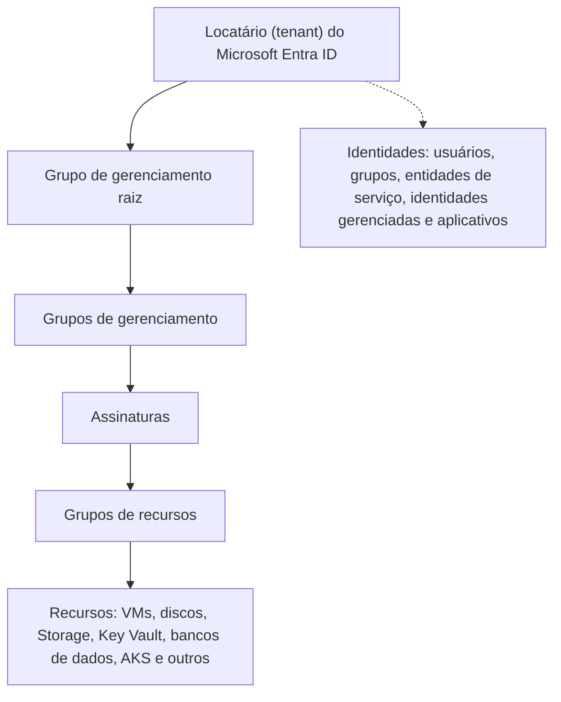

# Arquitetura do Azure e Modelo de Identidade para Forense

> **Objetivo pedagógico:** compreender a hierarquia de recursos do Azure (locatário, grupos de gerenciamento, assinaturas, grupos de recursos e recursos), o modelo de identidade e de autorização (Microsoft Entra ID, RBAC do Azure, PIM, identidades gerenciadas e entidades de serviço) e a prontidão forense específica da plataforma, para delimitar o escopo e saber onde cada evidência reside.

## 1. Hierarquia do Azure

| Nível | Relevância forense |
|---|---|
| Locatário (Entra ID) | Identidades, aplicativos, políticas de acesso condicional, federação e logs de identidade; um locatário pode associar-se a várias assinaturas |
| Grupos de gerenciamento | Herança de políticas e de atribuições de funções; escopo amplo de uma atribuição |
| Assinaturas | Limite de cobrança e de administração; logs de atividade são por assinatura; contêm os recursos |
| Grupos de recursos | Agrupamento lógico; atribuições e bloqueios podem ser aplicados aqui |
| Recursos | Onde estão as cargas de trabalho e os dados; cada tipo tem logs próprios |

Princípio: o **plano de identidade** (Entra ID) e o **plano de recursos** (Azure Resource Manager) são diferentes. Um incidente costuma atravessar ambos, e as evidências estão em logs distintos.

## 2. Identidade e autorização

### 2.1 Dois sistemas de funções

| Sistema | Controla | Exemplos |
|---|---|---|
| Funções do Microsoft Entra ID | Administração do diretório e de serviços do Entra e do Microsoft 365 | Administrador Global, Administrador de Aplicativos, Administrador de Autenticação |
| RBAC do Azure | Acesso aos recursos do Azure | Proprietário, Colaborador, Leitor, Administrador de Acesso do Usuário |

Há uma ponte relevante: um Administrador Global pode **elevar o acesso** para obter a função de Administrador de Acesso do Usuário no escopo raiz e, com isso, gerenciar todas as assinaturas do locatário. Esse evento é crítico para a investigação (ver o arquivo de identidade).

### 2.2 Tipos de principais

| Principal | Descrição | Risco típico |
|---|---|---|
| Usuários | Pessoas, internas e convidadas (B2B) | Senhas, tokens e fadiga de MFA |
| Registros de aplicativos e entidades de serviço | Identidade de aplicativos, com segredos ou certificados e permissões | Segredos vazados, permissões excessivas, consentimentos maliciosos |
| Identidades gerenciadas | Identidades de recursos do Azure, sem segredos para gerenciar | Roubo de token pelo serviço de metadados (SSRF) |
| Identidades federadas de carga de trabalho | Confiança em provedores externos (por exemplo, GitHub Actions e Kubernetes) | Configuração de confiança excessivamente ampla |
| Grupos | Atribuição de acesso | Adição indevida de membros |
| Contas de acesso de emergência (break-glass) | Contas privilegiadas excluídas de controles | Uso indevido ou comprometimento |

### 2.2 Controles que afetam a evidência

| Controle | Efeito |
|---|---|
| Acesso condicional | Define quando e como o acesso é concedido; os registros mostram quais políticas se aplicaram |
| Privileged Identity Management (PIM) | Elevações com prazo; as ativações são registradas |
| MFA e métodos de autenticação | Registro de alterações e de desafios |
| Identity Protection | Detecções de risco de usuário e de entrada |
| Gestão de consentimento de aplicativos | Concessões de permissões, inclusive de usuários |
| Identidade híbrida (Entra Connect, PTA e AD FS) | Superfície adicional e fonte de persistência |

## 3. Modelo de dados e de logs: visão geral

| Plano | Fonte principal | Escopo |
|---|---|---|
| Identidade | Logs de entrada e de auditoria do Entra ID | Locatário |
| Recursos (controle) | Log de atividade do Azure | Assinatura (e locatário, para eventos de nível de locatário) |
| Recursos (dados e serviços) | Logs de recursos (diagnóstico) | Por recurso |
| Segurança | Microsoft Defender for Cloud, Defender XDR e Microsoft Sentinel | Assinatura e locatário |
| Gráfico de API | Logs de atividade do Microsoft Graph | Locatário (quando habilitados) |

Detalhes no arquivo seguinte.

## 4. Prontidão forense específica do Azure

| Controle | Descrição |
|---|---|
| Enviar os logs do Entra ID e da assinatura para um workspace do Log Analytics com retenção adequada | Configurações de diagnóstico para o locatário e para cada assinatura |
| Workspace de segurança separado e protegido | Acesso restrito; administradores de produção sem permissão de alterar ou excluir |
| Arquivamento imutável | Armazenamento de blobs com política de imutabilidade e retenção legal para exportações de logs |
| Retenção de longo prazo | Retenção interativa e arquivamento conforme os requisitos legais e investigativos |
| Microsoft Sentinel e Defender for Cloud | Detecção e correlação; planos de proteção habilitados para os recursos críticos |
| Bloqueios de recursos e proteção contra exclusão | Bloqueios `CanNotDelete` em recursos críticos e exclusão reversível (soft delete) em cofres e armazenamento |
| Assinatura ou ambiente forense | Assinatura separada para receber cópias de discos e executar análises |
| Contas e funções de resposta a incidentes | Permissões mínimas, acesso de emergência registrado e monitorado |
| Inventário de entidades de serviço, segredos e consentimentos | Visibilidade de credenciais e de permissões de aplicativos |
| PIM para funções privilegiadas | Elevação com justificativa e alerta |
| Exercícios | Simulações de incidentes de identidade e de recursos |

## 5. Questões legais e de privacidade

> **Aviso:** este material é técnico-educacional e não substitui parecer jurídico. Valide cada caso com o Jurídico e com o DPO.

| Tema | Orientação |
|---|---|
| Localização dos dados | Regiões do Azure e residência de dados; mapear onde estão os dados e os logs |
| Transferência internacional | LGPD, arts. 33 a 36 e a regulamentação da ANPD (confirme a norma vigente) |
| Dados de usuários nos logs | Endereços IP, localização e atividade são dados pessoais; minimizar, restringir o acesso e definir a retenção |
| Acesso do investigador | Conta nominal com privilégios mínimos e registrada; o acesso do investigador é auditável |
| Dados de convidados e de terceiros | Contas B2B e de parceiros: tratar conforme contratos e privacidade |
| Cooperação com o provedor | Pedidos de dados ao provedor seguem os termos contratuais e processos legais |

## 6. Mapeamento ATT&CK para Azure e Entra ID

| Objetivo | Técnicas (exemplos) |
|---|---|
| Acesso inicial | T1078.004 (contas na nuvem), T1566 (phishing), T1190 (exploração de aplicações) |
| Credenciais | T1528 (roubo de token de acesso de aplicativo), T1539, T1621 (fadiga de MFA), T1552 |
| Persistência | T1098.001 (credenciais adicionais), T1098.003 (funções adicionais), T1136.003, T1484.002 (confiança de domínio) |
| Escalada | Elevação de acesso e atribuição de funções |
| Evasão | T1562.008 (desativar logs), T1578 (modificar infraestrutura) |
| Descoberta | T1087.004, T1526, T1580 |
| Coleta e exfiltração | T1530, T1537, T1567 |
| Impacto | T1496, T1485, T1486 |

## 7. Exemplo prático: delimitação do escopo de um incidente de identidade

| Pergunta | Fonte | Resultado |
|---|---|---|
| Quais contas foram usadas? | Logs de entrada do Entra ID | Um usuário e uma entidade de serviço |
| O que a entidade de serviço pode acessar? | Atribuições de funções (RBAC) e permissões de API | Colaborador em duas assinaturas e acesso ao Key Vault |
| O que foi feito nas assinaturas? | Log de atividade | Criação de VMs e atribuição de funções |
| Quais recursos de dados foram tocados? | Logs de recursos (Key Vault e Storage) | Leitura de segredos e de blobs |
| Conclusão | O escopo envolve o locatário (identidades), duas assinaturas (recursos) e dois serviços de dados |

## 8. Casos de uso corporativos

- Avaliação da prontidão forense do locatário e das assinaturas.
- Mapeamento de privilégios e de caminhos de ataque em Azure e Entra ID.
- Definição dos requisitos de log e de retenção para auditoria e conformidade.

## 9. Normas e frameworks relevantes

- NIST SP 800-201; NIST SP 800-61 Rev. 3; ISO/IEC 27017 e 27018
- MITRE ATT&CK for Cloud (Azure AD e IaaS)
- CIS Microsoft Azure Foundations Benchmark; Microsoft Cloud Security Benchmark
- CIS Controls v8.1, controles 5, 6, 8 e 17
- LGPD, arts. 33 a 36 e 46

## 10. Referências

- Microsoft Learn. Documentação do Microsoft Entra ID, do Azure Resource Manager, do RBAC do Azure e do PIM.
- Microsoft Learn. Microsoft Cloud Security Benchmark e Cloud Adoption Framework (governança).
- Microsoft. Incident response playbooks (senhas por pulverização, phishing, consentimento de aplicativos e aplicativos comprometidos).
- CIS. Microsoft Azure Foundations Benchmark.
- MITRE ATT&CK for Cloud. https://attack.mitre.org
- SANS Institute. FOR509: Enterprise Cloud Forensics and Incident Response.
