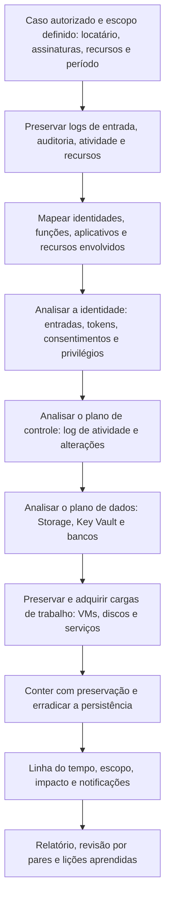

# Ferramentas, Fluxo, Modelos e Checklist de Azure

> **Objetivo pedagógico:** padronizar as ferramentas, o fluxo de trabalho, os registros e a verificação de qualidade das investigações no Azure e no Microsoft Entra ID, de modo que sejam reproduzíveis, seguras, rastreáveis e proporcionais ao escopo autorizado.

## 1. Ferramentas por finalidade

| Finalidade | Ferramentas |
|---|---|
| Linha de comando e automação | Azure CLI (`az`), Azure PowerShell, Microsoft Graph PowerShell, `kubectl` e Azure Cloud Shell |
| Consulta e análise de logs | Log Analytics (KQL), Microsoft Sentinel, Microsoft Defender XDR (caça avançada), Azure Resource Graph |
| Detecção e postura | Microsoft Defender for Cloud, Identity Protection e Microsoft Cloud Security Benchmark |
| Coleta de logs e de configurações do Entra ID e do M365 | Microsoft-Extractor-Suite, Hawk e Microsoft Graph |
| Mapeamento de privilégios e de caminhos de ataque | AzureHound (BloodHound), ROADtools e relatórios de atribuições do RBAC |
| Armazenamento e transferência | Azure Storage Explorer e AzCopy |
| Aquisição de memória | AVML, LiME e WinPmem |
| Análise de discos | Autopsy, The Sleuth Kit e ferramentas da pasta 10, em VM de análise na assinatura forense |
| Contêineres e imagens | `kubectl`, `docker`, Trivy e Grype |
| Linha do tempo | Plaso, Timesketch e planilhas (pasta 05) |
| Emulação de ataques (somente em locatário de teste) | Stratus Red Team, BadZure e Atomic Red Team |
| Documentação | Modelos deste arquivo e repositório versionado |

Registre nome, versão, origem e permissões usadas. O acesso do investigador deve ser por conta nominal, com privilégios mínimos (somente leitura sempre que possível) e registrado.

## 2. Contas e permissões do investigador (referência)

| Necessidade | Permissão típica (privilégio mínimo) |
|---|---|
| Ler logs de entrada e de auditoria | Leitor de Segurança ou Leitor de Relatórios, no Entra ID |
| Ler o log de atividade e os recursos | Leitor, no escopo da assinatura |
| Consultar o Log Analytics | Leitor do Log Analytics ou função de consulta no workspace |
| Criar snapshots e bloqueios | Colaborador de VM e de discos e função de bloqueios, apenas no escopo necessário |
| Acesso à assinatura forense | Colaborador na assinatura forense |
| Acesso de emergência (break-glass) | Somente quando necessário, com PIM, justificativa e alerta |

Toda a atividade do investigador deve ser auditável e revisada ao final do caso.

## 3. Fluxo de trabalho padronizado

## 4. Dez perguntas e como respondê-las

| Pergunta | Onde responder |
|---|---|
| 1. Quais locatários, assinaturas, recursos e identidades estão no escopo? | Inventário e hierarquia do Azure |
| 2. Os logs necessários existem e por quanto tempo? | Mapa de logs e configurações de diagnóstico |
| 3. Qual identidade foi comprometida e como? | Logs de entrada, Identity Protection e auditoria |
| 4. Que privilégios e persistência o atacante obteve? | Atribuições de funções, aplicativos, consentimentos e federação |
| 5. O que foi alterado no plano de controle? | Log de atividade e histórico de configuração |
| 6. Que dados foram acessados, copiados ou destruídos? | Logs de Storage, Key Vault, bancos e rede |
| 7. Que cargas de trabalho foram afetadas e foram preservadas? | VMs, AKS, App Service e snapshots com hash |
| 8. Há persistência remanescente? | Funções, entidades de serviço, extensões, runbooks e pipelines |
| 9. Quais obrigações legais e contratuais se aplicam? | Jurídico, DPO e contratos |
| 10. Que limitações precisam ser declaradas? | Diagnósticos ausentes, retenção e recursos efêmeros |

## 5. Modelo A: Inventário do Escopo Azure

| ID | Locatário | Assinatura (ID e nome) | Grupo de recursos | Recurso e tipo | Responsável | Diagnóstico habilitado | Retenção | Observações |
|---|---|---|---|---|---|---|---|---|
| Z-001 | | | | | | | | |
| Z-002 | | | | | | | | |

## 6. Modelo B: Mapa de Logs do Azure e do Entra ID

| Fonte | Escopo | Habilitada? | Destino e retenção | Imutabilidade e acesso | Lacunas |
|---|---|---|---|---|---|
| Logs de entrada (4 categorias) | Locatário | | | | |
| Auditoria do Entra ID | Locatário | | | | |
| Log de atividade | Cada assinatura | | | | |
| Logs de atividade do Microsoft Graph | Locatário | | | | |
| Key Vault (logs de recurso) | Por cofre | | | | |
| Storage (logs de plano de dados) | Por conta | | | | |
| Bancos de dados (auditoria) | Por servidor | | | | |
| Rede (firewall, WAF e fluxo) | | | | | |
| AKS (auditoria) | Por cluster | | | | |

## 7. Modelo C: Registro de Aquisição no Azure

| Campo | Preenchimento |
|---|---|
| Identificador | DFL-AAAA-NNN-ENNN |
| Assinatura, grupo de recursos, região e recurso | |
| Identificadores (VM e discos) | |
| Estado ao identificar | |
| Ações de preservação (bloqueio, isolamento e coleta volátil) com horário (UTC) | |
| Snapshots (nomes e identificadores) | |
| Chaves de criptografia e cofres usados | |
| Cópia na assinatura forense (conta de armazenamento e blobs) e hashes | |
| Memória capturada (ferramenta, versão e hash) | |
| Imagens brutas e hashes SHA-256 | |
| Responsável e conta usada | |
| Limitações | |
| Custódia | |

## 8. Modelo D: Registro de Ações de Contenção (com estado anterior)

| ID | Data e hora (UTC) | Ação | Recurso ou identidade | Estado anterior preservado | Autorizada por | Impacto observado | Reversão possível |
|---|---|---|---|---|---|---|---|
| A-001 | | | | | | | |
| A-002 | | | | | | | |

## 9. Modelo E: Registro de Aplicativos, Consentimentos e Privilégios

| ID | Aplicativo ou entidade de serviço | Tipo (registro, entidade de serviço ou identidade gerenciada) | Permissões (API e funções RBAC) | Credenciais (segredos e certificados, datas) | Proprietários | Data de criação ou de consentimento | Avaliação (legítimo, suspeito ou malicioso) | Ação |
|---|---|---|---|---|---|---|---|---|
| P-001 | | | | | | | | |

## 10. Modelo F: Linha do Tempo no Azure

| Hora (UTC) | Plano (identidade, controle ou dados) | Identidade | Evento | Recurso | IP e agente | Interpretação | Fonte e identificador | Confiança | ATT&CK |
|---|---|---|---|---|---|---|---|---|---|
| | | | | | | | | | |

## 11. Checklist operacional de Azure

**Caso:** DFL-AAAA-NNN
**Locatário e assinaturas:** ____________________
**Analista:** ____________________
**Data e hora (UTC):** ____________________

### 11.1 Escopo e autorização

- [ ] Autorização, base legal e escopo definidos; Jurídico e DPO consultados
- [ ] Conta nominal do investigador com privilégios mínimos, registrada
- [ ] Inventário do locatário, das assinaturas e dos recursos elaborado

### 11.2 Preservação

- [ ] Logs de entrada (as quatro categorias), auditoria, log de atividade e logs de recursos exportados com hash
- [ ] Configurações de diagnóstico e retenções verificadas; retenção ampliada onde necessário
- [ ] Configuração do Entra ID exportada (usuários, funções, aplicativos, consentimentos e acesso condicional)
- [ ] Recursos protegidos com bloqueios; exclusão reversível e backups verificados
- [ ] VMs isoladas e preservadas; snapshots criados e copiados para a assinatura forense
- [ ] Chaves de criptografia e permissões verificadas

### 11.3 Análise

- [ ] Vetor e identidade comprometida identificados
- [ ] Privilégios, aplicativos, consentimentos, federação e métodos de MFA revisados
- [ ] Plano de controle: atribuições de funções, criação de recursos e alterações de diagnóstico
- [ ] Plano de dados: Storage, Key Vault e bancos, com as limitações de logs declaradas
- [ ] Persistência procurada (funções, entidades de serviço, extensões, runbooks e pipelines)
- [ ] Horários normalizados para UTC; eventos mapeados ao ATT&CK

### 11.4 Contenção, relato e melhoria

- [ ] Ações de contenção registradas com o estado anterior
- [ ] Sessões revogadas; credenciais e segredos rotacionados; consentimentos e persistência removidos
- [ ] Causa raiz corrigida e controles reforçados (MFA resistente a phishing, acesso condicional e PIM)
- [ ] Notificações e comunicações avaliadas (LGPD, contratos e reguladores)
- [ ] Limitações e grau de confiança declarados
- [ ] Revisão por pares realizada

## 12. Resultado da verificação

| Resultado | Condição |
|---|---|
| Conforme | Todos os itens aplicáveis marcados |
| Conforme com ressalvas | Pendências sem impacto nas conclusões, com plano de ação |
| Não conforme | Recursos ou credenciais excluídos antes da preservação, logs não exportados, acesso fora do escopo ou conclusões sem corroboração; comunicar o líder e o Jurídico |

**Assinatura do analista:** ____________________
**Assinatura do revisor:** ____________________

## 13. Casos de uso corporativos

- Padronização das investigações no Azure e no Entra ID pelo SOC e pelo time de resposta.
- Treinamento de analistas em locatário de teste, com cenários e modelos.
- Auditoria da prontidão forense do Azure e da qualidade das investigações.

## 14. Normas e frameworks relevantes

- NIST SP 800-201; NIST SP 800-61 Rev. 3; ISO/IEC 27037, 27041, 27042 e 27043; ISO/IEC 27017
- MITRE ATT&CK for Cloud; CIS Microsoft Azure Foundations Benchmark; Microsoft Cloud Security Benchmark
- CIS Controls v8.1, controles 5, 6, 8 e 17
- LGPD, arts. 6º, 46 e 48

## 15. Referências

- Microsoft Learn. Documentação do Azure CLI, do Azure PowerShell, do Microsoft Graph PowerShell, do Log Analytics, do Sentinel e do Defender for Cloud.
- Invictus Incident Response. Microsoft-Extractor-Suite. Hawk (documentação).
- SpecterOps. AzureHound e BloodHound. Mollema, D. ROADtools.
- Datadog. Stratus Red Team. Cáseres, M. BadZure.
- Microsoft. Incident response playbooks.
- SANS Institute. FOR509 e SEC541.
