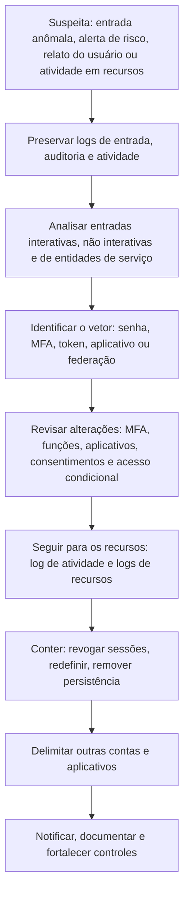

# Investigação de Identidade no Entra ID

> **Objetivo pedagógico:** investigar o comprometimento de identidades no Microsoft Entra ID (usuários, tokens, entidades de serviço, consentimentos de aplicativos, funções privilegiadas e federação híbrida), interpretar os logs de entrada e de auditoria, conter com preservação e erradicar a persistência.

## 1. Por que a identidade é o centro do incidente em nuvem

Em ambientes Azure e Microsoft 365, a maior parte dos ataques passa pela identidade: senhas e tokens roubados, phishing com proxy reverso, fadiga de MFA, aplicativos maliciosos e abuso de funções privilegiadas. A investigação começa pelas entradas, segue para as alterações de privilégio e de aplicativos, e termina nos recursos tocados.

## 2. Análise dos logs de entrada

### 2.1 Campos e significado

| Campo (SigninLogs e correlatos) | Utilidade |
|---|---|
| `UserPrincipalName`, `UserId` | Conta |
| `IPAddress`, `LocationDetails`, `NetworkLocationDetails` | Origem e localização |
| `AppDisplayName`, `AppId`, `ResourceDisplayName` | Aplicativo e recurso acessados |
| `ResultType` e `ResultDescription` | Sucesso (`0`) ou código de erro (por exemplo, senha incorreta e MFA exigido) |
| `AuthenticationRequirement` | Fator único ou autenticação multifator |
| `AuthenticationDetails` | Métodos usados e resultado de cada etapa |
| `ConditionalAccessStatus` e `ConditionalAccessPolicies` | Políticas aplicadas |
| `DeviceDetail` | Dispositivo, sistema, navegador e conformidade |
| `UserAgent` | Cliente, útil para identificar ferramentas |
| `RiskLevelDuringSignIn` e `RiskState` | Risco calculado pelo Identity Protection |
| `CorrelationId`, `SessionId` e identificador do token | Correlação entre eventos e sessões |
| `ClientAppUsed` | Protocolo (inclusive autenticação legada) |

### 2.2 Tipos de entrada

| Categoria | Observação |
|---|---|
| Interativas | O usuário fornece credenciais; `SigninLogs` |
| Não interativas | Renovação de tokens e acesso de aplicativos em nome do usuário; `AADNonInteractiveUserSignInLogs`. Tokens roubados costumam aparecer aqui |
| Entidades de serviço | Aplicativos que se autenticam com segredo ou certificado; `AADServicePrincipalSignInLogs` |
| Identidades gerenciadas | Recursos do Azure obtendo tokens; `AADManagedIdentitySignInLogs` |

Investigue sempre os quatro tipos: atacantes com tokens ou aplicativos podem não gerar entradas interativas.

## 3. Padrões de ataque e como reconhecê-los

| Ataque | Indícios | ATT&CK |
|---|---|---|
| Pulverização de senhas (password spraying) | Muitas contas, poucas tentativas por conta, a partir de poucos IPs; erros de senha incorreta seguidos de sucesso | T1110.003 |
| Força bruta e preenchimento de credenciais | Falhas em volume por conta; credenciais vindas de vazamentos | T1110 |
| Fadiga de MFA | Muitas solicitações de MFA recusadas ou ignoradas seguidas de uma aprovada; relato do usuário | T1621 |
| Phishing com proxy reverso (AiTM) | Entrada bem-sucedida com MFA a partir de IP e agente incomuns, logo após o usuário clicar em link; sessão usada de outro IP; detecções de "token anômalo" ou de "atacante no meio" no Identity Protection | T1557, T1539 |
| Roubo e reutilização de tokens | Entradas não interativas de IPs diferentes com a mesma sessão; acesso sem novo desafio de MFA | T1550.001 |
| Autenticação legada | Protocolos que não suportam MFA (IMAP, POP e SMTP autenticado) | T1078.004 |
| Entrada por código de dispositivo (device code phishing) | Fluxo de código de dispositivo com aplicativo e usuário inesperados | T1528 |
| Convidados (B2B) maliciosos | Convites e contas de convidados recentes com acesso a recursos | T1136.003 |

```kusto
// Pulverização de senhas: IPs com muitas contas distintas e falhas de senha
SigninLogs
| where TimeGenerated > ago(1d)
| where ResultType in ("50126", "50053", "50057")   // senha incorreta, bloqueio, conta desabilitada
| summarize Falhas = count(), Contas = dcount(UserPrincipalName) by IPAddress, bin(TimeGenerated, 1h)
| where Contas > 10 and Falhas > 30
| order by Contas desc
```

```kusto
// Sucesso após muitas falhas do mesmo IP
let suspeitos = SigninLogs
| where TimeGenerated > ago(1d) and ResultType == "50126"
| summarize Falhas = count(), UltimaFalha = max(TimeGenerated) by IPAddress
| where Falhas > 20;
SigninLogs
| where TimeGenerated > ago(1d) and ResultType == 0
| join kind=inner suspeitos on IPAddress
| where TimeGenerated > UltimaFalha
| project TimeGenerated, UserPrincipalName, IPAddress, AppDisplayName, AuthenticationRequirement
```

```kusto
// Uma mesma sessão usada por mais de um IP (indício de roubo de token)
union SigninLogs, AADNonInteractiveUserSignInLogs
| where TimeGenerated > ago(2d)
| where UserPrincipalName =~ "usuario@exemplo.com"
| summarize IPs = make_set(IPAddress), Qtd = dcount(IPAddress), Primeiro = min(TimeGenerated), Ultimo = max(TimeGenerated) by SessionId
| where Qtd > 1
```

Códigos de erro e nomes de colunas variam; valide-os na documentação vigente e no esquema do seu workspace.

## 4. Aplicativos, entidades de serviço e consentimentos

| Evento de auditoria (exemplos) | Interpretação |
|---|---|
| `Consent to application`, `Add delegated permission grant`, `Add OAuth2PermissionGrant` | Concessão de permissões a um aplicativo; consentimentos maliciosos permitem acesso persistente a e-mail e arquivos (T1528) |
| `Add service principal` e `Add application` | Novo aplicativo ou entidade de serviço |
| `Add service principal credentials` e `Update application – Certificates and secrets management` | Novo segredo ou certificado: persistência (T1098.001) |
| `Add app role assignment to service principal` | Concessão de permissões de aplicativo (por exemplo, leitura de todas as caixas de correio) |
| Alterações de `redirect URIs` e de proprietários do aplicativo | Preparação de abuso |
| Entradas de entidades de serviço de IPs incomuns | Uso de credenciais de aplicativo roubadas |

```powershell
# Microsoft Graph PowerShell: inventário de concessões de permissões delegadas e de funções de aplicativo
Connect-MgGraph -Scopes "Directory.Read.All","Application.Read.All"
Get-MgOauth2PermissionGrant -All | Select-Object ClientId, ConsentType, PrincipalId, ResourceId, Scope |
  Export-Csv .\concessoes_oauth.csv -NoTypeInformation

# Credenciais (segredos e certificados) de registros de aplicativos e datas de expiração
Get-MgApplication -All | ForEach-Object {
  $app = $_
  $app.PasswordCredentials | ForEach-Object { [pscustomobject]@{App=$app.DisplayName; Tipo="Segredo"; Inicio=$_.StartDateTime; Fim=$_.EndDateTime} }
  $app.KeyCredentials | ForEach-Object { [pscustomobject]@{App=$app.DisplayName; Tipo="Certificado"; Inicio=$_.StartDateTime; Fim=$_.EndDateTime} }
} | Export-Csv .\credenciais_aplicativos.csv -NoTypeInformation
```

Atenção às permissões amplas (por exemplo, `Mail.Read`, `Files.ReadWrite.All` e `Directory.ReadWrite.All`) concedidas a aplicativos de terceiros ou recém-criados.

## 5. Funções privilegiadas, PIM e elevação de acesso

| Evento | Interpretação |
|---|---|
| `Add member to role` (Entra) | Atribuição de função do diretório |
| Ativações do PIM (eventos de gerenciamento de funções) | Elevação com justificativa; revisar quem, quando e por quê |
| Atribuição de função do RBAC (`ROLEASSIGNMENTS/WRITE` no log de atividade) | Acesso a recursos do Azure |
| `Microsoft.Authorization/elevateAccess/action` | Administrador Global elevou o acesso ao escopo raiz do Azure: evento crítico, visível no log de atividade de nível de locatário |
| Criação de contas e adição a grupos privilegiados | Persistência (T1098.003 e T1136.003) |
| Alterações de políticas de acesso condicional | Enfraquecimento de controles (por exemplo, exclusão de usuários ou de locais) |
| Alterações nos métodos de autenticação (registro de nova chave ou número) | Persistência de conta |

## 6. Identidade híbrida e federação

| Elemento | Risco e evidência |
|---|---|
| Microsoft Entra Connect (sincronização) | Servidor privilegiado; comprometimento permite acesso às identidades e a segredos de sincronização |
| Autenticação transmitida (PTA) e SSO contínuo | Agentes e contas de computador; acesso a credenciais |
| AD FS e federação | Roubo do certificado de assinatura de tokens permite forjar tokens SAML ("Golden SAML", T1606.002); alterações em domínios federados (T1484.002) |
| Eventos de auditoria | `Set federation settings on domain`, `Set domain authentication`, alterações de certificados de federação |
| Contas do conector | Contas de sincronização com permissões elevadas |

Tratamento: servidores de identidade híbrida são ativos de nível 0; verifique os logs de segurança desses servidores, as alterações de configuração e a integridade dos certificados.

## 7. Contenção e erradicação (após preservar)

| Ação | Cuidado |
|---|---|
| Preservar logs e exportar a configuração (usuários, aplicativos, funções, políticas e métodos de autenticação) | Antes de qualquer alteração |
| Revogar sessões e tokens do usuário (`Revoke-MgUserSignInSession`) | Combine com a redefinição de senha; tokens de acesso já emitidos expiram em prazo curto |
| Redefinir a senha e revisar os métodos de autenticação | Remover métodos desconhecidos; exigir novo registro |
| Desabilitar contas comprometidas | Preferível a excluir |
| Remover consentimentos e aplicativos maliciosos | Registrar permissões e credenciais antes |
| Rotacionar segredos e certificados de entidades de serviço | Revisar pipelines e serviços dependentes |
| Revisar funções privilegiadas, grupos e acessos de convidados | Remover o acesso indevido |
| Reforçar o acesso condicional | MFA resistente a phishing, bloqueio de autenticação legada e dispositivos em conformidade |
| Revisar a federação e a identidade híbrida | Rotação de certificados de assinatura de tokens, quando houver suspeita |
| Monitorar | Regras de detecção para reentrada |

```powershell
# Revogar as sessões de um usuário (após preservar as evidências)
Connect-MgGraph -Scopes "User.ReadWrite.All"
Revoke-MgUserSignInSession -UserId "usuario@exemplo.com"
```

## 8. Fluxo de investigação de identidade



## 9. Exemplo prático: AiTM e consentimento de aplicativo

| Hora (UTC) | Evento | Interpretação |
|---|---|---|
| 13:02 | Usuário clica em link de phishing (proxy) | Vetor (ver pasta 12) |
| 13:04 | `SigninLogs`: sucesso com MFA, IP de hospedagem, agente incomum; Identity Protection: "atacante no meio" | Sessão capturada (T1557 e T1539) |
| 13:10 | `AADNonInteractiveUserSignInLogs`: renovações de token do mesmo IP | Uso do token |
| 13:15 | `AuditLogs`: `Consent to application` para um aplicativo desconhecido com `Mail.Read` e `offline_access` | Persistência por aplicativo (T1528) |
| 13:20 | Auditoria de caixa: regra de caixa de entrada criada (ver pasta 19) | Ocultação e fraude |
| 14:05 | Relato do usuário | Detecção |
| Resposta | Preservar; revogar as sessões; redefinir a senha e revisar o MFA; remover o consentimento e o aplicativo; revisar outros usuários que consentiram ao mesmo aplicativo; bloquear o IP; reforçar o acesso condicional |

## 10. Casos de uso corporativos

- Resposta a contas comprometidas por phishing, pulverização de senhas e roubo de tokens.
- Revisão periódica de consentimentos, segredos de aplicativos e funções privilegiadas.
- Investigação de abuso de elevação de acesso e de federação.

## 11. Normas e frameworks relevantes

- MITRE ATT&CK for Cloud: T1078.004, T1110, T1528, T1539, T1550.001, T1557, T1621, T1098.001, T1098.003, T1136.003, T1484.002, T1606.002
- NIST SP 800-63B (autenticação); NIST SP 800-61 Rev. 3
- CIS Microsoft Azure Foundations Benchmark; CIS Controls v8.1, controles 5, 6 e 17
- ISO/IEC 27002:2022, controles 5.15, 5.16, 5.17, 5.18 e 8.2 (acessos privilegiados)

## 12. Referências

- Microsoft. Incident response playbooks: password spray, phishing, application consent grant e compromised and malicious applications.
- Microsoft Learn. Logs de entrada do Entra ID, Identity Protection e Privileged Identity Management.
- Microsoft Learn. Elevar o acesso para gerenciar todas as assinaturas do Azure.
- Mollema, D. Pesquisas públicas sobre tokens e Entra ID (ROADtools).
- MITRE ATT&CK for Cloud. https://attack.mitre.org
- SANS Institute. FOR509.
