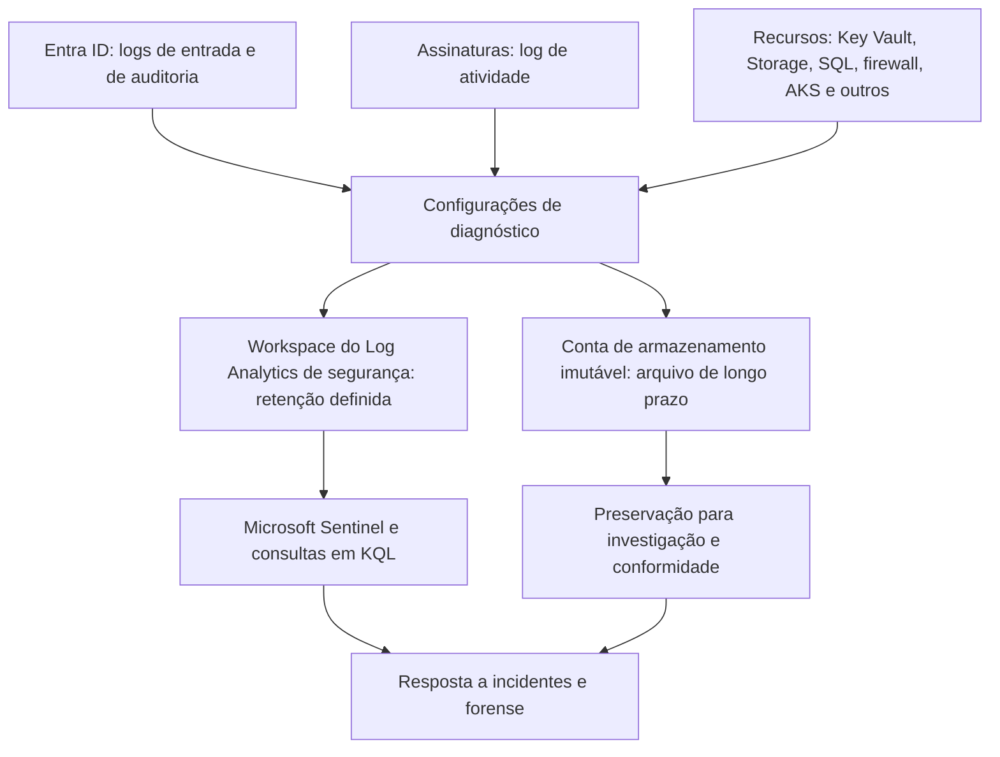

# Logs e Telemetria do Azure e do Entra ID

> **Objetivo pedagógico:** conhecer as fontes de log do Azure e do Microsoft Entra ID (log de atividade, logs de entrada e de auditoria, logs de recursos, logs do Microsoft Graph e telemetria de segurança), suas retenções e configurações de diagnóstico, consultá-las em KQL e preservá-las com integridade.

> Retenções, nomes de tabelas e disponibilidade mudam com frequência e dependem de licenciamento. Confirme na documentação vigente no início do caso.

## 1. Mapa das fontes

| Fonte | Escopo | Conteúdo | Retenção nativa (referência) |
|---|---|---|---|
| Log de atividade do Azure | Assinatura (e eventos de nível de locatário) | Operações do plano de controle: criação, alteração e exclusão de recursos, atribuições de funções | 90 dias; exportar para retenção maior |
| Logs de entrada do Entra ID | Locatário | Entradas interativas, não interativas, de entidades de serviço e de identidades gerenciadas | 7 dias (Free) e 30 dias (P1 e P2); exportar |
| Logs de auditoria do Entra ID | Locatário | Alterações em usuários, grupos, funções, aplicativos, consentimentos, políticas e federação | 7 dias (Free) e 30 dias (P1 e P2); exportar |
| Logs de provisionamento do Entra ID | Locatário | Sincronização de contas com aplicativos | Conforme licenciamento |
| Identity Protection | Locatário | Usuários e entradas com risco, detecções | Conforme licenciamento |
| Logs de atividade do Microsoft Graph | Locatário | Solicitações à API do Microsoft Graph (quando habilitados) | Depende do destino configurado |
| Logs de recursos (diagnóstico) | Por recurso | Acesso a dados e eventos do serviço (Key Vault, Storage, SQL, firewall e outros) | Depende do destino configurado |
| Defender for Cloud e Defender XDR | Assinaturas e locatário | Alertas e incidentes | Conforme o serviço |
| Microsoft Sentinel | Workspace | Dados ingeridos, alertas e incidentes | Retenção do workspace |
| Azure Resource Graph e histórico de alterações | Assinaturas | Inventário e alterações de configuração | Conforme o serviço |

## 2. Configurações de diagnóstico e destinos

| Destino | Uso | Observações |
|---|---|---|
| Workspace do Log Analytics | Consulta em KQL, alertas e integração com o Sentinel | Retenção interativa padrão de 30 dias, configurável até 730 dias; retenção total de longo prazo (arquivo) de até 12 anos |
| Conta de armazenamento | Arquivamento de baixo custo | Combinar com imutabilidade (WORM) |
| Hub de eventos | Envio a SIEM externo | Exige integração |
| Parceiros | Soluções de terceiros | Avaliar privacidade e contrato |



Pontos críticos:

| Ponto | Observação |
|---|---|
| Cobrir todas as assinaturas e o locatário | Uma assinatura esquecida é uma lacuna |
| Logs de recursos dependem de habilitação | Sem diagnóstico, não há registro de acesso a dados |
| Proteção do workspace | Controle de acesso mínimo; alertas para alterações de configuração |
| Alterações nas configurações de diagnóstico são eventos auditáveis | Exclusão ou alteração de diagnósticos pode indicar evasão (T1562.008) |
| Latência | A ingestão pode levar minutos |
| Substituição de agentes | O agente do Azure Monitor substituiu o agente legado do Log Analytics; verifique a cobertura |
| Logs de fluxo de rede | A Microsoft anunciou a substituição dos logs de fluxo de NSG por logs de fluxo de redes virtuais; confirme o serviço vigente |

## 3. Tabelas principais no Log Analytics (referência)

| Tabela | Conteúdo |
|---|---|
| `AzureActivity` | Log de atividade do Azure |
| `SigninLogs` | Entradas interativas de usuários |
| `AADNonInteractiveUserSignInLogs` | Entradas não interativas (renovação de token, acesso por aplicativos) |
| `AADServicePrincipalSignInLogs` | Entradas de entidades de serviço |
| `AADManagedIdentitySignInLogs` | Entradas de identidades gerenciadas |
| `AuditLogs` | Auditoria do Entra ID |
| `AADUserRiskEvents` e `AADRiskyUsers` | Riscos do Identity Protection |
| `MicrosoftGraphActivityLogs` | Solicitações ao Microsoft Graph |
| `AzureDiagnostics` e tabelas específicas de recurso | Logs de recursos |
| `StorageBlobLogs` | Acesso ao armazenamento de blobs |
| `AZKVAuditLogs` | Auditoria do Key Vault (modo de tabela específica) |
| `SecurityAlert` e `SecurityIncident` | Alertas e incidentes do Defender e do Sentinel |

Os nomes variam entre o modo de diagnóstico do Azure (`AzureDiagnostics`) e o modo de tabelas específicas de recurso; verifique o modo do seu ambiente.

## 4. Consultas em KQL: exemplos

### 4.1 Log de atividade: alterações de atribuição de funções

```kusto
AzureActivity
| where TimeGenerated > ago(14d)
| where OperationNameValue =~ "MICROSOFT.AUTHORIZATION/ROLEASSIGNMENTS/WRITE"
| where ActivityStatusValue in ("Success", "Succeeded")
| project TimeGenerated, Caller, CallerIpAddress, SubscriptionId, ResourceGroup, _ResourceId, Properties
| order by TimeGenerated desc
```

### 4.2 Log de atividade: execuções de Run Command em máquinas virtuais

```kusto
AzureActivity
| where TimeGenerated > ago(30d)
| where OperationNameValue =~ "MICROSOFT.COMPUTE/VIRTUALMACHINES/RUNCOMMAND/ACTION"
| project TimeGenerated, Caller, CallerIpAddress, ResourceGroup, _ResourceId, ActivityStatusValue
| order by TimeGenerated desc
```

### 4.3 Entradas de um usuário

```kusto
SigninLogs
| where TimeGenerated > ago(14d)
| where UserPrincipalName =~ "usuario@exemplo.com"
| project TimeGenerated, IPAddress, AppDisplayName, ResourceDisplayName, ResultType, ResultDescription,
          ConditionalAccessStatus, AuthenticationRequirement, RiskLevelDuringSignIn,
          Country = tostring(LocationDetails.countryOrRegion), DeviceDetail
| order by TimeGenerated asc
```

### 4.4 Auditoria: consentimentos e credenciais de aplicativos

```kusto
AuditLogs
| where TimeGenerated > ago(30d)
| where OperationName in ("Consent to application", "Add service principal credentials",
                          "Update application – Certificates and secrets management",
                          "Add app role assignment to service principal")
| project TimeGenerated, OperationName, InitiatedBy, TargetResources, Result
| order by TimeGenerated desc
```

### 4.5 Key Vault: leitura de segredos

```kusto
AZKVAuditLogs
| where TimeGenerated > ago(14d)
| where OperationName in ("SecretGet", "SecretList", "KeyGet", "CertificateGet")
| project TimeGenerated, OperationName, CallerIPAddress, identity_claim_appid_g, identity_claim_oid_g, ResultSignature, requestUri_s
| order by TimeGenerated desc
```

Os nomes de colunas podem variar conforme o modo de diagnóstico; valide o esquema com `getschema`.

## 5. Preservação e integridade dos logs

| Medida | Descrição |
|---|---|
| Exportar o conjunto de logs do incidente | Exportar resultados de consultas e dados brutos para arquivos com hash |
| Imutabilidade | Contêineres com política de imutabilidade (retenção por tempo e retenção legal) |
| Cópia independente | Cópia em assinatura e locatário distintos, com acesso restrito |
| Registro da consulta | Texto da consulta, período, workspace, conta usada e horário (UTC) |
| Controle do workspace | Bloqueios, permissões mínimas e alertas para alteração de retenção ou de exclusão de dados |
| Retenção legal | Estender retenções antes que os dados expirem |

```bash
# Azure CLI: consulta ao Log Analytics e exportação do resultado
az monitor log-analytics query \
  --workspace "<ID_DO_WORKSPACE>" \
  --analytics-query "AzureActivity | where TimeGenerated > ago(14d) | where Caller =~ 'usuario@exemplo.com'" \
  --output json > atividade_usuario.json
sha256sum atividade_usuario.json > atividade_usuario.json.sha256

# Log de atividade diretamente (últimos dias), por assinatura
az monitor activity-log list --offset 14d --caller usuario@exemplo.com --output json > activitylog_usuario.json
```

```powershell
# Microsoft Graph PowerShell: logs de entrada e de auditoria (retenção nativa limitada)
Connect-MgGraph -Scopes "AuditLog.Read.All","Directory.Read.All"
Get-MgAuditLogSignIn -Filter "userPrincipalName eq 'usuario@exemplo.com'" -All |
  Select-Object CreatedDateTime, IpAddress, AppDisplayName, @{n='Resultado';e={$_.Status.ErrorCode}} |
  Export-Csv .\entradas_usuario.csv -NoTypeInformation
Get-MgAuditLogDirectoryAudit -Filter "activityDisplayName eq 'Consent to application'" -All |
  Export-Csv .\auditoria_consentimentos.csv -NoTypeInformation
```

## 6. Lacunas e evasão em Azure

| Ação do atacante ou falha | Indício | ATT&CK |
|---|---|---|
| Excluir ou alterar configurações de diagnóstico | Operações `Microsoft.Insights/diagnosticSettings/delete` ou `write` no log de atividade | T1562.008 |
| Alterar a retenção ou excluir dados do workspace | Alterações no workspace e em tabelas | T1562.008, T1070 |
| Desabilitar planos do Defender for Cloud | Alterações de preços e de configuração | T1562.001 |
| Usar assinaturas sem logs | Atividade em assinaturas sem diagnóstico | T1578 |
| Entradas por canais com menos registro | Entradas não interativas e de entidades de serviço não ingeridas | T1078.004 |
| Tokens e sessões roubados | Entradas sem novo desafio de MFA | T1539, T1550.001 |

Mitigações: políticas do Azure que exigem configurações de diagnóstico (DeployIfNotExists), alertas para alterações nelas, imutabilidade e cobertura de todas as assinaturas.

## 7. Exemplo prático: avaliação de cobertura

| Pergunta | Fonte | Resultado |
|---|---|---|
| Quem atribuiu a função de Proprietário? | `AzureActivity` | Disponível, assinatura com diagnóstico |
| Quem leu os segredos do Key Vault? | Logs de recurso do Key Vault | Habilitados no cofre de produção |
| Quem acessou os blobs? | `StorageBlobLogs` | Não habilitados na conta de armazenamento afetada |
| As entradas por entidades de serviço foram registradas? | `AADServicePrincipalSignInLogs` | Não exportadas para o workspace |
| Conclusão | Identidade e plano de controle cobertos; plano de dados do Storage e entradas de entidades de serviço com lacunas; declarar as limitações |

## 8. Casos de uso corporativos

- Auditoria da cobertura de logs do Azure e do Entra ID.
- Definição de retenção e de arquivamento imutável.
- Padronização das consultas de investigação para o SOC.

## 9. Normas e frameworks relevantes

- NIST SP 800-92; NIST SP 800-201; ISO/IEC 27002:2022, controles 8.15 e 8.16
- CIS Microsoft Azure Foundations Benchmark; Microsoft Cloud Security Benchmark (registro e detecção)
- MITRE ATT&CK: T1562.001, T1562.008, T1070, T1578
- PCI DSS v4.0, requisito 10; LGPD, art. 46

## 10. Referências

- Microsoft Learn. Azure Monitor (configurações de diagnóstico e Log Analytics), Activity Log e retenção de dados.
- Microsoft Learn. Logs de entrada e de auditoria do Microsoft Entra ID e logs de atividade do Microsoft Graph.
- Microsoft Learn. Referência das tabelas do Azure Monitor Logs.
- Kent, K.; Souppaya, M. NIST SP 800-92. 2006.
- SANS Institute. FOR509 e SEC541.
