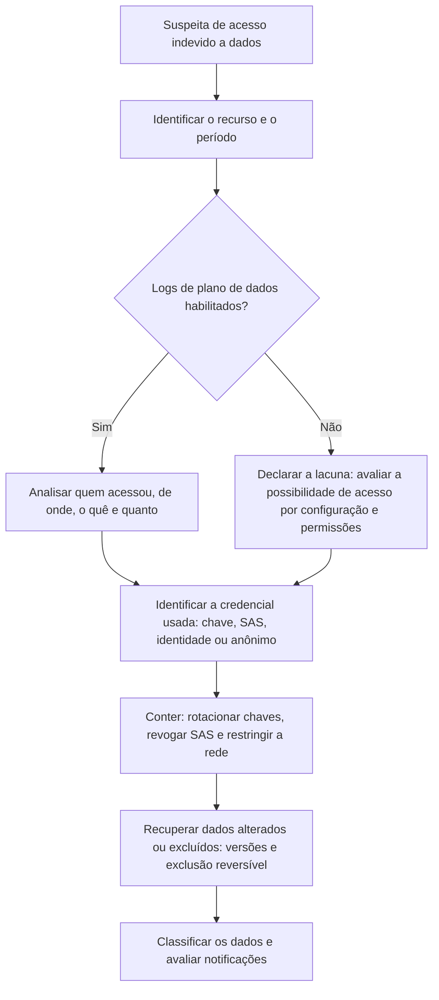

# Storage, Key Vault e Bancos de Dados no Azure

> **Objetivo pedagógico:** investigar o acesso e a exposição de dados em contas de armazenamento, cofres de chaves e bancos de dados do Azure, interpretando os logs de plano de dados, os mecanismos de autenticação (chaves de conta, SAS e identidades) e os recursos de recuperação, e conter com preservação.

## 1. Armazenamento do Azure (Storage)

### 1.1 Mecanismos de acesso e riscos

| Mecanismo | Descrição | Risco e evidência |
|---|---|---|
| Chaves da conta | Acesso total à conta de armazenamento | Vazamento: acesso irrestrito; o log mostra `AuthenticationType` igual a `AccountKey` |
| Assinatura de acesso compartilhado (SAS) | URL com permissões e prazo | URLs vazadas e com prazos longos; `AuthenticationType` igual a `SAS` |
| SAS de delegação de usuário | SAS assinada com identidade do Entra ID | Mais rastreável; revogável pela chave de delegação |
| Microsoft Entra ID (RBAC) | Acesso por identidade | Melhor rastreabilidade; `AuthenticationType` igual a `OAuth` |
| Acesso anônimo (público) | Contêineres de blob públicos | Exposição de dados; `AuthenticationType` igual a `Anonymous` |
| Pontos de extremidade privados e firewall de rede | Restringem a origem | Alterações abrem a exposição |

### 1.2 Logs

| Fonte | Conteúdo |
|---|---|
| `StorageBlobLogs` (e logs de arquivos, filas e tabelas) | Operações no plano de dados: `GetBlob`, `PutBlob`, `DeleteBlob`, `ListBlobs`, `CopyBlob`, com `CallerIpAddress`, `AuthenticationType`, `Uri`, `UserAgentHeader` e `StatusCode` |
| Log de atividade e logs de configuração | Alterações de configuração: chaves regeneradas, firewall, acesso público e políticas |
| Microsoft Defender for Storage | Alertas de acesso anômalo, de varredura de malware e de exposição |

Os logs de plano de dados **não vêm habilitados por padrão**; habilite o diagnóstico antes do incidente.

```kusto
// Leituras e listagens a partir de IPs incomuns em uma conta de armazenamento
StorageBlobLogs
| where TimeGenerated > ago(14d)
| where AccountName == "stexemplo"
| where OperationName in ("GetBlob", "ListBlobs", "ListContainers")
| summarize Leituras = count(), Bytes = sum(ResponseBodySize), Blobs = dcount(Uri) by CallerIpAddress, AuthenticationType
| order by Bytes desc
```

```kusto
// Exclusões e cópias de blobs (destruição ou exfiltração)
StorageBlobLogs
| where TimeGenerated > ago(14d)
| where OperationName in ("DeleteBlob", "DeleteContainer", "CopyBlob", "PutBlob")
| project TimeGenerated, OperationName, AccountName, Uri, CallerIpAddress, AuthenticationType, StatusCode
| order by TimeGenerated desc
```

### 1.3 Recuperação e proteção

| Recurso | Uso na investigação |
|---|---|
| Exclusão reversível (soft delete) de blobs e contêineres | Recuperar objetos excluídos durante o período de retenção |
| Versionamento de blobs | Restaurar versões anteriores após adulteração |
| Restauração para um ponto no tempo | Reverter os dados de contêineres de blob block |
| Imutabilidade (WORM) | Protege contra exclusão e alteração; também serve para o arquivo de evidências |
| Replicação entre contas | Pode ser usada para exfiltração; verificar políticas |

### 1.4 Contenção

```bash
# Regenerar as chaves da conta (após preservar logs e configuração); isto invalida SAS assinadas com a chave
az storage account keys renew --resource-group RG --account-name stexemplo --key primary

# Revogar chaves de delegação de usuário (invalida SAS de delegação de usuário)
az storage account revoke-delegation-keys --resource-group RG --name stexemplo

# Verificar acesso público e regras de rede
az storage account show --resource-group RG --name stexemplo \
  --query "{publico:allowBlobPublicAccess, acessoRede:networkRuleSet.defaultAction, chavesPermitidas:allowSharedKeyAccess}"
```

Registre a configuração antes de alterá-la. Considere desabilitar o acesso por chave compartilhada e usar apenas o Entra ID, e restringir o acesso por rede.

## 2. Azure Key Vault

### 2.1 Modelo de acesso

| Elemento | Descrição |
|---|---|
| Modelo de autorização | RBAC do Azure (recomendado) ou políticas de acesso do cofre |
| Objetos | Segredos, chaves e certificados |
| Exclusão reversível e proteção contra expurgo | Retém objetos excluídos e impede o expurgo imediato; fundamentais para evidências e recuperação |
| Firewall e pontos de extremidade privados | Restrição de rede |
| Identidades | Aplicativos e identidades gerenciadas que leem segredos |

### 2.2 Logs e investigação

| Operação | Interpretação |
|---|---|
| `SecretGet`, `SecretList`, `KeyGet`, `CertificateGet` | Leitura de objetos; verificar identidade, IP e horário |
| `SecretSet`, `SecretDelete`, `KeyDelete`, `VaultDelete` | Alteração ou destruição |
| `SecretPurge` e `KeyPurge` | Expurgo definitivo (bloqueado com proteção contra expurgo) |
| Alterações de políticas de acesso e de atribuições de RBAC no cofre | Concessão de acesso ao atacante |
| Acesso de IPs incomuns e de identidades novas | Exfiltração de segredos (T1555 e T1552) |

Sem o diagnóstico habilitado, não há registro de leitura de segredos. Quando a leitura é possível, considere **todos os segredos acessíveis à identidade comprometida** como expostos e planeje a rotação.

```bash
# Listar objetos excluídos (exclusão reversível) para avaliar tentativas de destruição
az keyvault secret list-deleted --vault-name kv-exemplo --output table

# Verificar proteções do cofre
az keyvault show --name kv-exemplo --query "{softDelete:properties.enableSoftDelete, purgeProtection:properties.enablePurgeProtection, rbac:properties.enableRbacAuthorization}"
```

### 2.4 Rotação após comprometimento

| Passo | Descrição |
|---|---|
| Inventariar | Todos os segredos, chaves e certificados do cofre e quem os usa |
| Priorizar | Credenciais de bancos, chaves de assinatura, tokens de terceiros e segredos de pipelines |
| Rotacionar | Nos sistemas de origem e no cofre, com atualização dos consumidores |
| Verificar | Que os consumidores usam as novas versões e que as antigas foram desativadas |
| Revisar | Acesso ao cofre (RBAC e rede) e identidades com permissão |

## 3. Bancos de dados (Azure SQL, PostgreSQL, MySQL e Cosmos DB)

| Fonte | Conteúdo |
|---|---|
| Auditoria do Azure SQL (para o Log Analytics, armazenamento ou hub de eventos) | Logins, consultas e alterações de esquema e de permissões; categoria `SQLSecurityAuditEvents` |
| Logs de recursos de PostgreSQL e MySQL | Conexões, consultas e erros, conforme a configuração |
| Cosmos DB | Logs de plano de dados e de controle conforme a configuração |
| Regras de firewall do servidor | Alterações abrem o acesso (`firewallRules/write` no log de atividade) |
| Microsoft Defender for SQL | Alertas de injeção de SQL, de acessos anômalos e de ataques de força bruta |
| Backups e restauração para um ponto no tempo | Recuperação e comparação de estados |
| Administradores do Entra ID e logins locais | Acessos privilegiados |

```kusto
// Azure SQL: logins e consultas de um IP suspeito (esquema depende do modo de diagnóstico)
AzureDiagnostics
| where TimeGenerated > ago(7d)
| where Category == "SQLSecurityAuditEvents"
| where client_ip_s == "203.0.113.50"
| project TimeGenerated, action_name_s, server_principal_name_s, database_name_s, statement_s, succeeded_s
| order by TimeGenerated asc
```

Indícios: abertura de regra de firewall para um IP externo, login administrativo incomum, consultas de volume alto (exportação) e criação de logins e de usuários novos. Preserve os logs de auditoria, as configurações e os pontos de restauração.

## 4. Fluxo de investigação de acesso a dados



## 5. Exemplo prático: SAS vazada e exfiltração de blobs

| Hora (UTC) | Evento | Interpretação |
|---|---|---|
| D-3 | URL SAS com permissão de leitura e listagem por 1 ano, enviada por e-mail a um terceiro | Origem provável do vazamento |
| D-1, 22:10 | `StorageBlobLogs`: `ListBlobs` e 18 mil `GetBlob` de um IP de hospedagem, `AuthenticationType` igual a `SAS` | Exfiltração (T1530) |
| D-1, 22:40 | 42 GB baixados; volume 60 vezes acima do normal | Impacto |
| Log de atividade | Sem alterações de configuração | O acesso usou credencial válida, e não alteração de configuração |
| Resposta | Registrar a configuração; regenerar as chaves da conta (invalida a SAS), reduzir os prazos de SAS por política, preferir SAS de delegação de usuário e Entra ID, classificar os dados baixados, avaliar a notificação |

## 6. Casos de uso corporativos

- Investigação de exposição e de exfiltração de dados em armazenamento e bancos de dados.
- Resposta a vazamento de segredos e chaves em cofres.
- Revisão de proteções (exclusão reversível, imutabilidade e restrições de rede).

## 7. Normas e frameworks relevantes

- MITRE ATT&CK for Cloud: T1530, T1537, T1552, T1555, T1485, T1567
- CIS Microsoft Azure Foundations Benchmark (Storage, Key Vault e bancos de dados); Microsoft Cloud Security Benchmark
- NIST SP 800-201; ISO/IEC 27017 e 27018
- CIS Controls v8.1, controles 3, 8 e 13; LGPD, arts. 46 e 48

## 8. Referências

- Microsoft Learn. Azure Storage (registro, SAS, exclusão reversível e versionamento), Azure Key Vault (registro e proteção contra expurgo) e auditoria do Azure SQL.
- Microsoft Learn. Microsoft Defender for Storage, Key Vault e SQL.
- CIS. Microsoft Azure Foundations Benchmark.
- Documentação do Azure CLI (`az storage`, `az keyvault`).
- MITRE ATT&CK for Cloud. https://attack.mitre.org
- SANS Institute. FOR509.
