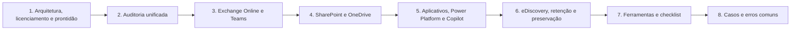

# 19 Forense em Microsoft 365

## Objetivo

Investigar incidentes no Microsoft 365: avaliar o licenciamento e a prontidão do locatário, coletar e interpretar a auditoria unificada, investigar o Exchange Online, o Teams, o SharePoint e o OneDrive, aplicativos OAuth, fluxos do Power Platform e interações com o Copilot, e preservar, pesquisar e exportar conteúdo com eDiscovery, retenção e retenção legal, com integridade, base legal, minimização e limitações declaradas.

## Trilha de estudo recomendada

## Conteúdo da pasta

| Ordem | Arquivo | Objetivo |
|---|---|---|
| 1 | [arquitetura-do-m365-licenciamento-e-prontidao-forense.md](arquitetura-do-m365-licenciamento-e-prontidao-forense.md) | Serviços, licenciamento, prontidão e aspectos legais |
| 2 | [auditoria-unificada-purview-e-coleta-de-logs.md](auditoria-unificada-purview-e-coleta-de-logs.md) | Estrutura do registro, coleta, limites e preservação |
| 3 | [exchange-online-e-teams-evidencias-de-comunicacao.md](exchange-online-e-teams-evidencias-de-comunicacao.md) | Auditoria de caixa, rastreamento, Defender for Office 365 e Teams |
| 4 | [sharepoint-onedrive-e-exfiltracao-de-arquivos.md](sharepoint-onedrive-e-exfiltracao-de-arquivos.md) | Eventos de arquivos, exfiltração, compartilhamento e recuperação |
| 5 | [aplicativos-oauth-power-platform-e-copilot.md](aplicativos-oauth-power-platform-e-copilot.md) | Aplicativos, fluxos automatizados e recursos de IA |
| 6 | [ediscovery-retencao-e-preservacao-no-purview.md](ediscovery-retencao-e-preservacao-no-purview.md) | Retenção legal, pesquisa, exportação e custódia |
| 7 | [ferramentas-fluxo-modelos-e-checklist-de-m365.md](ferramentas-fluxo-modelos-e-checklist-de-m365.md) | Ferramentas, funções, fluxo, modelos e checklist |
| 8 | [casos-de-uso-e-erros-comuns-em-m365.md](casos-de-uso-e-erros-comuns-em-m365.md) | Sete cenários, erros comuns e exercícios |

## Princípios

- Inventariar o licenciamento, as retenções e a prontidão antes de prometer conclusões
- Exportar a auditoria com o `AuditData` bruto e hash, dividir janelas e conferir contagens
- Aplicar a retenção legal antes de pesquisar, de coletar e de remover
- Correlacionar identidade, e-mail, arquivos, aplicativos e automações; cada fonte mostra parte da cadeia
- Revisar a persistência além das senhas: aplicativos, regras, conectores, delegações e fluxos
- Tratar funções de eDiscovery, de auditoria e de administração como privilégios altos, com PIM e monitoramento
- Aplicar escopo, minimização e revisão de privilégio no acesso a comunicações
- Declarar as limitações de logs e considerar o pior caso quando a evidência de acesso a dados não existir

## Relação com outras pastas

- 02-cadeia-de-custodia e 04-hash-e-integridade: custódia e hash das exportações
- 05-timeline-analysis: linha do tempo unificada
- 06-evidencias-digitais: validade e apresentação de provas
- 11-log-analysis: KQL, Sigma e detecção
- 12-email-forensics: phishing, BEC e análise de mensagens
- 17-cloud-forensics e 18-azure-forensics: fundamentos de nuvem e identidade no Entra ID
- 16-ransomware-investigation: ransomware e recuperação em nuvem

## Referências

- Microsoft Learn. Microsoft Purview (Auditoria, eDiscovery e Retenção), Exchange Online, SharePoint, Teams, Power Platform e Microsoft Defender XDR
- Microsoft. Incident response playbooks; Microsoft Sentinel Training Lab
- NIST SP 800-201 (2023); NIST SP 800-61 Rev. 3 (2025); NIST SP 800-92; NIST AI RMF 1.0
- ISO/IEC 27037; ISO/IEC 27050 (descoberta eletrônica); ISO/IEC 42001:2023
- CIS Microsoft 365 Foundations Benchmark; CISA SCuBA
- MITRE ATT&CK for Cloud
- Invictus Incident Response. Microsoft-Extractor-Suite; Hawk
- EDRM. Electronic Discovery Reference Model
- Brasil. Lei nº 13.709/2018 (LGPD); Lei nº 12.965/2014 (Marco Civil da Internet)
- SANS Institute. FOR509: Enterprise Cloud Forensics and Incident Response; SEC541
