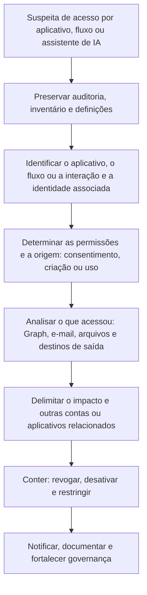

# Aplicativos, OAuth, Power Platform e Copilot

> **Objetivo pedagógico:** investigar o acesso a dados do Microsoft 365 por aplicativos de terceiros e do próprio locatário (OAuth e Microsoft Graph), por fluxos automatizados (Power Automate e Power Apps) e por recursos de IA (Microsoft 365 Copilot), identificando abuso, exfiltração e persistência, e delimitando os dados alcançados.

## 1. Por que os aplicativos e a automação importam

| Tendência | Consequência |
|---|---|
| Atacantes preferem tokens e aplicativos a senhas | Acesso persistente que sobrevive à troca de senha |
| Aplicativos têm permissões de longo alcance (ler todas as caixas, todos os arquivos) | Impacto em larga escala com uma única concessão |
| Fluxos automatizados movem dados sem interação | Exfiltração discreta e contínua |
| IA integrada acessa dados conforme as permissões do usuário | Dados mal protegidos tornam-se descobríveis |
| Atividade de aplicativos tem identidade própria | Não aparece como atividade de um usuário interativo |

## 2. Aplicativos e OAuth no Microsoft 365

A investigação de identidade já cobre consentimentos e credenciais de aplicativos (pasta 18). Aqui, o foco é **o que o aplicativo fez nos dados**.

| Pergunta | Fonte |
|---|---|
| Que aplicativos têm acesso a e-mail, arquivos e diretório? | Inventário de concessões de permissões e de funções de aplicativo (Entra ID) |
| O aplicativo está registrado no locatário ou é de terceiros? | Entidades de serviço e registros de aplicativos; locatário do emissor |
| O que o aplicativo acessou? | Auditoria unificada (identidade de aplicativo em `UserType` e `ApplicationId`), `MailItemsAccessed` e logs de atividade do Microsoft Graph |
| De onde? | IPs das entradas da entidade de serviço e do acesso |
| Quando foi consentido? | Auditoria do Entra ID (`Consent to application`) |
| Usuário ou administrador consentiu? | Tipo de concessão (usuário ou administrador) |

### 2.1 Defender for Cloud Apps (governança de aplicativos)

| Recurso | Uso |
|---|---|
| Descoberta e governança de aplicativos OAuth | Avaliar permissões, prevalência e risco |
| Log de atividades | Atividades de aplicativos e usuários em aplicativos de nuvem |
| Políticas de detecção | Alertas para aplicativos com permissões sensíveis e para atividades anômalas |
| Tabela `CloudAppEvents` | Caça avançada |

### 2.2 Logs de atividade do Microsoft Graph

Quando habilitados, registram as solicitações à API do Microsoft Graph (caminho, método, identidade, IP e resultado), permitindo ver **o que um aplicativo ou token fez** (por exemplo, listagens de usuários, leitura de e-mails e de arquivos).

```kusto
// Solicitações ao Graph por um aplicativo específico (verifique o esquema da sua versão)
MicrosoftGraphActivityLogs
| where TimeGenerated > ago(14d)
| where AppId == "<ID_DO_APLICATIVO>"
| summarize Solicitacoes = count(), IPs = make_set(IPAddress, 10) by RequestUri, RequestMethod, bin(TimeGenerated, 1h)
| order by Solicitacoes desc
```

```kusto
// Aplicativos que leem muitas caixas de correio pelo Graph
MicrosoftGraphActivityLogs
| where TimeGenerated > ago(7d)
| where RequestUri has "/messages" or RequestUri has "/mailFolders"
| summarize Caixas = dcount(UserId), Solicitacoes = count() by AppId, IPAddress
| order by Caixas desc
```

Os nomes de colunas dependem da versão e do modo de ingestão; use `getschema` para confirmar.

## 3. Power Platform: Power Automate e Power Apps

### 3.1 Riscos

| Risco | Descrição |
|---|---|
| Exfiltração automatizada | Fluxos que encaminham e-mails, copiam arquivos ou enviam dados a destinos externos (T1020, T1114.003) |
| Persistência | Fluxos criados na conta comprometida que continuam funcionando após a troca de credenciais; conexões com as credenciais do usuário |
| Conectores para serviços de terceiros | Envio de dados a contas pessoais ou a serviços não aprovados |
| Compartilhamento de fluxos e de conexões | Outros usuários ou entidades com acesso |
| Gatilhos por e-mail ou por arquivo | Reação a mensagens ou arquivos específicos (por exemplo, "fatura") |
| Aplicativos Power Apps com acesso amplo | Interfaces que acessam dados corporativos |

### 3.2 Fontes de evidência

| Fonte | Conteúdo |
|---|---|
| Auditoria unificada (eventos do Power Automate e do Power Apps) | Criação, edição, exclusão e compartilhamento de fluxos e de conexões, conforme a disponibilidade |
| Centro de administração do Power Platform | Inventário de fluxos, aplicativos, conexões e proprietários; políticas de prevenção de perda de dados (DLP) de conectores |
| Histórico de execuções do fluxo | Quando o fluxo foi executado, gatilho, ações e resultados |
| Ambientes do Power Platform | Separação de ambientes (padrão, de produção e de teste) |
| Entra ID | Entradas de serviço associadas às conexões |
| Defender for Cloud Apps | Atividade e governança |

### 3.3 Investigação

| Passo | Ação |
|---|---|
| 1 | Inventariar os fluxos criados ou alterados pela conta e no período |
| 2 | Examinar o gatilho, as ações e os destinos de cada fluxo (e-mail externo, armazenamento e webhooks) |
| 3 | Verificar as conexões usadas (credenciais de quem) e as permissões |
| 4 | Revisar o histórico de execuções para estimar os dados movimentados |
| 5 | Desativar (e não excluir) o fluxo e exportar sua definição como evidência |
| 6 | Avaliar políticas de DLP de conectores e restringir conectores de risco |
| 7 | Procurar fluxos semelhantes em outras contas |

```powershell
# Módulos de administração do Power Platform (por exemplo, Microsoft.PowerApps.Administration.PowerShell); verifique a versão e as permissões
Add-PowerAppsAccount
Get-AdminFlow | Select-Object DisplayName, FlowName, CreatedTime, LastModifiedTime, @{n='Criador';e={$_.CreatedBy.userPrincipalName}}, Enabled |
  Export-Csv .\fluxos_E033.csv -NoTypeInformation
Get-AdminFlowOwnerRole -EnvironmentName <AMBIENTE> -FlowName <FLUXO>
```

## 4. Microsoft 365 Copilot e recursos de IA

### 4.1 O que existe de evidência

| Fonte | Conteúdo | Observações |
|---|---|---|
| Auditoria unificada (`CopilotInteraction`, conforme disponibilidade) | Registro de interações do usuário com o Copilot, incluindo os recursos acessados | Depende do licenciamento e da configuração |
| Conteúdo das interações | Prompts e respostas podem ser retidos e pesquisáveis por eDiscovery, conforme a configuração e as políticas de retenção | Verifique a documentação vigente e as políticas aplicáveis |
| Registros de acesso a arquivos e e-mails | O Copilot acessa dados com as permissões do usuário; os eventos de acesso podem refletir a atividade do serviço | Interpretar com cuidado |
| Rótulos de sensibilidade e DLP | Controles de proteção do conteúdo | Políticas específicas para Copilot, conforme disponibilidade |
| Relatórios de uso e de adoção | Quem usa, com que frequência | Contexto |

### 4.2 Riscos e perguntas investigativas

| Risco | Pergunta |
|---|---|
| Excesso de compartilhamento (oversharing) | Que dados o Copilot pôde recuperar em nome de um usuário por permissões excessivas? |
| Uso por conta comprometida | O atacante usou o Copilot para localizar informações sensíveis rapidamente? |
| Injeção de instruções por conteúdo | Documentos ou e-mails com instruções ocultas influenciaram o comportamento do assistente? |
| Vazamento por saída | O usuário copiou resultados com dados sensíveis para fora? |
| Conformidade | Interações com dados regulados foram retidas e auditadas? |

Como investigar:

| Passo | Ação |
|---|---|
| 1 | Exportar as interações da conta no período a partir da auditoria |
| 2 | Identificar os recursos (arquivos, e-mails e sites) referenciados |
| 3 | Verificar se o usuário tinha acesso legítimo a esses recursos |
| 4 | Correlacionar com entradas suspeitas e com atividades subsequentes (downloads e compartilhamentos) |
| 5 | Avaliar a necessidade de corrigir permissões, rótulos e políticas |
| 6 | Registrar a limitação: a visibilidade depende da configuração e do licenciamento |

A evidência de Copilot é uma área em evolução; confirme sempre na documentação vigente o que é registrado, por quanto tempo e como obtê-lo.

## 5. Contenção e erradicação

| Ação | Observação |
|---|---|
| Preservar: exportar auditoria, definições de fluxos e inventário de aplicativos | Antes de alterar |
| Revogar consentimentos e remover aplicativos maliciosos | Pasta 18 |
| Rotacionar segredos e certificados de aplicativos do locatário | Revisar dependências |
| Desativar fluxos suspeitos | Exportar a definição e o histórico antes |
| Restringir a criação de fluxos e conectores de risco | Políticas de DLP do Power Platform |
| Restringir o consentimento de usuários a aplicativos | Configurar a política de consentimento e o fluxo de aprovação de administrador |
| Corrigir o excesso de compartilhamento | Revisão de permissões e rótulos de sensibilidade |
| Monitorar | Alertas para novos consentimentos, fluxos e uso anômalo |

## 6. Fluxo de investigação



## 7. Exemplo prático: fluxo de encaminhamento persistente

| Hora (UTC) | Evento | Interpretação |
|---|---|---|
| D-9, 03:30 | Entra ID: entrada anômala de uma conta de contas a pagar | Comprometimento (pasta 18) |
| D-9, 03:41 | Auditoria: criação de um fluxo "Sincronizar arquivos" na conta, com gatilho em novas mensagens com "pagamento" e ação de encaminhar a um endereço externo | Exfiltração automatizada (T1020 e T1114.003) |
| D-9, 04:00 | A senha da conta é redefinida pela equipe de TI | O fluxo continua funcionando com a conexão existente |
| D-9 a D-0 | O histórico de execuções mostra 212 mensagens encaminhadas | Vazamento contínuo |
| D-0 | Revisão de fluxos encontra o fluxo | Detecção tardia |
| Resposta | Exportar a definição e o histórico; desativar o fluxo; revogar as conexões; avaliar as mensagens encaminhadas; restringir o conector e o encaminhamento externo; revisar fluxos de outras contas |

## 8. Casos de uso corporativos

- Revisão de aplicativos OAuth, fluxos automatizados e conectores do locatário.
- Investigação de exfiltração persistente após comprometimento de contas.
- Avaliação de exposição de dados antes da adoção de assistentes de IA.

## 9. Normas e frameworks relevantes

- MITRE ATT&CK for Cloud: T1528, T1550.001, T1098.001, T1020, T1114.003, T1530, T1213, T1567
- NIST SP 800-61 Rev. 3; NIST AI RMF 1.0 (gestão de riscos de IA); ISO/IEC 42001:2023
- CIS Microsoft 365 Foundations Benchmark; CIS Controls v8.1, controles 3, 6 e 17
- LGPD, arts. 6º, 46 e 48

## 10. Referências

- Microsoft Learn. Gerenciamento de consentimento de aplicativos, Defender for Cloud Apps, logs de atividade do Microsoft Graph e Microsoft Purview Audit.
- Microsoft Learn. Administração do Power Platform (DLP de conectores, inventário e auditoria) e Microsoft 365 Copilot (segurança, privacidade e auditoria).
- Microsoft. Incident response playbooks: application consent grant e compromised and malicious applications.
- NIST AI RMF 1.0. 2023.
- SANS Institute. FOR509.
