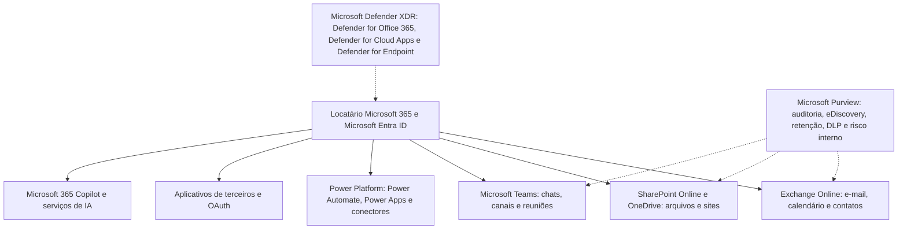

# Arquitetura do M365, Licenciamento e Prontidão Forense

> **Objetivo pedagógico:** compreender a arquitetura do Microsoft 365 (serviços, locatário, identidade, armazenamento e portais de segurança e de conformidade), o impacto do licenciamento sobre as evidências disponíveis (auditoria, retenção e detecção) e a prontidão forense do locatário, para saber, antes do incidente, o que será possível provar.

## 1. Arquitetura geral



| Componente | Função e relevância forense |
|---|---|
| Microsoft Entra ID | Identidade, autenticação e aplicativos (ver pasta 18) |
| Exchange Online | Caixas de correio, rastreamento de mensagens, regras e auditoria de caixa |
| SharePoint Online e OneDrive | Arquivos, versões, compartilhamentos e lixeiras |
| Teams | Mensagens, canais, reuniões, convidados e aplicativos |
| Power Platform | Fluxos automatizados, aplicativos e conectores (possível exfiltração e persistência) |
| Aplicativos de terceiros | Permissões OAuth e integrações |
| Copilot | Interações com dados do locatário, auditáveis conforme o licenciamento |
| Microsoft Purview | Auditoria unificada, eDiscovery, retenção, rótulos de sensibilidade, DLP e risco interno |
| Microsoft Defender XDR | Detecção, caça avançada e resposta (e-mail, identidades, endpoints e aplicativos de nuvem) |

## 2. Onde estão as evidências

| Pergunta | Fonte principal |
|---|---|
| Quem entrou e como? | Logs de entrada do Entra ID (pasta 18) |
| O que a conta fez nos serviços do M365? | Log de auditoria unificado (Purview) |
| Que e-mails foram enviados, recebidos, lidos, movidos ou excluídos? | Auditoria de caixa, rastreamento de mensagens e eventos de e-mail do Defender |
| Que arquivos foram acessados, baixados, compartilhados ou excluídos? | Auditoria do SharePoint e do OneDrive |
| Que mensagens do Teams existem? | Caixas de correio ocultas e eDiscovery; auditoria de eventos do Teams |
| Que aplicativos e fluxos têm acesso aos dados? | Entra ID (consentimentos), Power Platform e Defender for Cloud Apps |
| O que o conteúdo diz? | eDiscovery e pesquisa de conteúdo |

## 3. Licenciamento e seus efeitos nas evidências

> Os recursos e as retenções por licença mudam com frequência. Verifique no portal do locatário e na documentação vigente no início de cada caso.

| Capacidade | Efeito forense | Observação (referência) |
|---|---|---|
| Auditoria (Standard) | Registro de atividades dos usuários e administradores; retenção padrão de 180 dias | Habilitada por padrão em locatários novos; confira o parâmetro do locatário |
| Auditoria (Premium) | Retenção maior (padrão de 1 ano para usuários licenciados com os planos adequados), eventos adicionais de alto valor e políticas de retenção de auditoria | Retenção de até 10 anos com licença complementar |
| Auditoria de caixa de correio | Ações de proprietários, delegados e administradores | Habilitada por padrão; retenção padrão de 180 dias |
| `MailItemsAccessed` | Quais itens de e-mail foram acessados por clientes e por aplicativos | A Microsoft ampliou o acesso a esse evento para clientes do Audit (Standard); confirme o seu caso |
| eDiscovery (Standard e Premium) | Pesquisa, retenção legal, exportação e (Premium) revisão e análise | Funções específicas necessárias |
| Defender for Office 365 (planos 1 e 2) | Proteção de e-mail, Threat Explorer, dados de e-mail na caça avançada e investigação automatizada | Plano 2 inclui capacidades de investigação ampliadas |
| Defender for Cloud Apps | Governança de aplicativos de nuvem e atividade nos aplicativos | Integra ao `CloudAppEvents` |
| Microsoft Entra ID P1 e P2 | Retenção e detecções de identidade; acesso condicional e PIM | Ver pasta 18 |
| Insider Risk, Communication Compliance e DLP | Sinais de risco interno e de movimentação de dados sensíveis | Licenciamento próprio |
| Retenção de logs de entrada (Entra) | 7 dias (Free) e 30 dias (P1 e P2) | Exportar |

A ausência de uma licença pode significar a ausência de evidência: um dos primeiros passos de qualquer caso é inventariar o que está disponível.

## 4. Prontidão forense do locatário

| Controle | Descrição | Verificação (exemplo) |
|---|---|---|
| Auditoria unificada habilitada | Registro das atividades em todos os serviços | `Get-AdminAuditLogConfig | Format-List UnifiedAuditLogIngestionEnabled` |
| Auditoria de caixa habilitada e retenção adequada | Ações de proprietário, delegado e administrador | `Get-Mailbox usuario | Format-List AuditEnabled,AuditLogAgeLimit` |
| Exportação contínua de logs | Envio dos logs para um SIEM (por exemplo, o Microsoft Sentinel) ou data lake, com retenção maior | Conectores do Office 365 e do Entra ID |
| Retenção de auditoria prolongada | Políticas de retenção para usuários e atividades críticas (Audit Premium) | Portal do Purview |
| Retenção e retenção legal | Políticas de retenção para e-mail, Teams e arquivos conforme requisitos legais | Purview |
| Funções de investigação definidas | Funções de eDiscovery, de auditoria e de resposta, com privilégio mínimo | Portal do Purview e do Entra |
| Controle de encaminhamento e de aplicativos | Bloqueio de encaminhamento externo automático, consentimento de aplicativos restrito | Políticas de spam de saída e configuração de consentimento |
| Políticas de acesso condicional e MFA resistente a phishing | Redução de comprometimentos | Pasta 18 |
| Alertas de segurança | Alertas para regras de caixa, encaminhamentos, compartilhamentos anônimos e downloads em massa | Defender XDR e Purview |
| Contas de emergência monitoradas | Acesso privilegiado alertado | Pasta 18 |
| Locatário de teste e exercícios | Simulações de BEC, de exfiltração e de ransomware em nuvem | Contas de teste |

```powershell
# Verificações rápidas de prontidão (Exchange Online PowerShell)
Connect-ExchangeOnline
Get-AdminAuditLogConfig | Format-List UnifiedAuditLogIngestionEnabled
Get-OrganizationConfig | Format-List AuditDisabled
Get-Mailbox -ResultSize 10 | Format-List UserPrincipalName,AuditEnabled,AuditLogAgeLimit
Get-HostedOutboundSpamFilterPolicy | Format-List Name,AutoForwardingMode
Get-RemoteDomain | Format-List Name,AutoForwardEnabled
```

## 5. Aspectos legais, privacidade e relações de trabalho

> **Aviso:** este material é técnico-educacional e não substitui parecer jurídico. Valide cada caso com o Jurídico e com o DPO.

| Tema | Orientação |
|---|---|
| Monitoramento de comunicações corporativas | Exige política de uso aceitável comunicada, finalidade legítima, proporcionalidade e base legal (LGPD, arts. 6º e 7º); o Jurídico define os limites do acesso a e-mails e mensagens de colaboradores |
| Sigilo e comunicações privadas | CF, art. 5º, X e XII, e Marco Civil da Internet, art. 7º; separar o uso pessoal do corporativo e tratar comunicações privilegiadas (por exemplo, com advogados) |
| Dados pessoais nos logs | Endereços IP, assuntos e nomes de arquivos são dados pessoais; minimizar, restringir o acesso e definir a retenção |
| Acesso do investigador | Contas nominais com funções mínimas; as pesquisas de eDiscovery e de auditoria também são auditadas |
| Dados de terceiros | Convidados, clientes e parceiros: tratar conforme contratos |
| Localização dos dados | Região geográfica do locatário e dos serviços; transferência internacional (LGPD, arts. 33 a 36 e regulamentação da ANPD; confirme a norma vigente) |
| Representação dos trabalhadores | Conforme o caso, consultar o RH e o Jurídico trabalhista |

## 6. Mapeamento ATT&CK para o Microsoft 365

| Objetivo | Técnicas (exemplos) |
|---|---|
| Acesso inicial | T1078.004, T1566 (inclusive T1566.003 pelo Teams), T1199 (relação de confiança) |
| Credenciais e sessões | T1528, T1539, T1550.001, T1621 |
| Persistência | T1098.002 (delegados de e-mail), T1114.003 (regra de encaminhamento), T1137, T1098.003 |
| Coleta | T1114.002 (e-mail remoto), T1213.002 (SharePoint), T1213.005 (aplicativos de mensagens) |
| Exfiltração | T1567, T1537, T1020 (exfiltração automatizada, por exemplo, por fluxos) |
| Evasão | T1564.008 (regras de ocultação), T1070 (exclusão de indicadores), T1562 |
| Impacto | T1485, T1486 |

## 7. Exemplo prático: avaliação de prontidão

| Item | Situação | Lacuna |
|---|---|---|
| Auditoria unificada | Habilitada, retenção de 180 dias | Retenção insuficiente para investigações tardias |
| Exportação para SIEM | Apenas logs do Entra ID | Sem os logs do Exchange, do SharePoint e do Teams |
| Auditoria de caixa | Padrão, 180 dias | Aceitável; monitorar acessos |
| Encaminhamento externo | Permitido por padrão | Risco de exfiltração: bloquear |
| Consentimento de aplicativos | Usuários podem consentir | Risco de consentimento malicioso |
| Retenção legal | Sem política para Teams | Mensagens podem ser excluídas por usuários |
| Resultado | Plano de ação priorizado, com responsáveis e prazos |

## 8. Casos de uso corporativos

- Avaliação da prontidão forense do Microsoft 365 antes de auditorias e de certificações.
- Definição dos requisitos de licenciamento e de retenção alinhados à capacidade investigativa.
- Preparação do locatário para exigências de eDiscovery e de investigações internas.

## 9. Normas e frameworks relevantes

- NIST SP 800-201; NIST SP 800-92; NIST SP 800-61 Rev. 3; ISO/IEC 27017 e 27018
- MITRE ATT&CK for Cloud (SaaS e identidade)
- CIS Microsoft 365 Foundations Benchmark; Microsoft Cloud Security Benchmark
- CIS Controls v8.1, controles 6, 8, 9 e 17
- LGPD, arts. 6º, 7º, 33 a 36 e 46

## 10. Referências

- Microsoft Learn. Documentação do Microsoft Purview (Auditoria, eDiscovery e Retenção), do Exchange Online e do Microsoft Defender XDR.
- Microsoft Learn. Descrições de serviço do Microsoft 365 (auditoria, retenção e licenciamento).
- Microsoft. Incident response playbooks.
- CIS. Microsoft 365 Foundations Benchmark.
- CISA. Orientações sobre segurança do Microsoft 365 (SCuBA).
- SANS Institute. FOR509 e SEC541.
