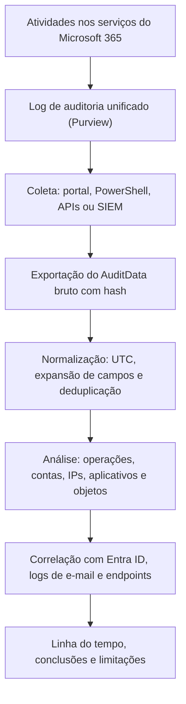

# Auditoria Unificada (Purview) e Coleta de Logs

> **Objetivo pedagógico:** coletar e interpretar o log de auditoria unificado do Microsoft 365 (Microsoft Purview), conhecendo os métodos de coleta (portal, PowerShell, APIs e SIEM), os campos do registro de auditoria, os limites de volume, de latência e de retenção, e a preservação dos resultados com integridade.

> Nomes de operações, limites e retenções mudam com frequência. Confirme-os na documentação vigente.

## 1. O que é o log de auditoria unificado

O log de auditoria unificado registra atividades de usuários, administradores, aplicativos e do sistema em serviços como Exchange Online, SharePoint, OneDrive, Teams, Entra ID, Power Platform e outros. É a principal fonte para reconstruir **o que uma conta fez** nos serviços do Microsoft 365, em complemento aos logs de entrada (pasta 18).

| Aspecto | Observação |
|---|---|
| Escopo | Locatário, com eventos de vários serviços (`Workload`) |
| Retenção padrão | 180 dias (Audit Standard); mais longa com Audit Premium e políticas de retenção de auditoria |
| Latência | Os eventos podem levar de cerca de 30 minutos até 24 horas para aparecer |
| Habilitação | Normalmente habilitada por padrão; verificar |
| Acesso | Funções de auditoria (por exemplo, "Audit Logs" e "View-Only Audit Logs") |
| Auditoria da auditoria | As pesquisas e as exportações de auditoria são, por sua vez, registradas |

## 2. Estrutura de um registro

Cada registro tem campos comuns e o campo `AuditData`, em JSON, com detalhes que dependem do serviço.

| Campo | Significado |
|---|---|
| `CreationTime` (`CreationDate`) | Horário do evento, em UTC |
| `Id` | Identificador único do registro |
| `Operation` | Nome da operação (por exemplo, `FileDownloaded`, `MailItemsAccessed`, `New-InboxRule`) |
| `RecordType` | Tipo do registro (por exemplo, SharePointFileOperation e ExchangeItem) |
| `Workload` | Serviço de origem |
| `UserId` e `UserKey` | Identidade que agiu |
| `UserType` | Tipo de identidade: regular, administrador, sistema, aplicativo, entidade de serviço e outros |
| `ResultStatus` | Sucesso ou falha |
| `ClientIP` ou `ActorIpAddress` e `ClientIPAddress` | IP de origem (pode ser IP de serviço da Microsoft) |
| `ObjectId` | Objeto afetado (arquivo, item ou recurso) |
| `UserAgent` e `ClientInfoString` | Cliente e agente de usuário |
| `ApplicationId` | Aplicativo que realizou a ação |
| `SiteUrl`, `SourceFileName`, `SourceRelativeUrl` | Detalhes de SharePoint e OneDrive |
| `MailboxOwnerUPN`, `LogonType` | Detalhes de Exchange: proprietário da caixa e tipo de logon (proprietário, administrador ou delegado) |
| `Parameters` | Parâmetros de comandos administrativos (por exemplo, de `New-InboxRule`) |

## 3. Métodos de coleta

| Método | Uso | Limites e observações |
|---|---|---|
| Portal do Microsoft Purview (pesquisa de auditoria) | Consultas interativas, filtros por data, usuário, atividade e arquivo; exportação para CSV | Limite de resultados por exportação; bom para triagem |
| PowerShell: `Search-UnifiedAuditLog` | Consultas programáticas | Até 5.000 resultados por chamada; com `ReturnLargeSet` e identificador de sessão, até 50.000 registros por consulta; repetir com janelas de tempo menores |
| Office 365 Management Activity API | Coleta contínua por assinatura de tipos de conteúdo (Azure AD, Exchange, SharePoint, General e DLP) | O conteúdo fica disponível por um período curto (cerca de 7 dias): coletar de forma contínua |
| API de consulta de log de auditoria do Microsoft Graph | Consultas assíncronas ao log de auditoria | Recurso em evolução; verificar a disponibilidade |
| Conector do Microsoft Sentinel (tabela `OfficeActivity`) | Retenção longa e consultas em KQL | Verifique a cobertura dos serviços |
| Defender XDR (`CloudAppEvents`) | Caça avançada com atividade de aplicativos em nuvem | Requer integração do Defender for Cloud Apps com o Microsoft 365 |
| Ferramentas de extração (por exemplo, Microsoft-Extractor-Suite) | Coleta automatizada e formatada | Validar a versão e os resultados |

### 3.1 Exemplo com PowerShell (paginação de grandes volumes)

```powershell
Connect-ExchangeOnline

$inicio = Get-Date "2026-10-20T00:00:00Z"
$fim    = Get-Date "2026-10-31T23:59:59Z"
$sessao = "DFL2026001-" + (Get-Date -Format yyyyMMddHHmmss)
$todos  = @()

do {
    $pagina = Search-UnifiedAuditLog -StartDate $inicio -EndDate $fim `
        -UserIds "usuario@exemplo.com" -SessionId $sessao -SessionCommand ReturnLargeSet -ResultSize 5000
    if ($pagina) { $todos += $pagina }
} while ($pagina -and $pagina.Count -gt 0)

# Remover duplicidades por identificador e exportar com o AuditData bruto
$unicos = $todos | Sort-Object Identity -Unique
$unicos | Select-Object CreationDate, UserIds, Operations, RecordType, AuditData |
    Export-Csv .\ual_usuario_E030.csv -NoTypeInformation -Encoding UTF8
(Get-FileHash .\ual_usuario_E030.csv -Algorithm SHA256).Hash | Out-File .\ual_usuario_E030.csv.sha256

# Expandir campos do AuditData para análise
$unicos | ForEach-Object {
    $d = $_.AuditData | ConvertFrom-Json
    [pscustomobject]@{ Hora=$_.CreationDate; Operacao=$_.Operations; IP=$d.ClientIP; Objeto=$d.ObjectId; Agente=$d.UserAgent }
} | Export-Csv .\ual_usuario_E030_resumo.csv -NoTypeInformation -Encoding UTF8
```

Observações: se uma janela retornar o limite máximo, **divida o período em intervalos menores** para não perder registros; mantenha o `AuditData` bruto como evidência e produza as colunas expandidas como camada derivada (pasta 11).

### 3.2 Filtros por operação (exemplos)

```powershell
# Regras de caixa e encaminhamentos (ver pasta 12)
Search-UnifiedAuditLog -StartDate $inicio -EndDate $fim -UserIds "usuario@exemplo.com" `
  -Operations New-InboxRule,Set-InboxRule,UpdateInboxRules,Set-Mailbox -ResultSize 5000

# Downloads e sincronizações de arquivos
Search-UnifiedAuditLog -StartDate $inicio -EndDate $fim -UserIds "usuario@exemplo.com" `
  -Operations FileDownloaded,FileSyncDownloadedFull -ResultSize 5000

# Compartilhamentos e links anônimos
Search-UnifiedAuditLog -StartDate $inicio -EndDate $fim `
  -Operations SharingSet,AnonymousLinkCreated,SharingInvitationCreated -ResultSize 5000
```

### 3.3 KQL no Sentinel e no Defender XDR

```kusto
// Sentinel: atividade de SharePoint e OneDrive de um usuário
OfficeActivity
| where TimeGenerated > ago(14d)
| where OfficeWorkload in ("SharePoint", "OneDrive")
| where UserId =~ "usuario@exemplo.com"
| project TimeGenerated, Operation, UserId, ClientIP, OfficeObjectId, SourceFileName, UserAgent
| order by TimeGenerated asc
```

```kusto
// Defender XDR: atividade de aplicativos em nuvem
CloudAppEvents
| where Timestamp > ago(14d)
| where AccountDisplayName == "Nome Exemplo"
| project Timestamp, ActionType, Application, IPAddress, ObjectName, UserAgent
| order by Timestamp asc
```

## 4. Limitações e armadilhas

| Limitação | Efeito | Mitigação |
|---|---|---|
| Latência de ingestão | Eventos recentes podem faltar | Repetir a consulta depois e registrar o horário da coleta |
| Limite de resultados | Resultados truncados | Dividir o período e paginar; conferir contagens |
| Retenção limitada | Eventos antigos indisponíveis | Exportar continuamente para retenção própria |
| IPs de serviços Microsoft | Atribuição enganosa de origem | Verificar o `UserAgent`, o aplicativo e o tipo de logon |
| Eventos agregados e limitados (por exemplo, `MailItemsAccessed`) | Nem todo acesso gera um registro individual | Entender as regras de agregação do evento |
| Atividade de aplicativos e de serviços | Identidades de aplicativo e do sistema aparecem como `UserType` próprios | Filtrar por tipo de usuário e por aplicativo |
| Operações não auditadas | Algumas ações não geram evento | Declarar a limitação e buscar fontes complementares |
| Mudança de nomes | Operações são renomeadas ou agrupadas | Consultar a documentação vigente |
| Fusos | Datas e horas em UTC | Normalizar (pasta 05) |

## 5. Preservação e integridade

| Medida | Descrição |
|---|---|
| Exportar o conjunto completo com `AuditData` bruto | Arquivos CSV ou JSON, com hash |
| Registrar a consulta | Datas, usuários, operações, método, conta usada e horário (UTC) |
| Conferir a contagem | Comparar o número de registros com o relatado pelo portal |
| Armazenamento protegido | Repositório com controle de acesso, criptografia e imutabilidade (pastas 02 e 04) |
| Retenção estendida | Para casos em andamento, exportar antes que os dados expirem; considerar políticas de retenção de auditoria |
| Cadeia de custódia | Formulários da pasta 02 |
| Separação entre bruto e derivado | Preservar o bruto e documentar as transformações (pasta 11) |



## 6. Operações de alto valor investigativo (referência)

| Categoria | Operações e eventos (exemplos) |
|---|---|
| E-mail | `MailItemsAccessed`, `Send`, `SendAs`, `SendOnBehalf`, `MoveToDeletedItems`, `SoftDelete`, `HardDelete`, `UpdateInboxRules`, `New-InboxRule`, `Set-Mailbox`, `Add-MailboxPermission` |
| Arquivos | `FileAccessed`, `FileDownloaded`, `FileSyncDownloadedFull`, `FileModified`, `FileDeleted`, `FileRecycled`, `FileRenamed`, `FileMoved`, `FileCopied` |
| Compartilhamento | `SharingSet`, `SharingInvitationCreated`, `AnonymousLinkCreated`, `AnonymousLinkUsed`, `SecureLinkCreated`, `AddedToSecureLink` |
| Administração de sites | `SiteCollectionAdminAdded`, `PermissionLevelAdded`, `SiteAdminChangeRequest` |
| Teams | `MemberAdded`, `ChannelAdded`, `TeamCreated`, `MessageUpdated`, `MessageDeleted`, `AppInstalled`, `TeamsSessionStarted` |
| Entra e consentimentos | `Consent to application`, `Add service principal`, `Add member to role`, `Update user` |
| Conformidade | `SearchCreated`, `SearchExported`, `HoldCreated`, `CaseAdded` (eDiscovery) |
| Power Platform | Eventos de criação, edição e exclusão de fluxos e conexões |
| Copilot | `CopilotInteraction` (conforme disponibilidade) |
| Proteção | `FileMalwareDetected`, alertas de DLP, rótulos de sensibilidade alterados |

## 7. Exemplo prático: reconstrução de atividade de uma conta

| Hora (UTC) | Fonte | Evento | Interpretação |
|---|---|---|---|
| 13:04 | Entra ID | Entrada com MFA de IP de hospedagem (pasta 18) | Acesso do atacante |
| 13:12 | UAL (Exchange) | `MailItemsAccessed` (Sync) com aplicativo desconhecido | Leitura em massa da caixa |
| 13:15 | UAL (Entra) | `Consent to application` com `Mail.Read` | Persistência por aplicativo |
| 13:20 | UAL (Exchange) | `New-InboxRule`: mover mensagens "fatura" para RSS | Ocultação |
| 13:40 | UAL (SharePoint) | 640 `FileDownloaded` do site Financeiro em 12 minutos | Coleta de arquivos |
| 14:05 | UAL (Exchange) | `Send` de 9 mensagens para fornecedores | Fraude (BEC) |
| Conclusão | Tomada de conta com coleta de e-mail e de arquivos, persistência por aplicativo e fraude; confiança alta; ações descritas nas pastas 12 e 18 |

## 8. Casos de uso corporativos

- Reconstrução de atividade de contas comprometidas e de insiders.
- Exportação contínua e retenção prolongada de auditoria para conformidade.
- Elaboração de detecções (alertas) a partir de operações de alto valor.

## 9. Normas e frameworks relevantes

- NIST SP 800-92; NIST SP 800-53 Rev. 5 (AU-2, AU-3, AU-6, AU-9 e AU-11); ISO/IEC 27002:2022, controles 8.15 e 8.16
- MITRE ATT&CK for Cloud: T1114, T1213.002, T1530, T1098, T1562, T1070
- CIS Microsoft 365 Foundations Benchmark; CIS Controls v8.1, controle 8
- LGPD, arts. 6º e 46

## 10. Referências

- Microsoft Learn. Microsoft Purview Audit (Standard e Premium), `Search-UnifiedAuditLog`, Office 365 Management Activity API e API de consulta de auditoria do Microsoft Graph.
- Microsoft Learn. Tabelas `OfficeActivity` (Sentinel) e `CloudAppEvents` (Defender XDR).
- Invictus Incident Response. Microsoft-Extractor-Suite (documentação).
- Kent, K.; Souppaya, M. NIST SP 800-92. 2006.
- SANS Institute. FOR509 e SEC541.
