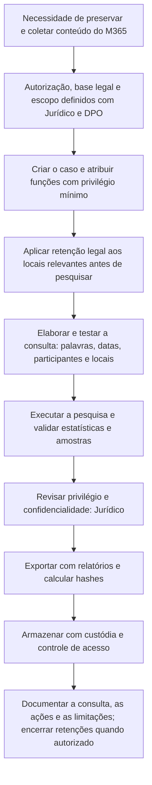

# eDiscovery, Retenção e Preservação no Purview

> **Objetivo pedagógico:** usar o Microsoft Purview (eDiscovery, retenção e retenção legal) para preservar, pesquisar, coletar e exportar conteúdo do Microsoft 365 de forma defensável, com escopo, funções, auditoria e cadeia de custódia, e conhecer os limites de cada recurso.

> As interfaces e os nomes de recursos do Purview mudam com frequência. Os procedimentos abaixo descrevem os conceitos e os comandos de referência; confirme-os na documentação vigente.

## 1. Conceitos

| Conceito | Descrição |
|---|---|
| Retenção legal (hold) | Preserva o conteúdo de locais específicos (caixas de correio, sites e Teams), impedindo a exclusão definitiva; independe da ação do usuário |
| Política de retenção | Reter e (ou) excluir conteúdo por prazos definidos, por regra de conformidade e não por litígio |
| Rótulos de retenção | Aplicados a itens específicos, manual ou automaticamente |
| Pesquisa de conteúdo | Consulta em KQL sobre caixas, sites, Teams e outros locais, com estatísticas e visualização por amostras |
| Caso de eDiscovery (Standard) | Contêiner de pesquisas, retenções legais e exportações, com permissões por caso |
| eDiscovery (Premium) | Custodiantes, avisos, coleta, conjuntos de revisão, análise e exportação com metadados e carga para plataformas de revisão |
| Exportação | Resultados em arquivos nativos, PST ou formatos com relatórios (conforme o recurso) |
| Caixas inativas | Caixas de ex-colaboradores mantidas por retenção, pesquisáveis |
| Itens recuperáveis | Camada de itens excluídos mantida por retenção (pasta 12) |

## 2. Quando usar cada recurso

| Necessidade | Recurso recomendado |
|---|---|
| Preservar imediatamente o conteúdo de um usuário para investigação | Retenção legal de litígio na caixa e retenção legal de caso de eDiscovery nos locais relevantes (OneDrive, Teams e sites) |
| Pesquisar e exportar mensagens e arquivos para um caso | Caso de eDiscovery com pesquisa e exportação |
| Revisão em larga escala, com análise de threads e de duplicatas | eDiscovery (Premium) |
| Pesquisa rápida e pontual, sem manutenção do caso | Pesquisa de conteúdo, com cautela quanto à documentação |
| Retenção contínua por requisito regulatório | Políticas e rótulos de retenção |
| Pesquisa da auditoria | Auditoria unificada (arquivo 2) |

## 3. Fluxo defensável



## 4. Funções e controle de acesso

| Função (exemplos) | Capacidade |
|---|---|
| Gerente de eDiscovery | Cria e gerencia casos e pesquisas, e exporta dados |
| Administrador de eDiscovery | Acesso ampliado a todos os casos |
| Revisor | Revisa conteúdo em conjuntos de revisão |
| Pesquisa de conteúdo | Executa pesquisas sem gerenciamento de casos |
| Filtros de permissões de pesquisa | Restringem os locais que um investigador pode pesquisar |
| Auditoria | Registro de pesquisas, retenções e exportações |

Boas práticas: separar quem **coleta** de quem **revisa**; restringir por escopo (departamento ou caso); revisar periodicamente quem tem funções de eDiscovery; usar PIM para funções privilegiadas. Um administrador de eDiscovery comprometido pode pesquisar e exportar caixas inteiras, de modo que essas contas devem ser tratadas como de alto privilégio e monitoradas (eventos de pesquisa e de exportação no log de auditoria).

## 5. Comandos de referência (Segurança e Conformidade)

```powershell
# Conectar ao PowerShell de Segurança e Conformidade
Connect-IPPSSession

# Retenção legal de litígio em uma caixa (Exchange Online), com duração em dias
Connect-ExchangeOnline
Set-Mailbox -Identity usuario@exemplo.com -LitigationHoldEnabled $true -LitigationHoldDuration 2555 `
  -LitigationHoldOwner "DFL-2026-001" -LitigationHoldDate (Get-Date)

# Pesquisa de conteúdo de e-mails do usuário em um período e por assunto
New-ComplianceSearch -Name "DFL-2026-001-S01" -ExchangeLocation usuario@exemplo.com `
  -ContentMatchQuery '(received>=2026-10-01 AND received<=2026-10-31) AND (subject:"pagamento")'
Start-ComplianceSearch -Identity "DFL-2026-001-S01"
Get-ComplianceSearch -Identity "DFL-2026-001-S01" | Format-List Name,Status,Items,Size,JobEndTime

# Pesquisa de mensagens do Teams de um usuário (consulta KQL com o tipo de conteúdo)
New-ComplianceSearch -Name "DFL-2026-001-S02" -ExchangeLocation usuario@exemplo.com `
  -ContentMatchQuery 'kind:microsoftteams AND (sent>=2026-10-01 AND sent<=2026-10-31)'

# Exportação dos resultados (ação de exportação; o download usa a ferramenta de exportação do portal)
New-ComplianceSearchAction -SearchName "DFL-2026-001-S01" -Export
```

Em casos de eDiscovery, as retenções legais e as pesquisas são criadas dentro do caso, pelo portal ou pelos cmdlets correspondentes (por exemplo, `New-ComplianceCase`, `New-CaseHoldPolicy` e `New-CaseHoldRule`). Teste a consulta antes de exportar e registre o texto completo da consulta.

## 6. Consultas KQL: boas práticas

| Prática | Exemplo |
|---|---|
| Limitar por período e participantes | `(sent>=2026-10-01 AND sent<=2026-10-31) AND (participants:"usuario@exemplo.com")` |
| Termos exatos entre aspas | `subject:"proposta comercial"` |
| Combinar palavras com operadores | `(contrato OR aditivo) AND NOT "newsletter"` |
| Tipo de conteúdo | `kind:email`, `kind:microsoftteams`, `kind:docs` |
| Pesquisar anexos e nomes de arquivos | `filename:"orcamento"` |
| Validar com amostras e estatísticas | Revisar os resultados antes da exportação |
| Evitar consultas amplas demais | Minimização e desempenho |
| Registrar a versão da consulta | Quem, quando e por quê |

## 7. Exportação e cadeia de custódia

| Etapa | Prática |
|---|---|
| Relatórios da exportação | Preservar o resumo e a lista de resultados (relatórios gerados) |
| Chave de exportação | Tratar como credencial: não registrar em texto claro |
| Hashes | Calcular o hash (SHA-256) de cada arquivo ou pacote exportado e de relatórios |
| Armazenamento | Repositório seguro, com controle de acesso e imutabilidade (pastas 02 e 04) |
| Formato | Manter o formato nativo quando possível; PST é conveniente, mas altera a estrutura (pasta 12) |
| Metadados | Preservar relatórios com datas, remetentes, destinatários e identificadores |
| Documentação | Termo de extração com consulta, locais, datas, funções e responsáveis |
| Cópia de trabalho | Analisar em cópia e preservar o original |

```powershell
# Hashes dos arquivos exportados
Get-ChildItem .\Exportacao_DFL-2026-001 -Recurse -File | Get-FileHash -Algorithm SHA256 |
  Select-Object Hash, Path | Export-Csv .\hashes_exportacao_DFL-2026-001.csv -NoTypeInformation
```

## 8. Limitações e cuidados

| Limitação | Efeito | Mitigação |
|---|---|---|
| Itens indexáveis versus não indexáveis | Alguns itens (por exemplo, formatos não suportados) não aparecem nos resultados | Incluir itens não indexados na exportação, quando necessário |
| Mensagens do Teams, reações e conteúdo efêmero | Cobertura parcial | Confirmar o que é retido |
| Retenção insuficiente | Itens já excluídos definitivamente | Retenção legal antecipada |
| Limites de pesquisa e exportação | Pacotes fragmentados | Dividir por período ou por local |
| Privilégio e confidencialidade | Exposição de comunicações com advogados | Filtro e revisão pelo Jurídico antes da entrega |
| Tempo de aplicação de retenções | A retenção pode levar tempo para ser efetivada | Aplicar logo e verificar o estado |
| Itens de terceiros e de convidados | Dados de outras pessoas | Minimização e base legal |

## 9. Aspectos legais e éticos

| Tema | Orientação |
|---|---|
| Base legal e escopo | Definidos pelo Jurídico e pelo DPO; documentados |
| Comunicações privilegiadas e privadas | Tratamento específico e revisão jurídica |
| Minimização | Coletar apenas o necessário ao caso |
| Dados pessoais e sensíveis | Acesso restrito; retenção e descarte conforme a política (LGPD, arts. 6º, 15, 16 e 46) |
| Autoria da coleta | Investigador nominal; as ações são auditadas |
| Término do caso | Remover retenções legais quando autorizado, e descartar as cópias conforme a política |

## 10. Exemplo prático: coleta para ação trabalhista

| Etapa | Registro |
|---|---|
| Autorização | Pedido do Jurídico, com escopo: um gerente e dois diretores, período de 1/2026 a 10/2026 |
| Retenção | Litigation hold nas três caixas; retenção legal do caso no OneDrive e no Teams |
| Consulta | `(sent>=2026-01-01 AND sent<=2026-10-31) AND (participants:"gerente@exemplo.com") AND ("contrato" OR "comissão")` |
| Validação | Estatísticas: 3.210 itens; amostra revisada pelo Jurídico; exclusão de comunicações com advogados |
| Exportação | Arquivos nativos e relatório; hashes calculados; custódia registrada |
| Documentação | Termo com a consulta, os locais, as datas e os responsáveis; auditoria da exportação anexada |
| Encerramento | Retenções mantidas até o fim da ação; revisão semestral |

## 11. Casos de uso corporativos

- Atendimento de ordens judiciais, de auditorias e de investigações internas.
- Preservação rápida de dados de colaboradores em desligamento ou sob investigação.
- Definição de políticas de retenção alinhadas às obrigações legais.

## 12. Normas e frameworks relevantes

- ISO/IEC 27050-1 a 4 (descoberta eletrônica); EDRM (Electronic Discovery Reference Model)
- ISO/IEC 27037:2012; NIST IR 8387
- CPC (Lei nº 13.105/2015) e legislação processual quanto à prova documental e eletrônica; Marco Civil da Internet
- ISO/IEC 27002:2022, controles 5.33 (proteção de registros) e 8.10 (exclusão de informações)
- LGPD, arts. 6º, 7º, 15, 16 e 46

## 13. Referências

- Microsoft Learn. Microsoft Purview eDiscovery (Standard e Premium), pesquisa de conteúdo, retenção legal, políticas e rótulos de retenção.
- Microsoft Learn. Cmdlets do PowerShell de Segurança e Conformidade (`New-ComplianceSearch`, `New-ComplianceSearchAction`).
- EDRM. Electronic Discovery Reference Model.
- ISO/IEC 27050. Electronic discovery.
- SANS Institute. FOR509 e FOR518.
