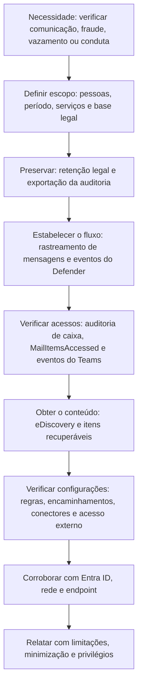

# Exchange Online e Teams: Evidências de Comunicação

> **Objetivo pedagógico:** investigar evidências de comunicação no Exchange Online e no Microsoft Teams (auditoria de caixa, rastreamento de mensagens, configurações de fluxo de e-mail, dados de proteção do Defender for Office 365, mensagens de chat e de canal, reuniões e acesso externo), recuperar conteúdo excluído e interpretar as limitações.

> O Exchange Online já foi tratado quanto a phishing, a regras de caixa e a comprometimento de contas na pasta 12. Este arquivo complementa com fontes adicionais e com o Teams.

## 1. Exchange Online: fontes e o que respondem

| Pergunta | Fonte |
|---|---|
| Que mensagens entraram e saíram da organização, e com qual resultado? | Rastreamento de mensagens (message trace) |
| Quem abriu, moveu, excluiu ou enviou itens em uma caixa? | Auditoria de caixa (proprietário, delegado e administrador) |
| Que itens foram acessados por clientes e aplicativos? | `MailItemsAccessed` (conforme licenciamento) |
| Que regras, encaminhamentos, delegações e conectores existem? | Configuração da caixa e do locatário |
| Como a mensagem foi tratada pelos filtros de proteção? | Eventos de e-mail do Defender for Office 365 e Threat Explorer |
| Quem clicou no link depois da entrega? | `UrlClickEvents` e proteção de links |
| O que foi removido pós-entrega? | `EmailPostDeliveryEvents` (por exemplo, ZAP e remoção) |
| O que existe na caixa, inclusive itens excluídos? | Itens recuperáveis, retenção e eDiscovery |

## 2. Auditoria de caixa

| Tipo de logon | Descrição |
|---|---|
| Proprietário | O titular da caixa |
| Delegado | Alguém com permissão de acesso (acesso total, enviar como ou em nome de) |
| Administrador | Acesso por funções administrativas ou por ferramentas |

| Ação (exemplos) | Interpretação |
|---|---|
| `MailItemsAccessed` (`Bind` e `Sync`) | Leitura de itens; `Sync` indica sincronização por cliente ou aplicativo (por exemplo, leitura em massa) |
| `Send`, `SendAs`, `SendOnBehalf` | Envio pela caixa |
| `MoveToDeletedItems`, `SoftDelete`, `HardDelete` | Exclusões |
| `MoveToFolder`, `Copy`, `Create`, `Update` | Alterações de itens |
| `UpdateInboxRules`, `New-InboxRule` | Regras de caixa |
| `Add-MailboxPermission`, `Add-RecipientPermission`, `Set-Mailbox` | Delegações, permissões e encaminhamentos |

Observações: `MailItemsAccessed` tem regras de agregação e de limitação de volume; uma ausência de registro não significa ausência de acesso se o volume exceder os limites. A auditoria de caixa vem habilitada por padrão, com retenção padrão de 180 dias; verifique o parâmetro da caixa.

```powershell
# Verificar a auditoria e as ações auditadas da caixa
Get-Mailbox usuario@exemplo.com | Format-List AuditEnabled,AuditLogAgeLimit,AuditOwner,AuditDelegate,AuditAdmin

# Permissões e delegações
Get-MailboxPermission -Identity usuario@exemplo.com | Where-Object { $_.User -notlike "NT AUTHORITY*" }
Get-RecipientPermission -Identity usuario@exemplo.com
```

## 3. Rastreamento de mensagens

| Aspecto | Observação |
|---|---|
| Alcance | Registra o trânsito e o resultado da entrega (entregue, falhou, em quarentena, expandida, filtrada); não contém o corpo da mensagem |
| Retenção e consulta | Pesquisa rápida para um período recente e pesquisas históricas para até 90 dias, com relatório por e-mail |
| Cmdlets | `Get-MessageTrace` ou `Get-MessageTraceV2` (conforme a versão do módulo) e `Start-HistoricalSearch` |
| Campos úteis | Remetente, destinatário, assunto, IP de origem, status, identificador da mensagem (`MessageId`) e identificador de rede |

```powershell
# Mensagens enviadas por uma conta nos últimos dias (cmdlet conforme a versão do módulo)
Get-MessageTrace -SenderAddress usuario@exemplo.com -StartDate (Get-Date).AddDays(-10) -EndDate (Get-Date) |
  Select-Object Received, SenderAddress, RecipientAddress, Subject, Status, FromIP, MessageId |
  Export-Csv .\messagetrace_E031.csv -NoTypeInformation

# Pesquisa histórica (relatório por e-mail), para períodos mais longos
Start-HistoricalSearch -ReportTitle "DFL-2026-001 mensagens da conta" -ReportType MessageTrace `
  -StartDate (Get-Date).AddDays(-60) -EndDate (Get-Date) -SenderAddress usuario@exemplo.com -NotifyAddress investigador@exemplo.com
```

## 4. Configurações que afetam o fluxo e a exfiltração

| Item | Consulta | Risco |
|---|---|---|
| Regras de fluxo de e-mail (transporte) | `Get-TransportRule` | Redirecionamento e cópia oculta (Bcc) em nível do locatário |
| Conectores de entrada e de saída | `Get-InboundConnector`, `Get-OutboundConnector` | Conectores criados por atacantes para enviar ou desviar e-mails |
| Encaminhamento automático | `Get-HostedOutboundSpamFilterPolicy` e `Get-RemoteDomain` | Encaminhamento externo permitido |
| Regras de caixa e encaminhamento da caixa | `Get-InboxRule`, `Get-Mailbox` | Ver pasta 12 |
| Domínios aceitos e registros de DNS | `Get-AcceptedDomain` | Abuso de domínios |
| Funções de gerenciamento | Atribuições de funções administrativas | Persistência |

```powershell
Get-TransportRule | Format-List Name,State,Priority,SentTo,RedirectMessageTo,BlindCopyTo,CreatedBy,WhenChanged
Get-InboundConnector | Format-List Name,Enabled,SenderDomains,SenderIPAddresses,WhenCreated
Get-OutboundConnector | Format-List Name,Enabled,RecipientDomains,SmartHosts,WhenCreated
```

## 5. Defender for Office 365 e caça avançada

| Tabela (Defender XDR) | Conteúdo |
|---|---|
| `EmailEvents` | Mensagens, remetentes, destinatários, assuntos, resultado de entrega e de ameaças, autenticação |
| `EmailAttachmentInfo` | Anexos, hashes e tipos |
| `EmailUrlInfo` | URLs contidas nas mensagens |
| `EmailPostDeliveryEvents` | Ações após a entrega (por exemplo, remoção automática) |
| `UrlClickEvents` | Cliques em links, com usuário, URL e IP |

```kusto
// Mensagens com um anexo malicioso conhecido e quem as recebeu e abriu links
EmailAttachmentInfo
| where Timestamp > ago(14d) and SHA256 == "<hash_do_anexo>"
| join kind=inner EmailEvents on NetworkMessageId
| project Timestamp, SenderFromAddress, RecipientEmailAddress, Subject, DeliveryAction, DeliveryLocation, FileName
```

```kusto
// Cliques em uma URL suspeita
UrlClickEvents
| where Timestamp > ago(14d) and Url has "dominio-suspeito.exemplo"
| project Timestamp, AccountUpn, Url, ActionType, IPAddress
```

O Threat Explorer (plano 2) permite pesquisar mensagens por muitos atributos e executar ações de remoção (purge); registre cada ação, pois remover mensagens altera o estado da evidência. Preserve antes de remover.

## 6. Itens recuperáveis e retenção

Os mecanismos de recuperação (itens recuperáveis, retenção legal e retenção de itens excluídos) são descritos na pasta 12. Pontos adicionais:

| Item | Observação |
|---|---|
| Retenção legal de litígio (litigation hold) | Preserva o conteúdo, inclusive o excluído pelo usuário; aplicar antes da coleta |
| Retenção por políticas de retenção do Purview | Preserva em pastas ocultas e pode impedir a exclusão definitiva |
| Caixas inativas | Caixa de ex-colaborador preservada por retenção, acessível a eDiscovery |
| Exclusão pelo administrador | Registrada na auditoria; verificar quem excluiu contas e caixas |

## 7. Microsoft Teams

### 7.1 Onde ficam os dados

| Dado | Armazenamento | Observação |
|---|---|---|
| Mensagens de chat | Pasta oculta na caixa de correio de cada participante (Exchange Online) | Pesquisáveis por eDiscovery; sujeitas a retenção |
| Mensagens de canal | Caixa de correio do grupo associado à equipe | Idem |
| Arquivos compartilhados em canais | SharePoint (site da equipe) | Auditoria do SharePoint |
| Arquivos compartilhados em chats | OneDrive do remetente | Auditoria do OneDrive |
| Gravações e transcrições de reuniões | OneDrive ou SharePoint | Permissões e acesso auditáveis |
| Eventos do Teams | Log de auditoria unificado | Membros, canais, aplicativos, sessões e alterações |
| Dados de chamadas e de reuniões | Relatórios do Teams e logs de uso | Metadados |

### 7.2 Eventos de auditoria e indícios

| Evento (exemplos) | Interpretação |
|---|---|
| `TeamsSessionStarted` | Início de sessão do cliente |
| `MemberAdded` e `MemberRemoved` | Alterações de membros, inclusive convidados externos |
| `ChannelAdded` e `TeamCreated` | Estruturas novas |
| `AppInstalled` e eventos de bots e conectores | Aplicativos adicionados (possível abuso) |
| `MessageUpdated` e `MessageDeleted` | Edição e exclusão de mensagens (o conteúdo original pode estar retido) |
| Acesso externo e federação | Mensagens de locatários externos, usado em phishing e em engenharia social |

Indícios de abuso: contas externas ou convidados criados recentemente enviando mensagens e links a usuários internos (T1566.003); aplicativos instalados fora do padrão; exclusão de mensagens após incidente; compartilhamento de arquivos sensíveis com externos.

```powershell
# Configurações de acesso externo e federação (módulos do Teams ou do Skype for Business Online; verifique a versão)
Get-CsTenantFederationConfiguration | Format-List AllowFederatedUsers,AllowedDomains,BlockedDomains,AllowPublicUsers
```

### 7.3 Coleta de conteúdo do Teams

O conteúdo das mensagens é obtido por **eDiscovery** (pesquisa de conteúdo) nas caixas dos usuários e dos grupos, por exemplo, com a consulta `kind:microsoftteams` e filtros de participantes e de datas (ver o arquivo de eDiscovery). Considere:

| Aspecto | Observação |
|---|---|
| Retenção | Se não houver política de retenção, as mensagens excluídas pelo usuário podem ficar indisponíveis após o período de recuperação |
| Retenção legal | Aplicar antes da pesquisa |
| Mensagens editadas e excluídas | Versões originais podem ser retidas conforme as políticas |
| Reações, imagens e arquivos | Conteúdo em armazenamento distinto |
| Privacidade | Chats privados exigem base legal, escopo e minimização |

## 8. Fluxo de investigação de comunicação



## 9. Exemplo prático: chat externo no Teams e roubo de credenciais

| Hora (UTC) | Evento | Interpretação |
|---|---|---|
| 09:00 | UAL: contas externas de um locatário recém-criado enviam mensagens a 14 usuários da área financeira, com um link para "atualização de segurança" | Phishing por Teams (T1566.003) |
| 09:05 a 09:30 | `UrlClickEvents`: 5 cliques; Entra ID: 2 entradas bem-sucedidas de IP de hospedagem | Credenciais comprometidas (pasta 18) |
| 09:40 | UAL (Exchange): `New-InboxRule` e `MailItemsAccessed` (Sync) nas 2 contas | Persistência e coleta |
| Resposta | Preservar; bloquear o domínio externo na federação do Teams; revogar sessões e redefinir as contas; remover regras; pesquisar e remover as mensagens (após preservar); orientar os usuários |
| Prevenção | Restringir o acesso externo a domínios permitidos; alertas para aplicativos e mensagens externas com links |

## 10. Casos de uso corporativos

- Investigação de fraudes de pagamento e de comunicações em disputas trabalhistas.
- Análise de vazamentos por e-mail e por chats.
- Avaliação de controles de comunicação externa no Exchange e no Teams.

## 11. Normas e frameworks relevantes

- MITRE ATT&CK for Cloud e SaaS: T1566.003, T1534, T1114.002, T1114.003, T1213.005, T1098.002, T1564.008
- NIST SP 800-177 Rev. 1; NIST SP 800-61 Rev. 3
- CIS Microsoft 365 Foundations Benchmark; CIS Controls v8.1, controles 9 e 17
- LGPD, arts. 6º, 7º e 46; CF, art. 5º, X e XII

## 12. Referências

- Microsoft Learn. Exchange Online (auditoria de caixa, rastreamento de mensagens e fluxo de e-mail), Defender for Office 365 e Teams (auditoria, retenção e eDiscovery).
- Microsoft. Incident response playbooks (phishing e BEC).
- Documentação do Exchange Online PowerShell.
- Invictus Incident Response. Microsoft-Extractor-Suite.
- Rose, S. et al. NIST SP 800-177 Rev. 1. 2019.
- SANS Institute. FOR509.
