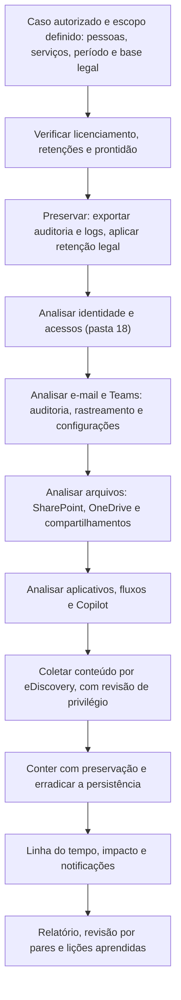

# Ferramentas, Fluxo, Modelos e Checklist de M365

> **Objetivo pedagógico:** padronizar as ferramentas, as permissões do investigador, o fluxo de trabalho, os registros e a verificação de qualidade das investigações no Microsoft 365, de modo que sejam reproduzíveis, seguras, proporcionais ao escopo autorizado e defensáveis.

## 1. Ferramentas por finalidade

| Finalidade | Ferramentas |
|---|---|
| Auditoria e conformidade | Portal do Microsoft Purview (Auditoria, eDiscovery e Retenção) |
| Linha de comando | Exchange Online PowerShell, Security & Compliance PowerShell (`Connect-IPPSSession`), Microsoft Graph PowerShell, módulos do SharePoint, do Teams e do Power Platform |
| Coleta automatizada | Microsoft-Extractor-Suite, Hawk, Office 365 Management Activity API, API de auditoria do Graph |
| Consulta e correlação | Microsoft Sentinel (KQL), Microsoft Defender XDR (caça avançada), Log Analytics |
| Proteção de e-mail | Threat Explorer e relatórios do Defender for Office 365 |
| Governança de aplicativos | Defender for Cloud Apps, Entra ID (aplicativos empresariais) |
| Linha do tempo | Plaso, Timesketch e planilhas (pasta 05) |
| Hashes e integridade | `Get-FileHash`, `sha256sum` (pasta 04) |
| Análise de arquivos e de cabeçalhos | Ferramentas das pastas 12 e 15 |
| Simulação (somente em locatário de teste) | Simulador de ataques do Defender for Office 365 e exercícios controlados |
| Documentação | Modelos deste arquivo e repositório versionado |

Registre nome, versão, origem e permissões usadas. O acesso do investigador deve ser por conta nominal, com funções mínimas e registrado.

## 2. Contas e funções do investigador (referência)

| Necessidade | Função típica (privilégio mínimo) |
|---|---|
| Pesquisar a auditoria | Funções de auditoria (por exemplo, leitura de logs de auditoria) |
| Ler a configuração do Exchange Online | Funções somente leitura de organização |
| Pesquisar e exportar conteúdo | Gerente de eDiscovery, por caso e com filtros de escopo |
| Ler logs de entrada e de auditoria do Entra | Leitor de Segurança ou Leitor de Relatórios |
| Caça avançada | Leitor de Segurança no Defender XDR |
| Alterações de contenção | Funções específicas, ativadas por PIM e registradas |

Toda a atividade do investigador deve ser auditável e revisada no final do caso.

## 3. Fluxo de trabalho padronizado

## 4. Dez perguntas e como respondê-las

| Pergunta | Onde responder |
|---|---|
| 1. Quais serviços, contas e período estão no escopo, e há base legal? | Autorização, Jurídico e DPO |
| 2. Que evidências existem (licenciamento e retenção)? | Inventário de prontidão |
| 3. Como o acesso ocorreu e que identidades foram usadas? | Logs de entrada e de auditoria do Entra |
| 4. O que a conta fez nos serviços do M365? | Auditoria unificada |
| 5. O que aconteceu com os e-mails e as mensagens? | Auditoria de caixa, rastreamento, eventos do Defender e Teams |
| 6. Que arquivos foram acessados, baixados, compartilhados ou destruídos? | Auditoria do SharePoint e do OneDrive |
| 7. Há aplicativos, fluxos ou integrações com acesso aos dados? | Consentimentos, Power Platform e Graph |
| 8. Qual o conteúdo relevante e quem pode vê-lo? | eDiscovery, com revisão de privilégio |
| 9. Quais obrigações legais e contratuais se aplicam? | Jurídico, DPO e contratos |
| 10. Que limitações precisam ser declaradas? | Retenção, licenciamento, latência e eventos não registrados |

## 5. Modelo A: Inventário de Prontidão e Escopo do M365

| Item | Situação |
|---|---|
| Locatário e região dos dados | |
| Licenças relevantes (Audit Standard ou Premium, eDiscovery Standard ou Premium, Defender for Office 365, Entra P1 ou P2) | |
| Auditoria unificada habilitada e retenção | |
| Auditoria de caixa (retenção) | |
| Exportação para SIEM e retenção prolongada | |
| Retenção e retenção legal existentes | |
| Funções de investigação definidas | |
| Controles de encaminhamento externo, consentimento de aplicativos e compartilhamento externo | |
| Serviços no escopo (Exchange, SharePoint, OneDrive, Teams, Power Platform e Copilot) | |
| Lacunas | |

## 6. Modelo B: Registro de Coleta de Auditoria

| Campo | Preenchimento |
|---|---|
| Identificador | DFL-AAAA-NNN-ENNN |
| Método (portal, `Search-UnifiedAuditLog`, API ou SIEM) | |
| Conta usada e funções | |
| Data e hora da coleta (UTC) | |
| Período, usuários, operações e filtros | |
| Número de registros esperado e coletado | |
| Arquivos gerados e hashes SHA-256 | |
| Divisão de janelas e paginação (se aplicável) | |
| Limitações (latência, retenção e truncamento) | |
| Responsável e custódia | |

## 7. Modelo C: Registro de Retenção Legal e de Pesquisa

| ID | Data e hora (UTC) | Local (caixa, site, OneDrive ou Teams) | Tipo (litigation hold, retenção do caso ou política) | Autorizado por | Consulta (texto completo) | Resultado (itens e tamanho) | Exportação (arquivos e hashes) | Observações |
|---|---|---|---|---|---|---|---|---|
| H-001 | | | | | | | | |
| H-002 | | | | | | | | |

## 8. Modelo D: Registro de Contenção (com estado anterior)

| ID | Data e hora (UTC) | Ação (por exemplo, remover regra, link ou fluxo) | Objeto e serviço | Estado anterior preservado | Autorizada por | Impacto observado | Reversão possível |
|---|---|---|---|---|---|---|---|
| A-001 | | | | | | | |
| A-002 | | | | | | | |

## 9. Modelo E: Linha do Tempo no Microsoft 365

| Hora (UTC) | Serviço | Identidade (usuário, aplicativo ou administrador) | Evento (operação) | Objeto | IP e agente | Interpretação | Fonte e identificador | Confiança | ATT&CK |
|---|---|---|---|---|---|---|---|---|---|
| | | | | | | | | | |

## 10. Modelo F: Avaliação de Impacto em Dados

| Dados afetados | Local (site, caixa ou equipe) | Classificação (rótulo ou tipo de informação) | Dados pessoais? Sensíveis? | Titulares estimados | Acesso comprovado, possível ou desconhecido | Fonte da avaliação | Limitações |
|---|---|---|---|---|---|---|---|
| | | | | | | | |

## 11. Checklist operacional de M365

**Caso:** DFL-AAAA-NNN
**Locatário:** ____________________
**Analista:** ____________________
**Data e hora (UTC):** ____________________

### 11.1 Autorização e prontidão

- [ ] Autorização, base legal e escopo definidos; Jurídico e DPO consultados
- [ ] Conta nominal e funções mínimas do investigador, registradas
- [ ] Licenciamento, retenções e lacunas inventariados
- [ ] Tratamento de comunicações privilegiadas e privadas definido

### 11.2 Preservação

- [ ] Auditoria unificada exportada com `AuditData` bruto e hash; contagens conferidas
- [ ] Logs de entrada e de auditoria do Entra exportados (pasta 18)
- [ ] Retenção legal aplicada (caixas, OneDrive, sites e Teams) antes das pesquisas
- [ ] Configurações exportadas: regras, encaminhamentos, delegações, conectores, regras de fluxo, aplicativos, fluxos e compartilhamentos
- [ ] Dados voláteis de ferramentas do Defender preservados (alertas e eventos)
- [ ] Custódia registrada

### 11.3 Análise

- [ ] Acesso inicial e identidade comprometida estabelecidos (pasta 18)
- [ ] E-mail: auditoria de caixa, rastreamento, `MailItemsAccessed` e configurações
- [ ] Teams: eventos, acesso externo e conteúdo, quando autorizado
- [ ] Arquivos: downloads, sincronizações, compartilhamentos, alterações e exclusões
- [ ] Aplicativos, fluxos e Copilot: acessos e destinos
- [ ] Persistência procurada (regras, delegações, conectores, aplicativos e fluxos)
- [ ] Horários normalizados para UTC; eventos mapeados ao ATT&CK

### 11.4 Conteúdo e contenção

- [ ] Consultas de eDiscovery testadas, registradas e validadas; revisão de privilégio
- [ ] Exportação com relatórios e hashes; custódia registrada
- [ ] Contenção registrada com o estado anterior
- [ ] Sessões revogadas; persistência removida; controles reforçados

### 11.5 Relato

- [ ] Impacto em dados avaliado, com a limitação de logs declarada
- [ ] Notificações e comunicações avaliadas (LGPD, contratos e reguladores)
- [ ] Minimização aplicada ao relatório; acesso restrito
- [ ] Limitações e grau de confiança declarados
- [ ] Revisão por pares realizada

## 12. Resultado da verificação

| Resultado | Condição |
|---|---|
| Conforme | Todos os itens aplicáveis marcados |
| Conforme com ressalvas | Pendências sem impacto nas conclusões, com plano de ação |
| Não conforme | Acesso a conteúdo fora do escopo, retenção legal aplicada tardiamente com perda de dados, exportações sem hash ou conclusões sem corroboração; comunicar o líder e o Jurídico |

**Assinatura do analista:** ____________________
**Assinatura do revisor:** ____________________

## 13. Casos de uso corporativos

- Padronização das investigações no Microsoft 365 pelo SOC, pelo DFIR e pelo Jurídico.
- Treinamento de analistas em locatário de teste, com cenários e modelos.
- Auditoria da prontidão do M365 e da qualidade das investigações.

## 14. Normas e frameworks relevantes

- NIST SP 800-201; NIST SP 800-61 Rev. 3; ISO/IEC 27037, 27041, 27042 e 27043; ISO/IEC 27050
- MITRE ATT&CK for Cloud; CIS Microsoft 365 Foundations Benchmark; CIS Controls v8.1, controles 6, 8, 9 e 17
- LGPD, arts. 6º, 7º, 46 e 48

## 15. Referências

- Microsoft Learn. Microsoft Purview, Exchange Online, Microsoft Defender XDR, Microsoft Sentinel e Microsoft Graph.
- Invictus Incident Response. Microsoft-Extractor-Suite. Hawk (documentação).
- Microsoft. Incident response playbooks.
- EDRM. Electronic Discovery Reference Model.
- SANS Institute. FOR509 e SEC541.
