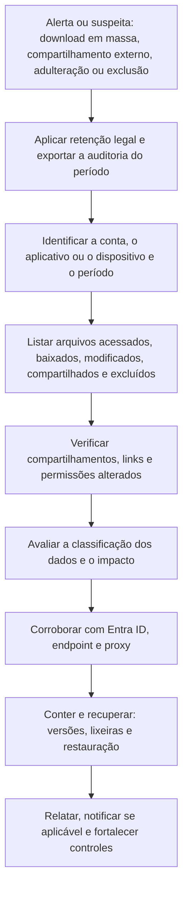

# SharePoint, OneDrive e Exfiltração de Arquivos

> **Objetivo pedagógico:** investigar o acesso, o compartilhamento, a exfiltração, a adulteração e a destruição de arquivos no SharePoint Online e no OneDrive, interpretando os eventos de auditoria, identificando padrões de coleta em massa e de compartilhamento externo, e recuperando dados por versões, lixeiras e restauração.

## 1. Modelo de dados e de acesso

| Elemento | Relevância forense |
|---|---|
| Sites do SharePoint (de equipe, de comunicação e hub) e bibliotecas | Onde estão os arquivos corporativos; permissões por site, biblioteca, pasta e arquivo |
| OneDrive de cada usuário | Arquivos pessoais de trabalho; compartilhamentos e sincronização |
| Equipes e grupos do Microsoft 365 | Cada equipe tem um site, um grupo e uma caixa de correio |
| Links de compartilhamento | "Qualquer pessoa" (anônimo), "pessoas da organização" e "pessoas específicas" |
| Convidados (B2B) e compartilhamento externo | Acesso por pessoas fora da organização |
| Cliente de sincronização do OneDrive | Cópia local dos arquivos; downloads completos para dispositivos |
| Versões | Histórico de versões de arquivos |
| Lixeiras (primeiro e segundo estágio) | Recuperação de exclusões |
| Rótulos de sensibilidade e DLP | Classificação e controles de movimentação |
| Biblioteca de retenção de preservação (oculta) | Cópias preservadas por políticas de retenção e de retenção legal |

## 2. Eventos de auditoria (SharePoint e OneDrive)

| Categoria | Eventos (exemplos) | Interpretação |
|---|---|---|
| Acesso e leitura | `FileAccessed`, `FilePreviewed`, `PageViewed` | Visualização de arquivos |
| Download e sincronização | `FileDownloaded`, `FileSyncDownloadedFull`, `FileSyncDownloadedPartial` | Cópia para o dispositivo; sincronizações completas indicam cópia em massa |
| Alteração | `FileModified`, `FileRenamed`, `FileMoved`, `FileCopied`, `FileUploaded` | Adulteração, movimentação e carga |
| Exclusão e recuperação | `FileDeleted`, `FileRecycled`, `FileDeletedFirstStageRecycleBin`, `FileRestored` | Destruição e recuperação |
| Compartilhamento | `SharingSet`, `SharingInvitationCreated`, `AnonymousLinkCreated`, `AnonymousLinkUsed`, `SecureLinkCreated`, `CompanyLinkCreated`, `AddedToSecureLink` | Exposição de arquivos |
| Permissões de sites | `SiteCollectionAdminAdded`, `PermissionLevelAdded`, `SharingPolicyChanged`, `SiteAdminChangeRequest` | Escalada e exposição |
| Busca | `SearchQueryPerformed` | Descoberta de dados |
| Proteção | `FileMalwareDetected`, rótulos aplicados ou removidos, alertas de DLP | Eventos de segurança |

Campos úteis do `AuditData`: `UserId`, `ClientIP`, `UserAgent`, `DeviceName` (quando disponível), `SiteUrl`, `SourceRelativeUrl`, `SourceFileName`, `ObjectId`, `ApplicationId` e `ItemType`.

## 3. Padrões de exfiltração e de abuso

| Padrão | Indícios | ATT&CK |
|---|---|---|
| Coleta em massa por download | Centenas ou milhares de `FileDownloaded` por um usuário em curto período; origem em IP e agente incomuns | T1213.002, T1530 |
| Sincronização completa para dispositivo | `FileSyncDownloadedFull` de dispositivos não gerenciados ou novos | T1213.002 |
| Compartilhamento anônimo ou externo | `AnonymousLinkCreated` e `SharingInvitationCreated` para endereços externos, em volume; links usados por IPs externos | T1567, T1537 |
| Acesso por aplicativos | Leitura por aplicativos OAuth ou por Graph, com identidade de aplicativo | T1528, T1213 |
| Exfiltração por fluxos | Fluxos do Power Automate que copiam arquivos a destinos externos (ver arquivo de aplicativos) | T1020 |
| Movimentação para serviços pessoais | Downloads seguidos de uploads a serviços externos (corroborar com proxy e endpoint) | T1567 |
| Insider: coleta antes do desligamento | Aumento de acessos e downloads nas semanas anteriores à saída | T1213 |
| Adulteração e destruição | Muitos `FileModified`, `FileRenamed` e `FileDeleted` com extensões alteradas (ransomware em nuvem) | T1485, T1486 |
| Escalada de permissões | Administrador de site adicionado e alteração de políticas de compartilhamento | T1098 |

```powershell
# Downloads e sincronizações de um usuário em um período
Search-UnifiedAuditLog -StartDate "2026-10-20" -EndDate "2026-10-31" -UserIds "usuario@exemplo.com" `
  -Operations FileDownloaded,FileSyncDownloadedFull -ResultSize 5000 |
  ForEach-Object { $d = $_.AuditData | ConvertFrom-Json
    [pscustomobject]@{ Hora=$_.CreationDate; Operacao=$_.Operations; IP=$d.ClientIP; Site=$d.SiteUrl; Arquivo=$d.SourceFileName; Agente=$d.UserAgent } } |
  Export-Csv .\downloads_usuario_E032.csv -NoTypeInformation
```

```kusto
// Defender XDR: usuários com muitos downloads por hora
CloudAppEvents
| where Timestamp > ago(7d)
| where ActionType in ("FileDownloaded", "FileSyncDownloadedFull")
| summarize Arquivos = count(), IPs = dcount(IPAddress), Primeiro = min(Timestamp), Ultimo = max(Timestamp) by AccountDisplayName, bin(Timestamp, 1h)
| where Arquivos > 200
| order by Arquivos desc
```

```kusto
// Sentinel: links anônimos criados e usados
OfficeActivity
| where TimeGenerated > ago(14d)
| where Operation in ("AnonymousLinkCreated", "AnonymousLinkUsed")
| project TimeGenerated, Operation, UserId, ClientIP, OfficeObjectId, SourceFileName
| order by TimeGenerated asc
```

Os limiares são exemplos: compare com a linha de base do usuário e da área (pasta 11). Equipes legítimas (por exemplo, migrações e backups) também geram volumes altos.

## 4. Avaliação de impacto

| Pergunta | Como responder |
|---|---|
| Quais arquivos foram acessados ou baixados? | Eventos de acesso e de download, com `SourceFileName` e `SiteUrl` |
| Qual a classificação dos arquivos? | Rótulos de sensibilidade, tipos de informação e inventário de dados |
| Houve compartilhamento externo? | Eventos de compartilhamento e relatório de links ativos |
| Para quem? | Destinatários de convites e identidades que usaram os links |
| Houve sincronização para dispositivos? | Eventos de sincronização, nome do dispositivo e gestão |
| O que foi modificado ou excluído? | Eventos de alteração, versões e lixeira |
| Os dados contêm dados pessoais? | Classificação e consulta ao DPO (notificações LGPD) |

Quando a auditoria registrou o acesso por aplicativos, correlacione com o `ApplicationId` e com os consentimentos (pasta 18).

## 5. Recuperação de dados

| Mecanismo | Descrição | Limite |
|---|---|---|
| Histórico de versões | Restaurar versões anteriores de arquivos adulterados | Depende da configuração de limites de versão |
| Lixeira de primeiro estágio (usuário) e de segundo estágio (administrador da coleção de sites) | Recuperar arquivos excluídos | Retenção combinada de 93 dias |
| Restaurar o OneDrive | Reverter o OneDrive a um ponto no tempo (até 30 dias) | Útil em ransomware e em exclusões em massa |
| Restaurar a biblioteca do SharePoint | Reverter uma biblioteca de documentos a um ponto no tempo | Dentro do período de restauração |
| Biblioteca de retenção de preservação | Cópias retidas por políticas de retenção | Acesso por eDiscovery e por administradores |
| Backups de terceiros | Soluções específicas de backup de M365 | Dependem de contratação |
| Recuperação de sites e coleções excluídos | Lixeira de sites do administrador | Período limitado |

Antes de restaurar, **preserve o estado atual** (exportar a lista de arquivos e as versões afetadas) e registre a ação. A restauração em massa altera o estado dos dados e gera eventos de auditoria.

## 6. Contenção

| Ação | Observação |
|---|---|
| Revogar sessões e redefinir credenciais da conta | Pasta 18 |
| Remover links anônimos e externos | Preservar primeiro a lista de links e de convites |
| Suspender o compartilhamento externo do site | Mudança de política com registro |
| Bloquear a sincronização em dispositivos não gerenciados | Acesso condicional e controles de sincronização |
| Remover aplicativos e fluxos maliciosos | Arquivo seguinte |
| Colocar o usuário em investigação, com retenção legal | Preservação para eDiscovery |
| Aplicar retenção legal ao site e ao OneDrive | Impede a exclusão definitiva |

## 7. Fluxo de investigação de arquivos



## 8. Exemplo prático: coleta antes do desligamento

| Hora (UTC) | Evento | Interpretação |
|---|---|---|
| D-14 a D-1 | Aumento de 12 vezes nos acessos aos sites Comercial e Contratos pelo gerente G | Mudança de comportamento |
| D-3, 19:00 a 20:30 | 3.900 `FileSyncDownloadedFull` e `FileDownloaded` de um dispositivo não gerenciado; `DeviceName` desconhecido | Cópia em massa (T1213.002) |
| D-2 | 14 `AnonymousLinkCreated` para pastas de propostas | Exposição por links |
| D-2, 22:10 | `AnonymousLinkUsed` de IP residencial fora da cidade do usuário | Acesso externo |
| Corroboração | Proxy: 4,8 GB enviados a serviço de armazenamento pessoal no mesmo horário | Exfiltração (T1567) |
| Contexto | Desligamento comunicado no D-1 | Motivação e oportunidade |
| Resposta | Retenção legal e preservação da auditoria; remoção dos links; bloqueio da sincronização; relatório ao Jurídico e ao RH; análise do endpoint (pastas 07 e 10); avaliação de dados pessoais e sigilosos |

## 9. Casos de uso corporativos

- Investigação de vazamento de arquivos por colaboradores e por contas comprometidas.
- Resposta a ransomware em OneDrive e SharePoint, com restauração por ponto no tempo.
- Revisão periódica de compartilhamentos externos e de links anônimos.

## 10. Normas e frameworks relevantes

- MITRE ATT&CK for Cloud: T1213.002, T1530, T1537, T1567, T1020, T1485, T1486, T1098
- NIST SP 800-61 Rev. 3; ISO/IEC 27002:2022, controles 5.12, 5.13 (classificação e rotulagem), 8.12 (prevenção de vazamento de dados) e 8.15
- CIS Microsoft 365 Foundations Benchmark; CIS Controls v8.1, controles 3, 8 e 17
- LGPD, arts. 6º, 46 e 48

## 11. Referências

- Microsoft Learn. Eventos de auditoria do SharePoint e do OneDrive; histórico de versões; lixeiras; Restaurar o OneDrive e Restaurar uma biblioteca; compartilhamento externo.
- Microsoft Learn. Microsoft Purview DLP e rótulos de sensibilidade.
- Microsoft. Incident response playbooks.
- CISA. Orientações de segurança do Microsoft 365 (SCuBA).
- SANS Institute. FOR509 e FOR508.
