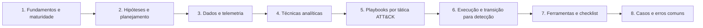

# 20 Threat Hunting

## Objetivo

Estruturar a caça proativa a ameaças como disciplina: formular hipóteses testáveis a partir de inteligência, do ATT&CK e do risco; garantir os dados necessários; aplicar técnicas analíticas e estatísticas; executar fichas de caça por tática; escalar achados à resposta a incidentes; e converter os resultados em detecções, melhorias de telemetria e controles, com documentação, métricas, privacidade e governança.

## Trilha de estudo recomendada

## Conteúdo da pasta

| Ordem | Arquivo | Objetivo |
|---|---|---|
| 1 | [fundamentos-modelos-e-maturidade-de-threat-hunting.md](fundamentos-modelos-e-maturidade-de-threat-hunting.md) | Definição, tipos, modelos (Sqrrl, PEAK e TaHiTI), maturidade e governança |
| 2 | [hipoteses-inteligencia-e-planejamento-de-hunts.md](hipoteses-inteligencia-e-planejamento-de-hunts.md) | Hipóteses (ABLE), inteligência, priorização, plano e cobertura |
| 3 | [dados-e-telemetria-para-hunting.md](dados-e-telemetria-para-hunting.md) | Fontes, qualidade, enriquecimento, plataformas e lacunas |
| 4 | [tecnicas-analiticas-e-estatisticas-de-hunting.md](tecnicas-analiticas-e-estatisticas-de-hunting.md) | Empilhamento, agrupamento, análise temporal, grafos, pivôs e anomalias |
| 5 | [playbooks-de-hunt-por-tatica-attack.md](playbooks-de-hunt-por-tatica-attack.md) | Fichas de caça com consultas, falsos positivos e escalonamento |
| 6 | [execucao-documentacao-e-transicao-para-deteccao.md](execucao-documentacao-e-transicao-para-deteccao.md) | Execução, escalonamento, documentação, detecção e emulação |
| 7 | [ferramentas-fluxo-modelos-e-checklist-de-hunting.md](ferramentas-fluxo-modelos-e-checklist-de-hunting.md) | Ferramentas, modelos, matriz de cobertura e checklist |
| 8 | [casos-de-uso-e-erros-comuns-em-hunting.md](casos-de-uso-e-erros-comuns-em-hunting.md) | Sete cenários, erros comuns e exercícios |

## Princípios

- Toda caça parte de uma hipótese específica, testável e relevante, com escopo e tempo definidos
- Verificar a qualidade e a cobertura dos dados antes de caçar; registrar as lacunas
- Combinar técnicas e exigir corroboração por fonte independente; anomalia não é prova
- Documentar todas as caças, inclusive as sem achado, e versionar consultas e relatórios
- Converter resultados em detecção, telemetria ou controle; validar por emulação em ambiente de teste
- Escalar achados com evidências preservadas e coordenar a contenção com a resposta a incidentes
- Respeitar autorização, minimização e privacidade; tratar condutas de pessoas com RH e Jurídico
- Medir valor por detecções, lacunas fechadas e cobertura, e não por quantidade de achados

## Relação com outras pastas

- 03-coleta-de-evidencias: preservação ao escalar achados
- 05-timeline-analysis: linhas do tempo e correlação
- 07-windows-forensics, 08-linux-forensics e 09-memory-forensics: artefatos e técnicas aplicados nas fichas de caça
- 11-log-analysis: Sigma, KQL e análise de anomalias
- 12-email-forensics, 13-network-forensics e 15-malware-forensics: dados e técnicas de e-mail, rede e malware
- 16-ransomware-investigation: escalonamento e sinais de preparação de ransomware
- 17-cloud-forensics, 18-azure-forensics e 19-m365-forensics: caças em nuvem, identidade e SaaS
- 21-osint-for-investigations: inteligência externa para hipóteses

## Referências

- MITRE. ATT&CK; TTP-Based Hunting (2019); ATT&CK Navigator; CALDERA
- Sqrrl (D. Bianco). A Framework for Threat Hunting; Hunting Maturity Model; The Pyramid of Pain
- Splunk SURGe. The PEAK Threat Hunting Framework (2023); FI-ISAC NL. TaHiTI (2018)
- Rabobank CDC. DeTT&CT; SigmaHQ. Sigma
- OTRF. Threat Hunter Playbook e Security-Datasets; Splunk. Boss of the SOC
- NIST CSF 2.0 (2024); NIST SP 800-61 Rev. 3 (2025); NIST SP 800-115
- ISO/IEC 27002:2022 (5.7, 8.15, 8.16); ISO/IEC 27035
- AlFardan, N. Cyber Threat Hunting. Manning (2023); Pease, A. Threat Hunting with Elastic Stack (2021); Roddie, M. Practical Threat Detection Engineering (2023)
- Red Canary. Atomic Red Team; Datadog. Stratus Red Team
- Brasil. Lei nº 13.709/2018 (LGPD)
- SANS Institute. FOR508 e SEC555
