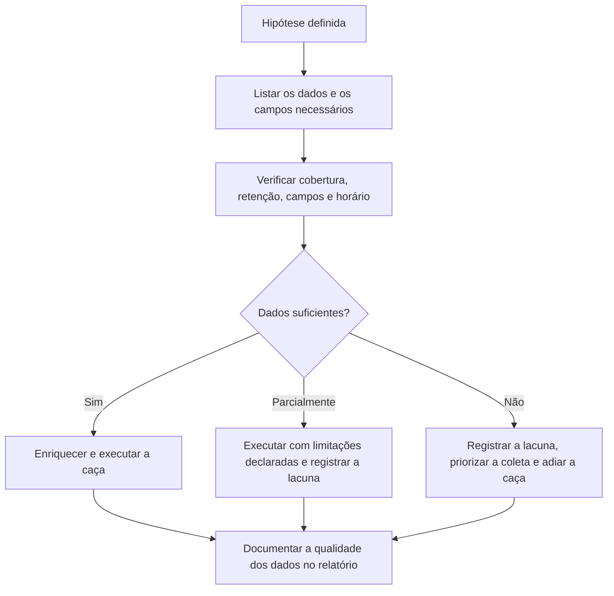

# Dados e Telemetria para Hunting

> **Objetivo pedagógico:** identificar e garantir os dados necessários à caça (endpoint, identidade, rede, nuvem e e-mail), avaliar a qualidade, a retenção e o enriquecimento, escolher plataformas de consulta, configurar a telemetria que mais contribui e registrar as lacunas, reconhecendo que a qualidade da caça é limitada pela qualidade dos dados.

## 1. Princípio

Sem dados adequados, a caça não consegue testar hipóteses. Antes de cada caça, verifique: **os dados existem? Cobrem os sistemas e o período? Têm os campos necessários? Estão corretos, com horário confiável?** Quando a resposta for não, o primeiro resultado da caça é uma **lacuna de dados**, que deve ser registrada e priorizada.

## 2. Fontes por domínio

| Domínio | Fontes | Valor para a caça |
|---|---|---|
| Endpoint (Windows) | EDR, Sysmon, EVTX (4688 com linha de comando, 4697, 4698, 7045, PowerShell 4104), Amcache e Prefetch (coleta sob demanda) | Execução, persistência, credenciais e movimentação |
| Endpoint (Linux e macOS) | auditd, journald, `auth.log`, EDR, osquery | Execução, autenticação e persistência |
| Identidade | Logs do Active Directory, do Entra ID e de provedores de identidade; PAM | Credenciais, escalada, acessos anômalos |
| Rede | Zeek, DNS, proxy, firewall, NetFlow, VPN, IDS (pastas 11 e 13) | C2, exfiltração e movimentação lateral |
| Nuvem | CloudTrail, Activity Log, Cloud Audit Logs, fluxos e DNS de nuvem (pastas 17 e 18) | Acesso, persistência e dados |
| SaaS e Microsoft 365 | Auditoria unificada e logs do Defender (pasta 19) | Contas, e-mail e arquivos |
| E-mail | Gateway, rastreamento, eventos de proteção (pasta 12) | Entrega, phishing e BEC |
| Aplicações e bancos de dados | Logs web, de aplicação e de auditoria | Exploração e acesso a dados |
| Inventário e contexto | CMDB, inventário de ativos, vulnerabilidades, RH e diretório | Enriquecimento e linha de base |

## 3. Telemetria de maior retorno (configurações recomendadas)

| Área | Configuração | Observação |
|---|---|---|
| Windows: criação de processos | Auditoria de criação de processos com linha de comando (evento 4688) e/ou Sysmon (evento 1) | Base para a maioria das caças de execução |
| Windows: PowerShell | Registro de blocos de script (4104) e de módulos (4103) | Código desofuscado (pasta 15) |
| Windows: autenticação | Auditoria avançada de logon, Kerberos e alterações de contas e de grupos | Credenciais e movimentação |
| Sysmon | Configuração baseada em modelos públicos mantidos pela comunidade, ajustada ao ambiente | Conexões de rede, carregamento de imagens, acesso a processos, WMI, DNS, pipes |
| Linux | Regras de auditd para execução, alterações de arquivos críticos, privilégios e rede; registro de comandos | Execução e persistência |
| DNS | Registro de consultas do resolvedor corporativo | Túneis, DGA e C2 |
| Proxy | Registro de URL, agente de usuário, volume e categoria | Exfiltração e C2 |
| Nuvem | Trilhas organizacionais, eventos de dados críticos, fluxos e DNS | Pastas 17 e 18 |
| Identidade | Todos os tipos de logs de entrada, auditoria e risco | Pasta 18 |

Princípio: coletar **menos com mais qualidade** supera coletar tudo sem estrutura; selecione eventos de maior valor e ajuste os filtros para controlar volume.

## 4. Qualidade dos dados

| Dimensão | Pergunta | Verificação |
|---|---|---|
| Cobertura | Todos os hosts, contas e redes relevantes enviam dados? | Comparar o inventário com as fontes ativas; alertas de silêncio |
| Completude | Os campos necessários estão presentes? | Verificar o esquema e a taxa de campos nulos |
| Precisão | Os valores estão corretos (parsing e normalização)? | Amostragem manual |
| Tempestividade | Qual o atraso de ingestão? | Medir a diferença entre o horário do evento e o da ingestão |
| Consistência | Os nomes de campos e de entidades são padronizados entre fontes? | Esquema comum (por exemplo, ECS ou OCSF) |
| Tempo | Os relógios estão sincronizados e em UTC? | Pastas 05 e 11 |
| Retenção | O período disponível cobre a janela de caça? | Comparar com a política |
| Integridade | Os dados podem ter sido alterados ou removidos? | Centralização e imutabilidade (pasta 11) |

```kusto
// Exemplo de verificação de cobertura: quantos hosts do inventário enviaram eventos de criação de processo nos últimos 7 dias?
let inventario = datatable(Host:string)["srv01","srv02","wks101","wks102"];   // substitua por tabela real de inventário
let ativos = SecurityEvent
| where TimeGenerated > ago(7d) and EventID == 4688
| summarize Ultimo = max(TimeGenerated) by Computer;
inventario | join kind=leftouter ativos on $left.Host == $right.Computer
| project Host, Ultimo, SemDados = isempty(Ultimo)
```

## 5. Enriquecimento

| Enriquecimento | Uso |
|---|---|
| Ativos (criticidade, função, dono e localização) | Priorizar achados e entender o comportamento normal |
| Identidade (cargo, departamento, privilégios e contas de serviço) | Separar comportamento legítimo do suspeito |
| Geolocalização e ASN de IPs | Contexto de origem (com cautela) |
| Reputação e inteligência de ameaças | Contexto sobre domínios, IPs e hashes |
| Prevalência de arquivos e de processos | Raridade dentro da organização |
| Vulnerabilidades e exposição | Priorizar sistemas expostos |
| Listas de permissão | Reduzir ruído (administração legítima) |

## 6. Plataformas de consulta e armazenamento

| Tipo | Exemplos | Observações |
|---|---|---|
| SIEM e data lake | Microsoft Sentinel, Splunk, Elastic e OpenSearch, Chronicle | Retenção, desempenho e custo variam; consultas em KQL, SPL, ES\|QL e outras |
| XDR e EDR | Defender XDR, CrowdStrike, SentinelOne e outros | Caça avançada em telemetria de endpoint, com retenção própria e limitada |
| Consulta local e exploratória | Python (pandas), DuckDB, Jupyter e Miller | Análise de exportações; reprodutível e rápida (pasta 11) |
| Ferramentas de caça em endpoints | Velociraptor e osquery | Coleta sob demanda em escala (arquivo de ferramentas) |
| Logs de rede | Zeek, RITA e Arkime (pasta 13) | Metadados e pacotes |
| Notebooks | Jupyter, notebooks de SIEM | Documentação executável das caças |

Boas práticas de desempenho: restringir por tempo e por tabela primeiro; filtrar antes de agregar; pré-agregar dados recorrentes (resumos diários); salvar consultas e resultados; evitar expressões regulares abertas em grandes volumes.

## 7. Linha de base e inventário do comportamento normal

| Elemento | Como construir |
|---|---|
| Processos esperados por tipo de host | Empilhamento por função (servidores, estações e controladores de domínio) |
| Contas privilegiadas e de serviço | Lista de contas e dos hosts em que normalmente autenticam |
| Destinos externos habituais | Principais domínios e ASNs por segmento |
| Horários de atividade | Distribuição por hora e por dia por grupo |
| Ferramentas administrativas legítimas | Inventário de ferramentas de gestão remota e de automação |
| Software autorizado | Lista de aplicações e de versões |

Atualize a linha de base periodicamente e documente as fontes e os critérios. Cuidado com linhas de base contaminadas: se o adversário já estava presente, seu comportamento pode ter sido absorvido como "normal".

## 8. Registro de lacunas de dados

| Campo | Descrição |
|---|---|
| Identificador | GAP-NNN |
| Técnica ou hipótese afetada | ATT&CK e a caça que não pôde ser concluída |
| Dado ausente ou deficiente | Fonte, campo, cobertura ou retenção |
| Impacto | O que não é possível detectar ou investigar |
| Recomendação | Coleta, configuração, parsing ou retenção |
| Prioridade, responsável e prazo | Gestão da correção |
| Situação | Aberta, em andamento ou concluída |

## 9. Fluxo de preparação de dados



## 10. Exemplo prático: avaliação de dados para a hipótese de uso de Rclone

| Necessidade | Fonte | Situação |
|---|---|---|
| Linha de comando de processos nos servidores de arquivos | EDR | Cobertura de 92% dos servidores; 8% sem agente |
| Conexões de saída por processo | EDR e Sysmon | Disponíveis no EDR; retenção de 30 dias |
| Volume de saída por host | NetFlow | Disponível, retenção de 13 meses |
| Domínios de nuvem consultados | DNS | Não coletado (GAP-007) |
| Proxy | Servidores sem proxy configurado | Visibilidade parcial |
| Conclusão | Janela de 30 dias por EDR e de 90 dias por NetFlow; lacunas de DNS e de servidores sem agente registradas |

## 11. Casos de uso corporativos

- Avaliação da prontidão de telemetria antes de iniciar um programa de caça.
- Definição de configurações de Sysmon, de auditoria e de logs para ampliar a visibilidade.
- Gestão de lacunas de dados com prioridade e responsáveis.

## 12. Normas e frameworks relevantes

- NIST SP 800-92; NIST SP 800-53 Rev. 5 (AU-2, AU-3, AU-6 e AU-12); NIST CSF 2.0
- MITRE ATT&CK (fontes de dados) e DeTT&CT; ECS e OCSF (esquemas)
- ISO/IEC 27002:2022, controles 8.15, 8.16 e 8.17
- CIS Controls v8.1, controle 8 (gestão de logs de auditoria)

## 13. Referências

- Chuvakin, A.; Schmidt, K.; Phillips, C. Logging and Log Management. Syngress, 2013.
- Rabobank CDC. DeTT&CT.
- Documentação do Sysmon (Microsoft Sysinternals) e de modelos de configuração mantidos pela comunidade.
- Documentação do auditd, do osquery e do Velociraptor.
- OTRF. Threat Hunter Playbook e Security-Datasets.
- Pease, A. Threat Hunting with Elastic Stack. Packt, 2021.
