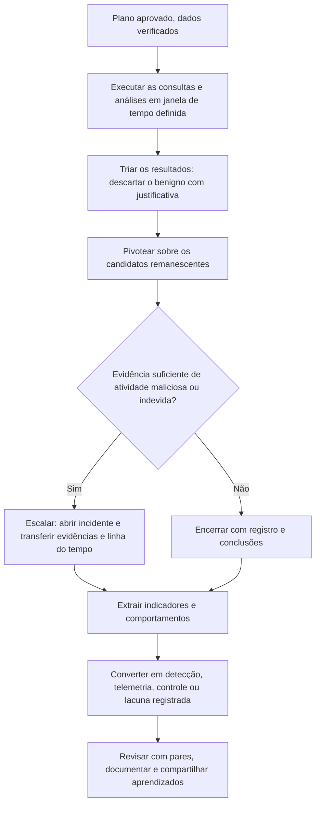
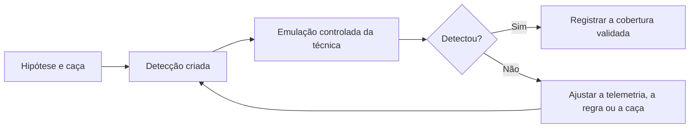

# Execução, Documentação e Transição para Detecção

> **Objetivo pedagógico:** executar caças de forma disciplinada, triar e validar resultados, escalar achados à resposta a incidentes, documentar caças com e sem achados, converter os resultados em detecções, melhorias de telemetria e controles, validar por meio de emulação controlada (purple team) e medir o valor do programa.

## 1. Fluxo de execução

## 2. Triagem de resultados

| Etapa | Prática |
|---|---|
| Classificar | Maliciosa, indevida (violação de política), benigna ou inconclusiva |
| Justificar descartes | Registrar por que cada candidato foi considerado benigno (dono, mudança aprovada ou ferramenta autorizada) |
| Verificar com os donos | Confirmar atividades administrativas com as áreas e com o RH, quando houver pessoas envolvidas |
| Aplicar o princípio da hipótese alternativa | Considerar explicações legítimas antes de concluir pela malícia |
| Corroborar | Exigir uma segunda fonte independente |
| Limitar o tempo | Respeitar o limite de tempo; registrar o que ficou por analisar |

## 3. Escalonamento para resposta a incidentes

| Critério | Ação |
|---|---|
| Indícios corroborados de atividade maliciosa | Abrir o incidente conforme o plano de resposta (pasta 16 e playbooks) |
| Dados a transferir | Hipótese, consultas, resultados, hosts e contas envolvidos, linha do tempo preliminar, indicadores e nível de confiança |
| Preservação | Preservar evidências voláteis e logs antes de qualquer contenção (pasta 03) |
| Comunicação | Líder da caça, líder de resposta e, quando necessário, Jurídico e DPO |
| Papéis | A caça apoia o escopo; a resposta conduz a contenção e a erradicação |
| Avaliação de comprometimento | Quando houver achado, ampliar a caça para identificar o escopo (outros hosts e contas) |

Achados que envolvem condutas de colaboradores devem seguir o processo de investigação interna, com RH e Jurídico, preservando a presunção de boa-fé até a conclusão.

## 4. Documentação da caça

| Seção do relatório | Conteúdo |
|---|---|
| Identificação | Número, título, período, caçador e revisor |
| Hipótese e motivação | ABLE, técnicas ATT&CK e inteligência |
| Escopo e dados | Sistemas, contas, período, fontes, qualidade e lacunas |
| Método | Consultas (versão completa), técnicas e pivôs |
| Resultados | Candidatos, classificações e justificativas |
| Achados | Evidências, linha do tempo e confiança |
| Conclusão | Hipótese confirmada, refutada ou inconclusiva |
| Ações | Escalonamentos, detecções, correções e lacunas de telemetria |
| Lições aprendidas | O que funcionou, o que melhorar e hipóteses derivadas |
| Anexos | Consultas, exportações com hash e capturas |

Caças **sem achado** também devem ser documentadas: provam o que foi testado, o que foi coberto e o que não pôde ser verificado, e evitam o retrabalho.

## 5. Da caça à detecção

| Etapa | Descrição |
|---|---|
| 1. Identificar o comportamento repetível | O que distinguiu o malicioso do benigno? |
| 2. Escrever a regra | Sigma, consulta de SIEM ou de EDR, assinaturas YARA e regras de rede (pastas 11, 13 e 15) |
| 3. Testar | Com dados históricos da caça (verdadeiros positivos) e com dados normais (falsos positivos) |
| 4. Calibrar | Listas de permissão e contexto; definir severidade e responsável |
| 5. Definir a resposta | Procedimento do analista para o alerta (playbook) |
| 6. Implantar e monitorar | Acompanhar o volume, a precisão e o tempo de triagem |
| 7. Documentar e versionar | Descrição, dados, falsos positivos conhecidos, técnica ATT&CK e histórico de alterações |
| 8. Revisar periodicamente | Retirar ou ajustar regras obsoletas |

Detecções originadas de caças tendem a ser mais robustas, por serem baseadas em comportamentos reais do ambiente.

## 6. Outras saídas da caça

| Saída | Exemplos |
|---|---|
| Melhoria de telemetria | Habilitar logs ausentes e corrigir parsing e cobertura |
| Hardening e correção | Corrigir configurações que facilitam a técnica (por exemplo, restringir ferramentas de acesso remoto) |
| Inventário e linha de base | Listas atualizadas de ferramentas autorizadas e de contas de serviço |
| Inteligência interna | Indicadores e comportamentos observados, compartilhados com parceiros sob TLP |
| Novas hipóteses | Pivôs que merecem caças próprias |
| Treinamento | Materiais para analistas e para as equipes de TI |
| Risco e conformidade | Evidências de controle para auditorias |

## 7. Validação por emulação (purple team)

| Prática | Descrição |
|---|---|
| Objetivo | Verificar se a detecção ou a caça identifica a técnica de forma controlada |
| Ferramentas | Atomic Red Team, MITRE CALDERA e Stratus Red Team (nuvem) |
| Condições | Somente em ambientes de teste ou com autorização formal e coordenação, com plano de reversão |
| Resultado | Cobertura confirmada, ajustes nas regras e novas lacunas de telemetria |
| Cuidado | Nunca emular ransomware ou destruição em produção |

## 8. Métricas e relatórios para a gestão

| Indicador | Uso |
|---|---|
| Caças concluídas por trimestre e por tática | Atividade e distribuição |
| Achados confirmados e gravidade | Resultado direto |
| Detecções criadas ou ajustadas por caça | Valor duradouro |
| Lacunas de telemetria abertas e fechadas | Melhoria de visibilidade |
| Cobertura ATT&CK (caça, detecção e telemetria) | Maturidade |
| Tempo de permanência estimado dos achados | Impacto |
| Tempo da hipótese à detecção | Eficiência |
| Precisão das detecções derivadas | Qualidade |
| Tempo dedicado de analistas | Capacidade |

Relate à direção em linguagem de risco: o que foi testado, o que foi encontrado, o que mudou nas defesas e o que ainda é ponto cego.

## 9. Governança e melhoria contínua

| Prática | Descrição |
|---|---|
| Revisão por pares | Todo plano e todo relatório revisado por outro caçador |
| Reuniões de retrospectiva | Lições aprendidas e priorização do próximo ciclo |
| Calendário de caças | Caças recorrentes para técnicas críticas e caças novas por inteligência |
| Repositório versionado | Planos, consultas, relatórios e regras com histórico |
| Gestão de conhecimento | Biblioteca de fichas e de linhas de base |
| Revisão de privacidade | Consultas sobre dados pessoais e retenção de resultados revisadas periodicamente |

## 10. Exemplo prático: do achado à detecção

| Etapa | Resultado |
|---|---|
| Caça | HNT-2026-014: uso de ferramentas de sincronização em servidores de arquivos |
| Achado | `rclone.exe` em um servidor, executado por conta de serviço, com configuração em diretório temporário e 380 GB enviados a um armazenamento externo |
| Escalonamento | Incidente aberto, evidências preservadas, escopo ampliado (pasta 16) |
| Indicadores | Nome do executável, caminho, argumentos, destino e padrão de volume |
| Detecção | Regra de EDR para execução de ferramentas de sincronização por contas de serviço; regra de NetFlow para uploads acima do limite por servidor |
| Validação | Emulação em laboratório com uma ferramenta equivalente; a regra disparou |
| Telemetria | Coleta de DNS implantada (fechando a lacuna GAP-007) |
| Métricas | 1 incidente, 2 detecções, 1 lacuna fechada, cobertura de T1567 e T1048 ampliada |

## 11. Casos de uso corporativos

- Padronização do ciclo de execução, documentação e encerramento das caças.
- Transformação sistemática de achados em detecções validadas.
- Relatórios periódicos de valor da caça para a direção.

## 12. Normas e frameworks relevantes

- MITRE ATT&CK; MITRE CALDERA; Atomic Red Team; Stratus Red Team
- NIST SP 800-61 Rev. 3; NIST CSF 2.0; NIST SP 800-115 (testes de segurança)
- ISO/IEC 27002:2022, controles 5.24 a 5.28 e 8.16; ISO/IEC 27035
- CIS Controls v8.1, controles 13, 17 e 18 (testes de intrusão)
- LGPD, arts. 6º, 46 e 48

## 13. Referências

- Splunk SURGe. The PEAK Threat Hunting Framework (2023).
- FI-ISAC NL. TaHiTI (2018).
- SigmaHQ. Sigma e documentação de engenharia de detecção.
- Red Canary. Atomic Red Team; MITRE. CALDERA; Datadog. Stratus Red Team.
- Roddie, M. Practical Threat Detection Engineering. Packt, 2023.
- SANS Institute. FOR508 e SEC555.
