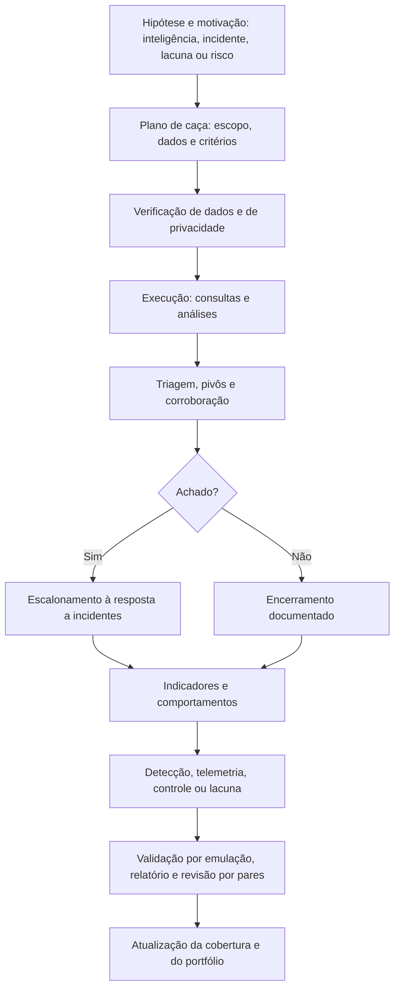

# Ferramentas, Fluxo, Modelos e Checklist de Hunting

> **Objetivo pedagógico:** padronizar as ferramentas, o fluxo de trabalho, os registros e a verificação de qualidade das caças, de modo que sejam reproduzíveis, proporcionais ao escopo autorizado, úteis para a defesa e documentadas para auditoria.

## 1. Ferramentas por finalidade

| Finalidade | Ferramentas |
|---|---|
| SIEM, XDR e consulta | Microsoft Sentinel e Defender XDR (KQL), Splunk (SPL), Elastic e OpenSearch, Chronicle e outros |
| Caça e coleta em endpoints | Velociraptor (VQL), osquery, EDR com caça ativa |
| Análise de logs do Windows | Hayabusa, Chainsaw, EvtxECmd e Timeline Explorer (pasta 11) |
| Rede | Zeek, RITA, Suricata, Arkime e Wireshark (pasta 13) |
| Análise exploratória | Python (pandas, NetworkX e scikit-learn), Jupyter, DuckDB e Miller |
| Linha do tempo | Plaso e Timesketch (pasta 05) |
| Grafos de identidade e privilégios | BloodHound (para defensores, em ambientes autorizados) |
| Detecção | Sigma, YARA e regras de EDR e de rede (pastas 11 e 15) |
| Cobertura e planejamento | ATT&CK Navigator e DeTT&CT |
| Inteligência | MISP, OpenCTI e relatórios de parceiros |
| Dados de prática | OTRF Security-Datasets e Threat Hunter Playbook, Boss of the SOC (Splunk), Splunk Attack Data |
| Emulação controlada (laboratório) | Atomic Red Team, MITRE CALDERA e Stratus Red Team |
| Documentação | Modelos deste arquivo, repositório versionado e notebooks |

Registre nome, versão, origem e permissões das ferramentas. Ferramentas de caça em endpoints (como Velociraptor e osquery) têm alto poder de coleta: restrinja o acesso, registre as execuções e limite o escopo.

## 2. Exemplos de consultas em ferramentas de caça em endpoints

```sql
-- osquery: processos cujo binário não está mais em disco (possível execução a partir de arquivo removido)
SELECT pid, name, path, cmdline, parent
FROM processes
WHERE on_disk = 0;

-- osquery: portas em escuta e processos associados
SELECT lp.port, lp.address, lp.protocol, p.name, p.path
FROM listening_ports lp JOIN processes p USING (pid)
WHERE lp.address NOT IN ('127.0.0.1', '::1');
```

```text
-- Velociraptor (VQL): processos do PowerShell em execução e suas linhas de comando
SELECT Pid, Ppid, Name, Exe, CommandLine
FROM pslist()
WHERE Name =~ "powershell"

-- Velociraptor (VQL): executáveis recentes em perfis de usuário
SELECT FullPath, Size, Mtime
FROM glob(globs="C:/Users/*/AppData/**/*.exe")
WHERE Mtime > now() - 14 * 24 * 3600
```

Valide a sintaxe e as colunas nas versões instaladas e use as coletas em larga escala com cuidado (desempenho e privacidade).

## 3. Fluxo de trabalho padronizado



## 4. Dez perguntas de qualidade e como responder

| Pergunta | Onde responder |
|---|---|
| 1. A hipótese é específica, testável e relevante? | Plano de caça (ABLE) |
| 2. Há autorização e escopo definidos, com avaliação de privacidade? | Plano, Jurídico e DPO |
| 3. Os dados cobrem os sistemas e o período? | Verificação de dados e registro de lacunas |
| 4. As consultas estão registradas e são reproduzíveis? | Registro de execução |
| 5. Os candidatos foram classificados e os descartes justificados? | Relatório |
| 6. Houve corroboração por uma segunda fonte? | Relatório e linha do tempo |
| 7. Os achados foram escalados com evidências preservadas? | Registro de escalonamento |
| 8. O que muda nas defesas (detecção, telemetria ou controle)? | Plano de ação |
| 9. A cobertura foi atualizada e a detecção validada? | Matriz de cobertura e emulação |
| 10. Que limitações e lacunas precisam ser declaradas? | Relatório |

## 5. Modelo A: Plano de Caça

| Campo | Preenchimento |
|---|---|
| Identificador | HNT-AAAA-NNN |
| Título | |
| Tipo (hipótese, inteligência, baseline, assistida por modelos ou situacional) | |
| Hipótese (ABLE): ator, comportamento, localização e evidência | |
| Técnicas ATT&CK | |
| Motivação e fonte | |
| Escopo (sistemas, contas, período e janela de retroação) | |
| Dados e campos necessários; disponibilidade e retenção | |
| Método planejado (consultas e técnicas) | |
| Critérios de sucesso e de encerramento; tempo máximo | |
| Avaliação de privacidade e autorização (quem aprovou) | |
| Caçador, revisor e prazo | |

## 6. Modelo B: Registro de Execução

| ID | Data e hora (UTC) | Consulta ou técnica (texto completo e versão) | Plataforma e fonte de dados | Período e escopo | Resultados (contagem) | Observações | Responsável |
|---|---|---|---|---|---|---|---|
| Q-001 | | | | | | | |
| Q-002 | | | | | | | |

## 7. Modelo C: Registro de Candidatos e de Decisões

| ID | Entidade (host, conta, processo ou IP) | Motivo da seleção | Pivôs realizados | Corroboração | Classificação (maliciosa, indevida, benigna ou inconclusiva) | Justificativa | Ação |
|---|---|---|---|---|---|---|---|
| C-001 | | | | | | | |
| C-002 | | | | | | | |

## 8. Modelo D: Registro de Lacunas de Dados

| ID | Técnica ou hipótese afetada | Dado ausente ou deficiente | Impacto | Recomendação | Prioridade | Responsável e prazo | Situação |
|---|---|---|---|---|---|---|---|
| GAP-001 | | | | | | | |

## 9. Modelo E: Matriz de Cobertura (por técnica)

| Técnica ATT&CK | Telemetria (fontes e qualidade) | Detecção (regra e versão) | Caça (última execução) | Validação por emulação (data e resultado) | Lacunas e observações |
|---|---|---|---|---|---|
| T1053.005 | | | | | |
| T1003.001 | | | | | |
| T1558.003 | | | | | |

## 10. Modelo F: Relatório de Caça

| Seção | Conteúdo |
|---|---|
| 1. Resumo | Hipótese, resultado e principais decisões |
| 2. Escopo e dados | Sistemas, período, fontes, qualidade e lacunas |
| 3. Método | Consultas e técnicas |
| 4. Resultados e candidatos | Classificações e justificativas |
| 5. Achados | Evidências, linha do tempo e confiança |
| 6. Conclusão | Hipótese confirmada, refutada ou inconclusiva |
| 7. Ações | Escalonamento, detecções, correções e telemetria |
| 8. Lições aprendidas e hipóteses derivadas | Melhoria do programa |
| 9. Anexos | Consultas, exportações com hash e capturas |

## 11. Checklist operacional de hunting

**Caça:** HNT-AAAA-NNN
**Caçador:** ____________________
**Data e hora (UTC):** ____________________

### 11.1 Planejamento

- [ ] Hipótese específica e testável, com técnicas ATT&CK e motivação
- [ ] Escopo, período e limite de tempo definidos
- [ ] Autorização obtida; privacidade avaliada (Jurídico e DPO, quando aplicável)
- [ ] Dados verificados: cobertura, campos, horário e retenção; lacunas registradas

### 11.2 Execução e análise

- [ ] Consultas registradas com versão e plataforma
- [ ] Técnicas adequadas aplicadas (empilhamento, temporal, grafos e sequências)
- [ ] Candidatos classificados, com descartes justificados
- [ ] Pivôs documentados e corroboração por segunda fonte independente
- [ ] Hipóteses alternativas legítimas consideradas; donos de sistemas consultados

### 11.3 Achados e escalonamento

- [ ] Achados escalados com evidências e linha do tempo preliminar
- [ ] Evidências voláteis e logs preservados antes de qualquer contenção
- [ ] Condutas de pessoas tratadas com RH e Jurídico, com sigilo e presunção de boa-fé

### 11.4 Conversão e encerramento

- [ ] Detecções, telemetria ou controles propostos (ou lacunas registradas)
- [ ] Detecções testadas com dados da caça e com dados normais
- [ ] Validação por emulação em ambiente de teste, quando aplicável
- [ ] Matriz de cobertura atualizada
- [ ] Relatório redigido (inclusive para caças sem achado) e revisado por pares
- [ ] Dados pessoais dos resultados com acesso restrito e retenção definida

## 12. Resultado da verificação

| Resultado | Condição |
|---|---|
| Conforme | Todos os itens aplicáveis marcados |
| Conforme com ressalvas | Pendências sem impacto nas conclusões, com plano de ação |
| Não conforme | Caça sem autorização ou fora do escopo, consultas não registradas, conclusões sem corroboração, achados sem escalonamento ou dados pessoais expostos; comunicar o líder |

**Assinatura do caçador:** ____________________
**Assinatura do revisor:** ____________________

## 13. Casos de uso corporativos

- Padronização do programa de caça com modelos e revisão por pares.
- Treinamento de caçadores com dados de prática e fichas de caça.
- Auditoria da governança, da privacidade e da qualidade das caças.

## 14. Normas e frameworks relevantes

- MITRE ATT&CK; ATT&CK Navigator; DeTT&CT
- NIST CSF 2.0; NIST SP 800-61 Rev. 3; NIST SP 800-115
- ISO/IEC 27002:2022, controles 5.7, 8.15 e 8.16; ISO/IEC 27035
- CIS Controls v8.1, controles 8, 13 e 17; LGPD, arts. 6º, 7º e 46

## 15. Referências

- Documentação do Velociraptor, do osquery, do Sentinel, do Defender XDR, do Splunk e do Elastic.
- OTRF. Security-Datasets e Threat Hunter Playbook; Splunk. Boss of the SOC e Attack Data.
- Rabobank CDC. DeTT&CT; MITRE. ATT&CK Navigator, CALDERA.
- Red Canary. Atomic Red Team; Datadog. Stratus Red Team.
- Splunk SURGe. PEAK; FI-ISAC NL. TaHiTI.
- SANS Institute. FOR508 e SEC555.
