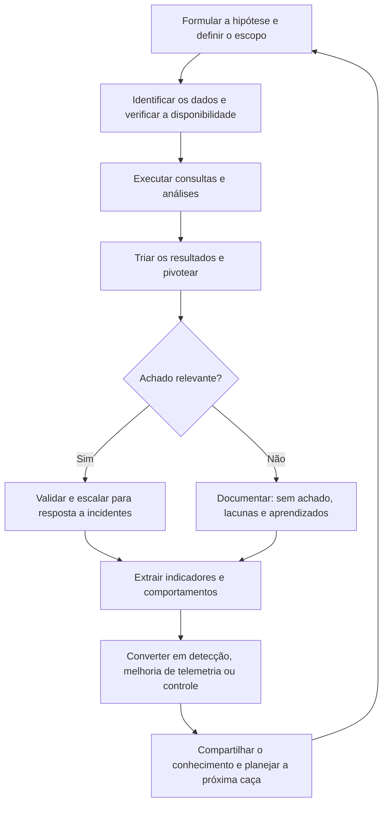

# Fundamentos, Modelos e Maturidade de Threat Hunting

> **Objetivo pedagógico:** compreender o que é a caça a ameaças (threat hunting), como ela se diferencia do monitoramento, da engenharia de detecção e da resposta a incidentes, os tipos de caça, os modelos de referência (ciclo de caça, PEAK, TaHiTI e modelo de maturidade) e as condições de dados, de pessoas e de governança para conduzir caças de forma sustentável e proporcional.

## 1. Definição

Threat hunting é a busca **proativa, iterativa e conduzida por analistas** por atividade maliciosa ou indevida que **passou despercebida** pelas detecções automáticas existentes. Parte da premissa de que o adversário pode já estar no ambiente (assumir o comprometimento) e que as detecções têm lacunas.

| Característica | Descrição |
|---|---|
| Proativa | Não espera por um alerta; parte de uma hipótese ou de uma pergunta |
| Orientada por hipótese | Cada caça testa uma afirmação específica sobre o comportamento do adversário ou sobre o ambiente |
| Conduzida por pessoas | A análise humana, apoiada por dados e ferramentas, é o diferencial |
| Iterativa | Os resultados geram novas perguntas, pivôs e refinamentos |
| Produtiva mesmo sem achados | Gera detecções, melhorias de telemetria e conhecimento do ambiente |
| Delimitada | Tem escopo, período, dados e critérios de sucesso definidos |

## 2. Como se relaciona com outras funções

| Função | Foco | Relação com a caça |
|---|---|---|
| Monitoramento do SOC | Triagem de alertas em tempo quase real | A caça procura o que não gerou alerta; os alertas orientam hipóteses |
| Engenharia de detecção | Criar, testar e manter regras (pasta 11) | A caça descobre comportamentos e converte os resultados em detecções |
| Resposta a incidentes | Conter e investigar incidentes confirmados | A caça pode revelar incidentes e subsidia o escopo (pasta 16) |
| Inteligência de ameaças | Produzir conhecimento sobre adversários | Fornece hipóteses; a caça valida a presença e gera inteligência interna |
| Gestão de vulnerabilidades | Reduzir fraquezas conhecidas | A caça verifica a exploração e a exposição reais |
| Forense digital | Investigar o ocorrido com rigor probatório | A caça aplica técnicas forenses em escala e com rapidez; achados confirmados passam ao processo forense |
| Equipes ofensivas (red team) e de emulação | Testar as defesas | Os exercícios de emulação validam as caças (purple team) |

## 3. Tipos de caça

| Tipo | Ponto de partida | Exemplo |
|---|---|---|
| Orientada por hipótese (TTP) | Comportamento de adversário (ATT&CK) ou risco do ambiente | "Adversários usam tarefas agendadas para persistência: há tarefas criadas por contas e por caminhos incomuns?" |
| Orientada por inteligência | Relatório de ameaça, campanha ou indicadores | "A campanha X usa o domínio Y e a técnica Z: há sinais no ambiente?" |
| Baseada em linha de base (baseline) | Comportamento normal e desvios | "Que processos são executados em poucos hosts e raramente?" |
| Assistida por modelos (modelos estatísticos e de aprendizado de máquina) | Pontuação de anomalias | "Que hosts têm perfil de rede mais atípico em relação aos pares?" |
| Situacional ou investigativa | Evento, vulnerabilidade ou mudança | "Foi divulgada uma falha em um equipamento de borda: houve exploração?" |
| Avaliação de comprometimento (compromise assessment) | Verificação ampla do ambiente | Após uma aquisição ou um incidente, avaliar a presença de adversários |

Não existe tipo "melhor": a escolha depende dos dados, da maturidade e do risco.

## 4. Ciclo de caça

## 5. Modelos e frameworks de referência

| Modelo | Origem | Ideia central |
|---|---|---|
| Ciclo de caça (Threat Hunting Loop) | Sqrrl | Criar hipóteses, investigar com ferramentas e técnicas, descobrir novos padrões e TTPs e informar e enriquecer as análises |
| Modelo de maturidade de caça (HMM) | Sqrrl (D. Bianco) | Níveis de HM0 a HM4, conforme a qualidade dos dados e a capacidade analítica |
| PEAK | Splunk SURGe | Prepare, Execute, Act with Knowledge; tipos hipótese, baseline e assistido por modelos |
| TaHiTI | Setor financeiro holandês | Caça integrada à inteligência de ameaças, com fases de iniciação, caça e finalização |
| Caça baseada em TTP | MITRE | Usar o ATT&CK para estruturar as hipóteses e a cobertura |
| ABLE | Sqrrl (D. Bianco) | Estrutura de hipótese: Ator, Comportamento, Localização e Evidência |
| Pirâmide da Dor | D. Bianco | Priorizar indicadores e comportamentos mais custosos ao adversário |

## 6. Maturidade de caça

| Nível | Descrição | Características |
|---|---|---|
| HM0: Inicial | Depende de alertas automáticos; pouca ou nenhuma coleta de dados | Sem caça proativa |
| HM1: Mínimo | Busca de indicadores a partir de relatórios de inteligência; coleta moderada de dados | Caça baseada em indicadores |
| HM2: Procedimental | Segue procedimentos de caça criados por terceiros; coleta intensa de dados | Caças repetíveis, com modelos externos |
| HM3: Inovador | Cria procedimentos próprios e novas hipóteses; dados abundantes | Equipe produz conhecimento |
| HM4: Liderança | Automatiza os procedimentos eficazes em detecções; ciclo contínuo | Caça gera detecções automaticamente |

Meta realista: avançar um nível por vez, com dados adequados e processos documentados, em vez de adquirir ferramentas sem método.

## 7. Pré-requisitos

| Pré-requisito | Descrição |
|---|---|
| Telemetria suficiente | Endpoint, identidade, rede, nuvem e e-mail, com retenção compatível (arquivo 3) |
| Capacidade de consulta | Plataformas que permitam consultas rápidas sobre grandes volumes |
| Conhecimento do ambiente | Ativos, redes, contas, aplicativos e comportamento normal |
| Conhecimento de adversários | ATT&CK, inteligência e incidentes anteriores |
| Competências | Análise de dados, sistemas operacionais, redes, identidade, forense e escrita de consultas |
| Processo | Modelos de plano, execução, relatório e transição para detecção |
| Governança | Autorização, escopo, privacidade e gestão de achados |
| Tempo protegido | Tempo dedicado, sem competição constante com o atendimento de alertas |

## 8. Papéis

| Papel | Responsabilidade |
|---|---|
| Líder da caça | Prioriza hipóteses, revisa planos e resultados e garante a qualidade |
| Caçador (analista) | Executa as caças, documenta e propõe detecções |
| Engenheiro de detecção | Converte comportamentos em regras e as mantém |
| Analista de inteligência | Fornece hipóteses e contexto sobre adversários |
| Engenheiro de dados e de plataforma | Garante a coleta, o parsing e o desempenho |
| Resposta a incidentes | Recebe os achados confirmados |
| Jurídico e DPO | Orientam sobre escopo, privacidade e tratamento de dados pessoais |
| Donos de sistemas e de negócio | Fornecem contexto sobre o comportamento normal |

## 9. Métricas de valor

| Métrica | Observação |
|---|---|
| Número de caças concluídas e de hipóteses testadas | Atividade; não é resultado por si só |
| Achados confirmados (incidentes e violações de política) | Resultado direto |
| Detecções criadas ou melhoradas a partir das caças | Valor duradouro |
| Lacunas de telemetria identificadas e corrigidas | Melhoria de visibilidade |
| Cobertura de técnicas ATT&CK com caça ou detecção | Maturidade |
| Redução do tempo de permanência (dwell time) e do tempo de detecção | Impacto |
| Taxa de falsos positivos das detecções derivadas | Qualidade |
| Tempo entre a hipótese e a detecção implantada | Eficiência |

Cuidado: medir apenas o número de achados incentiva distorções. Uma caça sem achado, mas com uma lacuna de dados documentada e corrigida, tem valor.

## 10. Aspectos legais, éticos e de privacidade

> **Aviso:** este material é técnico-educacional e não substitui parecer jurídico. Valide cada caso com o Jurídico e com o DPO.

| Tema | Orientação |
|---|---|
| Autorização e escopo | A caça acessa grande volume de dados de usuários e de sistemas; deve haver autorização formal, finalidade legítima e política de monitoramento comunicada (LGPD, arts. 6º e 7º) |
| Minimização | Consultar apenas os dados necessários à hipótese e restringir os campos pessoais quando possível |
| Acesso aos resultados | Restrito; resultados com dados pessoais devem ter retenção e descarte definidos |
| Achados envolvendo pessoas | Condutas de colaboradores exigem tratamento com o RH e o Jurídico; evitar conclusões precipitadas e vieses |
| Sigilo profissional | Cuidados com comunicações privilegiadas e privadas |
| Achados que configuram incidente | Seguir o processo de resposta e as notificações legais (LGPD, art. 48) |
| Registro | Documentar as consultas e os acessos aos dados |

## 11. Exemplo prático: avaliação de maturidade

| Dimensão | Situação | Próximo passo |
|---|---|---|
| Dados | Logs de endpoint apenas em 60% dos hosts; sem logs de DNS | Ampliar a cobertura e coletar o DNS |
| Processo | Caças ad hoc, sem registro | Modelos de plano e de relatório |
| Pessoas | Dois analistas com tempo parcial | Tempo protegido de 20% |
| Detecção | Sem ligação entre caça e regras | Etapa obrigatória de conversão |
| Cobertura ATT&CK | Mapeada só para a detecção | Matriz de cobertura com caças |
| Nível estimado | HM1 a HM2 | Meta de HM3 em 12 meses, com indicadores de progresso |

## 12. Casos de uso corporativos

- Estruturação de um programa de caça com maturidade, métricas e governança.
- Avaliação do ambiente após uma aquisição ou um incidente (avaliação de comprometimento).
- Validação de detecções e identificação de lacunas de visibilidade.

## 13. Normas e frameworks relevantes

- MITRE ATT&CK; MITRE. TTP-Based Hunting; ATT&CK Navigator; DeTT&CT
- Sqrrl (D. Bianco). A Framework for Threat Hunting e Hunting Maturity Model; Splunk SURGe. PEAK Threat Hunting Framework; TaHiTI
- NIST CSF 2.0 (função Detectar); NIST SP 800-61 Rev. 3; NIST SP 800-137 (monitoramento contínuo)
- ISO/IEC 27002:2022, controle 8.16 (atividades de monitoramento); ISO/IEC 27035
- CIS Controls v8.1, controles 8, 13 e 17; LGPD, arts. 6º, 7º, 46 e 48

## 14. Referências

- Bianco, D. The Pyramid of Pain (2013) e The Cyber Hunting Maturity Model (2015).
- Sqrrl. A Framework for Threat Hunting (whitepaper).
- Splunk SURGe. The PEAK Threat Hunting Framework (2023).
- Daszczyszak, R. et al. TTP-Based Hunting. MITRE, 2019.
- FI-ISAC NL. TaHiTI: Targeted Hunting integrating Threat Intelligence (2018).
- Lee, R. M.; Lee, R. The Who, What, Where, When, Why and How of Effective Threat Hunting. SANS, 2016.
- AlFardan, N. Cyber Threat Hunting. Manning, 2023.
- SANS Institute. FOR508 e SEC555.
