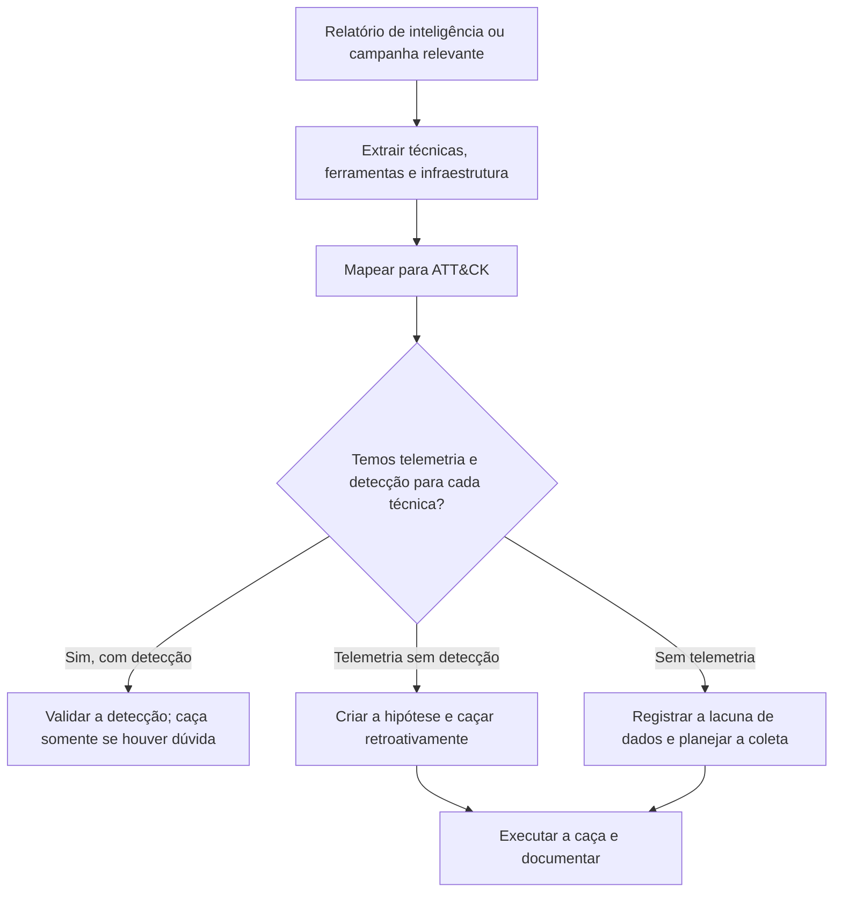

# Hipóteses, Inteligência e Planejamento de Hunts

> **Objetivo pedagógico:** formular hipóteses de caça testáveis a partir de inteligência de ameaças, do MITRE ATT&CK, de incidentes anteriores e do risco do negócio, estruturá-las (por exemplo, no formato ABLE), planejar cada caça com escopo, dados, critérios de sucesso e limites, e priorizar um portfólio de caças.

## 1. O que é uma boa hipótese

| Atributo | Descrição |
|---|---|
| Específica | Descreve um comportamento concreto do adversário ou uma condição do ambiente |
| Testável | Pode ser confirmada ou refutada com os dados disponíveis |
| Relevante | Ligada a ameaças plausíveis para a organização e a ativos críticos |
| Delimitada | Tem período, escopo de sistemas e dados definidos |
| Acionável | O resultado leva a uma decisão: escalar, detectar, corrigir ou registrar a lacuna |

Exemplos de **más** hipóteses: "Há malware na rede" (vaga e não testável); "Procurar coisas estranhas nos logs" (sem pergunta).
Exemplos de **boas** hipóteses:

| Hipótese | Técnica ATT&CK | Dados |
|---|---|---|
| "Adversários usam o Rclone ou ferramentas similares para exfiltrar dados de servidores de arquivos nos últimos 90 dias." | T1567, T1048 | EDR (linhas de comando), proxy, fluxos |
| "Contas de serviço são usadas para logon interativo em estações, indicando abuso de credenciais." | T1078 | Logs de autenticação do domínio |
| "Existem assinaturas permanentes de WMI criadas por contas não administrativas, indicando persistência." | T1546.003 | Sysmon 19, 20 e 21; WMI-Activity |
| "Chaves de acesso de nuvem foram criadas fora do processo normal de gestão de identidades." | T1098.001 | Logs de auditoria da nuvem |
| "Servidores web executam processos filhos de shell, indicando webshell." | T1505.003 | EDR e logs web |

## 2. Fontes de hipóteses

| Fonte | Como gerar hipóteses |
|---|---|
| Inteligência de ameaças | Relatórios de campanhas e de grupos relevantes para o setor: traduzir as técnicas em perguntas sobre o ambiente |
| MITRE ATT&CK | Escolher técnicas com alta prevalência e pouca cobertura de detecção |
| Incidentes e quase incidentes anteriores | O que passou despercebido? Que técnicas foram usadas? |
| Resultados de red team e de emulação | Técnicas que não foram detectadas |
| Vulnerabilidades e mudanças | Falhas divulgadas em tecnologias usadas; novas exposições |
| Avaliação de risco e ativos críticos | O que mais importa proteger e como o atacante chegaria lá? |
| Lacunas de detecção | Técnicas sem regra ou sem telemetria |
| Dados do próprio ambiente | Anomalias observadas na linha de base |
| Alertas de baixa fidelidade | Padrões repetidos que merecem investigação aprofundada |
| Inteligência de fornecedores e de parceiros do setor | Alertas e indicadores compartilhados |

## 3. Formato ABLE para estruturar a hipótese

| Elemento | Pergunta | Exemplo |
|---|---|---|
| Ator (Actor) | Quem poderia estar fazendo isso (opcional)? | Afiliados de ransomware com acesso por credenciais válidas |
| Comportamento (Behavior) | O que o ator faz? (técnica) | Instala ferramentas de acesso remoto legítimas para persistência (T1219) |
| Localização (Location) | Onde procurar? (sistemas, redes e contas) | Estações e servidores de usuários privilegiados |
| Evidência (Evidence) | Que artefatos e dados provariam? | Instalação de serviços novos, conexões a domínios de gestão remota, hashes e assinaturas de executáveis |

## 4. Da inteligência de ameaças à hipótese

Cuidados ao usar inteligência: verificar a relevância para o setor e para a tecnologia usada; priorizar comportamentos (TTPs) sobre indicadores perecíveis; considerar o tempo de validade dos indicadores; evitar interpretar a ausência de indicadores como ausência da ameaça.

## 5. Priorização de hipóteses

| Critério | Pergunta | Peso (exemplo) |
|---|---|---|
| Probabilidade | A técnica é usada por adversários relevantes para nós? | 30% |
| Impacto | Qual o dano se for bem-sucedida nos ativos críticos? | 30% |
| Disponibilidade de dados | Temos telemetria para testar? | 20% |
| Lacuna de detecção | Hoje existe cobertura? | 10% |
| Custo e esforço | Quanto tempo e recursos exige? | 10% |

Pontue cada hipótese e ordene o portfólio. Reveja a priorização a cada trimestre ou quando houver eventos relevantes (novas campanhas e incidentes).

## 6. Plano de caça

| Elemento | Conteúdo |
|---|---|
| Identificador e título | HNT-AAAA-NNN |
| Hipótese (ABLE) | Comportamento, localização e evidência |
| Técnicas ATT&CK | Identificadores |
| Motivação | Inteligência, incidente, lacuna ou risco |
| Escopo | Sistemas, contas, redes e período de análise (janela de retroação) |
| Dados necessários | Fontes e campos; verificação de disponibilidade e de retenção |
| Método | Consultas, análises estatísticas e pivôs previstos |
| Critérios de sucesso e de encerramento | O que confirma, o que refuta e quando parar |
| Limites e riscos | Impacto de desempenho, privacidade e dados sensíveis |
| Aprovação e autorização | Líder e, se necessário, Jurídico e DPO |
| Prazos e responsáveis | Tempo máximo (time-box) |
| Saídas esperadas | Relatório, detecção, melhoria de telemetria ou escalonamento |

## 7. Definição de escopo e janela de retroação

| Decisão | Orientação |
|---|---|
| Período | Compatível com a retenção e com o comportamento do adversário; por exemplo, 30 a 90 dias para hipóteses de persistência e de acesso |
| Sistemas | Priorizar ativos críticos e alvos prováveis; amostrar quando o universo for grande, documentando o método |
| Contas | Privilegiadas, de serviço e de alto risco |
| Profundidade | Começar com consultas amplas e estreitar com pivôs |
| Tempo máximo | Definir um limite para evitar caças intermináveis |
| Reprodutibilidade | Registrar versões das consultas e dos dados |

## 8. Cobertura e lacunas

| Ferramenta | Uso |
|---|---|
| MITRE ATT&CK Navigator | Visualizar as técnicas cobertas por detecções, por caças e por telemetria |
| DeTT&CT | Mapear fontes de dados e a qualidade da visibilidade, e a cobertura de detecção |
| Matriz de cobertura própria | Técnica x telemetria x detecção x caça x data da última validação |

A matriz deve ser atualizada a cada caça: caças bem documentadas mostram onde a cobertura é real e onde é apenas presumida.

## 9. Exemplo prático: de uma campanha à hipótese e ao plano

| Elemento | Conteúdo |
|---|---|
| Inteligência | Relatório público sobre um grupo de ransomware que usa ferramentas de gestão remota e Rclone antes da criptografia |
| Hipóteses derivadas | H1: ferramentas de acesso remoto não aprovadas instaladas; H2: uso de Rclone ou similares em servidores de arquivos; H3: exclusão de cópias de sombra por contas incomuns |
| Telemetria | H1 e H3 com Sysmon e EDR; H2 com EDR e proxy, sem DNS |
| Priorização | H2 alta (impacto e probabilidade); H1 alta; H3 média; lacuna de DNS registrada |
| Plano HNT-2026-014 (H2) | Janela de 90 dias; servidores de arquivos e de banco de dados; linhas de comando com `rclone`, arquivos de configuração e destinos de nuvem; critério de sucesso: nenhuma execução não autorizada, ou escalonamento |
| Saídas esperadas | Relatório; detecção por linha de comando e por volume de saída; ampliação da cobertura de DNS |

## 10. Casos de uso corporativos

- Construção de um portfólio de caças priorizado por risco e por inteligência.
- Tradução de relatórios de ameaça em planos de caça e em detecções.
- Mapeamento da cobertura ATT&CK, com lacunas de telemetria e de detecção.

## 11. Normas e frameworks relevantes

- MITRE ATT&CK; ATT&CK Navigator; DeTT&CT; MITRE. TTP-Based Hunting
- Sqrrl (ABLE e Hunting Loop); PEAK; TaHiTI
- NIST SP 800-150 (compartilhamento de inteligência); NIST CSF 2.0
- ISO/IEC 27002:2022, controles 5.7 (inteligência de ameaças) e 8.16
- CIS Controls v8.1, controles 13 e 17

## 12. Referências

- Bianco, D. Generating Hypotheses for Successful Threat Hunting (Sqrrl, 2016).
- MITRE. ATT&CK e TTP-Based Hunting (2019).
- Rabobank CDC. DeTT&CT (documentação).
- Brown, R.; Roberts, S. Intelligence-Driven Incident Response. 2. ed. O'Reilly, 2023.
- Splunk SURGe. The PEAK Threat Hunting Framework (2023).
- FI-ISAC NL. TaHiTI (2018).
