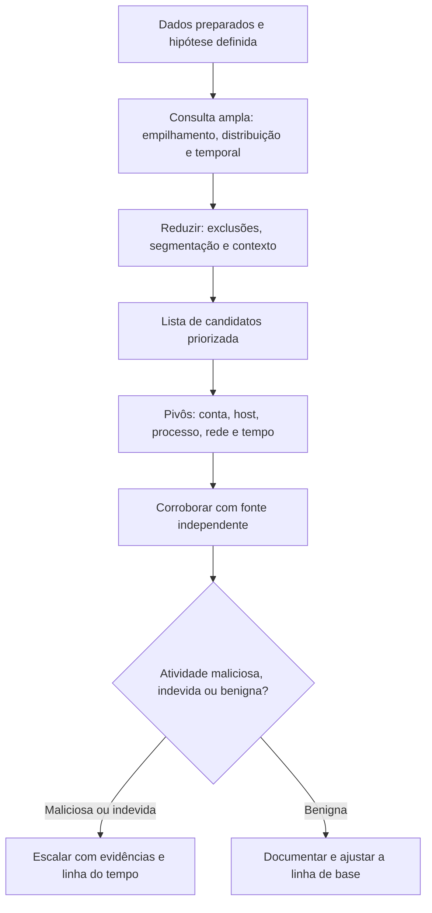

# Técnicas Analíticas e Estatísticas de Hunting

> **Objetivo pedagógico:** aplicar técnicas analíticas e estatísticas à caça (empilhamento e frequência mínima, agrupamento, análise temporal, análise de grafos, análise de sequências, pivôs e modelos de anomalia), compreender suas limitações e reduzir falsos positivos com contexto, calibração e validação.

## 1. Escolha da técnica

| Pergunta | Técnica indicada |
|---|---|
| O que é raro neste ambiente? | Empilhamento (stacking) e frequência mínima (LFO) |
| Que entidades se comportam de forma parecida ou diferente de seus pares? | Agrupamento e comparação com grupos pares |
| Que atividade é periódica ou ocorre em horários incomuns? | Análise temporal |
| Quem fala com quem, e por quais caminhos? | Análise de grafos |
| Que eventos formam uma cadeia suspeita? | Análise de sequências e de árvores de processos |
| Que valores têm características extremas (comprimento, entropia e volume)? | Análise de distribuição e de valores extremos |
| Que hosts ou contas têm o perfil mais atípico em muitas dimensões? | Modelos de detecção de anomalias |

## 2. Empilhamento e frequência mínima

Empilhar consiste em **contar ocorrências por valor** (processos, caminhos, agentes de usuário e domínios) e examinar os extremos: muito raros (candidatos) ou muito frequentes (linha de base). A cauda longa concentra os comportamentos incomuns.

| Boa prática | Descrição |
|---|---|
| Escolher o campo certo | Nome do processo, caminho, linha de comando, hash ou domínio |
| Segmentar | Empilhar por tipo de host, por departamento ou por sistema operacional |
| Combinar raridade com contexto | Raro + executado em servidor crítico + por conta de serviço |
| Medir prevalência | Em quantos hosts aparece? Raro em hosts e raro em ocorrências são conceitos diferentes |
| Tratar o ruído | Software legítimo raro (por exemplo, utilitários de uma área) precisa ser excluído por lista de permissão |

```sql
-- DuckDB: processos executados em poucos hosts, por tipo de host (processos.csv: host, tipo_host, processo, caminho)
SELECT tipo_host, processo, count(*) AS execucoes, count(DISTINCT host) AS hosts
FROM read_csv_auto('processos.csv')
GROUP BY tipo_host, processo
HAVING hosts <= 3
ORDER BY tipo_host, execucoes ASC
LIMIT 100;
```

```kusto
// KQL: caminhos de execução incomuns em servidores (EDR)
DeviceProcessEvents
| where Timestamp > ago(30d) and DeviceName startswith "srv"
| summarize Hosts = dcount(DeviceName), Execucoes = count() by FolderPath, FileName
| where Hosts <= 2
| order by Execucoes asc
```

## 3. Agrupamento e comparação entre pares

| Abordagem | Exemplo |
|---|---|
| Grupo de pares | Comparar o comportamento de uma conta com o de outras do mesmo cargo ou departamento |
| Perfis de host | Servidores de banco de dados raramente executam navegadores; estações raramente executam utilitários de banco |
| Agrupamento (clustering) | Agrupar hosts por padrões de processos e identificar os que não pertencem a nenhum grupo |
| Primeira ocorrência | Entidades que aparecem pela primeira vez (domínio, processo ou ASN) em relação ao histórico |

## 4. Análise temporal

| Técnica | Descrição | Exemplo |
|---|---|---|
| Distribuição por hora e por dia | Atividade fora do horário habitual | Logons administrativos às 03:00 |
| Rajadas | Picos curtos de eventos | Muitas falhas seguidas de sucesso |
| Periodicidade (beaconing) | Intervalos regulares entre conexões | Coeficiente de variação baixo (pastas 11 e 13) |
| Sequência temporal | Ordem de eventos em janelas | Logon, criação de serviço e execução em poucos minutos |
| Tempo de permanência de entidades | Contas e hosts que surgiram recentemente | Conta criada e usada no mesmo dia |

```kusto
// Logons de contas privilegiadas fora do horário comercial (ajuste a lista de contas e o fuso)
SecurityEvent
| where TimeGenerated > ago(30d) and EventID == 4624 and LogonType in (2, 10)
| where TargetUserName in~ ("adm_ana", "adm_bruno")
| extend Hora = hourofday(TimeGenerated)
| where Hora < 6 or Hora > 22
| project TimeGenerated, TargetUserName, Computer, IpAddress, LogonType
```

## 5. Análise de grafos

Grafos modelam relações (conta para host, host para host e processo para processo). Úteis para movimentação lateral, caminhos de privilégio e relações de rede.

| Aplicação | Pergunta |
|---|---|
| Grafo de autenticações | Que contas autenticam em quantos hosts? Há contas com alcance incomum? |
| Caminhos de ataque (Active Directory e nuvem) | Qual o caminho mais curto de uma conta comum a um administrador de domínio? (ferramentas como BloodHound, usadas também por defensores) |
| Comunicação host a host | Que hosts de usuário falam com muitos servidores? |
| Árvore de processos | Qual a cadeia de pai e filho de um comportamento suspeito? |

```python
# Grafo de autenticações: contas com maior alcance (autenticacoes.csv: conta, origem, destino)
import pandas as pd
import networkx as nx

df = pd.read_csv("autenticacoes.csv")
G = nx.from_pandas_edgelist(df, source="origem", target="destino", edge_attr=["conta"], create_using=nx.DiGraph())

# Hosts de origem que autenticam em mais destinos distintos
alcance = sorted(G.out_degree(), key=lambda x: x[1], reverse=True)[:15]
for host, grau in alcance:
    print(host, grau)

# Contas que autenticam em muitos hosts distintos
por_conta = df.groupby("conta")["destino"].nunique().sort_values(ascending=False).head(15)
print(por_conta)
```

## 6. Análise de distribuições e de valores extremos

| Característica | Uso |
|---|---|
| Comprimento de linhas de comando, de URLs e de rótulos de DNS | Comandos codificados e túneis |
| Entropia de nomes (domínios e arquivos) | Nomes gerados algoritmicamente |
| Volume de dados por entidade | Exfiltração |
| Número de entidades distintas contactadas | Varreduras e abuso de credenciais |
| Razão entre bytes enviados e recebidos | Assimetria de upload |

```bash
# Linhas de comando mais longas em um CSV exportado de EDR (coluna 'cmdline'), para triagem de comandos codificados
mlr --icsv --ojson put '$tamanho = strlen($cmdline)' then sort -nr tamanho then head -n 30 processos.csv
```

Valores extremos são **indícios**, não conclusões: comandos legítimos longos (por exemplo, instaladores) e CDNs com nomes longos geram falsos positivos.

## 7. Análise de sequências e de árvores de processos

| Padrão | Interpretação | Fontes |
|---|---|---|
| Aplicativo de escritório criando interpretador de comandos | Macro ou documento malicioso | EDR e Sysmon 1 |
| Servidor web criando shell | Webshell | EDR e auditd |
| Logon de rede, criação de serviço e execução | Movimentação lateral | EVTX 4624, 4697 e 7045 |
| Acesso a LSASS, compactação de arquivo e conexão de saída | Credenciais e exfiltração | Sysmon 10, EDR e proxy |
| Exclusão de cópias de sombra seguida de grande volume de renomeações | Ransomware | EDR e logs de arquivos |

Cadeias mais longas e específicas têm menos falsos positivos do que eventos isolados.

## 8. Pivôs

| Pivô a partir de | Para | Exemplo |
|---|---|---|
| Hash ou nome de arquivo | Outros hosts com o mesmo arquivo | Prevalência e dispersão |
| Linha de comando | Outros usuários e hosts com o mesmo padrão | Escopo |
| Conta | Hosts, horários e aplicativos | Uso anômalo |
| IP ou domínio | Hosts que se comunicaram, processos e horários | Infraestrutura do adversário |
| Processo pai | Filhos e conexões | Árvore de execução |
| Horário | Eventos próximos em outras fontes | Linha do tempo (pasta 05) |
| Agente de usuário e JA3 | Outros clientes com a mesma impressão | Agrupamento |

Documente cada pivô: de onde partiu, que consulta usou e o que encontrou.

## 9. Modelos de anomalia (assistidos por aprendizado de máquina)

| Aspecto | Observação |
|---|---|
| Uso | Priorizar candidatos em dados de alta dimensionalidade (por exemplo, perfis de hosts) |
| Modelos comuns | Floresta de isolamento (isolation forest), agrupamento e análise de componentes principais |
| Pré-requisitos | Características (features) bem escolhidas, normalização e dados de qualidade |
| Limitações | Anomalia não é malícia; difícil de explicar; sensível a mudanças legítimas (por exemplo, implantações); necessita de validação humana |
| Cuidado | Evitar contaminação por dados já comprometidos; revisar periodicamente |

```python
# Floresta de isolamento sobre características por host (features_hosts.csv: host, procs_novos, conexoes_saida, bytes_saida, hosts_distintos)
import pandas as pd
from sklearn.ensemble import IsolationForest

df = pd.read_csv("features_hosts.csv")
X = df.drop(columns=["host"])
modelo = IsolationForest(n_estimators=200, contamination=0.01, random_state=42).fit(X)
df["pontuacao"] = -modelo.score_samples(X)          # quanto maior, mais atípico
print(df.sort_values("pontuacao", ascending=False).head(20))
```

Trate a saída como lista de candidatos para investigação, nunca como veredito.

## 10. Redução de falsos positivos

| Medida | Descrição |
|---|---|
| Contexto de negócio | Consultar o dono do sistema e a área antes de concluir |
| Listas de permissão revisadas | Ferramentas administrativas, varreduras e automações legítimas, com responsável e validade |
| Combinação de sinais | Exigir mais de um indício independente |
| Segmentação | Linhas de base por grupo |
| Validação com fonte independente | Corroborar em outra telemetria |
| Registro das decisões | Por que um candidato foi descartado, para evitar reanálise |
| Feedback às detecções | Os falsos positivos informam os ajustes das regras |

## 11. Fluxo de análise



## 12. Exemplo prático: empilhamento revela ferramenta de gestão remota não aprovada

| Passo | Resultado |
|---|---|
| Hipótese | Adversários instalam ferramentas legítimas de acesso remoto para persistência (T1219) |
| Consulta | Empilhamento de serviços e executáveis novos nos últimos 30 dias por tipo de host |
| Candidatos | Um executável de acesso remoto presente em 2 servidores, ausente do inventário aprovado |
| Pivô | Instalado por uma conta de serviço às 02:14Z; conexões a um domínio de gestão remota; mesmo hash em uma estação |
| Corroboração | Logon de VPN incomum da conta da estação 3 dias antes; sem solicitação de mudança |
| Conclusão | Atividade maliciosa provável (persistência); escalada à resposta a incidentes; detecção criada para instalações de ferramentas de acesso remoto fora do processo |

## 13. Casos de uso corporativos

- Caças orientadas por dados em ambientes com grande volume de telemetria.
- Identificação de movimentação lateral e de abuso de credenciais por análise de grafos.
- Priorização de candidatos com modelos de anomalia, sempre com validação humana.

## 14. Normas e frameworks relevantes

- MITRE ATT&CK: T1219, T1078, T1021, T1071, T1041, T1546, T1053
- NIST CSF 2.0 (Detectar); NIST SP 800-61 Rev. 3; ISO/IEC 27002:2022, controle 8.16
- CIS Controls v8.1, controles 8 e 13

## 15. Referências

- Bianco, D. The Pyramid of Pain (2013).
- Sanders, C.; Smith, J. Applied Network Security Monitoring. 2013.
- Documentação do pandas, do DuckDB, do Miller, do NetworkX e do scikit-learn.
- SpecterOps. BloodHound (documentação).
- Roddie, M. Practical Threat Detection Engineering. Packt, 2023.
- SANS Institute. SEC555 e FOR508.
