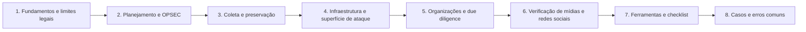

# 21 OSINT para Investigações

## Objetivo

Conduzir investigações com fontes abertas para fins corporativos e de segurança, de forma lícita, proporcional e documentada: planejar com requisito e base legal, proteger o investigador e o caso (OPSEC), coletar e preservar conteúdo com valor probatório, analisar infraestrutura e superfície de ataque, avaliar organizações e terceiros, verificar mídias e redes sociais, e produzir inteligência com fontes avaliadas, hipóteses concorrentes, confiança declarada e minimização de dados pessoais.

## Trilha de estudo recomendada

## Conteúdo da pasta

| Ordem | Arquivo | Objetivo |
|---|---|---|
| 1 | [fundamentos-ciclo-de-inteligencia-e-limites-legais-do-osint.md](fundamentos-ciclo-de-inteligencia-e-limites-legais-do-osint.md) | Ciclo de inteligência, usos legítimos, princípios, LGPD e linhas vermelhas |
| 2 | [planejamento-opsec-e-ambiente-de-investigacao.md](planejamento-opsec-e-ambiente-de-investigacao.md) | Requisitos, OPSEC, ambiente isolado, personas e proteção do investigador |
| 3 | [coleta-preservacao-e-validade-de-evidencias-osint.md](coleta-preservacao-e-validade-de-evidencias-osint.md) | Captura, WARC, hash, arquivamento, ata notarial e ficha de coleta |
| 4 | [infraestrutura-dominios-ips-e-superficie-de-ataque.md](infraestrutura-dominios-ips-e-superficie-de-ataque.md) | RDAP, DNS, CT, varreduras públicas, domínios semelhantes e remoção |
| 5 | [organizacoes-pessoas-e-due-diligence-com-fontes-abertas.md](organizacoes-pessoas-e-due-diligence-com-fontes-abertas.md) | Cadastros oficiais, sanções, beneficiário final, mídia adversa e LGPD |
| 6 | [geolocalizacao-verificacao-de-midias-e-redes-sociais.md](geolocalizacao-verificacao-de-midias-e-redes-sociais.md) | Cinco pilares, metadados, geolocalização, perfis inautênticos e IA |
| 7 | [ferramentas-fluxo-modelos-e-checklist-de-osint.md](ferramentas-fluxo-modelos-e-checklist-de-osint.md) | Ferramentas, modelos, ACH, classificação de fontes e checklist |
| 8 | [casos-de-uso-e-erros-comuns-em-osint.md](casos-de-uso-e-erros-comuns-em-osint.md) | Sete cenários, erros comuns e exercícios |

## Princípios

- Toda investigação parte de um requisito específico, com finalidade legítima, base legal e escopo aprovados
- "Público" não significa "livre de regras": aplicar finalidade, necessidade, proporcionalidade e minimização (LGPD, art. 7º, §§ 3º e 4º)
- Coleta passiva, em ambiente isolado, sem contas pessoais, sem engano e sem acesso indevido
- Nunca usar dados de vazamentos criminosos, nem compilar dossiês sobre a vida privada
- Preservar o conteúdo volátil com metadados, hash e método; ata notarial para provas centrais
- Avaliar fontes e informações, corroborar e comparar hipóteses concorrentes; declarar a confiança
- Agrupar infraestrutura por atributos múltiplos e raros; evitar atribuir autoria a pessoas
- Proteger o investigador e os dados; compartilhar com classificação e minimização

## Relação com outras pastas

- 02-cadeia-de-custodia e 04-hash-e-integridade: custódia e hash das coletas
- 05-timeline-analysis: linha do tempo de eventos e de infraestrutura
- 06-evidencias-digitais: validade probatória e ata notarial
- 12-email-forensics e 15-malware-forensics: campanhas de phishing e indicadores
- 16-ransomware-investigation: monitoramento de vazamentos e de extorsão, com cautela legal
- 17-cloud-forensics: resposta a segredos publicados e a chaves expostas
- 20-threat-hunting: inteligência para hipóteses de caça
- 27-deepfake-investigation: investigação aprofundada de mídias sintéticas

## Referências

- ONU (OHCHR) e UC Berkeley. Berkeley Protocol on Digital Open Source Investigations (2020)
- Heuer, R. J. Psychology of Intelligence Analysis (1999); Heuer, R. J.; Pherson, R. H. Structured Analytic Techniques for Intelligence Analysis (2014)
- Bellingcat. Online Investigation Toolkit; First Draft. Verification Handbook
- ISO/IEC 27037:2012; NIST SP 800-86 e SP 800-150; FIRST TLP; ISO 28500 (WARC); RFC 3161; RFC 7480 a 7484 (RDAP)
- ISO 37001 e ISO 37301; Recomendações do GAFI
- Brasil. Lei nº 13.709/2018 (LGPD); Lei nº 12.965/2014; Lei nº 12.846/2013; Lei nº 14.132/2021; CPC, art. 384
- Bazzell, M. Open Source Intelligence Techniques; Hassan, N. A. Open Source Intelligence Methods and Tools (2018)
- SANS Institute. SEC487: Open-Source Intelligence (OSINT) Gathering and Analysis
