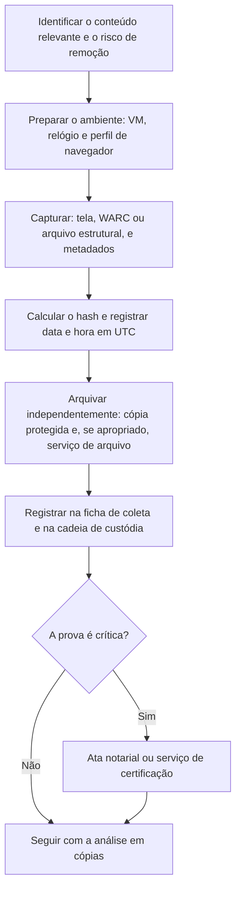

# Coleta, Preservação e Validade de Evidências OSINT

> **Objetivo pedagógico:** coletar e preservar conteúdo aberto da web e de redes sociais de forma íntegra e defensável (capturas, arquivos WARC, hashes, carimbo de tempo, arquivamento e ata notarial), documentar a origem e o método para que o conteúdo possa ser usado como prova, e conhecer as limitações de cada técnica, inclusive as de conteúdo dinâmico, efêmero e removido.

## 1. Por que a preservação é crítica

O conteúdo aberto é **volátil**: páginas são editadas ou removidas, publicações são apagadas, perfis mudam de nome e o conteúdo exibido depende de quem acessa e quando. Uma captura de tela solta, sem metadados nem método, é frágil como prova e fácil de contestar.

| Fragilidade | Consequência |
|---|---|
| Conteúdo alterado ou removido | Perda do que existia |
| Captura sem URL, data e hora | Impossibilidade de demonstrar origem e momento |
| Edição de imagens | Alegação de adulteração |
| Conteúdo dinâmico personalizado | O que foi visto não é o que outros veem |
| Falta de documentação do método | Prova contestável |
| Capturas feitas por terceiros desconhecidos | Autenticidade duvidosa |

## 2. Princípios

| Princípio | Aplicação |
|---|---|
| Preservar antes de analisar | A prioridade é capturar o que pode desaparecer |
| Múltiplos formatos e fontes | Captura visual, arquivo estrutural (WARC ou HTML) e arquivamento independente |
| Metadados completos | URL exata, data e hora em UTC, coletor, ferramenta, versão, endereço de rede e navegador |
| Hash e carimbo de tempo | Integridade verificável (pasta 04) |
| Método reprodutível | Descrever como a captura foi feita |
| Mínimo de alteração | Não editar, recortar ou anotar o original; trabalhar em cópias |
| Cadeia de custódia | Registrar quem coletou, quando, e onde está armazenado (pasta 02) |
| Proporcionalidade | Capturar o necessário e respeitar a privacidade e os termos de uso |

## 3. Métodos de captura

| Método | Vantagens | Limitações |
|---|---|---|
| Captura de tela (página inteira) | Rápida, mostra o que foi visto | Fácil de contestar isoladamente; perde a estrutura e os metadados |
| Impressão em PDF | Preserva texto; portátil | Pode alterar o layout e omitir elementos dinâmicos |
| Salvar a página (HTML e recursos) | Preserva a estrutura e o código | Conteúdo dinâmico carregado por scripts pode faltar |
| WARC (arquivo web) | Formato padrão de arquivamento da web, com requisições, respostas e cabeçalhos | Exige ferramentas; páginas muito dinâmicas exigem navegador completo |
| Extensões de captura e de arquivamento (por exemplo, SingleFile) | Arquivo único com a página renderizada | Dependem do navegador |
| Rastreadores com navegador completo (por exemplo, Browsertrix) | Captura de páginas dinâmicas em WARC | Requer configuração e recursos |
| Plataformas de arquivamento local (por exemplo, ArchiveBox) | Automatizam capturas em vários formatos | Manutenção |
| Ferramentas comerciais de captura de investigação | Registro automático de metadados e de hashes | Licença e dependência de fornecedor |
| Serviços públicos de arquivo (por exemplo, a Wayback Machine) | Arquivamento independente e acessível | **Torna o conteúdo público** e pode alertar o dono; não use com dados sensíveis |
| Serviços de certificação de capturas | Atestam a coleta por terceiro e podem agregar valor probatório | Avaliar custo, privacidade e aceitação |
| Ata notarial | Tabelião atesta o conteúdo visto, com fé pública | Custo e prazo; adequada para provas importantes |
| Captura de vídeo da tela | Registra a navegação e o conteúdo dinâmico | Volume e dificuldade de verificação; complementar |

## 4. Fluxo de captura



## 5. Exemplos práticos

### 5.1 Captura em WARC com `wget`

```bash
# Captura de uma página e de seus recursos em arquivo WARC (respeite os termos de uso do site e a legislação)
wget --warc-file=DFL-2026-001-W001 --warc-header="Caso: DFL-2026-001" \
     --page-requisites --no-parent --adjust-extension \
     "https://exemplo.com.br/pagina-investigada"

# Hash do arquivo WARC e registro dos metadados
sha256sum DFL-2026-001-W001.warc.gz > DFL-2026-001-W001.warc.gz.sha256
wget --version | head -n 1 >> DFL-2026-001-W001.metadados.txt
date -u +"coletado_em_utc=%Y-%m-%dT%H:%M:%SZ" >> DFL-2026-001-W001.metadados.txt
```

Arquivos WARC podem ser visualizados com ferramentas de reprodução (por exemplo, o ReplayWeb.page) sem alterar o original.

### 5.2 Cabeçalhos e redirecionamentos

```bash
# Cabeçalhos de resposta e cadeia de redirecionamentos (execute na VM de investigação)
curl -sIL --max-redirs 10 "https://exemplo.com.br/pagina-investigada" > DFL-2026-001-W001.cabecalhos.txt
```

### 5.3 Registro de metadados da captura (Python)

```python
import datetime
import hashlib
import json
import sys

arquivo, url = sys.argv[1], sys.argv[2]
with open(arquivo, "rb") as f:
    sha256 = hashlib.sha256(f.read()).hexdigest()

registro = {
    "caso": "DFL-2026-001",
    "identificador": "DFL-2026-001-W001",
    "url": url,
    "arquivo": arquivo,
    "sha256": sha256,
    "coletado_em_utc": datetime.datetime.now(datetime.timezone.utc).isoformat(timespec="seconds"),
    "coletor": "analista.exemplo",
    "ferramenta": "wget 1.21 (WARC)",
    "ambiente": "VM-OSINT-01; navegador: perfil dedicado",
}
print(json.dumps(registro, ensure_ascii=False, indent=2))
```

### 5.4 Consulta a registros de arquivo web (CDX da Wayback Machine)

```bash
# Capturas existentes de uma URL no arquivo (para reconstruir histórico), em JSON
curl -s "http://web.archive.org/cdx/search/cdx?url=exemplo.com.br/pagina&output=json&limit=20" | jq .
```

## 6. Redes sociais e conteúdo efêmero

| Aspecto | Orientação |
|---|---|
| Identificar de forma estável | Registrar o identificador numérico da conta e da publicação, além do nome de usuário e do endereço (nomes mudam, identificadores em geral não) |
| Contexto | Capturar a publicação, o perfil, as respostas relevantes e a data e hora exibidas |
| Conteúdo efêmero (histórias e mensagens temporárias) | Preservar rapidamente, respeitando os termos e a legislação; muitos exigem login: seguir a política de contas |
| Mídia | Preservar o arquivo original (imagem ou vídeo) com metadados, além da captura da página |
| Comentários e interações | Capturar apenas o necessário; minimizar dados de terceiros |
| Conteúdo removido | Procurar cópias em arquivos web e em capturas anteriores; registrar a tentativa e o resultado |
| Solicitação à plataforma | Ordem judicial e canais legais de preservação e de fornecimento de dados (Marco Civil, art. 22) |

## 7. Verificação e integridade

| Medida | Descrição |
|---|---|
| Hash | SHA-256 de cada arquivo (captura, WARC, mídia e relatórios) |
| Carimbo de tempo | Assinatura de tempo de terceiro confiável (RFC 3161) ou serviços de ancoragem de carimbos para o hash |
| Duas capturas independentes | Em ferramentas diferentes, quando a prova é importante |
| Verificação cruzada | Conferir o conteúdo com arquivo web ou com outra fonte |
| Preservação do original | Armazenar o original imutável e trabalhar em cópias |
| Registro do ambiente | Navegador, sistema, rede e relógio |

## 8. Validade probatória no Brasil (visão geral)

> **Aviso:** orientações gerais; consulte o Jurídico sobre o caso concreto.

| Tema | Orientação |
|---|---|
| Ata notarial | O Código de Processo Civil (art. 384) admite que a existência e o modo de existir de um fato sejam atestados por ata lavrada por tabelião, inclusive dados representados por imagem ou som em arquivos eletrônicos; é uma das formas mais robustas de preservar conteúdo da web |
| Prova digital e cadeia de custódia | Aplicam-se os princípios de integridade, autenticidade e rastreabilidade (pastas 02, 04 e 06) |
| Capturas isoladas | Podem ser aceitas, mas são contestáveis; devem vir acompanhadas de metadados, de hash e do método |
| Serviços de certificação | Podem reforçar a prova; avaliar a metodologia e a reputação |
| Origem lícita | A prova obtida por meios ilícitos pode ser invalidada; reforça a importância dos limites do arquivo 1 |
| Documentação do método | Permite a reprodução e o questionamento técnico por peritos |
| Conteúdo de terceiros e privacidade | Minimizar e proteger dados pessoais nas provas apresentadas |

## 9. Modelo de ficha de coleta OSINT

| Campo | Preenchimento |
|---|---|
| Identificador | DFL-AAAA-NNN-WNNN |
| Caso | |
| URL exata (e URL final após redirecionamentos) | |
| Plataforma e identificadores (conta e publicação) | |
| Descrição do conteúdo | |
| Data e hora da coleta (UTC) | |
| Coletor | |
| Ferramenta, versão e método | |
| Ambiente (VM, navegador, rede e relógio) | |
| Arquivos gerados (nomes) e hashes SHA-256 | |
| Arquivamento independente (sim ou não; onde) | |
| Ata notarial ou certificação (sim ou não; referência) | |
| Local de armazenamento e custódia | |
| Observações e limitações (conteúdo dinâmico e personalizado) | |

## 10. Armadilhas comuns

| Armadilha | Prevenção |
|---|---|
| Captura de tela sem URL, data e hora | Incluir a barra de endereços e o relógio; complementar com arquivo estrutural |
| Editar, recortar ou anotar a captura original | Preservar o original e anotar em cópias |
| Arquivar no serviço público conteúdo sensível | Usar arquivamento local ou privado; avaliar o risco de publicidade |
| Ignorar a personalização do conteúdo | Registrar o ambiente e capturar de ambientes distintos quando relevante |
| Perder o identificador estável da conta | Registrar identificadores além do nome de usuário |
| Capturar dados pessoais em excesso | Minimizar e restringir o acesso |
| Confiar em ferramentas sem validar | Testar e registrar as versões |
| Atraso na coleta | Priorizar a preservação do que está sob risco de remoção |

## 11. Exemplo prático: preservação de uma página de golpe

| Etapa | Registro |
|---|---|
| Situação | Site que imita a página de pagamento da empresa; denúncia de clientes às 14:05Z |
| Preservação | Na VM de investigação: captura em WARC (`wget`), captura de tela da página inteira e dos cabeçalhos; hashes calculados |
| Metadados | URL, cadeia de redirecionamentos, IP resolvido, certificado, horário em UTC e ferramentas |
| Arquivamento | Cópia em armazenamento protegido; sem envio a serviços públicos (a página contém dados de pagamento de vítimas) |
| Ata notarial | Solicitada, por se tratar de prova central para ação judicial e para a derrubada |
| Entrega | Relatório com os indicadores (domínio, IP e certificado) e a documentação da coleta |
| Resultado | Pedido de remoção ao registrador e à hospedagem, com anexos; página retirada em 20 horas, com a prova preservada |

## 12. Casos de uso corporativos

- Preservação de conteúdo para ações judiciais, notificações e pedidos de remoção.
- Documentação de campanhas de fraude e de uso indevido da marca.
- Registro de divulgação indevida de informações confidenciais em plataformas públicas.

## 13. Normas e frameworks relevantes

- ISO/IEC 27037:2012; NIST SP 800-86; NIST IR 8387; Protocolo de Berkeley (preservação e verificação)
- ISO 28500 (formato WARC); RFC 3161 (carimbo do tempo)
- CPC, art. 384 (ata notarial); CPP, arts. 158-A a 158-F (cadeia de custódia); Marco Civil da Internet, arts. 10 e 22
- LGPD, arts. 6º, 7º (§§ 3º e 4º) e 46

## 14. Referências

- ONU (OHCHR) e UC Berkeley. Berkeley Protocol on Digital Open Source Investigations. 2020.
- International Internet Preservation Consortium. Documentação do formato WARC; Webrecorder (Browsertrix e ReplayWeb.page); ArchiveBox; SingleFile.
- Internet Archive. Documentação da Wayback Machine e do CDX Server API.
- Documentação do GNU Wget (opções de WARC).
- Brasil. Lei nº 13.105/2015 (CPC); Decreto-Lei nº 3.689/1941 (CPP).
- Casey, E. Digital Evidence and Computer Crime. 3. ed. 2011.
