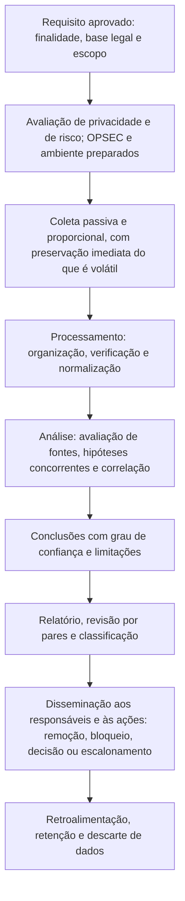

# Ferramentas, Fluxo, Modelos e Checklist de OSINT

> **Objetivo pedagógico:** padronizar as ferramentas, o fluxo de trabalho, os registros e a verificação de qualidade das investigações OSINT, de modo que sejam lícitas, proporcionais, reproduzíveis, bem documentadas e úteis para a decisão.

## 1. Ferramentas por finalidade

| Finalidade | Ferramentas |
|---|---|
| Captura e preservação | `wget` (WARC), Browsertrix, ArchiveBox, SingleFile, ReplayWeb.page; ferramentas comerciais de captura de investigação; serviços de certificação de capturas |
| Hash e carimbo de tempo | `sha256sum`, `Get-FileHash`, serviços de carimbo de tempo (RFC 3161) |
| Domínios e DNS | `whois`, RDAP, `dig`, serviços de DNS passivo, `dnstwist` |
| Certificados | `crt.sh` e outros serviços de Certificate Transparency, `openssl` |
| Superfície de ataque (autorizada) | `subfinder`, OWASP Amass, `theHarvester`, Shodan e Censys, SpiderFoot |
| Páginas e reputação | urlscan.io, VirusTotal e serviços de reputação (consulta por indicador) |
| Mídia e metadados | ExifTool, FFmpeg (ffprobe), InVID-WeVerify, busca reversa de imagens |
| Geolocalização | Google Earth e Maps, OpenStreetMap e Overpass Turbo, Mapillary, SunCalc, imagens de satélite abertas |
| Empresas e integridade | Receita Federal (CNPJ), Portal da Transparência (CEIS e CNEP), CVM, Diários Oficiais, listas de sanções, OpenCorporates, ICIJ Offshore Leaks |
| Análise de relações | Maltego, planilhas, grafos (por exemplo, NetworkX), MISP |
| Gestão do caso e anotações | Sistemas de gestão de casos, MISP, repositório versionado e notas criptografadas |
| Análise estruturada | Matriz de Análise de Hipóteses Concorrentes (ACH) |
| Compartilhamento | MISP, STIX e TAXII, com classificação TLP |

Registre nome, versão, origem e finalidade de cada ferramenta. Avalie os **termos de uso e a privacidade** de cada serviço antes de enviar qualquer dado do caso.

## 2. Fluxo de trabalho padronizado

## 3. Dez perguntas de qualidade e como responder

| Pergunta | Onde responder |
|---|---|
| 1. O requisito é específico e há finalidade e base legal documentadas? | Plano da investigação (modelo A) |
| 2. A coleta foi passiva, proporcional e dentro dos termos e da lei? | Registro de atividades |
| 3. O que é volátil foi preservado com metadados, hash e método? | Ficha de coleta (arquivo 3) |
| 4. As fontes foram avaliadas e a informação foi corroborada? | Registro de fontes (modelo B) |
| 5. As hipóteses alternativas foram consideradas? | Matriz ACH (modelo D) |
| 6. As entidades e as relações têm origem e confiança registradas? | Registro de entidades e relações (modelo C) |
| 7. Os dados pessoais foram minimizados e protegidos? | Avaliação de privacidade e checklist |
| 8. As conclusões declaram a confiança e as limitações? | Relatório (modelo E) |
| 9. Houve revisão por pares e aprovação da disseminação? | Revisão e classificação |
| 10. As ações decorrentes foram definidas e os dados serão descartados? | Plano de ação e política de retenção |

## 4. Modelo A: Plano da Investigação OSINT

| Campo | Preenchimento |
|---|---|
| Identificador | DFL-AAAA-NNN-OSINT |
| Requisito de inteligência (pergunta) | |
| Decisão apoiada e responsável pela decisão | |
| Finalidade e base legal (Jurídico e DPO) | |
| Escopo: entidades, período e limites | |
| Dados pessoais envolvidos e plano de minimização | |
| Fontes e métodos previstos; o que é proibido | |
| Ambiente e OPSEC | |
| Riscos e mitigações | |
| Prazo e entregáveis | |
| Aprovações (líder, Jurídico, RH e DPO, conforme o caso) | |
| Critérios de encerramento | |

## 5. Modelo B: Registro de Fontes e Avaliação

| ID | Fonte e endereço | Tipo (oficial, técnica, mídia ou rede social) | Data e hora da consulta (UTC) | Informação obtida | Confiabilidade da fonte (A a F) | Credibilidade da informação (1 a 6) | Corroboração | Ficha de coleta (referência) |
|---|---|---|---|---|---|---|---|---|
| F-001 | | | | | | | | |
| F-002 | | | | | | | | |

## 6. Modelo C: Registro de Entidades e Relações

| ID | Entidade (organização, domínio, perfil, IP ou evento) | Identificadores (CNPJ, URL e ID da conta) | Relação com outra entidade | Evidência do vínculo (fonte) | Força do vínculo e confiança | Observações |
|---|---|---|---|---|---|---|
| E-001 | | | | | | |
| E-002 | | | | | | |

## 7. Modelo D: Matriz de Análise de Hipóteses Concorrentes (ACH)

| Evidência ou informação | Credibilidade | H1: (descrição) | H2: (descrição) | H3: (descrição) |
|---|---|---|---|---|
| EV-01 | | Consistente, inconsistente ou neutra | | |
| EV-02 | | | | |
| EV-03 | | | | |
| Avaliação | | Menos evidências inconsistentes é preferível | | |

Priorize as evidências que **refutam** hipóteses. A hipótese com menos inconsistências é a mais provável, mas declare as incertezas.

## 8. Modelo E: Estrutura do Relatório OSINT

| Seção | Conteúdo |
|---|---|
| 1. Requisito, escopo e base legal | O que foi perguntado, por quê e com que autorização |
| 2. Resumo e conclusões | Respostas principais, confiança e recomendações |
| 3. Metodologia | Fontes, ferramentas, ambiente e limites |
| 4. Achados | Por tema, com evidências referenciadas |
| 5. Análise | Hipóteses, avaliação de fontes e relações |
| 6. Indicadores | Domínios, IPs, perfis e outros (neutralizados), com TLP |
| 7. Limitações e lacunas | O que não foi encontrado ou verificado |
| 8. Recomendações e ações | Remoção, bloqueio, notificação, decisão ou escalonamento |
| 9. Privacidade e minimização | Dados pessoais incluídos, justificativa e restrições |
| 10. Anexos | Fichas de coleta, hashes e registro de fontes |

## 9. Checklist operacional de OSINT

**Caso:** DFL-AAAA-NNN-OSINT
**Analista:** ____________________
**Data e hora (UTC):** ____________________

### 9.1 Planejamento e legalidade

- [ ] Requisito específico, decisão apoiada e responsável definidos
- [ ] Finalidade, base legal e escopo documentados; Jurídico e DPO consultados quando houver dados pessoais
- [ ] Avaliação de privacidade e de risco concluída; métodos menos invasivos considerados
- [ ] Linhas vermelhas observadas (sem acesso indevido, engano, dados vazados ou perfis fictícios sem aprovação)

### 9.2 Ambiente e coleta

- [ ] Ambiente isolado, perfil de navegador dedicado, sem contas pessoais nem credenciais corporativas
- [ ] Coleta passiva; sem interação com pessoas ou com a infraestrutura do adversário
- [ ] Conteúdo volátil preservado: captura, WARC, metadados, hash e horário em UTC
- [ ] Ata notarial ou certificação avaliada para provas centrais
- [ ] Serviços de terceiros avaliados quanto a termos e privacidade antes de enviar dados

### 9.3 Análise

- [ ] Fontes avaliadas (A a F) e informações classificadas (1 a 6)
- [ ] Corroboração independente das conclusões relevantes
- [ ] Hipóteses concorrentes consideradas (ACH); homônimos e vieses verificados
- [ ] Vínculos de infraestrutura baseados em atributos múltiplos e raros
- [ ] Confiança e limitações declaradas

### 9.4 Disseminação e encerramento

- [ ] Dados pessoais minimizados e protegidos no relatório
- [ ] Classificação (TLP) aplicada; revisão por pares realizada
- [ ] Indicadores neutralizados e compartilhados somente conforme autorizado
- [ ] Ações decorrentes (remoção, bloqueio e decisão) definidas e registradas
- [ ] Retenção e descarte de dados definidos; ambiente restaurado

## 10. Resultado da verificação

| Resultado | Condição |
|---|---|
| Conforme | Todos os itens aplicáveis marcados |
| Conforme com ressalvas | Pendências sem impacto na legalidade e nas conclusões, com plano de ação |
| Não conforme | Coleta sem requisito ou base legal, uso de meios ilícitos ou de engano, dados pessoais excessivos ou expostos, conclusões sem corroboração ou atribuição a pessoas sem evidências suficientes; comunicar o líder, o Jurídico e o DPO |

**Assinatura do analista:** ____________________
**Assinatura do revisor:** ____________________

## 11. Laboratório e prática

| Recurso | Observações |
|---|---|
| Desafios e exercícios de verificação e de geolocalização | Materiais abertos de organizações de verificação (por exemplo, Bellingcat) e plataformas de treinamento |
| Salas e trilhas de OSINT em plataformas de treinamento | Prática em ambiente controlado, com alvos fictícios |
| Eventos de treinamento em OSINT para finalidades humanitárias (por exemplo, o Trace Labs) | Exigem treinamento prévio e códigos de conduta |
| Cursos | SANS SEC487 e programas de verificação digital |
| Dados de prática próprios | Domínios e contas de teste da organização, com autorização |

Pratique sempre com alvos fictícios, públicos de treinamento ou ativos próprios; jamais use a prática para investigar pessoas reais sem requisito e base legal.

## 12. Casos de uso corporativos

- Padronização dos processos de OSINT do SOC, da resposta a incidentes, da integridade e da proteção da marca.
- Treinamento com modelos, alvos fictícios e revisão por pares.
- Auditoria da legalidade, da privacidade e da qualidade das investigações OSINT.

## 13. Normas e frameworks relevantes

- Protocolo de Berkeley; ISO/IEC 27037:2012; NIST SP 800-86 e SP 800-150; FIRST TLP; STIX 2.1
- ISO 37001 e ISO 37301 (due diligence); ISO/IEC 27002:2022, controles 5.7 e 5.34 (privacidade e proteção de DP)
- LGPD, arts. 6º, 7º (§§ 3º e 4º), 11, 14 e 46

## 14. Referências

- ONU (OHCHR) e UC Berkeley. Berkeley Protocol on Digital Open Source Investigations. 2020.
- Bellingcat. Online Investigation Toolkit.
- Heuer, R. J.; Pherson, R. H. Structured Analytic Techniques for Intelligence Analysis. 2014.
- Documentação do MISP, do Maltego, do SpiderFoot, do Amass, do subfinder e do ArchiveBox.
- Bazzell, M. Open Source Intelligence Techniques. Edição atual.
- SANS Institute. SEC487.
