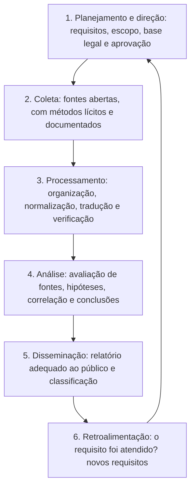

# Fundamentos, Ciclo de Inteligência e Limites Legais do OSINT

> **Objetivo pedagógico:** compreender o que é a inteligência de fontes abertas (OSINT), o ciclo de inteligência que a organiza, seus usos em investigações corporativas e de segurança, e os limites legais, éticos e de privacidade que determinam o que pode ser coletado, como e para quê, de modo que a investigação seja eficaz, proporcional e defensável.

> **Escopo:** este material trata de OSINT para fins legítimos e documentados (resposta a incidentes, proteção da marca, prevenção a fraudes, avaliação de terceiros e verificação de informações). Não trata de vigilância, perseguição, exposição de pessoas nem de obtenção de dados por meios ilícitos.

## 1. O que é OSINT

OSINT é a produção de inteligência a partir de **informações publicamente disponíveis**, coletadas, avaliadas e analisadas para responder a uma pergunta específica. "Aberto" não significa "livre de regras": informação pública pode estar sujeita a proteção de dados pessoais, a direitos autorais, a termos de uso de plataformas e a limites éticos.

| Termo | Significado |
|---|---|
| Informação publicamente disponível (PAI) | Dados acessíveis sem violar controles de acesso nem enganar o titular |
| OSINT | Inteligência produzida por análise de PAI, com avaliação de fonte e de confiabilidade |
| SOCMINT | OSINT de redes sociais |
| WEBINT e inteligência técnica aberta | Análise de sites, domínios, certificados e infraestrutura |
| GEOINT e IMINT abertos | Geolocalização e análise de imagens e de mídias |
| Inteligência de ameaças cibernéticas (CTI) | Inteligência sobre adversários e infraestrutura, com muitas fontes abertas |

Informação não é inteligência: inteligência é informação **avaliada, contextualizada e analisada** para apoiar uma decisão.

## 2. O ciclo de inteligência

| Etapa | Pontos de atenção |
|---|---|
| Planejamento | Perguntas claras (requisitos de inteligência), finalidade legítima, escopo e limite de tempo; aprovação e avaliação de privacidade |
| Coleta | Passiva e proporcional; preservar o que for relevante; respeitar termos e leis |
| Processamento | Remover duplicidades, traduzir, normalizar datas (UTC) e verificar autenticidade |
| Análise | Avaliar fontes e informações, testar hipóteses alternativas e declarar a confiança |
| Disseminação | Informar o necessário, a quem precisa, com classificação (por exemplo, TLP) e minimização de dados pessoais |
| Retroalimentação | Registrar lições aprendidas e ajustar requisitos |

## 3. Usos legítimos em investigações corporativas e de segurança

| Uso | Exemplos |
|---|---|
| Resposta a incidentes e CTI | Identificar infraestrutura de phishing, domínios, perfis e campanhas (pasta 12); contextualizar indicadores (pasta 15) |
| Proteção da marca e da identidade da organização | Domínios semelhantes, perfis falsos, anúncios fraudulentos, uso indevido de nomes de executivos |
| Prevenção a fraudes | Verificar a existência e a consistência de fornecedores, empresas e endereços; padrões de golpes |
| Avaliação da superfície de ataque externa (autorizada) | Ativos expostos, subdomínios e vazamentos de segredos da própria organização |
| Due diligence de terceiros e conformidade | Sanções, histórico de integridade e mídia adversa de empresas e de seus sócios (Lei Anticorrupção) |
| Verificação de informações e de mídia | Autenticidade e origem de imagens e vídeos que afetam a organização |
| Apoio a investigações internas e jurídicas | Preservação de conteúdo público relevante, sempre com base legal e com envolvimento do Jurídico, do RH e do DPO |
| Monitoramento de exposição de dados | Verificar vazamentos que envolvam a organização, por serviços e canais legítimos |

## 4. Princípios

| Princípio | Significado prático |
|---|---|
| Legalidade | Toda coleta e todo uso têm base legal e respeitam leis, contratos e termos de uso |
| Finalidade e necessidade | Coletar somente o que responde ao requisito aprovado |
| Proporcionalidade | A invasividade é compatível com a gravidade e com a necessidade |
| Minimização | Evitar dados pessoais desnecessários, de terceiros e de familiares |
| Exatidão | Verificar, evitar homônimos e declarar o grau de confiança |
| Transparência e prestação de contas | Documentar métodos, fontes e decisões |
| Segurança | Proteger os dados coletados e o investigador |
| Não causar dano | Não expor, não assediar, não difamar e não agir contra pessoas por meio de conclusões frágeis |
| Imparcialidade | Considerar hipóteses alternativas e evitar vieses |

## 5. Enquadramento legal e de privacidade (Brasil e referências)

> **Aviso:** este material é técnico-educacional e não substitui parecer jurídico. Valide cada caso com o Jurídico e com o DPO.

| Tema | Orientação |
|---|---|
| LGPD: dados de acesso público | O tratamento de dados pessoais de acesso público deve considerar a finalidade, a boa-fé e o interesse público que justificaram sua disponibilização (art. 7º, § 3º); a dispensa de consentimento para dados manifestamente públicos não afasta os direitos do titular e os princípios da lei (art. 7º, § 4º) |
| LGPD: bases legais e princípios | Identifique a base legal (por exemplo, legítimo interesse, obrigação legal ou exercício regular de direitos) e aplique finalidade, necessidade e adequação (arts. 6º e 7º); dados sensíveis exigem cautela reforçada (art. 11) |
| LGPD: crianças e adolescentes | Tratamento no melhor interesse da criança e do adolescente (art. 14); evitar investigar menores; o ECA protege a identidade e a imagem |
| Constituição Federal e Marco Civil | Intimidade, vida privada, honra e imagem (CF, art. 5º, X); sigilo das comunicações (art. 7º do Marco Civil); a obtenção de registros de aplicações e de conexão de terceiros depende de ordem judicial (art. 22) |
| Direito penal | Acesso indevido a dispositivos e sistemas (CP, art. 154-A), perseguição (CP, art. 147-A, Lei nº 14.132/2021), crimes contra a honra e falsa identidade: a investigação **não pode** configurar essas condutas |
| Termos de uso e raspagem de dados | Plataformas restringem a coleta automatizada e o uso de contas falsas; o descumprimento pode gerar responsabilidade contratual e, em certos casos, legal |
| Direitos autorais | Conteúdo capturado pode ser protegido (Lei nº 9.610/1998); usar para investigação, citação e prova, sem republicar indevidamente |
| Dados vazados e obtidos ilicitamente | Não baixar, adquirir nem usar bases criminosas de vazamentos; usar serviços legítimos de notificação e consultar o Jurídico |
| Jurisdição | Dados e plataformas estão em vários países; a lei local de cada coleta pode ser relevante |
| Relações de trabalho | Pesquisa sobre candidatos e colaboradores é restrita; a jurisprudência trabalhista limita, por exemplo, a exigência de certidões de antecedentes criminais salvo exceções; envolver RH e Jurídico |

## 6. Linhas vermelhas (o que não fazer)

| Prática | Motivo |
|---|---|
| Invadir contas, adivinhar senhas ou contornar controles de acesso | Crime e antiético, mesmo que o conteúdo "estivesse ali" |
| Usar engenharia social, falsa identidade ou perfis falsos para obter acesso a conteúdo restrito | Engano, violação de termos e riscos legais; só com aprovação formal do Jurídico e em hipóteses muito específicas |
| Baixar ou usar dados de vazamentos criminosos | Origem ilícita e violação de privacidade |
| Compilar dossiês sobre a vida privada de pessoas (endereço residencial, família, rotina) | Desproporcional e perigoso (risco de perseguição e de exposição) |
| Investigar pessoas por motivos pessoais ou sem requisito aprovado | Abuso e ilegalidade |
| Publicar ou repassar informações pessoais coletadas | Violação de privacidade e de confidencialidade |
| Atribuir autoria ou culpa a pessoas com base em indícios fracos | Dano grave e responsabilidade |
| Interagir com o alvo ou com a infraestrutura do adversário além do necessário | Risco de alerta, de retaliação e de responsabilidade |

## 7. Protocolos e boas práticas de referência

| Referência | Uso |
|---|---|
| Protocolo de Berkeley para Investigações Digitais de Fonte Aberta (ONU e UC Berkeley) | Padrões profissionais e éticos para coleta, preservação, verificação e análise de informação digital aberta |
| Sistema de avaliação de fontes e de informações (Almirantado, usado pela OTAN) | Classificar a confiabilidade da fonte (A a F) e a credibilidade da informação (1 a 6) |
| Técnicas analíticas estruturadas (por exemplo, a Análise de Hipóteses Concorrentes, de R. Heuer) | Reduzir vieses e testar hipóteses alternativas |
| ISO/IEC 27037 e NIST SP 800-86 | Princípios de identificação, coleta e preservação de evidências digitais |
| TLP (FIRST) e NIST SP 800-150 | Classificação e compartilhamento de inteligência |

## 8. Avaliação prévia de risco e de privacidade (resumo)

| Pergunta | Resposta esperada |
|---|---|
| Qual o requisito e a decisão que a investigação apoiará? | Definido e aprovado |
| Há base legal e finalidade legítima? | Documentadas (Jurídico e DPO) |
| Os dados envolvem pessoas? Quais categorias? | Listadas; minimização definida |
| Há métodos menos invasivos que atendem ao requisito? | Sim, o escolhido é o mínimo necessário |
| Quais os riscos para as pessoas e para a organização? | Avaliados, com mitigação |
| Como os dados serão protegidos, retidos e descartados? | Política definida |
| Quem aprova e quem revisa? | Líder, Jurídico e DPO, conforme a sensibilidade |

## 9. Exemplo prático: pedido que ultrapassa os limites

| Pedido | Avaliação | Alternativa adequada |
|---|---|---|
| "Descubra tudo sobre a vida pessoal de um ex-colaborador, inclusive família e endereço" | Desproporcional; sem requisito legítimo; risco de perseguição e de violação da LGPD | Restringir ao requisito (por exemplo, proteger ativos e confirmar divulgação indevida de informações confidenciais), com base legal, Jurídico e RH |
| "Crie um perfil falso para conversar com o suspeito" | Engano e risco legal e de violação de termos | Coleta passiva e preservação do conteúdo público; se necessário, medidas judiciais |
| "Baixe a base vazada para ver se há dados de clientes" | Origem ilícita | Usar serviços legítimos de notificação e a equipe de resposta a incidentes; Jurídico |
| "Verifique se a empresa X, candidata a fornecedor, tem sanções e processos relevantes" | Legítimo e proporcional | Consultar cadastros públicos oficiais e documentar |

## 10. Casos de uso corporativos

- Estruturação de um programa de OSINT com política, aprovação e revisão de privacidade.
- Apoio à resposta a incidentes com análise de infraestrutura e de campanhas.
- Avaliação de terceiros e de riscos reputacionais com fontes oficiais e abertas.

## 11. Normas e frameworks relevantes

- Protocolo de Berkeley (OHCHR e Human Rights Center, UC Berkeley, 2020)
- ISO/IEC 27037:2012; NIST SP 800-86; NIST SP 800-150; FIRST TLP
- MITRE ATT&CK (táticas de reconhecimento, para entender o que o adversário vê): T1589, T1591, T1593, T1594, T1596
- ISO 37001 (antissuborno) e ISO 37301 (conformidade), em due diligence
- LGPD, arts. 6º, 7º (§§ 3º e 4º), 11, 14 e 46; Marco Civil da Internet, arts. 7º e 22; Código Penal, arts. 147-A e 154-A; Lei nº 12.846/2013

## 12. Referências

- ONU (OHCHR) e Human Rights Center da Universidade da Califórnia em Berkeley. Berkeley Protocol on Digital Open Source Investigations. 2020.
- Heuer, R. J. Psychology of Intelligence Analysis. CIA, 1999; Heuer, R. J.; Pherson, R. H. Structured Analytic Techniques for Intelligence Analysis. CQ Press, 2014.
- Bazzell, M. Open Source Intelligence Techniques. Edição atual.
- Hassan, N. A. Open Source Intelligence Methods and Tools. Apress, 2018.
- Bellingcat. Online Investigation Toolkit e guias.
- Brasil. Lei nº 13.709/2018 (LGPD); Lei nº 12.965/2014; Lei nº 14.132/2021; Lei nº 12.846/2013.
- SANS Institute. SEC487: Open-Source Intelligence (OSINT) Gathering and Analysis.
