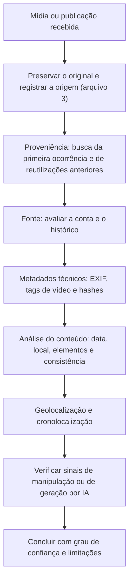

# Geolocalização, Verificação de Mídias e Redes Sociais

> **Objetivo pedagógico:** verificar a autenticidade, a origem, a data e o local de imagens e vídeos (proveniência, metadados, busca reversa, geolocalização e cronolocalização), analisar contas e conteúdo de redes sociais de forma responsável para finalidades corporativas legítimas (fraude, falsificação de identidade e desinformação que afeta a organização), e conhecer as limitações e os cuidados éticos dessas análises.

## 1. Os cinco pilares da verificação

| Pilar | Pergunta |
|---|---|
| Proveniência | Este é o conteúdo original? De onde veio primeiro? |
| Fonte | Quem o publicou ou capturou? É confiável e identificável? |
| Data | Quando foi capturado e publicado? |
| Local | Onde foi capturado? |
| Motivação | Por que foi capturado ou publicado? Há interesse em enganar? |

A verificação é um processo de **redução de incerteza**: nenhuma técnica isolada prova autenticidade; várias evidências independentes, consistentes entre si, aumentam a confiança.

## 2. Fluxo de verificação



## 3. Proveniência: busca reversa e primeira ocorrência

| Técnica | Ferramentas e fontes |
|---|---|
| Busca reversa de imagens | Mecanismos como Google Lens, TinEye, Bing Visual Search e Yandex Images; testar mais de um, pois os índices diferem |
| Busca por quadros de vídeo | Extrair quadros-chave (por exemplo, com o InVID-WeVerify) e buscar cada um |
| Busca por texto e por legendas | Procurar a descrição e o texto em redes e em veículos |
| Arquivos web | Verificar se o mesmo conteúdo apareceu antes, com outra data ou outro contexto |
| Buscas por data | Limitar os resultados a períodos anteriores ao suposto evento |

Um achado comum é a **reutilização**: imagens e vídeos antigos apresentados como novos.

## 4. Metadados técnicos

```bash
# EXIF completo, incluindo dados de GPS, quando existirem
exiftool -a -G1 -s imagem.jpg > imagem_metadados.txt
exiftool -gps:all -a -G1 -s imagem.jpg

# Metadados de vídeo (formato, codecs, datas de criação e dispositivo, quando preservados)
ffprobe -v quiet -print_format json -show_format -show_streams video.mp4 > video_metadados.json

# Extração de quadros a cada segundo para busca reversa e análise
mkdir -p quadros && ffmpeg -i video.mp4 -vf fps=1 quadros/%04d.png

# Hash do original (antes de qualquer processamento)
sha256sum imagem.jpg video.mp4 > hashes_originais.sha256
```

| Observação | Cuidado |
|---|---|
| Plataformas removem metadados | A ausência de EXIF é comum em mídias baixadas de redes sociais e não indica manipulação |
| Metadados podem ser editados | Data e GPS são fáceis de alterar; trate como indício |
| Obter o arquivo original | Sempre que possível, solicitar o arquivo original da fonte, e não a cópia redistribuída |
| Comparar com o conteúdo | Verificar a coerência entre metadados e o que a imagem mostra |

## 5. Análise do conteúdo

| Elemento | O que verificar |
|---|---|
| Placas, letreiros e idiomas | Região, país e época |
| Arquitetura, vegetação e relevo | Compatibilidade com o local alegado |
| Veículos e uniformes | Modelos, placas e padrões de uso por país e período |
| Clima e iluminação | Compatibilidade com as condições da data (por registros meteorológicos) |
| Sombras e posição do sol | Hora e orientação aproximadas (cronolocalização) |
| Eventos e objetos datáveis | Produtos, anúncios e telas que indiquem a data |
| Inconsistências | Proporções, reflexos, sombras e detalhes incoerentes |

## 6. Geolocalização

Geolocalizar é determinar onde uma imagem ou vídeo foi capturado, comparando o conteúdo com fontes cartográficas e de imagens.

| Etapa | Técnica e ferramentas |
|---|---|
| 1. Extrair pistas | Letreiros, relevo, edificações, cruzamentos e pontos de referência |
| 2. Restringir a região | País, cidade e bairro, por idioma, sinalização e características |
| 3. Procurar candidatos | Mapas e imagens de rua e de satélite (Google Maps e Earth, OpenStreetMap, Mapillary e imagens de satélite abertas) |
| 4. Consultas estruturadas em dados de mapas | Consultas ao OpenStreetMap (por exemplo, pelo Overpass Turbo) para encontrar combinações de elementos (cruzamentos, postos e prédios) |
| 5. Confirmar | Comparar ângulos, linha do horizonte, sombras e detalhes fixos |
| 6. Documentar | Registrar cada passo, as fontes e as coordenadas, com nível de confiança |

| Ferramentas úteis | Uso |
|---|---|
| Google Earth e Street View, Mapillary | Comparar o terreno e as vistas de rua |
| OpenStreetMap e Overpass Turbo | Encontrar locais por características |
| SunCalc | Posição do sol e das sombras por data e local |
| Imagens de satélite abertas (por exemplo, Sentinel Hub) | Verificar mudanças no terreno por data |
| Registros meteorológicos históricos | Compatibilidade climática |

A **cronolocalização** estima o horário a partir das sombras e do ângulo do sol, e a data pela posição do sol e por fatos associados.

## 7. Redes sociais: análise responsável

### 7.1 Usos corporativos legítimos

| Uso | Exemplos |
|---|---|
| Falsificação de identidade | Perfis falsos de executivos, de marcas e de canais de atendimento |
| Fraudes e golpes | Anúncios, sorteios e investimentos fraudulentos com a marca |
| Divulgação indevida de informações confidenciais | Publicações públicas que expõem informações da organização |
| Desinformação e conteúdo manipulado que afeta a organização | Vídeos e imagens falsos, inclusive gerados por IA (pasta 27) |
| Inteligência de ameaças | Anúncios e canais usados para recrutar, vender acesso ou coordenar fraudes |

### 7.2 Indicadores de perfis inautênticos (sempre indícios)

| Indicador | Observação |
|---|---|
| Conta recente com muito conteúdo ou crescimento súbito | Pode ser legítimo, como o de campanhas |
| Foto de perfil reutilizada ou gerada por IA | Busca reversa; sinais de geração artificial |
| Padrão de atividade em horários e em ritmo mecânicos | Automação ou operação coordenada |
| Rede de seguidores e de interações com perfis semelhantes | Possível coordenação |
| Histórico de nomes e de idiomas alterados | Reaproveitamento de contas |
| Texto repetido entre contas | Operações coordenadas |
| Inconsistências entre a persona alegada e o conteúdo | Falsificação |

Nenhum indicador isolado é conclusivo, e perfis reais podem apresentar muitos deles. Use a combinação de sinais e declare a confiança.

### 7.3 Boas práticas

| Prática | Descrição |
|---|---|
| Preservação | Capturar o perfil, a publicação e os identificadores estáveis (arquivo 3) |
| Coleta passiva e proporcional | Sem interação, sem aproximação e sem engano |
| Minimizar dados de terceiros | Pessoas em fotos e em comentários não fazem parte do requisito |
| Registrar a data e a hora | Conteúdo de redes sociais muda e some |
| Reportar | Canais de denúncia das plataformas para perfis falsos, com as provas |
| Medidas legais | Quando houver dano, o Jurídico avalia notificações e ações |

## 8. Mídias geradas ou manipuladas por IA

| Sinal | Observação |
|---|---|
| Detalhes anatômicos e de texto incoerentes (mãos, dentes, letras e reflexos) | Comuns em mídias sintéticas, mas os modelos evoluem rapidamente |
| Inconsistências de iluminação e de sombras | Indício |
| Ruído e padrões de compressão atípicos | Análise técnica especializada |
| Ausência de proveniência e de fonte original | Sinal importante |
| Ferramentas de detecção | Resultados probabilísticos; não devem ser usadas como única evidência |
| Marcas de procedência de conteúdo (credenciais de conteúdo, por exemplo, C2PA) | Quando presentes, ajudam a verificar a origem; sua ausência não prova manipulação |

A pasta 27 trata da investigação de deepfakes em profundidade.

## 9. Cuidados éticos

| Cuidado | Descrição |
|---|---|
| Proteger vítimas e menores | Não identificar nem divulgar pessoas vulneráveis; evitar replicar conteúdo violento ou íntimo |
| Verificar antes de compartilhar | Conclusões preliminares circulam como fatos; compartilhe apenas o que está verificado, com a confiança declarada |
| Não identificar pessoas privadas | A geolocalização e a identificação de pessoas comuns podem expô-las ao risco |
| Risco de dano | Considerar as consequências da divulgação do local ou da identidade |
| Saúde mental do investigador | Limitar a exposição a conteúdo perturbador (arquivo 2) |
| Transparência sobre os limites | Registrar o que não foi possível verificar |

## 10. Exemplo prático: vídeo falso de executivo

| Passo | Resultado |
|---|---|
| Situação | Circula nas redes um vídeo de um "anúncio" do presidente da empresa, promovendo um investimento fraudulento |
| Preservação | Captura do vídeo, da publicação e do perfil, com hashes e identificadores (arquivo 3) |
| Proveniência | Busca reversa dos quadros-chave: o cenário e as roupas vêm de uma entrevista de 8 meses antes |
| Metadados | O arquivo recebido não tem metadados (removidos pela plataforma) |
| Análise | Sincronismo labial imperfeito e artefatos nos contornos do rosto; o áudio apresenta cadência uniforme |
| Fonte | Perfil criado há 6 dias, com foto reaproveitada; mais de 20 perfis publicam o mesmo texto e o mesmo link |
| Conclusão | Vídeo manipulado (provável deepfake de voz e de imagem) com perfis inautênticos; confiança alta quanto à fraude, moderada quanto à técnica exata |
| Ações | Denúncia às plataformas com as provas; comunicado oficial aos clientes; pedido de remoção dos domínios do link; compartilhamento de indicadores; encaminhamento ao Jurídico (pasta 27) |

## 11. Casos de uso corporativos

- Resposta a perfis falsos, a golpes com a marca e a conteúdo manipulado.
- Verificação de imagens e de vídeos que afetam a organização antes da comunicação pública.
- Treinamento de equipes de comunicação e de segurança na verificação de mídias.

## 12. Normas e frameworks relevantes

- Protocolo de Berkeley (verificação e análise); First Draft e Bellingcat (metodologias de verificação)
- C2PA (Coalition for Content Provenance and Authenticity); ISO/IEC 27037:2012
- LGPD, arts. 6º, 7º (§§ 3º e 4º), 11 e 14; Marco Civil da Internet, art. 19 e 21; CF, art. 5º, X
- MITRE ATT&CK: T1585.001 (contas em redes sociais), T1656 (impersonação)

## 13. Referências

- ONU (OHCHR) e UC Berkeley. Berkeley Protocol on Digital Open Source Investigations. 2020.
- First Draft. Verification Handbook e os cinco pilares da verificação.
- Bellingcat. Online Investigation Toolkit e guias de geolocalização.
- Verification Handbook (European Journalism Centre). Edições disponíveis.
- Documentação do ExifTool, do FFmpeg (ffprobe), do InVID-WeVerify, do SunCalc e do Overpass Turbo.
- C2PA. Especificações de credenciais de conteúdo.
