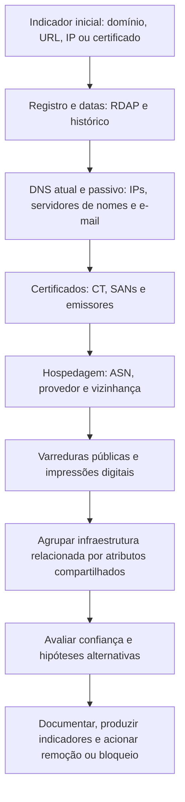

# Infraestrutura, Domínios, IPs e Superfície de Ataque

> **Objetivo pedagógico:** investigar infraestrutura de internet a partir de fontes técnicas abertas (registro de domínios, DNS, certificados, hospedagem, varreduras públicas e arquivos), para analisar campanhas de phishing e de fraude, proteger a marca, agrupar infraestrutura relacionada e avaliar a superfície de ataque da **própria** organização, com métodos passivos, lícitos e documentados.

> Consultas ativas contra sistemas de terceiros (varreduras e testes) exigem autorização. Nesta pasta, prefira fontes **passivas**; use ferramentas ativas apenas sobre ativos da organização e com autorização formal.

## 1. O que a infraestrutura revela

| Elemento | O que revela | Cuidados |
|---|---|---|
| Registro de domínio (WHOIS e RDAP) | Datas de criação, registrador, servidores de nomes e, às vezes, contatos | Muitos dados são ocultados por privacidade (LGPD, GDPR); não presumir identidade |
| DNS (A, AAAA, MX, NS, TXT e CNAME) | Hospedagem, e-mail e serviços associados; políticas de SPF, DKIM e DMARC | Registros mudam; capturar com data |
| DNS passivo | Histórico de resoluções (que IPs um domínio já usou e que domínios um IP já hospedou) | Dependente de fornecedor e de cobertura |
| Certificados e Certificate Transparency | Nomes (SANs) associados a um certificado, datas de emissão e emissor | Certificados compartilhados podem reunir muitos domínios sem relação |
| IPs, ASN e hospedagem | Provedor, país, rede e vizinhança | Geolocalização é imprecisa; serviços de nuvem e CDNs ocultam origens |
| Varreduras públicas (por exemplo, Shodan e Censys) | Serviços expostos, banners, certificados e impressões digitais | Dados de varreduras de terceiros, com defasagem |
| Páginas e arquivos (urlscan e arquivos web) | Aparência, recursos carregados, redirecionamentos e histórico | Cuidado ao enviar URLs sensíveis a serviços públicos |
| Reputação (VirusTotal e listas) | Classificações e relações | Consulta por indicador; não enviar conteúdo interno |

## 2. Fluxo de análise de infraestrutura



## 3. Registro de domínios: WHOIS e RDAP

```bash
# WHOIS tradicional (a saída varia por registro)
whois exemplo-suspeito.com | head -n 60

# RDAP: protocolo estruturado (JSON); rdap.org redireciona ao servidor RDAP autoritativo
curl -s https://rdap.org/domain/exemplo-suspeito.com | jq '.events, .nameservers[].ldhName, .entities[]?.roles'

# Domínios .br: consulta de registro (Registro.br oferece RDAP; dados pessoais podem estar ocultados conforme a LGPD)
curl -s https://rdap.registro.br/domain/exemplo.com.br | jq '.events, .status'
```

| Dado | Uso | Limitação |
|---|---|---|
| Data de criação | Domínios recentes são comuns em campanhas | Domínios legítimos novos também existem |
| Registrador e servidores de nomes | Agrupamento e canal de pedido de remoção | Compartilhados por muitos clientes |
| Contatos (quando visíveis) | Contexto | Frequentemente ocultados ou falsos; **não atribuir identidade com base neles** |
| Histórico de alterações | Mudanças de propriedade e de servidores | Fonte de histórico especializada |

## 4. DNS e DNS passivo

```bash
dig +short A exemplo-suspeito.com
dig +short NS exemplo-suspeito.com
dig +short MX exemplo-suspeito.com
dig +short TXT exemplo-suspeito.com
dig +short TXT _dmarc.exemplo-suspeito.com

# Resolução reversa de um IP
dig -x 198.51.100.25 +short
```

O DNS passivo (fornecido por serviços especializados) mostra o histórico de associações entre nomes e endereços e ajuda a encontrar **domínios que compartilham o mesmo IP ou o mesmo servidor de nomes**. Consulte por indicador, respeitando os termos do fornecedor.

## 5. Certificados e Certificate Transparency

```bash
# Certificados emitidos para um domínio e subdomínios (registros públicos de CT, via crt.sh)
curl -s "https://crt.sh/?q=%25.exemplo.com.br&output=json" | jq -r '.[] | [.id, .entry_timestamp, .name_value, .issuer_name] | @tsv' | sort -u | head -50

# Inspecionar o certificado apresentado por um servidor (na VM de investigação, contra ativos autorizados ou indicadores já públicos)
openssl s_client -connect exemplo.com.br:443 -servername exemplo.com.br </dev/null 2>/dev/null | openssl x509 -noout -subject -issuer -dates -serial -fingerprint -sha256
```

| Uso | Exemplo |
|---|---|
| Descobrir subdomínios e ativos da própria organização | Listar nomes em certificados emitidos |
| Detectar emissão de certificados para domínios semelhantes à marca | Monitoramento contínuo de CT |
| Agrupar infraestrutura de campanhas | Mesmo emissor, datas e padrões de nomes |
| Linha do tempo | Datas de emissão revelam quando a infraestrutura foi preparada |

## 6. Domínios semelhantes e proteção da marca

| Técnica | Descrição |
|---|---|
| Geração de variações (typosquatting, homógrafos e combosquatting) | Ferramentas como o dnstwist listam variações e verificam quais estão registradas |
| Monitoramento de novos registros e de certificados | Alertas para nomes com a marca |
| Análise do conteúdo e da hospedagem | Páginas clonadas, formulários de coleta e redirecionamentos |
| Avaliação de risco | Domínios registrados sem uso, em uso para fraude ou legítimos (por exemplo, parceiros) |

```bash
# Variações do domínio da marca e registros ativos (consulta DNS)
dnstwist --registered --format csv exemplo.com.br > variacoes_exemplo.csv
```

### 6.1 Medidas de remoção e de disputa

| Medida | Quando usar |
|---|---|
| Pedido de abuso ao registrador e à hospedagem | Phishing, fraude e malware; anexar provas preservadas (arquivo 3) |
| Denúncia a listas de navegação segura e a serviços de reputação | Reduz o alcance enquanto a remoção é processada |
| Pedido de remoção às plataformas | Perfis, anúncios e páginas em redes sociais |
| Procedimentos de disputa de nomes de domínio | UDRP (WIPO) para domínios genéricos e SACI-Adm para domínios sob o `.br` |
| Medidas judiciais | Quando houver dano relevante, necessidade de identificação ou resistência à remoção; Jurídico |
| Comunicação a CSIRTs | CERT.br e CTIR Gov, para coordenação |

## 7. Varreduras públicas e impressões digitais

| Fonte e técnica | Uso |
|---|---|
| Shodan e Censys | Serviços expostos, banners, certificados e portas por IP, organização ou impressão digital |
| Hash do favicon | Encontrar servidores que usam o mesmo ícone (por exemplo, painéis de phishing e interfaces administrativas) |
| JARM e JA3S | Impressões digitais TLS de servidores, para agrupar infraestrutura semelhante |
| Cabeçalhos e títulos de páginas | Agrupamento por padrões |
| urlscan e serviços similares | Renderização da página, recursos, redirecionamentos e relações entre domínios |

```bash
# Shodan (CLI): informações de um IP e consulta por organização (exige chave de API; somente para ativos próprios e indicadores)
shodan host 198.51.100.25
shodan search 'org:"Empresa Exemplo" port:3389'
```

Atenção: os resultados são fotografias passadas feitas por terceiros; confirme por métodos autorizados antes de agir. Agrupar infraestrutura por um único atributo (por exemplo, o mesmo provedor) leva a falsos vínculos: exija **atributos múltiplos e raros** para afirmar relação.

## 8. Avaliação da superfície de ataque da própria organização (autorizada)

| Atividade | Ferramentas e fontes |
|---|---|
| Enumeração passiva de subdomínios | `subfinder`, `amass enum -passive`, CT (`crt.sh`), `theHarvester` |
| Serviços expostos | Shodan e Censys por organização, faixas de IP e certificados |
| Credenciais e segredos em repositórios públicos | Busca autorizada em repositórios e em fontes de código da própria organização; ferramentas de detecção de segredos |
| Documentos e metadados publicados | Verificar arquivos públicos da organização (por exemplo, PDFs com metadados) |
| Domínios e marcas | Inventário de domínios registrados, vencimentos e proteção de registro |
| Registros de e-mail | SPF, DKIM e DMARC dos domínios (pasta 12) |

```bash
# Enumeração passiva de subdomínios de um domínio da própria organização (autorizada)
subfinder -d exemplo.com.br -silent | sort -u > subdominios_exemplo.txt
amass enum -passive -d exemplo.com.br -o amass_exemplo.txt

# Fontes por tipo, com theHarvester (apenas fontes passivas)
theHarvester -d exemplo.com.br -b crtsh
```

Os resultados alimentam o inventário de ativos e a gestão de vulnerabilidades. Qualquer verificação ativa (varredura de portas e testes) exige autorização formal e janela acordada.

## 9. Agrupamento e confiança

| Atributo compartilhado | Força do vínculo |
|---|---|
| Provedor de hospedagem ou ASN | Fraca (muitos clientes) |
| Mesma data de registro e mesmo registrador | Fraca a moderada |
| Mesmo servidor de nomes dedicado | Moderada |
| Mesmo IP dedicado | Moderada a forte, se não for infraestrutura compartilhada |
| Mesmo certificado ou chave pública, mesmo hash de favicon e mesma impressão digital TLS | Moderada a forte, se raros |
| Mesmo código e mesmos recursos da página (por exemplo, o mesmo kit de phishing) | Forte |
| Combinação de vários atributos independentes | Mais forte |

Declare sempre a confiança: "compatível com", "provavelmente relacionado" e "confirmado" têm significados diferentes.

## 10. Mapeamento ATT&CK

| Técnica (perspectiva do adversário) | Relevância para o defensor |
|---|---|
| T1583.001 (Adquirir infraestrutura: domínios) e T1584 (Comprometer infraestrutura) | Compreender o que o adversário prepara |
| T1585.001 (Contas em redes sociais) e T1586 | Perfis falsos e contas comprometidas |
| T1593, T1594 e T1596 (Pesquisar fontes abertas e bases técnicas) | O que o adversário consegue saber da organização |
| T1589 e T1591 (Reunir informações sobre a vítima) | Reduzir a exposição de informações |

## 11. Exemplo prático: campanha com domínios semelhantes

| Passo | Resultado |
|---|---|
| Indicador | `pagamentos-empresaexemplo[.]com`, relatado por clientes |
| RDAP | Criado há 4 dias; registrador X; servidores de nomes de um provedor de proxy reverso |
| CT | Certificado emitido há 4 dias; o mesmo emissor e padrão de nomes em outros 6 domínios (`boletos-empresaexemplo[.]com` e outros) |
| DNS passivo | Os 7 domínios já resolveram para os mesmos 2 IPs |
| Varredura pública | Os 2 IPs apresentam o mesmo hash de favicon e a mesma impressão TLS |
| Conteúdo | Páginas clonadas do portal de pagamentos, com formulário de coleta |
| Conclusão | Campanha única, com 7 domínios e 2 IPs; confiança alta (vários atributos raros em comum) |
| Ações | Preservação (arquivo 3), pedidos de remoção ao registrador e à hospedagem, bloqueio em DNS e proxy, aviso aos clientes e compartilhamento de indicadores (TLP) |

## 12. Casos de uso corporativos

- Análise e remoção de infraestrutura de phishing que usa a marca.
- Inventário e redução da superfície de ataque externa da organização.
- Alimentação da inteligência de ameaças com indicadores agrupados e com confiança declarada.

## 13. Normas e frameworks relevantes

- MITRE ATT&CK: T1583, T1584, T1585, T1586, T1589, T1591, T1593, T1594, T1596
- RFC 7480 a 7484 (RDAP); RFC 6962 e RFC 9162 (Certificate Transparency); RFC 3161
- NIST SP 800-150; FIRST TLP; ISO/IEC 27002:2022, controles 5.7 e 8.8
- LGPD, arts. 6º e 7º (dados de registro de domínios); CIS Controls v8.1, controles 1, 2 e 7

## 14. Referências

- ICANN. RDAP: documentação e perfis; Registro.br. Documentação de RDAP e do SACI-Adm; WIPO. UDRP.
- Documentação do dnstwist, do subfinder, do OWASP Amass, do theHarvester, do Shodan e do Censys.
- Salesforce. JARM e JA3S (documentação).
- Laurie, B. et al. RFC 6962: Certificate Transparency. 2013.
- Bianco, D. The Pyramid of Pain (2013).
- Bellingcat. Guias sobre análise de domínios e de infraestrutura.
