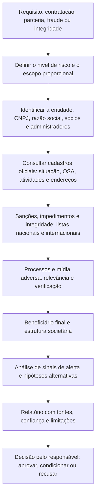

# Organizações, Pessoas e Due Diligence com Fontes Abertas

> **Objetivo pedagógico:** realizar a avaliação de organizações e de terceiros (fornecedores, parceiros e contrapartes) com fontes oficiais e abertas, incluindo cadastros públicos brasileiros e listas de sanções, tratar as informações sobre pessoas de forma proporcional, finalística e conforme a LGPD, aplicar técnicas para evitar vieses e erros de identificação, e documentar o resultado em um relatório útil à decisão.

## 1. Objetivo e limites

A due diligence com fontes abertas apoia decisões como contratar um fornecedor, avaliar uma contraparte ou investigar uma fraude. O foco é a **organização** e as **pessoas em seus papéis profissionais e societários** (sócios, administradores e beneficiários finais), e não a vida privada.

| Pode (com requisito legítimo) | Não deve |
|---|---|
| Verificar a existência, a situação cadastral e a composição societária de uma empresa | Compilar dossiês sobre vida pessoal, família, saúde, orientação ou rotina de pessoas |
| Consultar cadastros de sanções, de impedimentos e de integridade | Usar bases vazadas ou obtidas de forma ilícita |
| Avaliar mídia adversa relevante ao risco de integridade | Realizar perfis amplos de candidatos e de colaboradores fora das hipóteses legais |
| Verificar processos públicos relevantes ao requisito | Divulgar ou repassar informações pessoais coletadas |
| Confirmar a identidade e a regularidade de pessoas em relações comerciais, conforme a lei | Concluir culpa com base em homônimos ou em notícias não verificadas |

## 2. Fluxo da due diligence

## 3. Fontes oficiais e abertas no Brasil (referência)

> Os nomes, as formas de acesso e a disponibilidade dos serviços mudam. Confirme nos sites oficiais e registre a data da consulta.

| Fonte | O que oferece | Observações |
|---|---|---|
| Receita Federal: cadastro do CNPJ | Razão social, situação cadastral, data de abertura, atividades (CNAE), endereço e quadro de sócios e administradores (QSA) | Dados cadastrais públicos de pessoas jurídicas; verificar a situação (ativa, suspensa ou inapta) |
| Juntas Comerciais e Redesim | Atos constitutivos, alterações e arquivamentos | Acesso e custos variam por estado |
| CVM | Informações de companhias abertas, formulários de referência, fatos relevantes | Para empresas de capital aberto |
| Diários Oficiais (União, Estados e Municípios) | Contratos, penalidades, nomeações e licitações | Pesquisa por nome e por CNPJ |
| Portal da Transparência (CGU) | Cadastros como o CEIS (empresas inidôneas e suspensas) e o CNEP (empresas punidas pela Lei Anticorrupção); dados de pagamentos federais e outros cadastros | Fonte oficial de integridade |
| Cadastro de Empregadores que submeteram trabalhadores a condição análoga à de escravo (Ministério do Trabalho e Emprego) | Lista pública de empregadores | Relevância para integridade e reputação |
| IBAMA e órgãos ambientais | Áreas embargadas e autos de infração públicos | Relevância ambiental |
| Tribunais (sites de consulta processual) | Processos públicos; alguns correm em segredo de justiça | A consulta deve respeitar os termos; agregadores comerciais podem divergir das fontes oficiais |
| INPI | Marcas, patentes e desenhos industriais | Verificar titularidade |
| Registro.br e CGI.br | Titularidade de domínios `.br` | Dados pessoais podem ser ocultados |
| Banco Central, SUSEP, ANS, ANVISA e outros reguladores | Autorizações e penalidades de instituições reguladas | Conforme o setor |
| Cadastros de Pessoas Expostas Politicamente (PEP) disponibilizados por órgãos públicos | Identificação de PEP | Importante para avaliações de risco de integridade |

### 3.1 Fontes internacionais e de sanções

| Fonte | Uso |
|---|---|
| Listas de sanções (OFAC/SDN, União Europeia, ONU e Reino Unido) | Verificar nomes, entidades e propriedade; essencial em operações internacionais e financeiras |
| OpenCorporates | Registros de empresas de muitas jurisdições |
| Base de dados de vazamentos de documentos de paraísos fiscais (ICIJ Offshore Leaks Database) | Estruturas societárias conhecidas; indício, não prova |
| Registros de beneficiários finais de outras jurisdições (quando públicos) | Transparência societária |
| Mídia e fontes jornalísticas confiáveis | Mídia adversa, com verificação da fonte |

## 4. Beneficiário final e estrutura societária

| Elemento | Verificação |
|---|---|
| Quadro de sócios e administradores | Receita Federal e Junta Comercial |
| Participações em cadeia | Identificar sócios que também são pessoas jurídicas e seguir a cadeia até as pessoas naturais |
| Controladores e beneficiários finais | Quando disponível; considerar a regulamentação aplicável |
| Endereços, contatos e domínios compartilhados | Indício de relação entre empresas (por exemplo, empresas de fachada) |
| Mudanças recentes | Alterações societárias próximas a sanções, a contratações ou a litígios |

## 5. Sinais de alerta (red flags) em terceiros

| Sinal | Observação |
|---|---|
| Empresa recém-criada com capital incompatível com o contrato | Possível empresa de fachada |
| Endereço residencial ou compartilhado com muitas empresas | Verificar substância operacional |
| Atividade (CNAE) incompatível com o objeto contratado | Inconsistência |
| Sócios ou administradores com sanções, impedimentos ou PEP, sem controles | Risco de integridade |
| Mudança societária súbita após a sanção ou o contrato | Evasão |
| Presença em cadastros de sanções ou de empregadores infratores | Risco de conformidade |
| Processos recorrentes por fraude, corrupção ou trabalhista grave | Avaliar a natureza e o resultado |
| Domínio recente, site genérico e sem presença institucional verificável | Pode indicar fraude |
| Dados bancários em nome de terceiros | Risco de fraude de pagamento |
| Pressão por urgência e por exceções ao processo | Sinal comportamental |

Sinais de alerta **não são prova**: orientam a investigação e as perguntas a fazer à contraparte.

## 6. Mídia adversa

| Prática | Orientação |
|---|---|
| Avaliar a fonte | Credibilidade, independência e rastros de verificação (ver classificação de fontes) |
| Verificar a identidade | Homônimos e coincidências de nomes são comuns; confirmar com identificadores (CNPJ, cidade, datas e papéis) |
| Datar e contextualizar | Fatos antigos, absolvições e arquivamentos mudam o significado |
| Distinguir fatos de alegações | Notícia de investigação não é condenação |
| Registrar a pesquisa | Termos usados, datas e resultados, inclusive os negativos |

## 7. Pessoas: tratamento proporcional e conforme a LGPD

| Tema | Orientação |
|---|---|
| Base legal | Identificar a base (por exemplo, obrigação legal, execução de contrato ou legítimo interesse) e registrar a análise de proporcionalidade com o DPO |
| Finalidade e necessidade | Limitar-se aos dados necessários ao requisito (por exemplo, papel societário e sanções), evitando dados pessoais irrelevantes |
| Dados públicos | O fato de ser público não dispensa a observância da finalidade, da boa-fé e do interesse público (LGPD, art. 7º, §§ 3º e 4º) |
| Dados sensíveis | Evitar; o tratamento exige hipóteses legais específicas (art. 11) |
| Candidatos e colaboradores | A pesquisa de antecedentes é restrita; a jurisprudência trabalhista limita a exigência de certidões criminais, salvo exceções; envolver RH e Jurídico |
| Direitos dos titulares | Informar e atender solicitações, quando cabível |
| Retenção | Manter pelo tempo necessário e descartar |
| Vieses | Evitar discriminação e conclusões baseadas em estereótipos ou em informações não verificadas |

## 8. Técnicas para reduzir vieses e erros

| Técnica | Uso |
|---|---|
| Classificação de fontes e de informações (sistema do Almirantado) | Confiabilidade da fonte (A a F) e credibilidade da informação (1 a 6) |
| Análise de Hipóteses Concorrentes (ACH) | Comparar hipóteses e priorizar as evidências que **refutam** |
| Corroboração independente | Pelo menos duas fontes independentes para conclusões relevantes |
| Verificação de identidade | Documentos oficiais e identificadores únicos |
| Revisão por pares | Reduz viés de confirmação |
| Declarar a confiança | "Alta", "moderada" ou "baixa", com os fundamentos |

| Escala (Almirantado) | Significado |
|---|---|
| A | Fonte completamente confiável |
| B | Geralmente confiável |
| C | Razoavelmente confiável |
| D | Geralmente não confiável |
| E | Não confiável |
| F | Confiabilidade não pode ser avaliada |
| 1 | Informação confirmada por outras fontes |
| 2 | Provavelmente verdadeira |
| 3 | Possivelmente verdadeira |
| 4 | De veracidade duvidosa |
| 5 | Improvável |
| 6 | Veracidade não pode ser avaliada |

## 9. Estrutura do relatório de due diligence

| Seção | Conteúdo |
|---|---|
| 1. Requisito e escopo | Pergunta, entidades e período; base legal e aprovação |
| 2. Resumo e conclusão | Resultado, nível de risco e confiança |
| 3. Identificação da entidade | CNPJ, razão social, situação, sócios, administradores e estrutura |
| 4. Verificações oficiais | Cadastros consultados, resultados e datas |
| 5. Sanções e integridade | Listas nacionais e internacionais |
| 6. Processos e mídia adversa | Itens relevantes, com avaliação de fonte e de relevância |
| 7. Sinais de alerta e hipóteses alternativas | Análise e explicações legítimas |
| 8. Limitações | Dados não encontrados, homônimos e fontes indisponíveis |
| 9. Recomendações | Aprovar, condicionar (por exemplo, com cláusulas e monitoramento) ou recusar; perguntas à contraparte |
| 10. Anexos | Capturas preservadas e registro de fontes |

## 10. Exemplo prático: avaliação de fornecedor de TI

| Etapa | Resultado |
|---|---|
| Requisito | Contratação de fornecedor com acesso a sistemas críticos |
| CNPJ | Ativa; aberta há 14 meses; capital social incompatível com o porte do contrato; endereço em sala compartilhada |
| QSA | Dois sócios; um deles administra outra empresa suspensa no CEIS há 2 anos |
| Integridade | A empresa avaliada não consta nos cadastros de sanções; a outra empresa do sócio sim |
| Mídia adversa | Duas notícias sobre a outra empresa; a identidade foi confirmada por CNPJ e por sócios |
| Domínio e presença | Domínio registrado há 5 meses; site genérico; sem clientes verificáveis |
| Hipóteses | H1: empresa legítima em início de atividade; H2: empresa constituída para contornar uma sanção anterior |
| Avaliação | Evidências inconsistentes com H1 (continuidade de sócio e de atividade) e coerentes com H2; confiança moderada |
| Recomendação | Não aprovar sem esclarecimentos; solicitar documentos adicionais, referências e comprovação de capacidade; reavaliar o risco; decisão pelo comitê de integridade |

## 11. Casos de uso corporativos

- Avaliação de fornecedores, parceiros e adquirentes em programas de integridade e de conformidade.
- Verificação de contrapartes em transações e em pagamentos suspeitos.
- Apoio a investigações de fraude com análise de estruturas societárias.

## 12. Normas e frameworks relevantes

- Lei nº 12.846/2013 (Lei Anticorrupção) e Decreto nº 11.129/2022; Lei nº 14.133/2021
- ISO 37001 (gestão antissuborno); ISO 37301 (sistemas de gestão de conformidade); orientações da CGU sobre programas de integridade
- Recomendações do GAFI (FATF) sobre beneficiário final e due diligence
- LGPD, arts. 6º, 7º (§§ 3º e 4º), 11 e 46
- Protocolo de Berkeley; técnicas analíticas estruturadas (Heuer e Pherson)

## 13. Referências

- Brasil. Controladoria-Geral da União (CGU). Portal da Transparência (CEIS e CNEP) e Guia de integridade para empresas.
- Receita Federal. Cadastro Nacional da Pessoa Jurídica (CNPJ).
- ICIJ. Offshore Leaks Database; OpenCorporates.
- OFAC, União Europeia, ONU e OFSI. Listas de sanções consolidadas.
- Heuer, R. J.; Pherson, R. H. Structured Analytic Techniques for Intelligence Analysis. 2014.
- GAFI/FATF. Recomendações internacionais.
