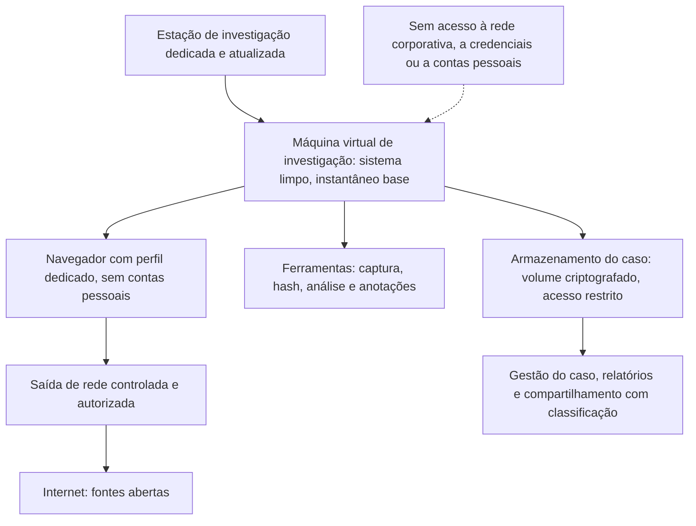

# Planejamento, OPSEC e Ambiente de Investigação

> **Objetivo pedagógico:** planejar a investigação OSINT a partir de requisitos claros, montar um ambiente de investigação isolado e controlado, adotar a segurança operacional (OPSEC) para evitar atribuição e exposição indevidas, manipular conteúdo potencialmente malicioso com segurança, proteger os dados coletados e o próprio investigador, e gerenciar o caso de forma organizada.

## 1. Planejamento da investigação

| Elemento | Conteúdo |
|---|---|
| Requisito de inteligência | A pergunta específica que a investigação deve responder |
| Decisão apoiada | O que será decidido com a resposta (bloquear, notificar, contratar, escalar) |
| Escopo | Entidades (organizações, domínios, perfis e eventos), período e limites |
| Base legal e avaliação de privacidade | Aprovadas pelo Jurídico e pelo DPO, quando houver dados pessoais |
| Fontes previstas | Oficiais, técnicas, de mídia e de redes sociais; ordem de preferência por confiabilidade |
| Métodos | Coleta passiva, ferramentas e limites; o que é proibido |
| Riscos | Para pessoas, para a organização, para o investigador e para o caso |
| Prazo e entregáveis | Relatório, indicadores, regras e recomendações |
| Aprovação | Líder do caso, Jurídico e, quando aplicável, RH e DPO |
| Critérios de encerramento | Requisito atendido, esgotamento das fontes ou prazo |

## 2. Perguntas de planejamento: do vago ao específico

| Pedido vago | Requisito específico |
|---|---|
| "Investigue essa empresa." | "A empresa X, candidata a fornecedor de TI, consta em cadastros de sanções, de empresas inidôneas ou de trabalho análogo ao escravo? Quem são seus sócios e administradores? Há processos relevantes de fraude ou de corrupção nos últimos 5 anos?" |
| "Veja o que há sobre esse golpe." | "Quais domínios, perfis e contas de pagamento estão associados à campanha que usa o nome da empresa, e como derrubá-los?" |
| "Procure vazamentos." | "Há arquivos, credenciais ou códigos da empresa publicados em repositórios e sites públicos?" |

## 3. OPSEC: riscos de atribuição e de exposição

A coleta aberta deixa rastros. O investigador pode ser identificado pela fonte (por exemplo, o dono do site ou o adversário), o que pode comprometer o caso e expor a organização.

| Risco | Exemplo | Mitigação |
|---|---|---|
| Rastros de rede | IP da organização nos logs do site investigado | Saída de rede controlada e autorizada para a investigação, sem relação direta com a organização, quando justificável |
| Impressão digital do navegador e do ambiente | Combinação de configurações, fontes e extensões identifica o investigador | Perfis de navegador dedicados e limpos, ambiente padronizado |
| Contas pessoais e corporativas | Entrar em plataformas com contas pessoais, vinculadas a seu nome | Nunca usar contas pessoais; usar apenas contas e métodos aprovados pela política |
| Avisos ao alvo | Visualizar perfis que notificam o dono; acessar páginas com rastreadores | Conhecer o comportamento das plataformas; preferir fontes que não notificam |
| Correlação entre atividades | Reutilizar o mesmo ambiente para uso pessoal | Separação estrita entre uso pessoal e investigativo |
| Conteúdo malicioso | Sites com exploração ou download de malware | Máquina virtual isolada, sem credenciais e com rede controlada |
| Vazamento de dados do caso | Enviar capturas e hashes a serviços de terceiros | Usar serviços aprovados; evitar enviar dados sensíveis a ferramentas públicas |
| Interação não intencional | Curtir, seguir ou solicitar amizade | Coleta estritamente passiva |

## 4. Contas de investigação e personas

| Tema | Orientação |
|---|---|
| Regra geral | A coleta deve ser **passiva** e, sempre que possível, sem login |
| Contas institucionais transparentes | Quando uma plataforma exigir conta para ver conteúdo público, use uma conta institucional da área de segurança, registrada na política e sem engano ativo |
| Perfis fictícios (personas) | Violam, em geral, os termos de uso das plataformas e podem gerar riscos legais e reputacionais; só com aprovação formal do Jurídico, escopo definido e em casos excepcionais; nunca para obter acesso privado, para interação ou para enganar pessoas |
| Interação com atores maliciosos | Evitar; quando indispensável, deve seguir procedimento aprovado, sem incitar condutas e sem violar a lei |
| Registro | Todas as contas e métodos usados são documentados no caso |

## 5. Ambiente de investigação

| Componente | Prática |
|---|---|
| Máquina virtual dedicada | Sistema limpo por caso ou por sessão, com instantâneo base; restaurar após uso |
| Navegador | Perfil dedicado, sem sincronização, sem contas pessoais; bloqueio de rastreadores e controle de extensões |
| Rede | Saída controlada e autorizada; registrar o método; avaliar riscos de bloqueio e de legalidade de serviços de anonimização |
| Ferramentas | Aprovadas, atualizadas e documentadas (versões) |
| Armazenamento | Volume criptografado, com controle de acesso e hash dos arquivos (pastas 02 e 04) |
| Relógio | Sincronizado; horários registrados em UTC |
| Separação de funções | Quem coleta e quem revisa; restrição de acesso a dados pessoais |
| Sem credenciais corporativas | Nenhuma conta ou token da organização no ambiente |

## 6. Manipulação segura de conteúdo potencialmente malicioso

| Cuidado | Descrição |
|---|---|
| Neutralizar URLs | Registrar como `hxxps://dominio[.]exemplo` em relatórios e mensagens |
| Visitar apenas na VM isolada | Sites de phishing e de distribuição de malware devem ser abertos somente no ambiente controlado |
| Não baixar nem executar arquivos | Analisar arquivos obtidos com os procedimentos da pasta 15 |
| Verificar antes de visitar | Consultar reputação por domínio e hash sem abrir o conteúdo, quando possível |
| Evitar formulários | Nunca inserir credenciais ou dados reais em páginas suspeitas |
| Capturar com ferramentas controladas | Para preservar o estado (arquivo 3) |
| Atenção a redirecionamentos e a conteúdo dinâmico | Registrar a cadeia de redirecionamentos |

## 7. Proteção dos dados coletados

| Medida | Descrição |
|---|---|
| Classificação | Rotular o caso (por exemplo, TLP e sensibilidade) |
| Minimização | Coletar o necessário; descartar o excedente e dados de terceiros |
| Acesso restrito | Somente a pessoas com necessidade; registrar acessos |
| Retenção e descarte | Prazos definidos pela política e pela base legal; descarte seguro (LGPD, arts. 15 e 16) |
| Criptografia | Em repouso e em trânsito |
| Pseudonimização | Em relatórios e em compartilhamentos, quando possível |
| Cópias e backups | Controlados e com a mesma proteção |

## 8. Proteção do investigador

| Risco | Medida |
|---|---|
| Retaliação e assédio de atores investigados | Não expor a identidade do investigador; canais institucionais; apoio da organização |
| Exposição a conteúdo perturbador | Limites de exposição, rodízio, acesso a apoio psicológico e uso de métodos de desfoque e de áudio desativado |
| Exposição da vida privada | Separar contas, reduzir informações públicas pessoais e orientar a equipe |
| Sobrecarga e viés | Revisão por pares e pausas |

## 9. Gestão do caso

| Elemento | Prática |
|---|---|
| Identificador | DFL-AAAA-NNN-OSINT |
| Registro de atividades | Data e hora (UTC), ação, fonte, ferramenta e resultado |
| Registro de fontes | Fonte, endereço, data de coleta e avaliação (ver o arquivo de modelos) |
| Gráfico de entidades e de relações | Pessoas jurídicas, domínios, contas e relações, com a origem de cada vínculo |
| Linha do tempo | Eventos relevantes em UTC (pasta 05) |
| Ferramentas de gestão | Plataformas de gestão de casos, planilhas, MISP, Maltego ou ferramentas de anotações com criptografia |
| Revisão por pares | Antes da disseminação |
| Versionamento | Relatórios e conclusões com histórico |

## 10. Exemplo prático: configuração de uma investigação de campanha de phishing

| Item | Decisão |
|---|---|
| Requisito | Identificar a infraestrutura e os perfis associados à campanha que usa o nome da empresa e subsidiar a derrubada |
| Base legal | Proteção da organização e prevenção a fraudes (legítimo interesse), aprovada pelo Jurídico e pelo DPO |
| Escopo | Domínios, certificados, hospedagem e contas de contato públicas; sem coleta de dados de vítimas além dos já recebidos por denúncia |
| Ambiente | VM dedicada, navegador limpo, saída de rede controlada e armazenamento criptografado |
| Métodos | Coleta passiva; consultas a bases técnicas por indicadores; nenhuma interação com os atacantes |
| Proteção | URLs neutralizadas, hashes calculados e acesso restrito |
| Entregáveis | Relatório com indicadores, evidências preservadas e pedidos de remoção |

## 11. Casos de uso corporativos

- Montagem de um laboratório de OSINT com padrões de OPSEC e de privacidade.
- Procedimento padrão de planejamento e de aprovação de investigações.
- Treinamento da equipe em ambiente seguro e em manuseio de conteúdo malicioso.

## 12. Normas e frameworks relevantes

- Protocolo de Berkeley (seções sobre preparação, segurança digital e física e proteção de dados)
- ISO/IEC 27002:2022, controles 5.12, 5.23, 8.12 e 8.31; ISO/IEC 27037:2012
- NIST SP 800-86; FIRST TLP
- LGPD, arts. 6º, 15, 16 e 46

## 13. Referências

- ONU (OHCHR) e UC Berkeley. Berkeley Protocol on Digital Open Source Investigations. 2020.
- Bazzell, M. Open Source Intelligence Techniques. Edição atual.
- Bellingcat. Online Investigation Toolkit e orientações de segurança digital para investigadores.
- Documentação de VirtualBox e de VMware (instantâneos), de MISP e de Maltego.
- SANS Institute. SEC487.
