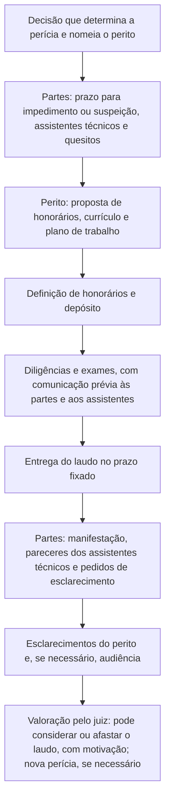

# Atuação Pericial, Assistência Técnica e Contraditório

> **Objetivo pedagógico:** compreender os papéis do perito, do assistente técnico e do consultor técnico, o processo pericial cível e criminal (nomeação, quesitos, diligências, laudo, esclarecimentos e audiência), o contraditório (revisão crítica de laudos), a preparação para depoimento e inquirição, e as responsabilidades e os padrões éticos que sustentam a credibilidade do profissional.

> **Aviso:** esta é uma visão técnica e geral. Os procedimentos dependem do tipo de processo e do juízo; consulte o Jurídico e as normas processuais vigentes.

## 1. Papéis

| Papel | Quem designa | Função | Observações |
|---|---|---|---|
| Perito oficial (criminal) | Estado | Realiza perícias criminais, com formação superior e vínculo oficial (CPP, art. 159) | Em falta de perito oficial, duas pessoas idôneas com curso superior, preferencialmente na área |
| Perito judicial (cível) | Juiz | Auxilia o juízo com conhecimento técnico, de forma imparcial (CPC, arts. 156 a 158) | Deve ter conhecimento especializado e comprovar sua qualificação |
| Assistente técnico | Cada parte | Acompanha a perícia e emite parecer técnico a favor da parte, com veracidade técnica | Não sujeito a impedimento ou suspeição (CPC, art. 466, § 1º, no entendimento geral) e atua a partir da indicação |
| Consultor técnico ou perito particular | Cliente | Assessora antes e fora do processo; relatório privado, possivelmente sob orientação jurídica | Sua manifestação pode ser protegida enquanto não for juntada |
| Perito consensual | Partes, de comum acordo | Substitui a perícia judicial (CPC, art. 471) | Escolha conjunta, com requisitos |
| Testemunha técnica | Parte ou juiz | Presta depoimento sobre fatos técnicos observados | Distinta do perito |

Diferença essencial: o perito judicial serve ao **juízo** e tem dever de imparcialidade; o assistente técnico atua para a **parte**, mas deve manter a integridade técnica e a veracidade.

## 2. Processo pericial cível: visão geral

| Etapa | Pontos práticos (CPC, referência) |
|---|---|
| Nomeação | O juiz nomeia o perito, fixa o prazo e intima as partes para, em 15 dias, arguir impedimento ou suspeição, indicar assistente técnico e apresentar quesitos (art. 465, § 1º) |
| Proposta do perito | Em 5 dias, apresenta proposta de honorários, currículo com comprovação de especialização e contatos profissionais (art. 465, § 2º) |
| Acesso dos assistentes | O perito deve assegurar o acesso e o acompanhamento das diligências aos assistentes técnicos, com prévia comunicação comprovada nos autos, com antecedência mínima de 5 dias (art. 466, § 2º) |
| Meios de investigação | O perito e os assistentes podem valer-se de todos os meios necessários, ouvindo testemunhas, obtendo informações e solicitando documentos (art. 473, § 3º) |
| Laudo | Entregue no prazo fixado, pelo menos 20 dias antes da audiência (art. 477) |
| Pareceres dos assistentes | Em 15 dias após a intimação da apresentação do laudo (art. 477, § 1º) |
| Esclarecimentos | O perito esclarece, no prazo de 15 dias, os pontos questionados (art. 477, § 2º) |
| Substituição do perito | Possível se carecer de conhecimento técnico ou deixar de cumprir o encargo sem motivo legítimo (art. 468) |
| Nova perícia | O juiz pode determinar nova perícia quando a matéria não estiver suficientemente esclarecida (art. 480) |
| Valoração | O juiz aprecia o laudo e motiva a sua decisão, levando em conta o método utilizado (art. 479) |

## 3. Perícia criminal (visão geral)

| Tema | Orientação |
|---|---|
| Perícia oficial | Realizada por perito oficial (CPP, art. 159); o laudo é parte do inquérito ou do processo |
| Quesitos e assistente | É facultada ao Ministério Público, ao assistente de acusação, ao ofendido, ao querelante e ao acusado a formulação de quesitos e a indicação de assistente técnico (CPP, art. 159, § 3º) |
| Atuação do assistente | Atua após a admissão pelo juiz e a conclusão do laudo pelos peritos oficiais (CPP, art. 159, § 4º) |
| Cadeia de custódia | Obrigatória, conforme os arts. 158-A a 158-F do CPP; falhas podem afetar a admissibilidade ou o valor da prova |
| Material em poder do assistente | O material probatório a ser periciado deve permanecer disponível para o exame conforme a decisão judicial |

## 4. Quesitos: formulação e resposta

| Boas práticas na formulação (partes e assistentes) | Boas práticas na resposta (perito) |
|---|---|
| Perguntas objetivas, técnicas e pertinentes | Responder cada quesito, na ordem, com a transcrição do texto |
| Uma pergunta por quesito, sem premissas embutidas | Resposta conclusiva, com fundamentação e referência aos achados |
| Evitar quesitos jurídicos ou de opinião sobre culpa | Declarar a impertinência ou a impossibilidade técnica, com motivo |
| Pedir a metodologia e os limites da conclusão | Declarar o grau de confiança e as limitações |
| Quesitos sobre a cadeia de custódia, as ferramentas e a validação | Apresentar a evidência de validação e de custódia |
| Quesitos suplementares e de esclarecimento | Responder dentro do prazo e sem extrapolar o escopo |

Exemplos de quesitos técnicos bem formulados:

| Quesito | Observação |
|---|---|
| "Qual a data e hora (UTC) da criação do arquivo X no volume Y, segundo os metadados do sistema de arquivos?" | Objetivo e verificável |
| "Há registros de conexão de dispositivos USB de armazenamento ao equipamento Z entre as datas A e B? Em caso positivo, informar a série e os horários." | Delimitado |
| "O e-mail de fls. N foi autenticado por SPF, DKIM e DMARC no momento da entrega? Qual a fonte da informação?" | Técnico, com fonte |
| "A cópia da imagem do disco apresentada pelo réu tem o mesmo hash da apresentada pelo autor?" | Binária e verificável |

## 5. Conduta e ética profissional

| Dever | Descrição |
|---|---|
| Imparcialidade (perito judicial) | Sem favorecer nenhuma das partes; declarar conflitos de interesse |
| Veracidade técnica (também dos assistentes) | Pareceres técnicos devem ser fiéis aos fatos e aos métodos, ainda que favoráveis à parte |
| Competência | Aceitar apenas encargos para os quais está qualificado; indicar auxiliares quando necessário |
| Diligência | Cumprir prazos e o encargo com escrúpulo (CPC, art. 466) |
| Sigilo | Proteger as informações do caso e os dados pessoais |
| Limites do encargo | Não emitir opiniões pessoais que extrapolem o exame técnico (CPC, art. 473, § 2º) |
| Independência de remuneração | A remuneração não pode depender do resultado |
| Responsabilidade | Informações inverídicas, por dolo ou culpa, geram responsabilidade civil e inabilitação (CPC, art. 158) e a falsa perícia é crime (Código Penal, art. 342) |
| Transparência | Declarar o método, as limitações e as incertezas |
| Atualização | Manter-se atualizado e registrar a formação |

## 6. Revisão crítica de laudos (contraditório técnico)

O assistente técnico (e o consultor) devem examinar o laudo com rigor técnico, **sem atacar pessoas**, concentrando-se na qualidade do método e da prova.

| Ponto de análise | Perguntas |
|---|---|
| Escopo e quesitos | Todos os quesitos foram respondidos? O perito respondeu além do escopo? |
| Materiais e cadeia de custódia | Os itens são identificados? Há lacunas, quebras de lacre ou discrepâncias de hash? |
| Aquisição | O método preservou a integridade? Houve bloqueio de escrita e verificação por hash? |
| Método | O método é adequado e aceito pela comunidade técnica? Está descrito de modo reproduzível? |
| Ferramentas | Foram validadas? As versões e os parâmetros estão informados? Há limitações conhecidas? |
| Tempo | Fusos, desvios de relógio e fontes de tempo foram considerados? |
| Achados | Cada achado tem fonte e referência? Há conflitos ou dados ignorados? |
| Interpretação | Hipóteses alternativas foram consideradas? Há saltos lógicos ou excesso de certeza? |
| Vieses | Há sinais de viés de confirmação ou de contexto? |
| Confiança e limitações | O laudo declara a incerteza? |
| Reprodutibilidade | É possível reproduzir os resultados com o material descrito? |
| Qualificação e conflitos | Há competência demonstrada e declaração de imparcialidade? |
| Verificações independentes | Reproduzir a análise crítica com o material disponível e com ferramenta diferente |

## 7. Fatores de admissibilidade e de confiabilidade (referências comparadas)

| Sistema | Critério |
|---|---|
| Brasil (CPC, art. 473 e art. 479) | O método deve ser esclarecido e predominantemente aceito pelos especialistas; o juiz avalia o laudo considerando o método |
| EUA (Regra 702 e critério Daubert) | Fundamentos do testemunho: conhecimento especializado que ajuda o julgador; base factual suficiente; métodos confiáveis; aplicação confiável dos métodos aos fatos. Fatores de Daubert: possibilidade de teste, revisão por pares, taxa de erro, existência de padrões e aceitação geral |
| Reino Unido | As regras processuais exigem o dever primário do perito para com o tribunal, e o relato de limitações e de alternativas |

Esses critérios guiam a elaboração do laudo: método testado, padrões aplicados, erro conhecido e aceitação técnica.

## 8. Preparação para a audiência e a inquirição

| Preparação | Prática |
|---|---|
| Domínio do caso | Reler o laudo, os achados, os anexos e as limitações; conhecer os números dos achados |
| Material de apoio | Anotações organizadas e cópias do laudo e dos anexos; evidências disponíveis para consulta |
| Comunicação | Explicar com clareza, para leigos; preparar analogias simples e exatas |
| Postura | Calma, cortesia e objetividade; ouvir a pergunta inteira; responder ao que foi perguntado |
| Veracidade | Dizer a verdade, reconhecer limites ("não é possível determinar") e corrigir erros sem hesitar |
| Limites do conhecimento | Declarar o que está fora da expertise; não especular |
| Evitar advocacia | O perito explica, e não defende a parte |
| Perguntas hipotéticas | Responder com cautela, apontando as premissas e as limitações |
| Objeções | Aguardar a decisão do juiz; não discutir com os advogados |
| Preparação com o advogado (assistente técnico) | Alinhar o formato e os temas, sem alterar o conteúdo técnico |

### 8.1 Pontos de ataque comuns e respostas técnicas

| Ataque | Resposta técnica |
|---|---|
| "A cadeia de custódia foi quebrada." | Apresentar os formulários, os hashes e as verificações; reconhecer lacunas reais e explicar seus efeitos |
| "A ferramenta não é confiável." | Apresentar a validação, os testes, a versão e a verificação por segunda ferramenta |
| "O horário pode estar errado." | Explicar a verificação do relógio, o fuso e as fontes de corroboração |
| "O senhor não tem como saber quem estava no teclado." | Concordar com o limite: o laudo identifica contas e dispositivos, não pessoas |
| "Outras explicações são possíveis." | Reconhecer as alternativas e explicar como foram avaliadas e por que as conclusões têm o grau de confiança declarado |
| "O senhor foi pago pela parte." | Esclarecer que a remuneração não depende do resultado e que o dever é com a verdade técnica |
| "O método não é aceito." | Apresentar as referências, as normas e a prática da área |

## 9. Honorários, independência e riscos

| Tema | Orientação |
|---|---|
| Honorários | Propostos de forma fundamentada, conforme o trabalho; no processo judicial, sujeitos à fixação do juiz (CPC, art. 465, § 2º, e art. 95) |
| Remuneração independente do resultado | Nunca vincular os honorários ao desfecho |
| Conflitos de interesse | Declarar relacionamentos com as partes e recusar o encargo, quando necessário |
| Pressões | Registrar tentativas de influência e resistir |
| Seguro e responsabilidade profissional | Avaliar a cobertura de responsabilidade civil profissional |
| Registro profissional e capacitação | Manter a qualificação, as certificações e o desenvolvimento contínuo |
| Material e guarda | Preservar o material de trabalho pelo prazo adequado e proteger os dados |

## 10. Exemplo prático: revisão crítica de um laudo pelo assistente técnico

| Ponto verificado | Achado | Conduta |
|---|---|---|
| Cadeia de custódia | O laudo registra o recebimento do notebook, mas não menciona hash da imagem forense | Quesito de esclarecimento: informar o hash e a verificação |
| Ferramenta | O laudo cita a versão de uma suíte comercial, sem evidência de validação | Pedido de documentação de validação |
| Fuso horário | Os horários do laudo estão no fuso local, sem indicar o horário de verão da data | Esclarecimento e reconferência da linha do tempo |
| Conclusão | "O réu copiou os arquivos" | O laudo identifica a conta do réu, não a pessoa; a conclusão excede o que os achados sustentam |
| Hipótese alternativa | Sincronização automática de nuvem não considerada | Reanálise independente: os registros de sincronização reforçam uma explicação alternativa |
| Parecer | Concordância parcial; divergências fundamentadas e apresentadas de forma técnica, com anexos | Parecer em 15 dias, sem ataque pessoal |

## 11. Casos de uso corporativos

- Atuação de equipes forenses como consultores ou assistentes técnicos em litígios.
- Preparação de profissionais para depoimentos e para a revisão crítica de laudos.
- Definição de política de conflitos de interesse, de independência e de honorários.

## 12. Normas e frameworks relevantes

- CPC, arts. 95, 148, 156 a 158, 464 a 480; CPP, arts. 158-A a 158-F e 159; Código Penal, art. 342
- Regra 702 das Regras Federais de Prova dos EUA e o precedente Daubert v. Merrell Dow Pharmaceuticals (1993); regras de prova pericial no Reino Unido
- ISO/IEC 27037, 27041, 27042 e 27043; ISO/IEC 17025
- ENFSI. Best Practice Manual for the Forensic Examination of Digital Technology
- LGPD, arts. 6º e 46

## 13. Referências

- Brasil. Lei nº 13.105/2015 (CPC); Decreto-Lei nº 3.689/1941 (CPP); Decreto-Lei nº 2.848/1940 (Código Penal).
- Daubert v. Merrell Dow Pharmaceuticals, Inc., 509 U.S. 579 (1993).
- National Research Council. Strengthening Forensic Science in the United States: A Path Forward. 2009.
- Casey, E. Digital Evidence and Computer Crime. 3. ed. 2011.
- ENFSI. Best Practice Manual for the Forensic Examination of Digital Technology.
- Documentos de orientação de tribunais e de órgãos de perícia.
