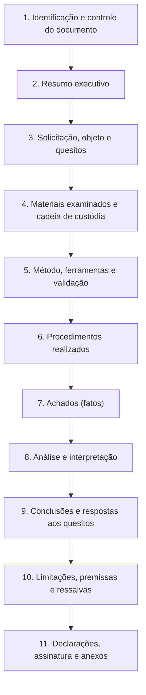

# Estrutura do Laudo e do Relatório Técnico

> **Objetivo pedagógico:** dominar a estrutura completa de um laudo pericial e de um relatório técnico forense (identificação, objeto, quesitos, materiais, método, achados, análise, conclusões, limitações, declarações e anexos), com o conteúdo esperado de cada seção e modelos de redação que atendam aos requisitos legais e permitam a avaliação e a reprodução do trabalho.

## 1. Visão geral da estrutura



A ordem pode variar conforme o tipo de documento, mas a **separação entre fatos (7), análise (8) e conclusões (9)** deve ser mantida em qualquer formato.

## 2. Seção 1: identificação e controle do documento

| Elemento | Conteúdo |
|---|---|
| Título e tipo | "Laudo Pericial de Informática", "Relatório Técnico Forense" ou "Parecer Técnico de Assistente" |
| Identificadores | Número do caso, do processo judicial (se houver) e do relatório (DFL-AAAA-NNN-RTNN) |
| Autor e qualificação | Nome, formação, registro profissional, certificações e experiência relevante |
| Solicitante | Quem requisitou o trabalho, com a data da solicitação |
| Datas | Do exame, da emissão e da versão; fuso horário usado no documento |
| Controle de versões | Histórico de alterações e revisores |
| Classificação | Confidencial, restrito ou público; observações sobre privilégio |
| Paginação e rodapé | Número de páginas e identificador em todas as páginas |

## 3. Seção 2: resumo executivo

| Elemento | Orientação |
|---|---|
| Extensão | Uma página ou menos |
| Conteúdo | Objeto, método em uma frase, principais conclusões (com grau de confiança) e as limitações mais relevantes |
| Linguagem | Compreensível para leigos |
| Fidelidade | Não pode conter nada que não esteja nas seções detalhadas |
| Referências | Remete às seções e aos números dos quesitos |

Modelo de redação:

```
Este laudo examina [objeto] com o objetivo de [finalidade]. Foram analisados [materiais, em uma linha],
por meio de [método, em uma linha]. Conclui-se que [conclusão 1, com grau de confiança] e que
[conclusão 2, com grau de confiança]. Não foi possível determinar [ponto relevante não esclarecido]
em razão de [limitação]. As conclusões detalhadas e as respostas aos quesitos constam das seções 9 e 10.
```

## 4. Seção 3: solicitação, objeto e quesitos

| Elemento | Conteúdo |
|---|---|
| Solicitação | Texto da designação ou do pedido, e o escopo autorizado |
| Objeto do exame | O que foi examinado (dispositivos, contas, sistemas e período) |
| Quesitos | Transcrição integral, numerados, com a identificação de quem os formulou (juiz, autor, réu ou Ministério Público) |
| Perguntas de investigação (para relatórios privados) | A lista de perguntas que o relatório responde |
| Limites do encargo | O que está dentro e fora do escopo (por exemplo, qualificação jurídica) |
| Premissas fornecidas | Informações recebidas do solicitante e que não foram verificadas pelo perito |

## 5. Seção 4: materiais examinados e cadeia de custódia

| Elemento | Conteúdo |
|---|---|
| Lista de itens | Identificador, descrição, origem, data e hora de recebimento ou de coleta, estado e embalagem |
| Hashes | SHA-256 dos itens e das cópias de trabalho (pasta 04) |
| Cadeia de custódia | Resumo da trajetória, com referência aos formulários no anexo (pasta 02) |
| Condição dos itens | Lacres, danos, discrepâncias e observações |
| Itens não recebidos ou não examinados | Lista e motivo |
| Local e período do exame | Laboratório, ambiente e datas |

## 6. Seção 5: método, ferramentas e validação

| Elemento | Conteúdo |
|---|---|
| Abordagem geral | Descrição do método (por exemplo, aquisição forense, análise de artefatos e linha do tempo) |
| Fundamento do método | Referências a normas, a literatura e à aceitação pela comunidade (exigência do CPC, art. 473, III) |
| Ferramentas | Nome, versão, finalidade e fabricante; ferramentas de código aberto com a versão exata |
| Validação | Evidência de que as ferramentas e os métodos são adequados (testes do NIST CFTT, validações internas e conferência por ferramenta independente) |
| Ambiente de análise | Sistemas, configuração e controles (bloqueadores de escrita, redes isoladas) |
| Limitações conhecidas dos métodos | Taxas de erro, vieses e casos em que o método falha |
| Desvios do procedimento padrão | Qualquer desvio e sua justificativa |

## 7. Seção 6: procedimentos realizados

Descreva, em ordem cronológica e com detalhe suficiente para a reprodução:

| Etapa | Conteúdo |
|---|---|
| Aquisição e verificação | Como as imagens e as cópias foram obtidas e verificadas (hashes) |
| Processamento | Ferramentas, parâmetros e filtros aplicados |
| Análise | Consultas, buscas e técnicas, com os comandos principais (os completos em anexo) |
| Normalização de tempo | Fusos, desvios de relógio e conversões |
| Verificações cruzadas | Corroboração entre fontes independentes |
| Procedimentos não realizados | O que se poderia fazer e não foi feito, e por quê |

## 8. Seção 7: achados (fatos)

| Regra | Descrição |
|---|---|
| Somente fatos e dados derivados | Sem interpretação nem opinião |
| Numerados | F-01, F-02, e assim por diante, para referência cruzada |
| Referenciados | Cada achado indica a evidência, o caminho, o hash, a consulta e o horário em UTC |
| Neutros | Descrevem o que existe e o que não existe, sem adjetivos |
| Apresentação | Tabelas e figuras com legendas; capturas de tela como ilustração, com o original preservado em anexo |

Modelo de achado:

```
F-07. No volume examinado (item I-03, SHA-256 abc...123), o arquivo "Contrato_Cliente_X.xlsx"
(caminho \Users\ana\Documents\) tem data de criação 2026-10-02 14:11:09 UTC e data de última
modificação 2026-10-02 14:40:51 UTC (fonte: $MFT, atributo $STANDARD_INFORMATION; ferramenta Z,
versão 1.2). Há registro de acesso ao arquivo por [aplicativo] às 2026-10-05 19:03:22 UTC
(fonte: Prefetch, arquivo EXCEL.EXE-XXXX.pf).
```

## 9. Seção 8: análise e interpretação

| Elemento | Conteúdo |
|---|---|
| Hipóteses | As hipóteses consideradas (inclusive as alternativas e as favoráveis à outra parte) |
| Avaliação | Como cada achado apoia, refuta ou é neutro para cada hipótese |
| Cadeia de raciocínio | Passo a passo do raciocínio que liga os fatos às inferências |
| Incertezas | Fontes de incerteza e seu efeito (por exemplo, fusos, perda de dados e possibilidade de adulteração) |
| Escala de confiança | Termos usados e seu significado (ver o arquivo de redação) |
| Explicações alternativas | Por que foram aceitas ou descartadas |

## 10. Seção 9: conclusões e respostas aos quesitos

| Regra | Descrição |
|---|---|
| Responder a todos os quesitos | Um a um, na ordem, com o número e o texto do quesito (CPC, art. 473, IV) |
| Resposta conclusiva | Clara, direta e fundamentada; quando não for possível responder, dizer "não é possível determinar" e explicar o motivo |
| Referência aos fatos e à análise | Cada resposta remete aos achados que a sustentam |
| Grau de confiança | Explícito |
| Dentro do escopo | Sem opiniões jurídicas nem pessoais além do exame técnico (CPC, art. 473, § 2º) |
| Quesitos impertinentes | Registrar a impertinência e o motivo, sem deixar de responder ao que for tecnicamente possível |

Modelo de resposta a quesito:

```
Quesito 3 (autor): "O arquivo X foi copiado para dispositivo externo antes do desligamento do réu?"
Resposta: Sim, com confiança alta. Há registro de conexão de dispositivo USB de armazenamento
(série ABC) em 2026-10-02 14:35:10 UTC (F-05, fonte: SYSTEM hive e setupapi.dev.log), seguido de
atividade de criação de arquivo com o mesmo nome e hash no volume do dispositivo (F-08). A
conclusão baseia-se em três fontes independentes (F-05, F-08 e F-09). Não foi possível determinar
o destino posterior do arquivo, pois o dispositivo não foi apresentado para exame.
```

## 11. Seção 10: limitações, premissas e ressalvas

| Elemento | Conteúdo |
|---|---|
| Limitações dos dados | Dados ausentes, logs não habilitados, retenção e dispositivos não apresentados |
| Limitações dos métodos | Taxas de erro e casos de falha |
| Premissas | O que foi assumido e a origem |
| Possibilidade de adulteração | Avaliação da proteção das fontes |
| Fatos que alterariam as conclusões | Que informação futura poderia mudar o resultado |
| Reservas de direito | Possibilidade de complementação diante de novos elementos |

## 12. Seção 11: declarações, assinatura e anexos

| Elemento | Conteúdo |
|---|---|
| Declaração de imparcialidade | O autor afirma ter atuado de forma independente e sem conflitos de interesse (ou os declara) |
| Declaração de veracidade | O autor afirma que o conteúdo é verdadeiro conforme seu conhecimento e que cumpriu o encargo com escrúpulo (CPC, art. 466) |
| Compromisso de atualização | Se surgirem novos elementos, o autor os comunicará |
| Assinatura | Manuscrita ou eletrônica qualificada (ICP-Brasil), conforme o caso |
| Glossário | Termos técnicos usados |
| Anexos | Formulários de custódia, tabelas de hashes, comandos e consultas, capturas, linha do tempo e currículo (ver o arquivo de anexos) |

Modelo de declaração:

```
Declaro que examinei os itens descritos neste documento com independência e imparcialidade,
que os fatos nele expostos são verdadeiros conforme meu conhecimento e que as opiniões
expressas refletem meu juízo técnico. Não tenho interesse pessoal ou financeiro no resultado
do processo, salvo a remuneração pelo trabalho realizada de forma independente do conteúdo
das conclusões. Comprometo-me a informar eventuais fatos supervenientes que alterem as conclusões.

Local, data.   [Nome, qualificação, registro e assinatura]
```

## 13. Parecer do assistente técnico: estrutura específica

| Seção | Conteúdo |
|---|---|
| Identificação e qualificação | Como no laudo |
| Escopo | Análise do laudo do perito e dos autos; quesitos próprios |
| Concordâncias | Pontos em que o assistente concorda com o perito, com fundamentos |
| Divergências | Pontos de discordância, com explicação técnica, evidências e referências |
| Verificações independentes | Reanálises, testes e reproduções feitas pelo assistente |
| Respostas aos quesitos suplementares | Se houver |
| Conclusões | Posição técnica fundamentada, sem advocacia, com limitações |
| Anexos | Material que sustenta as divergências |

O assistente técnico é de confiança da parte, mas **deve manter a veracidade e a objetividade técnica**; pareceres que distorcem os fatos perdem credibilidade e podem gerar responsabilidade.

## 14. Exemplo prático: sumário de um laudo

| Seção | Conteúdo resumido |
|---|---|
| 1. Identificação | Processo nº X; perito Y; versão 1.0 |
| 2. Resumo | Cópia de arquivos confidenciais para mídia removível comprovada com confiança alta; destino posterior indeterminado |
| 3. Objeto e quesitos | Notebook corporativo e conta de e-mail; 8 quesitos (3 do autor, 3 do réu e 2 do juízo) |
| 4. Materiais | 2 itens (notebook e imagem forense), hashes, cadeia de custódia |
| 5. Método | Aquisição conforme a ISO/IEC 27037; análise de artefatos do Windows; ferramentas validadas |
| 6. Procedimentos | Cronológicos, com comandos |
| 7. Achados | F-01 a F-19 |
| 8. Análise | Duas hipóteses comparadas: cópia intencional versus sincronização automática |
| 9. Conclusões | Respostas aos 8 quesitos |
| 10. Limitações | Dispositivo externo não apresentado; relógio do notebook com desvio de 38 s |
| 11. Declarações e anexos | Declaração, assinatura ICP-Brasil, anexos A a F |

## 15. Casos de uso corporativos

- Padronização do modelo de laudo e de relatório técnico do laboratório.
- Revisão de laudos de terceiros com a estrutura como lista de verificação.
- Treinamento de peritos e de assistentes técnicos.

## 16. Normas e frameworks relevantes

- CPC, arts. 465, 466, 473, 477 e 479; CPP, art. 159; Código Penal, art. 342
- ISO/IEC 27037, 27041, 27042, 27043; ISO/IEC 17025 (relatórios de ensaio)
- ENFSI Best Practice Manual; ENFSI Guideline for Evaluative Reporting
- MP nº 2.200-2/2001 e Lei nº 14.063/2020 (assinaturas eletrônicas)

## 17. Referências

- Brasil. Lei nº 13.105/2015 (CPC) e Decreto-Lei nº 3.689/1941 (CPP).
- Casey, E. Digital Evidence and Computer Crime. 3. ed. 2011.
- NIST. Computer Forensics Tool Testing Program (CFTT).
- ENFSI. Guideline for Evaluative Reporting in Forensic Science. 2015.
- ABNT NBR ISO/IEC 27037:2013 e normas correlatas.
