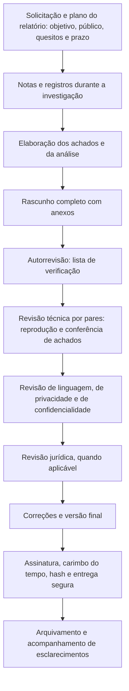

# Ferramentas, Fluxo, Modelos e Checklist de Relatórios Forenses

> **Objetivo pedagógico:** padronizar as ferramentas, o fluxo de produção e de revisão, os modelos e a verificação de qualidade dos relatórios forenses, de modo que sejam consistentes, verificáveis, revisados por pares, seguros e entregues com integridade.

## 1. Ferramentas por finalidade

| Finalidade | Ferramentas |
|---|---|
| Redação | Editores de texto, Markdown com Pandoc, LaTeX e processadores de texto (com modelos aprovados) |
| Controle de versões e revisão | Git, plataformas de revisão de código e de documentos, e comparação de versões |
| Tabelas e dados | Planilhas, CSV, DuckDB e notebooks (Jupyter) para gerar tabelas reproduzíveis |
| Diagramas | Mermaid, draw.io e ferramentas equivalentes |
| Linha do tempo | Timesketch, Plaso e exportações para tabelas (pasta 05) |
| Capturas de tela e figuras | Ferramentas de captura, preservando os originais e anotando em cópias |
| Hash e verificação | `sha256sum`, `Get-FileHash`, `gpg` |
| Assinatura e carimbo do tempo | Certificados ICP-Brasil, serviços de ACT, `openssl ts` |
| Redação segura e metadados | Ferramentas de redação verdadeira de PDF, `exiftool`, `pdftotext` |
| Gestão de casos | Sistemas de gestão de casos do laboratório (custódia, solicitações e prazos) |
| Revisão ortográfica e de estilo | Corretores e guias de estilo do laboratório |

## 2. Geração reprodutível de relatórios com Pandoc

Manter o relatório em Markdown com metadados permite versionar, revisar e gerar saídas em vários formatos.

```markdown
---
title: "Relatório Técnico Forense DFL-2026-001-RT01"
author: "Analista Exemplo"
date: "2026-11-05"
lang: pt-BR
---

# 1. Identificação
...
```

```bash
# PDF com sumário (requer um mecanismo LaTeX, como o XeLaTeX)
pandoc relatorio.md -o relatorio.pdf --pdf-engine=xelatex --toc -V lang=pt-BR

# Documento do Word com sumário, para revisão por terceiros
pandoc relatorio.md -o relatorio.docx --toc

# Hash dos arquivos gerados
sha256sum relatorio.pdf relatorio.docx > relatorio_hashes.sha256
```

Tabelas e figuras geradas a partir de dados (por exemplo, com notebooks) devem registrar o código e a versão dos dados, para que possam ser reproduzidas.

## 3. Fluxo de produção e de revisão



| Etapa | Responsável | Resultado |
|---|---|---|
| Autorrevisão | Autor | Rascunho corrigido, lista de verificação preenchida |
| Revisão técnica por pares | Segundo perito | Conferência de achados, hashes e conclusões; parecer de revisão |
| Revisão de linguagem | Revisor | Clareza, consistência e escalas de confiança |
| Revisão de privacidade | DPO ou responsável | Minimização, pseudonimização e redação segura |
| Revisão jurídica | Jurídico | Escopo, linguagem e riscos (sem alterar a substância técnica) |
| Aprovação | Líder do laboratório | Autorização de emissão |

Regra: o Jurídico pode sugerir a forma e a prudência da redação, mas **não deve alterar** as conclusões técnicas; alterações de conteúdo técnico devem ser feitas pelo perito, com justificativa, e registradas.

## 4. Dez perguntas de qualidade e como responder

| Pergunta | Onde verificar |
|---|---|
| 1. O objetivo, o público e os quesitos estão claros e atendidos? | Seção 3 do relatório e respostas aos quesitos |
| 2. Cada achado tem fonte, evidência e hash? | Seção 7 e Anexo B |
| 3. Fatos, inferências e opiniões estão separados? | Seções 7 a 9 |
| 4. O método e as ferramentas estão descritos, validados e reproduzíveis? | Seção 5 e Anexos C e G |
| 5. A cadeia de custódia está completa e coerente com os itens? | Seção 4 e Anexo A |
| 6. Os horários estão em UTC e os desvios, declarados? | Todo o relatório |
| 7. Hipóteses alternativas e evidências contrárias foram consideradas? | Seção 8 |
| 8. As limitações e as incertezas estão declaradas? | Seção 10 |
| 9. Dados pessoais e sigilosos foram minimizados e protegidos? | Revisão de privacidade |
| 10. O documento final tem integridade (hash, assinatura e carimbo)? | Termo de entrega |

## 5. Modelo A: Plano do Relatório

| Campo | Preenchimento |
|---|---|
| Identificador | DFL-AAAA-NNN-RTNN |
| Tipo (laudo, parecer, relatório técnico, executivo ou outro) | |
| Solicitante e finalidade | |
| Público e nível de detalhe | |
| Quesitos ou perguntas de investigação | |
| Prazo de entrega e marcos | |
| Confidencialidade e privilégio (orientação do Jurídico) | |
| Autor, revisor técnico e revisor jurídico | |
| Estrutura prevista e anexos | |
| Riscos (prazos, lacunas de evidência e pressões) | |

## 6. Modelo B: Resumo Executivo (uma página)

| Campo | Conteúdo |
|---|---|
| Título e identificador | |
| Contexto (2 linhas) | |
| Conclusões principais (3 a 5 itens, com confiança) | |
| Impacto | |
| Limitações mais relevantes | |
| Recomendações e decisões necessárias | |
| Próximos passos e prazos | |

## 7. Modelo C: Quadro de Respostas aos Quesitos

| Nº | Quesito (texto integral) | Autor do quesito | Resposta resumida | Confiança | Achados e anexos de suporte | Limitações |
|---|---|---|---|---|---|---|
| 1 | | | | | | |
| 2 | | | | | | |

## 8. Modelo D: Declaração de Imparcialidade e de Veracidade

```
DECLARAÇÃO

Eu, [nome], [qualificação e registro], declaro que:
1. Realizei os exames e elaborei este documento com independência e imparcialidade.
2. Os fatos nele descritos são verdadeiros, conforme meu conhecimento, e as opiniões refletem meu juízo técnico.
3. Não possuo interesse pessoal ou financeiro no resultado do processo; minha remuneração não depende do conteúdo das conclusões.
4. Declaro os seguintes vínculos ou possíveis conflitos de interesse: [nenhum / descrição].
5. Os métodos e as ferramentas utilizados estão descritos e, quanto possível, validados; as limitações foram declaradas.
6. Comprometo-me a informar fatos supervenientes que alterem as conclusões.

Local e data.   [assinatura]
```

## 9. Modelo E: Parecer de Revisão por Pares

| Item revisado | Resultado (conforme, com ressalvas ou não conforme) | Observações e correções solicitadas |
|---|---|---|
| Quesitos respondidos integralmente | | |
| Achados conferidos com as evidências e os hashes | | |
| Reprodução dos principais resultados | | |
| Fusos horários e linha do tempo | | |
| Separação entre fatos, análise e conclusões | | |
| Escalas de confiança e limitações | | |
| Hipóteses alternativas | | |
| Privacidade e redação segura | | |
| Referências cruzadas e anexos | | |
| Linguagem e clareza | | |

Revisor: ____________________   Data (UTC): ____________________

## 10. Checklist operacional de relatórios forenses

**Relatório:** DFL-AAAA-NNN-RTNN
**Autor:** ____________________
**Data (UTC):** ____________________

### 10.1 Conteúdo

- [ ] Objetivo, público e quesitos definidos; todos os quesitos respondidos
- [ ] Resumo executivo fiel ao corpo do relatório
- [ ] Materiais identificados, com hashes e cadeia de custódia coerente
- [ ] Método, ferramentas, versões e validação descritos
- [ ] Achados numerados, com fonte e hash; sem interpretação
- [ ] Análise com hipóteses alternativas, evidências contrárias e incertezas
- [ ] Conclusões fundamentadas, com grau de confiança e dentro do escopo
- [ ] Limitações, premissas e ressalvas declaradas

### 10.2 Qualidade técnica

- [ ] Horários em UTC, fusos e desvios declarados
- [ ] Resultados reproduzidos por um segundo perito
- [ ] Ferramentas conferidas por outra ferramenta, quando crítico
- [ ] Referências cruzadas, numeração e legendas conferidas
- [ ] Anexos completos e citados no texto

### 10.3 Privacidade e confidencialidade

- [ ] Minimização de dados pessoais e sigilosos aplicada
- [ ] Comunicações privilegiadas retiradas ou tratadas conforme orientação jurídica
- [ ] Redação verdadeira verificada (texto e metadados)
- [ ] Classificação e lista de distribuição definidas

### 10.4 Integridade e entrega

- [ ] Declaração de imparcialidade e de veracidade assinada
- [ ] Assinatura eletrônica qualificada e carimbo de tempo, quando exigidos
- [ ] Hash do relatório e dos anexos registrado
- [ ] Termo de entrega, canal seguro e confirmação de recebimento
- [ ] Arquivamento com retenção e acesso controlados

## 11. Resultado da verificação

| Resultado | Condição |
|---|---|
| Conforme | Todos os itens aplicáveis marcados |
| Conforme com ressalvas | Pendências sem impacto nas conclusões, com correção antes da emissão |
| Não conforme | Quesitos não respondidos, achados sem fonte, conclusões além do escopo, horários sem normalização, dados pessoais expostos ou falta de revisão por pares; reter a emissão |

**Assinatura do autor:** ____________________
**Assinatura do revisor:** ____________________

## 12. Casos de uso corporativos

- Padronização dos modelos e do fluxo de revisão do laboratório forense.
- Auditoria da qualidade dos relatórios antes da entrega.
- Treinamento de novos analistas com modelos e revisão por pares.

## 13. Normas e frameworks relevantes

- ISO/IEC 27037, 27041, 27042 e 27043; ISO/IEC 17025 (controle de relatórios e revisão)
- NIST SP 800-86; NIST IR 8387; NIST CFTT
- ENFSI Best Practice Manual; ENFSI Guideline for Evaluative Reporting
- CPC, art. 473; CPP, art. 159; LGPD, arts. 6º e 46

## 14. Referências

- Documentação do Pandoc, do Git, do Jupyter e do Timesketch.
- ISO/IEC 17025:2017. Requisitos gerais para a competência de laboratórios de ensaio e calibração.
- ENFSI. Best Practice Manual for the Forensic Examination of Digital Technology.
- Casey, E. Digital Evidence and Computer Crime. 3. ed. 2011.
- NIST. Computer Forensics Tool Testing Program.
