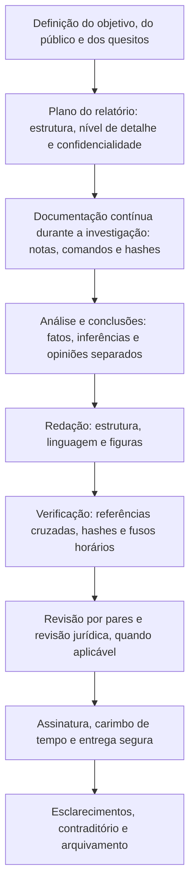

# Fundamentos, Tipos e Requisitos do Relatório Forense

> **Objetivo pedagógico:** compreender a função do relatório forense como produto final da investigação, seus tipos e públicos, os princípios que o tornam confiável (imparcialidade, exatidão, completude, rastreabilidade e reprodutibilidade), a distinção entre fato, inferência e opinião, e o enquadramento científico e legal (ISO/IEC 27041, 27042 e 27043, CPC e CPP) que determina o que um bom relatório deve conter.

## 1. Por que o relatório é o produto central

Toda a investigação (coleta, preservação, análise) só produz efeito quando comunicada. O relatório é o documento que permitirá a outra pessoa (juiz, advogado, executivo, auditor, regulador ou outro perito) **compreender, avaliar e, se necessário, reproduzir** o que foi feito e concluído.

| Função | Descrição |
|---|---|
| Comunicar | Transmitir achados e conclusões ao público certo, na linguagem certa |
| Documentar | Registrar o que foi feito, com quais dados e métodos |
| Sustentar decisões | Apoiar decisões judiciais, empresariais, disciplinares e regulatórias |
| Permitir o contraditório | Dar a outros a possibilidade de examinar e contestar |
| Preservar o conhecimento | Servir de memória institucional e fonte de lições aprendidas |
| Responsabilizar | Identificar quem fez o quê e com que fundamento |

Um relatório fraco pode invalidar uma investigação tecnicamente excelente; um relatório sólido permite que conclusões corretas sejam compreendidas e aceitas.

## 2. Tipos de relatório

| Tipo | Público | Característica |
|---|---|---|
| Laudo pericial (judicial ou oficial) | Juiz, partes e Ministério Público | Responde a quesitos; obedece a requisitos legais (CPC, art. 473; CPP, art. 159); engaja a responsabilidade do perito |
| Parecer técnico do assistente técnico | Parte que o indicou e juiz | Manifestação técnica sobre a perícia ou sobre os quesitos; submete-se ao contraditório |
| Relatório técnico forense (privado ou corporativo) | Cliente, Jurídico, RH, auditoria e conformidade | Detalha métodos e achados; pode apoiar litígios ou decisões internas |
| Relatório de investigação interna | Comitê de ética, RH e direção | Fatos, evidências e conclusões sobre condutas, com proporcionalidade e sigilo |
| Relatório de incidente (técnico) | Equipe de resposta, TI e SOC | Linha do tempo, causa raiz, indicadores e recomendações |
| Relatório executivo | Direção e conselho | Impacto, decisões necessárias, riscos e recomendações, em poucas páginas |
| Relatórios regulatórios e notificações | ANPD, reguladores setoriais e autoridades | Conteúdo previsto em norma, com fatos verificados |
| Relatórios para seguradoras | Seguradora e peritos de sinistro | Causas, perdas e conformidade com a apólice |
| Declaração ou depoimento escrito | Tribunais e processos administrativos | Afirmações verificadas sob responsabilidade pessoal |
| Relatório de lições aprendidas | Organização | Melhoria contínua (pasta 30) |

Muitos casos exigem **mais de um** relatório derivado da mesma investigação, adaptados ao público e ao regime de confidencialidade.

## 3. Públicos e necessidades

| Público | Necessidade | Como atender |
|---|---|---|
| Juiz e operadores do direito | Entender o fato e a prova, sem jargão | Linguagem simples, fundamentação lógica e método esclarecido (CPC, art. 473, § 1º) |
| Perito da parte contrária | Reproduzir e criticar | Método, ferramentas, versões, hashes e passos descritos |
| Direção e conselho | Decidir | Impacto, risco, opções e recomendações em linguagem de negócio |
| Jurídico e DPO | Obrigações legais | Fatos verificados, escopo, dados pessoais e prazos |
| Equipe técnica | Corrigir e detectar | Indicadores, causa raiz e recomendações técnicas |
| Auditoria e reguladores | Conformidade | Evidências de controle e rastreabilidade |
| Imprensa e público (indireto) | Informação | Por meio de comunicação coordenada, e não do relatório técnico |

## 4. Princípios do relatório forense

| Princípio | Significado prático |
|---|---|
| Imparcialidade e independência | O relatório expõe os fatos e a análise, sem advocacia; o perito não "torce" pelo contratante |
| Veracidade e exatidão | Cada afirmação é verdadeira e sustentada por evidência referenciada |
| Completude | Inclui o que favorece e o que contraria as hipóteses, e as limitações |
| Objetividade | Distingue fato, inferência e opinião; evita adjetivos e especulação |
| Rastreabilidade | Cada conclusão é ligada às evidências, às consultas e aos hashes que a sustentam |
| Reprodutibilidade | Outro especialista, com as mesmas evidências e o método descrito, chega ao mesmo resultado |
| Clareza | Estrutura lógica, termos definidos e linguagem adequada ao público |
| Competência e limites | O perito atua dentro de sua expertise e declara o que está fora dela |
| Confidencialidade e proporcionalidade | Inclui apenas os dados necessários e protege dados pessoais e sigilosos |
| Responsabilidade | O autor responde pelo conteúdo (civil, penal e administrativamente, quando aplicável) |

## 5. Fato, inferência e opinião

| Categoria | Definição | Exemplo |
|---|---|---|
| Fato observado | O que a evidência mostra diretamente, verificável | "O arquivo `contrato.docx` tem hash SHA-256 X e consta no volume Y." |
| Dado técnico derivado | Resultado de processamento com método descrito | "O registro 4624 com `LogonType` 10 ocorreu às 03:12:44 UTC." |
| Inferência | Conclusão lógica a partir de fatos, com grau de confiança | "O padrão é consistente com acesso remoto por RDP a partir do IP A." |
| Opinião técnica | Juízo fundamentado de especialista sobre significado e probabilidade | "É mais provável que o arquivo tenha sido copiado por meio de mídia removível do que por rede." |
| Conclusão jurídica | Qualificação legal do fato | **Fora do escopo** do perito, salvo quando solicitada e dentro de sua competência |
| Especulação | Afirmação sem suporte | Não deve constar no relatório |

Regra: o relatório deve permitir que o leitor identifique, para cada afirmação, a **categoria** a que pertence.

## 6. Enquadramento científico: ISO/IEC 27041, 27042 e 27043

| Norma | Contribuição para o relatório |
|---|---|
| ISO/IEC 27037 | Identificação, coleta, aquisição e preservação: base da seção de materiais e de cadeia de custódia |
| ISO/IEC 27041 | Adequação e suficiência do método investigativo: o relatório deve demonstrar que o método era adequado ao objetivo |
| ISO/IEC 27042 | Análise e interpretação de evidências: apoia a distinção entre achados e interpretações, e a avaliação de hipóteses |
| ISO/IEC 27043 | Princípios e processos de investigação: estrutura o fluxo e a documentação |
| ISO/IEC 27050 | Descoberta eletrônica: relevante para relatórios de eDiscovery |
| NIST IR 8354 | Revisão dos fundamentos científicos das técnicas de investigação digital: ajuda a justificar métodos e a reconhecer limitações |
| ISO/IEC 17025 | Acreditação de laboratórios: exige validação de métodos, rastreabilidade e controle de qualidade |

O método científico aplicado à forense digital implica **hipóteses**, **testes**, **avaliação de alternativas** e **declaração de incerteza**, tudo refletido no relatório.

## 7. Enquadramento legal (visão geral, Brasil)

> **Aviso:** orientações gerais; consulte o Jurídico sobre o caso concreto.

| Tema | Orientação |
|---|---|
| Perícia judicial cível | O laudo deve conter a exposição do objeto da perícia, a análise técnica ou científica realizada, a indicação do método utilizado (esclarecendo-o e demonstrando ser predominantemente aceito pelos especialistas da área) e a resposta conclusiva a todos os quesitos (CPC, art. 473) |
| Linguagem | O perito deve apresentar a fundamentação em linguagem simples e com coerência lógica, indicando como alcançou suas conclusões (CPC, art. 473, § 1º) |
| Limites do encargo | É vedado ao perito ultrapassar os limites de sua designação e emitir opiniões pessoais que extrapolem o exame técnico (CPC, art. 473, § 2º) |
| Responsabilidade | O perito que, por dolo ou culpa, prestar informações inverídicas responde pelos prejuízos e fica inabilitado por 2 a 5 anos (CPC, art. 158); a falsa perícia é crime (Código Penal, art. 342) |
| Valoração do laudo | O juiz aprecia o laudo e indica os motivos para considerá-lo ou não, levando em conta o método utilizado (CPC, art. 479) |
| Perícia criminal | Realizada por perito oficial (CPP, art. 159), com possibilidade de quesitos e de assistentes técnicos; a cadeia de custódia segue os arts. 158-A a 158-F |
| Assinatura eletrônica | Laudos assinados digitalmente têm regime próprio (MP nº 2.200-2/2001, ICP-Brasil, e Lei nº 14.063/2020) |
| Dados pessoais no relatório | Princípios de finalidade, necessidade e segurança (LGPD, arts. 6º e 46) |
| Referências internacionais | Regra 702 das Regras Federais de Prova dos EUA (e o critério Daubert), regras processuais do Reino Unido sobre prova pericial e as orientações das polícias e dos reguladores forenses |

## 8. Ciclo de vida do relatório

## 9. Exemplo prático: escolha dos relatórios a produzir em um caso

| Situação | Relatórios |
|---|---|
| Vazamento de dados por colaborador, com ação trabalhista prevista | Relatório técnico forense (privado, sob orientação do Jurídico); relatório executivo para a direção; relatório para o RH, restrito ao necessário; se houver ação judicial, laudo ou parecer de assistente técnico |
| Incidente de ransomware | Relatórios de situação durante o incidente; relatório técnico pós-incidente; relatório executivo e para o conselho; comunicação à ANPD e a reguladores; relatório para a seguradora; lições aprendidas |
| Perícia judicial em disputa sobre autenticidade de e-mail | Laudo pericial respondendo aos quesitos; parecer do assistente técnico de cada parte |
| Auditoria interna de acessos indevidos | Relatório de auditoria com evidências e recomendações de controles |

## 10. Casos de uso corporativos

- Padronização dos relatórios do laboratório forense e do time de resposta a incidentes.
- Treinamento de analistas na redação defensável de relatórios.
- Preparação de peritos e de assistentes técnicos para atuação em juízo.

## 11. Normas e frameworks relevantes

- ISO/IEC 27037:2012; ISO/IEC 27041:2015; ISO/IEC 27042:2015; ISO/IEC 27043:2015; ISO/IEC 27050; ISO/IEC 17025
- NIST IR 8354: Digital Investigation Techniques: A NIST Scientific Foundation Review (2022); NIST SP 800-86; NIST IR 8387
- ENFSI. Best Practice Manual for the Forensic Examination of Digital Technology; ENFSI Guideline for Evaluative Reporting in Forensic Science
- CPC (Lei nº 13.105/2015), arts. 156 a 158, 464 a 480; CPP, arts. 158-A a 158-F e 159; Código Penal, art. 342
- LGPD, arts. 6º e 46

## 12. Referências

- Casey, E. Digital Evidence and Computer Crime. 3. ed. Academic Press, 2011.
- Carrier, B. File System Forensic Analysis. Addison-Wesley, 2005.
- National Research Council. Strengthening Forensic Science in the United States: A Path Forward. 2009.
- Flaglien, A. O. et al. NIST IR 8354. 2022 (revisão dos fundamentos científicos).
- Brasil. Lei nº 13.105/2015 (CPC); Decreto-Lei nº 3.689/1941 (CPP); Decreto-Lei nº 2.848/1940 (Código Penal).
- ABNT NBR ISO/IEC 27037:2013 e normas da série 2704x.
