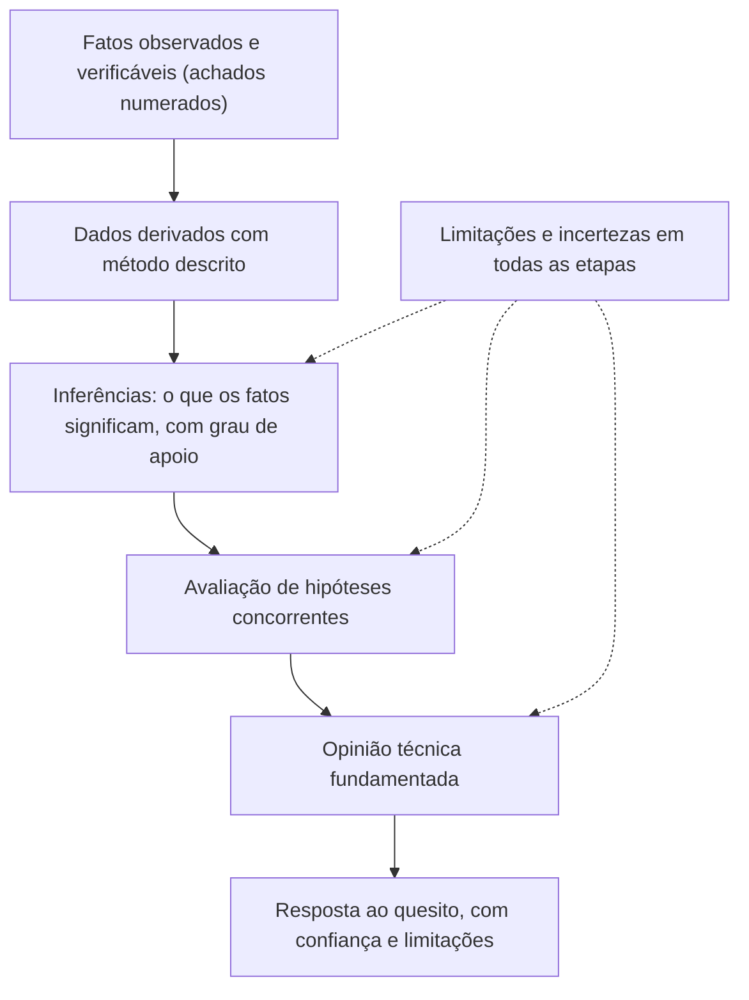

# Redação Técnica, Clareza e Comunicação de Incerteza

> **Objetivo pedagógico:** redigir relatórios forenses com clareza, precisão e adequação ao público, comunicar graus de certeza e de incerteza de forma padronizada (escalas verbais e escala de certeza para evidências digitais), tratar resultados negativos e ausências de evidência, evitar vieses cognitivos e exageros comuns, e usar tabelas, linhas do tempo e figuras de modo que reforcem a prova.

## 1. Princípios da redação forense

| Princípio | Prática |
|---|---|
| Uma ideia por frase | Frases curtas e diretas; evitar períodos longos e encadeados |
| Voz e verbo precisos | "O arquivo foi criado às 14:11 UTC" (fato) em vez de "parece que o arquivo surgiu" |
| Termos definidos | Definir siglas e termos técnicos na primeira ocorrência ou em glossário |
| Terminologia consistente | Usar a mesma palavra para o mesmo conceito (por exemplo, "imagem forense" sempre com o mesmo sentido) |
| Neutralidade | Evitar adjetivos, juízos de valor e linguagem emocional |
| Estrutura lógica | Fatos antes de análise; análise antes de conclusão |
| Referências cruzadas | Cada afirmação remete a achados e anexos |
| Adequação ao público | Explicar o necessário sem simplificar a ponto de distorcer |
| Revisão | Ler como se fosse o perito adversário |

## 2. Fato, inferência e opinião na redação

| Tipo | Linguagem recomendada | Linguagem a evitar |
|---|---|---|
| Fato | "O registro mostra...", "O arquivo contém...", "Foi observado..." | "Obviamente...", "Claramente..." |
| Dado derivado | "A partir da ferramenta X, versão Y, obteve-se..." | "O sistema indica..." sem fonte |
| Inferência | "Isso é consistente com...", "Os achados apoiam a hipótese de..." | "Isso prova que...", "Certamente..." |
| Opinião técnica | "Na minha avaliação técnica, é mais provável que..., porque..." | "Tudo indica que..." sem fundamento |
| Limitação | "Não foi possível determinar...", "Os dados disponíveis não permitem..." | Omitir a limitação |

## 3. Escalas de graus de apoio e de certeza

### 3.1 Escala verbal de apoio às hipóteses (inspirada em práticas de relatórios avaliativos)

| Termo | Significado |
|---|---|
| Os achados **não permitem distinguir** entre as hipóteses | Evidência igualmente provável sob ambas |
| Apoio **limitado** | Os achados são ligeiramente mais prováveis sob a hipótese A do que sob B |
| Apoio **moderado** | Mais prováveis, mas ainda há explicações alternativas plausíveis |
| Apoio **forte** | Muito mais prováveis sob A; explicações alternativas pouco plausíveis |
| Apoio **muito forte** | Praticamente só explicável por A, dadas as informações disponíveis |

Defina a escala no relatório e use-a com consistência. Evite atribuir porcentagens numéricas sem base estatística real.

### 3.2 Escala de certeza para evidências digitais (Casey)

A escala proposta por Eoghan Casey (2002) avalia a confiança em uma conclusão a partir da proteção contra adulteração e da concordância entre fontes independentes. Pode ser adaptada ao relatório:

| Nível | Descrição |
|---|---|
| C0 | A evidência contradiz fatos conhecidos |
| C1 | Evidência altamente questionável |
| C2 | Apenas uma fonte de evidência, que não está protegida contra adulteração |
| C3 | Fontes mais difíceis de adulterar, mas sem evidência suficiente para uma conclusão firme, ou com inconsistências não explicadas |
| C4 | (a) Evidência protegida contra adulteração, ou (b) várias fontes independentes concordam, mas podem não estar protegidas |
| C5 | Concordância de várias fontes independentes protegidas contra adulteração, mas com incertezas (por exemplo, erros temporais e perda de dados) |
| C6 | Evidência à prova de adulteração e inquestionável |

Use a escala como **ferramenta de raciocínio** e declare-a no relatório; os níveis mais altos (C5 e C6) são raros em evidências digitais.

### 3.3 Combinação prática de linguagem

| Situação | Redação sugerida |
|---|---|
| Várias fontes independentes e protegidas concordam | "Com confiança alta, o arquivo foi copiado em [data e hora], com base em F-05, F-08 e F-09, de fontes independentes." |
| Uma única fonte, não protegida | "Há um indício de que... (fonte única, sem corroboração); a conclusão tem confiança baixa." |
| Fontes em conflito | "Os registros F-03 e F-11 são contraditórios quanto ao horário; a diferença pode ser explicada por [causa], mas não foi possível confirmá-la." |

## 4. Ausência de evidência

| Afirmação | Significado | Cuidado |
|---|---|---|
| "Não foram encontrados registros de..." | Nos dados examinados, com o método descrito, não há registros | Declarar a cobertura: período, fontes e limitações (logs não habilitados, retenção) |
| "Há evidência de ausência de..." | Fontes completas e confiáveis mostram que o evento não ocorreu | Raramente possível; exige demonstração de cobertura completa |
| "Não é possível determinar..." | Os dados não permitem concluir | Explicar por quê e o que seria necessário |

Frase-modelo: "Não foram encontrados registros de acesso ao arquivo X no período de [datas] nos logs do servidor Y (retenção de 30 dias). A ausência de registros não permite concluir que o acesso não ocorreu, pois [limitação]."

## 5. Vieses cognitivos e como mitigá-los

| Viés | Descrição | Mitigação |
|---|---|---|
| Viés de confirmação | Buscar e valorizar evidências que confirmam a hipótese preferida | Testar hipóteses alternativas e buscar evidências que refutem |
| Viés de contexto | Informações irrelevantes sobre o caso influenciam a interpretação técnica | Limitar o contexto recebido durante a análise; revelar o contexto de forma sequencial (desvelamento sequencial linear) |
| Viés de ancoragem | A primeira impressão domina a análise | Revisão por pares e reavaliação independente |
| Viés de autoridade | Aceitar uma conclusão por quem a emitiu | Verificar de forma independente |
| Viés do resultado | Julgar a qualidade do método pelo resultado | Avaliar o método antes dos resultados |
| Efeito de pressão do cliente | Expectativa do contratante | Independência, declaração de imparcialidade e registro de pressões |
| Excesso de confiança em ferramentas | Tratar a saída da ferramenta como verdade | Validar, conferir manualmente e usar uma segunda ferramenta |

Boas práticas: documentar as hipóteses **antes** de examinar os resultados; registrar o que refuta cada hipótese; submeter o trabalho à revisão cega por pares quando possível.

## 6. Do fato à conclusão: encadeamento lógico

## 7. Exageros e armadilhas frequentes

| Armadilha | Exemplo | Correção |
|---|---|---|
| "Prova" onde há inferência | "Isto prova que o usuário copiou os arquivos." | "Isto é consistente com a cópia dos arquivos pelo usuário (confiança alta, F-05, F-08 e F-09)." |
| Atribuição de autoria sem base | "O réu apagou os logs." | "A conta do réu foi usada para executar o comando de limpeza às 22:10 UTC; o relatório não determina quem estava no teclado." |
| Falsa precisão | "Às 14:11:09,543 do dia..." com relógio sem sincronização conhecida | Declarar o desvio e a precisão |
| Jargão sem definição | "O MFT mostra a $SI timestomp..." | Definir e explicar em linguagem simples |
| Opinião jurídica | "Houve crime de..." | Limitar-se ao exame técnico; deixar a qualificação jurídica aos operadores do direito |
| Omitir limitações | Texto sem ressalvas | Seção de limitações e ressalvas ao longo do texto |
| Selecionar apenas evidências favoráveis | Relatório unilateral | Apresentar também as evidências contrárias e as explicações alternativas |
| Uso de captura de tela como única base | Tela sem rastreabilidade | Capturas apenas como ilustração, com a fonte e o hash do original |
| Ambiguidade temporal | "Ontem às 3h" | Datas completas em UTC e fuso local indicado |
| Passagem do tempo | "Atualmente o sistema está..." | Datar a observação |

## 8. Tabelas, linhas do tempo e figuras

| Recurso | Boas práticas |
|---|---|
| Tabelas | Títulos claros, colunas com unidades, horários em UTC, identificadores dos achados |
| Linha do tempo | Eventos em ordem cronológica, com fonte, grau de confiança e fuso; destacar os eventos-chave (pasta 05) |
| Diagramas | Simples, com legenda; indicar a origem dos dados; evitar desenhar o que não se provou |
| Capturas de tela | Ilustrativas; incluir a fonte e a referência ao arquivo original; anotações em cópias, sem alterar o original |
| Gráficos | Eixos rotulados, escala honesta e fonte dos dados |
| Cores e acessibilidade | Não depender só da cor; texto legível |
| Numeração e legendas | "Figura 3: título; fonte: F-12" |

## 9. Revisão de linguagem: lista rápida

- [ ] Cada frase afirma apenas o que a evidência sustenta
- [ ] Fatos, inferências e opiniões estão distinguíveis
- [ ] As escalas de confiança estão definidas e foram aplicadas com consistência
- [ ] Siglas e termos técnicos estão definidos
- [ ] Datas e horários estão completos, em UTC, com o fuso indicado
- [ ] As limitações aparecem onde são relevantes
- [ ] As alternativas e as evidências contrárias foram apresentadas
- [ ] Não há adjetivos, juízos de valor nem opiniões jurídicas
- [ ] O resumo corresponde ao corpo do relatório
- [ ] Um leigo entende o resumo; um perito consegue reproduzir o método

## 10. Exemplo prático: reescrita de trechos

| Trecho original | Problemas | Reescrita |
|---|---|---|
| "É evidente que o funcionário roubou os dados, pois o pen drive foi conectado." | Conclusão jurídica, adjetivo e inferência sem base | "Há registro de conexão do dispositivo USB de série ABC em 2026-10-02 14:35:10 UTC (F-05). Há atividade de cópia de arquivos para esse dispositivo na mesma janela (F-08). Não é possível determinar, com os dados disponíveis, a finalidade da cópia." |
| "Os logs mostram que ninguém acessou o servidor." | Ausência de evidência tratada como evidência de ausência | "No período de 01 a 15/10, os logs de autenticação (retenção de 30 dias, sem lacunas identificadas) não registram acessos ao servidor pela conta X. Logs de acesso físico e de rede não foram fornecidos." |
| "O arquivo foi modificado em 02/10 às 14h." | Fuso e fonte ausentes | "O atributo de última modificação do arquivo é 2026-10-02 14:40:51 UTC (F-07; $STANDARD_INFORMATION). Esse atributo pode ser alterado por ferramentas e não foi comparado com $FILE_NAME, conforme a seção de limitações." |

## 11. Casos de uso corporativos

- Padronização do estilo e das escalas de confiança dos relatórios do laboratório.
- Treinamento de redação defensável para analistas e peritos.
- Revisão por pares focada em linguagem, vieses e coerência.

## 12. Normas e frameworks relevantes

- ISO/IEC 27042:2015 (análise e interpretação); ENFSI Guideline for Evaluative Reporting; AFSP. Standards for the Formulation of Evaluative Forensic Science Expert Opinion
- Casey, E. Error, Uncertainty, and Loss in Digital Evidence (2002): escala de certeza
- Dror, I. E. e colaboradores: desvelamento sequencial linear (linear sequential unmasking) e vieses cognitivos em ciências forenses
- CPC, art. 473, §§ 1º e 2º

## 13. Referências

- Casey, E. Error, uncertainty, and loss in digital evidence. International Journal of Digital Evidence, v. 1, n. 2, 2002.
- Dror, I. E.; Kukucka, J. Linear Sequential Unmasking-Expanded (LSU-E). Forensic Science International: Synergy, 2021.
- ENFSI. Guideline for Evaluative Reporting in Forensic Science. 2015.
- Association of Forensic Science Providers. Standards for the formulation of evaluative forensic science expert opinion. Science & Justice, 2009.
- National Research Council. Strengthening Forensic Science in the United States: A Path Forward. 2009.
- Strunk, W.; White, E. B. The Elements of Style (princípios de redação concisa); manuais de redação técnica.
