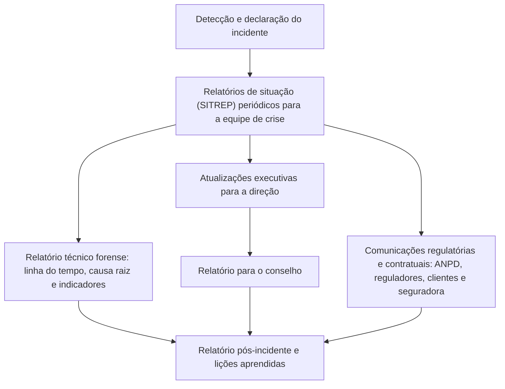

# Relatórios Executivos de Incidentes e Comunicação com Stakeholders

> **Objetivo pedagógico:** produzir relatórios de situação durante o incidente, relatórios executivos e para o conselho, notificações regulatórias e relatórios para seguradoras, coordenando a comunicação com stakeholders internos e externos com base em fatos verificados, em linguagem adequada a cada público e com o devido cuidado com o sigilo profissional (privilégio), a precisão e a consistência.

## 1. Princípios da comunicação em incidentes

| Princípio | Prática |
|---|---|
| Fatos verificados | Comunicar o que é sabido e declarar o que não é; atualizar quando o conhecimento mudar |
| Consistência | Uma única fonte de verdade; mensagens alinhadas entre públicos |
| Adequação ao público | Direção quer impacto e decisões; técnicos querem detalhes; reguladores querem o conteúdo previsto |
| Oportunidade | Ritmo definido de atualizações, mesmo quando não há novidades |
| Cautela com especulação | Evitar atribuir causa, culpa ou escopo sem evidências |
| Coordenação com o Jurídico | Mensagens externas e relatórios sensíveis passam por revisão jurídica |
| Rastreabilidade | Versões, horários (UTC) e responsáveis registrados |
| Sigilo e minimização | Distribuição restrita; dados pessoais apenas quando necessário |

## 2. Mapa de relatórios em um incidente



## 3. Relatório de situação (SITREP)

Documento curto e periódico, usado pela equipe de crise para alinhar o estado, as decisões e as próximas ações.

| Campo | Conteúdo |
|---|---|
| Identificação | Incidente, número do relatório, data e hora (UTC) e responsável |
| Resumo da situação | Em 3 a 5 linhas: o que está acontecendo |
| Status | Fase (detecção, contenção, erradicação ou recuperação) e nível de gravidade |
| O que sabemos | Fatos verificados, com fonte e confiança |
| O que não sabemos | Perguntas em aberto e o que será feito para respondê-las |
| Impacto atual | Sistemas, dados, negócio e pessoas afetados |
| Ações concluídas desde o último relatório | Lista objetiva |
| Ações em andamento e próximas | Responsáveis e prazos |
| Decisões necessárias | O que precisa ser decidido, por quem e até quando |
| Riscos e bloqueios | Pontos que ameaçam o progresso |
| Comunicações realizadas e planejadas | Públicos, mensagens e prazos |
| Próxima atualização | Data e hora |

Modelo de redação:

```
SITREP 07 | Incidente DFL-2026-001 | 2026-11-03 18:00 UTC | Líder: M. Souza
Situação: Ransomware afetou 214 estações e 18 servidores; contenção concluída no segmento de servidores.
Status: Contenção e erradicação; gravidade: crítica.
Sabemos (alta confiança): acesso inicial por VPN com credencial válida em 2026-10-24; domínio comprometido; 380 GB exfiltrados.
Não sabemos: se há persistência em ambientes em nuvem. Ação: revisão de logs, previsão 04/11 12:00 UTC.
Impacto: faturamento e logística paralisados; restauração dos sistemas de nível 0 e 1 prevista para 05/11.
Decisões necessárias: (1) aprovar reconstrução do domínio até 04/11 (CIO); (2) validar texto de comunicação aos titulares (Jurídico e DPO).
Próxima atualização: 2026-11-04 06:00 UTC.
```

## 4. Relatório executivo e para o conselho

| Elemento | Orientação |
|---|---|
| Extensão | Uma a duas páginas, mais anexos opcionais |
| Primeira frase | A conclusão ou a decisão necessária |
| Impacto de negócio | Em termos de receita, clientes, operações, segurança, conformidade e reputação |
| Causa e escopo | Resumo, sem detalhes técnicos excessivos; confiança declarada |
| Estado e prazos | O que foi feito e quando será normalizado |
| Obrigações legais e regulatórias | Prazos, notificações e riscos |
| Opções e recomendações | Alternativas, custos e riscos, com recomendação clara |
| Investimentos e mudanças necessárias | Para reduzir a reincidência |
| Indicadores | Tempo de permanência, tempo de detecção e de recuperação, volume de dados, número de sistemas e custo estimado |
| Linguagem | Sem jargão; termos técnicos explicados |
| Anexos | Linha do tempo resumida, glossário e referência ao relatório técnico |

### 4.1 Roteiro de apresentação ao conselho

| Bloco | Conteúdo |
|---|---|
| 1. O que aconteceu e qual o estado atual | Em linguagem simples |
| 2. Qual o impacto e o que está em risco | Operações, clientes, dados e obrigações |
| 3. O que fizemos e o que falta | Ações e prazos |
| 4. Decisões que precisamos do conselho | Pagamento, comunicação, investimentos e responsabilidades |
| 5. O que aprendemos e o que vamos mudar | Plano de melhoria |

## 5. Relatórios e comunicações regulatórias

> **Aviso:** os prazos e o conteúdo dependem da norma aplicável e do caso. O Jurídico e o DPO conduzem a avaliação e as comunicações.

| Destinatário | Conteúdo-chave | Observações |
|---|---|---|
| ANPD | Natureza e categorias de dados, número de titulares, medidas técnicas e de segurança, riscos, motivos de eventual atraso e medidas de reversão (LGPD, art. 48; Resolução CD/ANPD nº 15/2024) | Comunicar com base nos fatos conhecidos e complementar depois; prazo regulamentar de 3 dias úteis a partir do conhecimento do incidente de risco relevante |
| Titulares | Linguagem clara: o que aconteceu, quais dados, quais riscos, o que foi feito e o que o titular pode fazer | Evitar jargão e alarmismo; canal de apoio |
| Reguladores setoriais | Conteúdo previsto na norma setorial (por exemplo, Banco Central, SUSEP, ANS e CVM) | Confirmar a norma vigente |
| Clientes e parceiros | Conforme contratos: o que ocorreu, o que pode ter sido afetado, medidas e contato | Alinhamento com o Jurídico |
| Seguradora | Cronologia, causa, perdas e conformidade com a apólice | Notificação imediata e uso de fornecedores indicados, conforme a apólice |
| Autoridades policiais e CSIRTs | Resumo técnico, indicadores e linha do tempo | Preservar as provas e coordenar |
| Mercado de capitais (companhias abertas) | Fato relevante, conforme as regras da CVM | Em outras jurisdições, regras próprias (por exemplo, a divulgação de incidentes materiais nos EUA) |

Esqueleto de comunicação à ANPD (referência; confirme o formulário vigente):

| Campo | Conteúdo |
|---|---|
| Controlador e encarregado | Identificação e contato |
| Descrição do incidente | Data de ocorrência e de conhecimento; natureza |
| Dados afetados | Categorias, sensibilidade e inclusão de crianças e adolescentes |
| Titulares afetados | Número e critério de estimativa |
| Riscos e danos possíveis | Avaliação |
| Medidas adotadas e em curso | Técnicas e organizacionais |
| Comunicação aos titulares | Realizada ou prevista, e como |
| Motivos de atraso (se houver) | Justificativa |
| Complementação | Informações pendentes e prazo previsto |

## 6. Privilégio e confidencialidade nos relatórios

| Tema | Orientação |
|---|---|
| Sigilo profissional da advocacia | A relação advogado-cliente e os documentos relacionados ao exercício da advocacia têm proteção (Estatuto da Advocacia, Lei nº 8.906/1994, art. 7º); a estrutura da investigação pode ser conduzida por ou sob orientação de advogados para proteger análises e comunicações |
| Separação de documentos | Relatório de análise jurídica (privilegiado) distinto do relatório técnico fático e das comunicações operacionais, sem apresentar opiniões jurídicas em documentos distribuídos amplamente |
| Distribuição restrita | Quem precisa saber; marcação de confidencialidade; evitar encaminhamentos em cadeia |
| Linguagem cautelosa | Evitar termos que aleguem culpa ou negligência sem base; descrever fatos e medidas |
| Documentos futuros | Considerar que os relatórios podem ser exigidos em litígios, auditorias ou investigações regulatórias |
| Orientação especializada | O Jurídico define quais relatórios são feitos, por quem, com qual conteúdo e para quem |

Importante: a proteção da confidencialidade de um relatório não deve impedir o cumprimento das obrigações de comunicação aos titulares e aos reguladores.

## 7. Comunicação com públicos específicos

| Público | Cuidados |
|---|---|
| Colaboradores | Informações claras, instruções práticas (por exemplo, não usar sistemas afetados) e um canal para dúvidas; evitar vazamentos de informações técnicas |
| Clientes | Mensagens factuais, orientações de proteção e meios de contato; evitar prometer o que não se pode garantir |
| Imprensa e público | Um porta-voz; declaração aprovada pelo Jurídico; ajustes conforme os fatos |
| Autoridades | Informações precisas, com ressalvas sobre o que está em apuração |
| Investidores e conselho | Fatos, impacto material e riscos; atenção às regras de divulgação |
| Fornecedores | O necessário para a coordenação; confidencialidade |

Evite afirmações categóricas ("nenhum dado foi acessado") sem evidências sólidas; use declarações calibradas ("até o momento, a investigação não identificou...").

## 8. Relatório técnico pós-incidente

| Seção | Conteúdo |
|---|---|
| Resumo executivo | Em uma página |
| Linha do tempo | Do acesso inicial à recuperação, em UTC |
| Análise técnica | Vetor, técnicas, ferramentas e movimentação (com ATT&CK) |
| Escopo e impacto | Sistemas, contas, dados e titulares |
| Causa raiz e fatores contribuintes | Técnicos, de processo e de governança |
| Resposta e recuperação | O que funcionou e o que falhou |
| Recomendações | Priorizadas, com responsáveis e prazos |
| Limitações | Lacunas de evidência e incertezas |
| Anexos | Indicadores, hashes e custódia |

A revisão pós-incidente deve ser conduzida sem atribuição de culpa individual, com foco na melhoria de sistemas e processos (pasta 30).

## 9. Exemplo prático: três versões do mesmo fato

| Público | Versão |
|---|---|
| Conselho | "Um ataque de ransomware paralisou nossas operações por 6 dias. Dados de clientes foram acessados. Notificamos a ANPD e os clientes. Precisamos decidir sobre o investimento em segurança de identidade e em backups imutáveis." |
| Equipe técnica | "Acesso inicial por VPN sem MFA em 24/10; DCSync em 29/10; exclusão de backups em 02/11; 380 GB exfiltrados em 03/11; GPO de implantação em 04/11 às 03:00 UTC. Indicadores e consultas no anexo C." |
| Titulares | "Identificamos um acesso indevido a sistemas que continham seus dados de cadastro (nome, CPF, e-mail e telefone). Não há indício de acesso a senhas. Recomendamos atenção a contatos suspeitos e disponibilizamos o canal X. Estamos adotando medidas para reforçar a segurança." |

Os três são consistentes com os mesmos fatos verificados, em níveis de detalhe e linguagem adequados.

## 10. Casos de uso corporativos

- Padronização dos modelos de SITREP, relatório executivo e comunicações do plano de crise.
- Exercícios de simulação (tabletop) com produção de relatórios sob pressão de tempo.
- Preparação do conselho e da alta direção para decisões em incidentes.

## 11. Normas e frameworks relevantes

- NIST SP 800-61 Rev. 3; NIST CSF 2.0 (comunicação de incidentes); ISO/IEC 27035
- CISA #StopRansomware Guide (comunicação e relatórios); NIST IR 8374
- LGPD, arts. 46, 48 e 52; Resolução CD/ANPD nº 15/2024; normas setoriais (BCB, CVM, SUSEP, ANS)
- Estatuto da Advocacia (Lei nº 8.906/1994), art. 7º; CPC (provas)

## 12. Referências

- Brasil. Lei nº 13.709/2018 (LGPD); ANPD. Resolução CD/ANPD nº 15/2024.
- Cichonski, P. et al. NIST SP 800-61 e sua revisão 3 (2025).
- CISA; MS-ISAC. #StopRansomware Guide.
- FIRST. Computer Security Incident Response Team (CSIRT) Services Framework.
- Documentos de orientação de reguladores setoriais.
