# 23 Playbooks Forenses

## Objetivo

Reunir playbooks operacionais para os cenários mais frequentes de investigação forense e de resposta a incidentes, com gatilhos, papéis, passos verificáveis, pontos de decisão, portões legais e de privacidade, evidências e escalonamento, e estabelecer a governança (donos, revisões, testes, medição e automação segura) que mantém os playbooks confiáveis e utilizáveis sob pressão.

## Trilha de estudo recomendada

```mermaid
flowchart LR
    A["1. Fundamentos e ciclo de vida"] --> B["2. Triagem, preservação e custódia"]
    B --> C["3. Endpoint, servidor, memória e disco"]
    C --> D["4. E-mail, rede, web e malware"]
    D --> E["5. Nuvem, identidade e SaaS"]
    E --> F["6. Mobile, OSINT, IA e casos especiais"]
    F --> G["7. Governança, testes e checklist"]
    G --> H["8. Casos e erros comuns"]
```

## Conteúdo da pasta

| Ordem | Arquivo | Objetivo |
|---|---|---|
| 1 | [fundamentos-e-ciclo-de-vida-dos-playbooks-forenses.md](fundamentos-e-ciclo-de-vida-dos-playbooks-forenses.md) | Estrutura padrão, decisões, gravidade, ciclo de vida e automação |
| 2 | [playbooks-de-triagem-preservacao-e-custodia.md](playbooks-de-triagem-preservacao-e-custodia.md) | PB-00 a PB-04: abertura, preservação de logs, sistemas ligados, escala e custódia |
| 3 | [playbooks-de-endpoint-servidor-memoria-e-disco.md](playbooks-de-endpoint-servidor-memoria-e-disco.md) | PB-10 a PB-15: Windows, Linux, memória, disco, cópia indevida e linha do tempo |
| 4 | [playbooks-de-email-rede-web-e-malware.md](playbooks-de-email-rede-web-e-malware.md) | PB-20 a PB-25: phishing, amostras, web, rede, exfiltração e ransomware |
| 5 | [playbooks-de-nuvem-identidade-e-saas.md](playbooks-de-nuvem-identidade-e-saas.md) | PB-30 a PB-36: nuvem, Entra ID, BEC, SharePoint, armazenamento, Kubernetes e OAuth |
| 6 | [playbooks-de-mobile-osint-ia-e-casos-especiais.md](playbooks-de-mobile-osint-ia-e-casos-especiais.md) | PB-40 a PB-46: mobile, spyware, OSINT, marca, mídia, IA e eDiscovery |
| 7 | [governanca-testes-e-checklist-de-playbooks.md](governanca-testes-e-checklist-de-playbooks.md) | Catálogo, testes, métricas, automação, modelos e checklist |
| 8 | [casos-de-uso-e-erros-comuns-em-playbooks.md](casos-de-uso-e-erros-comuns-em-playbooks.md) | Sete cenários, erros comuns e exercícios |

## Princípios

- Preservar antes de conter, na ordem de volatilidade; registrar o estado anterior antes de alterar
- Portões legais e de privacidade nos primeiros passos de qualquer acesso a conteúdo de pessoas
- Passos verificáveis, decisões com critérios objetivos e responsáveis por passo
- Playbooks táticos curtos, com detalhes técnicos em runbooks
- Automatizar o que informa; exigir aprovação humana para o que altera evidências ou sistemas
- Dono, versão e data de revisão em todos os playbooks; revisão após incidentes e ao menos anual
- Testar leitura, mesa e execução técnica, inclusive o acesso ao catálogo em condições de crise
- Medir aderência e eficácia, e transformar as lições aprendidas em melhorias

## Relação com outras pastas

- 01 a 04: princípios, custódia, coleta e hashes que sustentam PB-00 a PB-04
- 05 a 10: linha do tempo, artefatos, memória e disco usados nos playbooks de sistemas
- 11 a 15: logs, e-mail, rede, mobile e malware
- 16: ransomware (playbook PB-25 e fundamentos)
- 17 a 19: nuvem, Azure e Microsoft 365 (PB-30 a PB-36)
- 20 e 21: caça a ameaças e OSINT (PB-03, PB-42 e PB-43)
- 22: relatórios (registros, SITREP e comunicações)
- 24 a 27: IA, prompts, incidentes com LLM e deepfakes (aprofundamento de PB-44 e PB-45)
- 30: lições aprendidas e melhoria contínua

## Referências

- NIST SP 800-61 Rev. 3 (2025); NIST SP 800-84; NIST SP 800-86; NIST CSF 2.0
- ISO/IEC 27035-1, 27035-2 e 27035-3; ISO/IEC 27037; ISO/IEC 27043; ISO 22301
- CISA. Cybersecurity Incident & Vulnerability Response Playbooks (2021) e Tabletop Exercise Packages
- FIRST. CSIRT Services Framework
- MITRE ATT&CK, ATT&CK Mobile e ATLAS
- Microsoft. Incident response playbooks; AWS. Security Incident Response Guide; Google Cloud. Resposta a incidentes
- TheHive, Cortex e Shuffle (documentação)
- Brasil. Lei nº 13.709/2018 (LGPD); Resolução CD/ANPD nº 15/2024; Decreto-Lei nº 3.689/1941 (CPP, arts. 158-A a 158-F)
