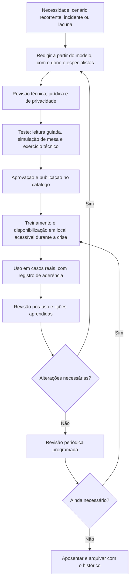

# Fundamentos e Ciclo de Vida dos Playbooks Forenses

> **Objetivo pedagógico:** compreender o que é um playbook forense (e como difere de plano, procedimento e runbook), a estrutura padrão que torna cada playbook executável sob pressão, os pontos de decisão e os portões legais e de privacidade que ele deve conter, o ciclo de vida (criação, teste, manutenção e aposentadoria) e os limites da automação quando a ação altera evidências.

## 1. Por que playbooks

Em um incidente ou em uma investigação, a pressão de tempo, a incerteza e o cansaço levam a erros: desligar o equipamento errado, esquecer de aplicar retenção legal, perder logs de retenção curta ou quebrar a cadeia de custódia. O playbook transforma o conhecimento das pastas anteriores em **passos verificáveis**, na ordem certa, com responsáveis e critérios de decisão.

| Benefício | Descrição |
|---|---|
| Consistência | Casos semelhantes são tratados do mesmo modo, independentemente de quem atende |
| Velocidade | Menos tempo decidindo "o que fazer agora" |
| Preservação de evidências | A ordem de volatilidade e os portões legais ficam embutidos |
| Treinamento | Novos analistas aprendem com procedimentos práticos |
| Auditabilidade | É possível comprovar que o procedimento foi seguido |
| Melhoria contínua | Falhas e lições aprendidas alimentam as revisões |

## 2. Terminologia

| Termo | Significado |
|---|---|
| Plano (por exemplo, plano de resposta a incidentes) | Documento estratégico: política, papéis, autoridade e escopo |
| Procedimento operacional padrão (POP ou SOP) | Instrução detalhada de uma atividade específica e repetível |
| Playbook | Roteiro de resposta a um **cenário** (por exemplo, phishing, ransomware, credencial de nuvem), com gatilhos, decisões e saídas |
| Runbook | Sequência técnica detalhada de comandos e verificações, frequentemente automatizável |
| Lista de verificação (checklist) | Conferência simples de itens |
| Manual de lições aprendidas | Registro de melhorias derivadas de casos reais |

Em geral, o playbook faz referência a POPs e a runbooks para os detalhes técnicos, e a um plano para a autoridade e a governança.

## 3. Estrutura padrão de um playbook

| Campo | Conteúdo |
|---|---|
| Identificador e título | PB-NN, nome e versão |
| Gatilho | O que inicia o playbook (alerta, relato, solicitação ou decisão) |
| Objetivo e resultados esperados | O que será alcançado e como saber que terminou |
| Escopo e exclusões | Quando **não** usar |
| Papéis e responsabilidades (RACI) | Quem executa, aprova, é consultado e é informado |
| Pré-requisitos | Autorizações, acessos, ferramentas, contatos e informações necessárias |
| Passos | Numerados, em ordem, com ações verificáveis |
| Pontos de decisão | Critérios claros e as ramificações (se... então...) |
| Portões legais e de privacidade | Condições que precisam ser atendidas antes de prosseguir (autorização, base legal e minimização) |
| Evidências e registros produzidos | O que é gerado, onde é guardado e como é protegido (hash e custódia) |
| Critérios de escalonamento | Quando e para quem escalar |
| Comunicação | Quem deve ser informado, quando e com que conteúdo |
| Saídas e encerramento | Entregáveis e critérios de fechamento |
| Referências | Pastas, normas, POPs e runbooks relacionados |
| Metadados | Responsável (dono), data de criação, data da última revisão, próxima revisão e histórico |

Modelo (copiar e preencher):

```
PB-NN: [Título]                       Versão: x.y   Dono: [nome]   Revisão: [data]
GATILHO:           [o que inicia este playbook]
OBJETIVO:          [resultado esperado]
NÃO USAR QUANDO:   [exclusões e playbooks alternativos]
PAPÉIS (RACI):     Executor [..]  Aprovador [..]  Consultado [..]  Informado [..]
PRÉ-REQUISITOS:    [autorizações, acessos, ferramentas]
PASSOS:
  1. [ação verificável]                         -> registro: [onde]
  2. [ação]
  3. DECISÃO: se [condição] então [passo X], senão [passo Y]
PORTÕES LEGAIS:    [autorização/DPO/Jurídico antes do passo N]
EVIDÊNCIAS:        [o que é gerado, hash, custódia]
ESCALONAMENTO:     [critérios e contatos]
SAÍDAS:            [entregáveis e fechamento]
REFERÊNCIAS:       [pastas e normas]
```

## 4. Níveis de detalhe

| Nível | Conteúdo | Exemplo |
|---|---|---|
| Estratégico | Decisões, papéis e comunicação | Comitê de crise decide sobre extorsão |
| Tático | Sequência de ações e decisões do cenário | Playbook de BEC: preservar, conter, avisar o banco |
| Técnico | Comandos, consultas e verificações | Runbook de coleta de logs de auditoria |

O playbook tático deve caber em poucas páginas; o detalhe técnico fica em runbooks vinculados.

## 5. Princípios de projeto

| Princípio | Aplicação |
|---|---|
| Preservar antes de conter, quando possível | A ordem dos passos reflete a ordem de volatilidade (pasta 03) |
| Portões legais explícitos | Nenhum acesso a conteúdo de pessoas sem a autorização verificada |
| Decisões com critérios claros | Evitar "avalie a situação" sem critérios |
| Simples e curto | Se não cabe em uma leitura rápida, divida |
| Executável sob estresse | Verbos no imperativo, um passo por linha, sem ambiguidades |
| Responsável por passo | Cada passo tem dono |
| Registro embutido | Cada passo crítico indica o que registrar |
| Reversibilidade | Registrar o estado anterior antes de alterar |
| Menor privilégio | Acessos de investigador mínimos e registrados |
| Revisável | Metadados, versionamento e histórico |
| Independente de ferramenta, quando possível | Descreve o objetivo, e remete a runbooks por ferramenta |

## 6. Pontos de decisão e critérios típicos

| Decisão | Critérios (exemplos) |
|---|---|
| Isolar ou manter conectado | Risco de propagação, criticidade do serviço e necessidade de observar o adversário |
| Desligar ou manter ligado | Criptografia de disco, memória relevante, criptografia em andamento e risco de perda |
| Adquirir memória e disco ou apenas triagem | Gravidade, tipo de caso, escopo autorizado e recursos |
| Escalar para resposta a incidentes | Indícios corroborados de atividade maliciosa, dados pessoais ou prazo legal |
| Notificar | Gatilhos legais, contratuais e regulatórios (Jurídico e DPO) |
| Remover mensagens ou contas | Só após a preservação; avaliar o impacto |
| Restaurar ou reconstruir | Grau de comprometimento e evidência de persistência |

## 7. Classificação de gravidade (modelo de matriz)

| Nível | Critérios (exemplos) | Resposta inicial |
|---|---|---|
| Crítico | Adversário ativo, impacto operacional grave, dados pessoais sensíveis em larga escala, risco à segurança de pessoas, prazo legal iminente | Equipe de crise imediata; comando único; direção informada |
| Alto | Comprometimento confirmado de sistemas importantes ou de contas privilegiadas; exposição de dados relevante | Resposta prioritária em horas; Jurídico e DPO acionados |
| Médio | Indício corroborado de atividade indevida com impacto limitado | Tratamento em horário normal, com prazo definido |
| Baixo | Evento isolado, sem impacto relevante | Registro, monitoramento e melhoria |

Cada organização deve calibrar a matriz com seus ativos e obrigações.

## 8. Ciclo de vida de um playbook



| Fase | Pontos de atenção |
|---|---|
| Criação | Escolher cenários por frequência, impacto e risco; envolver quem executa |
| Revisão | Técnica (exatidão), jurídica (autorização e prazos) e de privacidade (minimização) |
| Teste | Seguir os passos como escritos; registrar ambiguidades e passos impossíveis |
| Publicação | Local acessível mesmo se os sistemas estiverem indisponíveis (cópia offline) |
| Treinamento | Exercícios periódicos; novos membros treinados |
| Uso | Marcar os passos concluídos e os desvios, com horários |
| Revisão pós-uso | O que funcionou, o que falhou, o que faltou |
| Manutenção | Revisão após incidentes, mudanças de tecnologia, de legislação ou de organização, e ao menos anualmente |
| Aposentadoria | Quando o cenário não existe mais ou foi substituído; manter o histórico |

## 9. Playbooks e automação

| Aspecto | Orientação |
|---|---|
| O que automatizar | Coleta e enriquecimento de dados, abertura de casos, notificações, consultas de reputação e criação de tarefas |
| O que exige aprovação humana | Ações que **alteram evidências ou sistemas**: isolamento, exclusão de e-mails, desativação de contas, remoção de recursos e restauração |
| Preservação antes da ação | A automação deve preservar o estado (exportar configuração e logs) antes de agir |
| Registro | Toda ação automatizada é registrada, com identificação e horário (UTC) |
| Reversibilidade | Previsão de reversão e de limites (por exemplo, número máximo de contas por execução) |
| Testes | Em ambiente de teste, com dados fictícios, antes de produção |
| Plataformas | SOAR e orquestração (por exemplo, TheHive, Cortex e Shuffle, de código aberto; Microsoft Sentinel playbooks; XSOAR e Tines) |
| Falha segura | Em caso de erro, pausar e escalar; não prosseguir às cegas |
| Privilégios | Contas de automação com permissões mínimas e monitoradas |

Princípio: **automatize o que informa; peça aprovação para o que altera.**

## 10. Aspectos legais e de privacidade nos playbooks

> **Aviso:** este material é técnico-educacional e não substitui parecer jurídico. Valide cada caso com o Jurídico e com o DPO.

| Tema | Como refletir no playbook |
|---|---|
| Autorização e base legal | Portão obrigatório antes de acessar conteúdo, dispositivos, caixas de correio ou mensagens |
| Minimização | Escopo definido por período, pessoas e sistemas; coleta do necessário |
| Privilégio e confidencialidade | Instruções de classificação, distribuição restrita e orientação do Jurídico |
| Direitos dos titulares e notificações | Gatilhos para avaliação de notificações (LGPD, art. 48; Resolução CD/ANPD nº 15/2024) |
| Cadeia de custódia | Passos de lacre, registro e transferência (CPP, arts. 158-A a 158-F; pasta 02) |
| Retenção e descarte | Prazos e métodos de descarte seguro ao encerrar |
| Registro de acessos | Quem acessou o quê, quando e por quê |

## 11. Exemplo prático: de um incidente real para um playbook

| Etapa | Resultado |
|---|---|
| Incidente | Logs de nuvem com retenção curta foram perdidos antes da exportação |
| Lacuna | Não havia procedimento de preservação prioritária por fonte e por retenção |
| Playbook criado | PB-01: preservação imediata de logs de retenção curta, com tabela de fontes e de prazos |
| Teste | Simulação de mesa: o time executou em 25 minutos; 3 passos ambíguos foram corrigidos |
| Publicação | No catálogo e em cópia offline; treinamento da equipe de plantão |
| Uso | No incidente seguinte, a preservação ocorreu em 18 minutos, com registro completo |
| Revisão | Inclusão de uma nova fonte (auditoria do Teams) e do contato do provedor |

## 12. Casos de uso corporativos

- Construção de uma biblioteca de playbooks forenses para o time de resposta e para o laboratório.
- Padronização do atendimento por plantão e treinamento de novos analistas.
- Demonstração a auditores e a reguladores de que a organização segue procedimentos definidos.

## 13. Normas e frameworks relevantes

- NIST SP 800-61 Rev. 3; NIST CSF 2.0 (funções Responder e Recuperar); NIST SP 800-184
- ISO/IEC 27035-1, 27035-2 e 27035-3 (gestão de incidentes); ISO/IEC 27037; ISO/IEC 27043
- CISA. Federal Government Cybersecurity Incident and Vulnerability Response Playbooks; CISA Tabletop Exercise Packages
- FIRST. CSIRT Services Framework
- MITRE ATT&CK (mapeamento de cenários e de técnicas)
- LGPD, arts. 6º, 46, 48 e 50; Resolução CD/ANPD nº 15/2024; CPP, arts. 158-A a 158-F

## 14. Referências

- Cichonski, P. et al. NIST SP 800-61. Edições Rev. 2 e Rev. 3.
- CISA. Cybersecurity Incident & Vulnerability Response Playbooks. 2021.
- FIRST. CSIRT Services Framework. v2.1.
- Microsoft. Incident response playbooks (documentação).
- AWS. Security Incident Response Guide e playbooks de exemplo.
- Brasil. Lei nº 13.709/2018; Decreto-Lei nº 3.689/1941.
